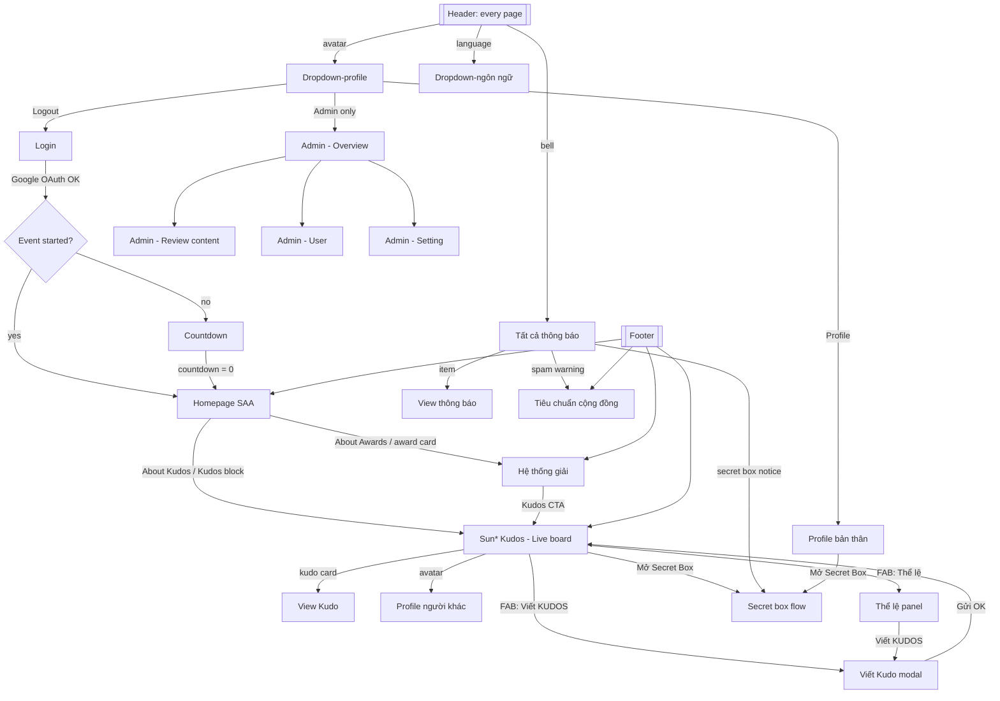

# Screen Flow Overview — SAA 2025 (Website)

## Project Info

| Property | Value |
|----------|-------|
| **Project** | Sun* Annual Awards (SAA) 2025 — "Root Further" |
| **Figma file** | [SAA 2025 - Internal Live Coding](https://www.figma.com/design/9ypp4enmFmdK3YAFJLIu6C/SAA-2025---Internal-Live-Coding) |
| **Figma file key** | `9ypp4enmFmdK3YAFJLIu6C` |
| **Figma page** | `Website` (sections `User` `354:4781`, `Admin` `3570:12851`) |
| **Source of truth** | Figma (surveyed in view-only browser mode). MoMorph is **not** used. |
| **Based on** | `sample` branch of `sun-asterisk-internal/agentic-coding-hands-on` (`.momorph/SCREENFLOW.md`, 2026-03-04) |
| **Last updated** | 2026-11-09 |

Figma link pattern: `https://www.figma.com/design/9ypp4enmFmdK3YAFJLIu6C/?node-id=<id with ":" → "-">`

---

## Discovery Progress

| Metric | Count |
|--------|-------|
| User-facing screens (full pages) | 12 |
| User overlays / modals / dropdowns / states | 33 |
| Admin screens (full pages) | 8 |
| Admin overlays / dropdowns | 15 |
| Screens with detail spec (`docs/screen-specs/`) | 3 (Homepage SAA, Countdown, Hệ thống giải) |

Frame sizes: full pages are 1440 wide (Homepage 1512×4480, Live board 1440×5862, Profile 1440×4660, Hệ thống giải 1440×6410); most other pages 1440×1024.

---

## Course Checklist Categories (daily report)

The course's daily report tracks 8 screen categories. Mapping of Figma frames and spec features:

| # | Category | Figma frames | Feature (spec draft) |
|---|----------|--------------|----------------------|
| 1 | Login | Login `662:14387` | F002 (+ F001 login chrome) |
| 2 | Homepage SAA | Homepage SAA `2167:9026`; shared header/footer, Floating Action Button `313:9137`/`313:9139`, Dropdown-profile `721:5223` | F004 + F001 |
| 3 | Hệ thống giải | Hệ thống giải `313:8436` | F004 |
| 4 | Countdown Prelaunch | Countdown - Prelaunch page `2268:35127` | F003 |
| 5 | Đa ngôn ngữ | Dropdown-ngôn ngữ `721:4942` (VN/EN on every page) | F001 |
| 6 | Sun\* Kudos | Live board `2940:13431`, View Kudo `520:18779`, Dropdown Hashtag filter `721:5580`, Dropdown Phòng ban `721:5684`, Hover Avatar `721:5827`/`2268:35101`, Hashtag group `1002:13094` | F006 |
| 7 | Viết Kudos | Viết Kudo `520:11602`, form variants `828:13433`/`1612:5056`, error state `662:13035`, Dropdown người nhận `828:10943`, Dropdown list hashtag `1002:13013`, Addlink Box `1002:12917`, Ẩn danh `2099:9148`, edit mode `1949:13746` | F005 |
| 8 | Like Kudos | Heart (♥) control on kudo cards / View Kudo; Hover campaign `3241:15021` (x2 heart) | F008 (heart part only) |

**Outside the 8 categories** (not tracked by the course report): Profile bản thân / người khác (F007), Thể lệ panel + Hero badge hovers + Secret Box (F008 non-heart parts), Thông báo (F009), Tiêu chuẩn cộng đồng (F004), Error 403/404 (F001), KUDO spam / Alert Overlay and all Admin screens (F010–F012).

---

## User — Pages

| # | Screen | Frame ID | Proposed route | Status | Notes |
|---|--------|----------|----------------|--------|-------|
| U1 | Login | `662:14387` | `/login` | surveyed | Key visual "ROOT FURTHER", "LOGIN With Google" button, language switch (VN), footer copyright |
| U2 | Countdown - Prelaunch page | `2268:35127` | `/countdown` | spec ✔ | Full-screen countdown (days/hours/minutes) before the event opens |
| U3 | Homepage SAA | `2167:9026` | `/` | spec ✔ | Cover + countdown + event info, CTA "About Awards / About Kudos", 6 award cards, Sun* Kudos block, footer, floating action button |
| U4 | Hệ thống giải (Awards Information) | `313:8436` | `/awards` | spec ✔ | Left sticky menu (6 awards) + detail cards, Kudos CTA |
| U5 | Sun* Kudos - Live board | `2940:13431` | `/kudos` | surveyed | Sections: Highlight Kudos (carousel, filters Hashtag / Phòng ban), Spotlight board (word cloud "388 KUDOS"), All Kudos feed + right sidebar (my stats, "Mở Secret Box", top 10 Sunner nhận quà) |
| U6 | Viết Kudo | `520:11602` | `/kudos` + modal | surveyed | Modal "Gửi lời cám ơn và ghi nhận đến đồng đội": Người nhận*, Danh hiệu*, rich text (B/I/S/list/link/quote, `@mention`), Hashtag* (max 5), Image (max 5), "ẩn danh" checkbox, Hủy / Gửi |
| U7 | View Kudo | `520:18779` | `/kudos/[id]` | surveyed | Kudo detail card: sender → receiver (with hero badge), title, content, images, hashtags, ♥ count, "Copy Link", "Đóng" |
| U8 | Profile bản thân | `362:5037` | `/profile` | surveyed (low-res) | Profile header (avatar, name, unit, collected icons), stats block + "Mở Secret Box" button, own Kudos list with received/sent filter — details to confirm at higher zoom |
| U9 | Profile người khác | `362:5097` | `/profile/[userId]` | surveyed | Same layout as U8, read-only |
| U10 | Tiêu chuẩn cộng đồng | `1161:8944` | `/community-standards` | surveyed | Static page: 10 content rules (spam criteria) + security standards |
| U11 | Error page - 403 | `2182:9291` | (error boundary) | surveyed | Forbidden |
| U12 | Error page - 404 | `1378:5063` | `not-found` | surveyed | Not found |

## User — Overlays, modals & states

| Screen | Frame ID(s) | Opened from |
|--------|-------------|-------------|
| Thể lệ UPDATE (rules side panel) | `3204:6051` | Floating action button → "Thể lệ" (Live board). Hero badge rules: New (1–4 senders), Rising (5–9), Super (10–20), Legend (20+); collect 6 icons via Secret Box; top 5 = "Kudos Quốc Dân" |
| Floating Action Button (closed / open) | `313:9137`, `313:9139` | All user pages — opens "Thể lệ" or "Viết KUDOS" |
| Gửi lời chúc Kudos (write form variants) | `828:13433`, `1612:5056` | Viết Kudo |
| Viết KUDO - lỗi chưa điền đủ thông tin | `662:13035` | Submit with missing required fields |
| Dropdown list người nhận | `828:10943` | Viết Kudo → Người nhận |
| Dropdown list hashtag | `1002:13013` | Viết Kudo → + Hashtag |
| Addlink Box ("Thêm đường dẫn") | `1002:12917` | Viết Kudo → link button |
| Ẩn danh (anonymous kudo) | `2099:9148` | Viết Kudo → anonymous checkbox |
| Màn sửa bài viết - edit mode | `1949:13746` | Own kudo → edit |
| Tất cả thông báo (notification panel) | `589:9132` | Header bell |
| View thông báo (notification detail) | `589:9152` | Notification item |
| Dropdown-ngôn ngữ | `721:4942` | Header language switch (VN / EN) |
| Dropdown-profile | `721:5223` | Header avatar (user) |
| Dropdown-profile Admin | `721:5277` | Header avatar (admin) — adds link to Admin |
| Dropdown Hashtag filter | `721:5580` | Live board filter |
| Dropdown Phòng ban | `721:5684` | Live board filter |
| Dropdown-filter đã nhận/gửi | `763:4728` | Profile kudos list filter |
| Hover Avatar info user / Infor - HoverAvatar | `721:5827`, `2268:35101` | Hover on avatar in a kudo card |
| Hover danh hiệu (New / Rising / Super / Legend Hero) | `3241:14991`, `3241:14995`, `3241:14999`, `3241:15003` | Hover on hero badge |
| Hover campaign | `3241:15021` | Hover on campaign badge (x2 heart) |
| Hashtag group | `1002:13094` | Kudo card hashtags |
| KUDO spam / Alert Overlay | `3127:24099`, `3127:24672` | Kudo flagged as spam |
| Open secret box - chưa mở | `1466:7069`, `1466:7676` | "Mở Secret Box" — "KHÁM PHÁ SECRET BOX CỦA BẠN", remaining count |
| Open secret box - action bấm mở | `1466:7024`, `1466:7593` | Click the box |
| Open Giftbox (result) | `2995:15708`, `2995:15733`, `2995:15754` | After opening |
| Open secret box - Standby sau khi bấm (8 variants) | `1466:7614`, `1466:7635`, `2995:15777`, `3066:15629`, `3241:15069`, `3241:15083`, `3241:15097`, `3241:15113` | Box states per collected icon |

## Admin — Pages

| # | Screen | Frame ID | Proposed route | Notes |
|---|--------|----------|----------------|-------|
| A1 | Admin - Overview | `620:7712` | `/admin` | Table per unit (All, CECV1–3…): total members, sent / received kudos, users with ≥1 kudo, secret boxes; date range + Export |
| A2 | Admin - Review content | `722:16251` | `/admin/review` | Kudo moderation table, filters (sender, receiver, status, date), Public / Spam actions, pagination |
| A3 | Admin - Review content - Search | `832:13197` | `/admin/review?q=` | Search state |
| A4 | Admin - User | `773:26403` | `/admin/users` | Users table (email, sent/received, hearts, level, badges, last login, role); filters unit / level / role; Export |
| A5 | Admin - Setting | `820:10492` | `/admin/settings` | Campaign list (e.g. "Campaign x2 heart"), Add Campaign, Edit / Delete |
| A6 | Admin - Setting - add new Campaign | `820:11445` | modal | |
| A7 | Admin - Setting - add Campaign | `832:12113` | modal | filled state |
| A8 | Admin - Setting - Edit Campaign | `832:12299` | modal | |

Admin overlays: Popup delete campaign `1760:8926`, Action - Campaign `820:11429`, date picker `1413:9045`, pick date `2492:9140`, Dropdown chọn thời gian `860:14284`, C_Filter `1002:15394`, Action - Spam `773:26373`, Action - Public `773:26295`, Dropdown list người đã gửi `1002:15428`, Dropdown list người nhận `1002:15464`, Dropdown list status `1002:15559`, Dropdown search user admin `1002:15639`, Dropdown list phòng ban `1002:15708`, Dropdown level `1002:15711`, Dropdown Role `1002:15714`.

---

## Navigation Graph

Header nav labels: **About SAA 2025** → Homepage, **Awards Information** → Hệ thống giải, **Sun\* Kudos** → Live board. Admin header: Overview / Review content / User (Role) / Settings.

---

## Domain Rules (read from design)

- **Hero badge** (by number of distinct senders): New Hero 1–4, Rising Hero 5–9, Super Hero 10–20, Legend Hero > 20.
- **Secret Box**: every 5 hearts received gives 1 Secret Box; opening one may reveal one of 6 icons (Revival, Touch of Light, Stay Gold, Flow to Horizon, Beyond the Boundary, Root Further). Collecting all 6 gives a prize at SAA 2025.
- **Kudos Quốc Dân**: top 5 kudos with the most hearts.
- **Campaign** (admin): time window, e.g. "x2 heart".
- **Spam**: kudos breaking the community standards are flagged (KUDO spam / Alert Overlay) and moderated in Admin - Review content.
- Kudo form: required Người nhận, Danh hiệu, content, Hashtag (≤ 5); optional images (≤ 5), links, anonymous send.

---

## Data Model Sketch (to confirm during planning)

`users` (unit, role user/admin, level, badges) · `kudos` (sender, receiver, title, content, anonymous, status public/spam) · `kudo_images` · `hashtags` / `kudo_hashtags` · `hearts` · `secret_boxes` (opened, icon) · `notifications` · `campaigns` · `events` (countdown target).

Backend suggested by the course: Supabase (auth with Google, Postgres, storage) — the repo `supabase/` folder on `main`.

---

## Discovery Log

| Date | Action | Notes |
|------|--------|-------|
| 2026-03-03 → 03-04 | Sample discovery (course team) | Login, Homepage SAA, Countdown, Hệ thống giải; 14 frames listed |
| 2026-11-09 | Full Website survey via Figma browser (view-only) | Listed all frames of sections User (45 screens/states) and Admin (23); node IDs read from Figma URL; visual check of Login, Homepage, Live board, Viết Kudo, View Kudo, Thể lệ, Thông báo, Secret box, Tiêu chuẩn cộng đồng, Profile, Admin Overview / Review / User / Setting. MoMorph dropped as data source. |

---

## Open Questions

- Exact visual values (colors, fonts, spacing) must be read from Figma per screen during implementation — view-only access has no Dev Mode; consider asking for edit/Dev access.
- Mobile and Tablet pages exist in Figma but are out of scope for this survey.
- API shape is a proposal; the course's `supabase/` schema on `main` should be checked first.
