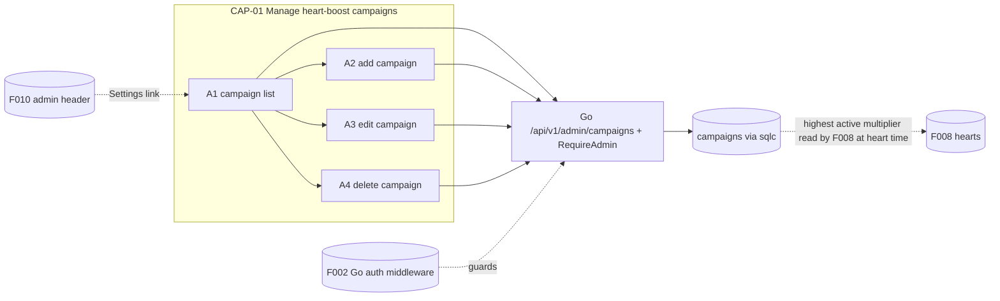
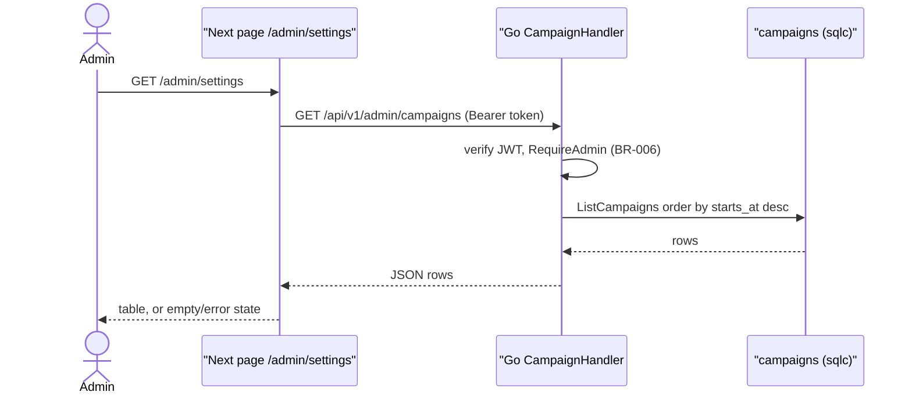
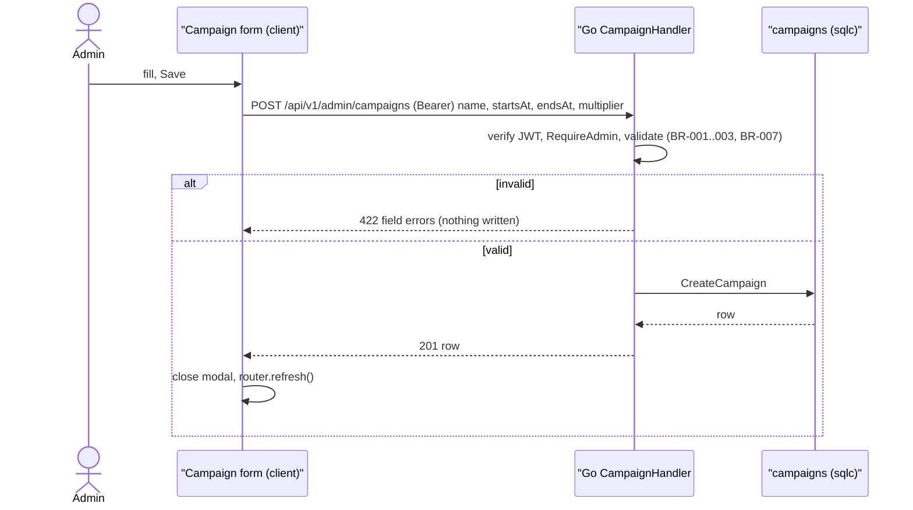
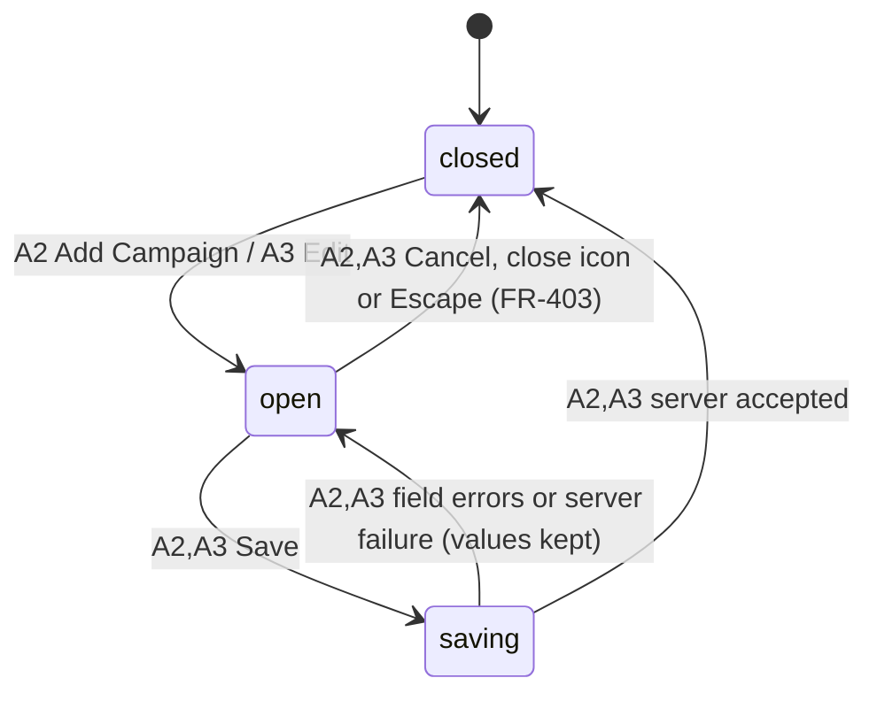

# F012_AdminCampaigns — Technical Spec

**Priority**: P3
**Type**: ui
**Generated**: 2026-11-09

**See also:** [`functional-spec.md`](./functional-spec.md) — plain-language overview, open decisions, requirements and business rules in one-liners, screens, user stories, scenarios, edge cases.

**How to read this file:** § 2 is the index — pick an action and read its block in § 3 top to bottom. § 4 is the shared appendix. Everything is a planned design: no code exists yet, so handler names are provisional identities and every `Source` is `TBD (draft)`. Backend paths are in the Go module `backend/` (`backend/cmd/api`, `backend/internal/<domain>`, `backend/db/queries` for sqlc); the Next.js app at the repo root is frontend only.

## 1. Technical Overview

F012 adds one admin page, Settings at `/admin/settings` (Next.js Server Component), and four Go endpoints in `backend/internal/campaign`: `GET /api/v1/admin/campaigns`, `POST /api/v1/admin/campaigns`, `PATCH /api/v1/admin/campaigns/{id}` and `DELETE /api/v1/admin/campaigns/{id}`. The page lists campaigns by calling Go server-side with the admin's access token; the form modal and the delete popup call Go from the browser with the same token as `Authorization: Bearer`, then refresh the page. Next.js never touches the database and has no Server Actions here. F012 owns the `campaigns` table (with the `multiplier` column F008 reads); F008 only reads it to weight a heart. Every `/api/v1/admin/...` route sits behind F002's Go auth middleware (JWT verified against Supabase JWKS, role loaded from the user row) and `RequireAdmin` (BR-006); all validation runs in Go (FR-602). Browser roles have no table grants; RLS stays enabled deny-all as defence in depth.



## 2. Action Index

| # | Action (handler) | Method · Path | Codes | Writes | Detail |
|---|---|---|---|---|---|
| **A0** | *cross-cutting — belongs to no single action* | — | FR-002, FR-601, BR-006 | — | § 4.4 |
| **A1** | `CampaignHandler#list` (planned) | `GET` `/api/v1/admin/campaigns` *(called by Next page `/admin/settings`)* | FR-101, FR-102, FR-103, FR-405, BR-007, DEC-001, INT-001, US001 | — *(read-only)* | § 3.1 |
| **A2** | `CampaignHandler#create` (planned) | `POST` `/api/v1/admin/campaigns` | FR-201, FR-203, FR-401, FR-402, FR-403, FR-602, BR-001, BR-002, BR-003, BR-004, BR-007, SM-001, INT-001, US002 | `campaigns` ← insert one row — `TBD (draft)` | § 3.1 |
| **A3** | `CampaignHandler#update` (planned) | `PATCH` `/api/v1/admin/campaigns/{id}` | FR-202, FR-203, FR-401, FR-402, FR-403, FR-602, BR-001, BR-002, BR-003, BR-004, BR-005, BR-007, DEC-002, SM-001, INT-001, US003 | `campaigns` ← update one row — `TBD (draft)` | § 3.1 |
| **A4** | `CampaignHandler#delete` (planned) | `DELETE` `/api/v1/admin/campaigns/{id}` | FR-404, FR-401, BR-005, DEC-002, INT-001, US004 | `campaigns` ← delete one row; `hearts.campaign_id` ← null by FK — `TBD (draft)` | § 3.1 |

## 3. Actions

### 3.1 CAP-01 — Manage heart-boost campaigns

#### A1 · Show the campaign list
`GET /api/v1/admin/campaigns` → `` `CampaignHandler#list` `` (planned) in `backend/internal/campaign`
`FR-101` `FR-102` `FR-103` `FR-405` `US001` · `SCR-admin-campaign-settings`

**Who** · signed-in admin (Go `RequireAdmin`; others get 403, and the Next admin layout shows the 403 page)
**FE** · Next.js Server Component page `/admin/settings` (`AdminSettingsPage`) calls the Go endpoint server-side with the admin's access token (`cache: 'no-store'`) and renders: title "Setting", "Add Campaign" button, table with columns ID, Name, Time (start, end), Actions; the Name cell ends with an "x{n}" multiplier tag and a hover hint "Heart multiplier x{n}" (the design has no multiplier column); the ⋯ menu of each row offers Edit and Delete (frame "Action - Campaign")
**Request** · none (no query parameters; the list is not paged)
**BE** · `CampaignHandler#list` (planned) calls `CampaignService.List(ctx)` → sqlc `ListCampaigns` (all rows ordered by `starts_at` desc, INT-001) and returns JSON `[{ id, name, startsAt, endsAt, multiplier }]` with RFC 3339 instants; the page formats times in the report time zone
**Rule**
- **BR-007 — Times are typed and shown in Asia/Ho_Chi_Minh; a campaign counts from its start up to, not including, its end.** The list shows `DD/MM/YYYY - HH:mm` in that zone while `starts_at`/`ends_at` are stored as absolute instants. *(full block § 4.4 Bin 2)*

| DEC | subtype | Condition | What the user sees | Source |
|---|---|---|---|---|
| **DEC-001** | render | no rows | empty message "no campaigns yet"; Add Campaign still shown | TBD (draft) |
| **DEC-001** | render | read fails | inline error with Retry; header still works | TBD (draft) |
| **DEC-001** | render | rows exist | the table | TBD (draft) |

**Result** · read-only — no DB write. ID column shows the first 8 characters of the id (functional D005).
**Source:** TBD (draft)



---

#### A2 · Add a campaign
`POST /api/v1/admin/campaigns` → `` `CampaignHandler#create` `` (planned) in `backend/internal/campaign`
`FR-201` `FR-203` `FR-401` `FR-402` `FR-403` `US002` · `SCR-admin-campaign-form`

**Who** · signed-in admin
**FE** · "Add Campaign" opens the client form modal (frame "add new Campaign") with name, start date-time, end date-time, multiplier preset to 2; Save sends the request from the browser with the access token as `Authorization: Bearer`, then calls `router.refresh()` so the Server Component list re-reads A1; the date fields open the date picker (frame `1413:9045`); Save shows a busy state; field messages appear under each wrong field; Cancel, the close icon or Escape closes without saving (FR-403)
**Request** · JSON `{ name, startsAt, endsAt, multiplier }` — date-times as local `YYYY-MM-DDTHH:mm` strings that Go reads in the report time zone (`time.ParseInLocation`, BR-007); `multiplier` defaults to 2 when omitted
**BE** · `CampaignHandler#create` (planned) behind `RequireAdmin` (BR-006) decodes the body, `CampaignService.Create` validates in Go (BR-001, BR-002, BR-003; FR-602 = the backend never trusts the browser) and inserts through sqlc `CreateCampaign` (INT-001) with `created_by` = caller id from the verified token; returns `201` with the row, or `422` with `{ errors: { field: message } }` and nothing written
**Rule** · field rules are shared with A3 and stated in full in § 4.4:
- **BR-001 — A campaign needs a name of 1 to 100 characters after trimming.** *(§ 4.4 Bin 2)*
- **BR-002 — The end must be later than the start.** *(§ 4.4 Bin 2)*
- **BR-003 — The multiplier is a whole number from 2 to 10.** *(§ 4.4 Bin 2)*
- **BR-004 — Campaigns may overlap; a heart takes the highest multiplier among campaigns active at that instant (F008).** F012 never blocks or warns on overlap. *(§ 4.4 Bin 2)*
- **BR-007** applies when reading the typed times (see A1).

**Result** · writes `campaigns` ← one row `(id, name, starts_at, ends_at, multiplier default 2, created_by, created_at, updated_at)` — `TBD (draft)`. User sees the form close and the new row in the list; on invalid input the form stays open with messages and no row is written (FR-402).
**State** · `SM-001`: `closed` → `open` → `saving` → `closed` | `open` *(§ 4.3)*
**Source:** TBD (draft)



---

#### A3 · Edit a campaign
`PATCH /api/v1/admin/campaigns/{id}` → `` `CampaignHandler#update` `` (planned) in `backend/internal/campaign`
`FR-202` `FR-203` `FR-401` `FR-402` `FR-403` `US003` · `SCR-admin-campaign-form`

**Who** · signed-in admin
**FE** · Edit in the row menu opens the same form modal (frame "Edit Campaign") filled with the row's values, including its multiplier; same fields, picker, messages and close behavior as A2; Save sends the request from the browser with the Bearer token, then `router.refresh()`
**Request** · path `id`; JSON `{ name, startsAt, endsAt, multiplier }` (all four sent; the form sends full values, not a diff)
**BE** · `CampaignHandler#update` (planned) behind `RequireAdmin` (BR-006) validates in Go as A2, runs sqlc `UpdateCampaign` by `id` setting `updated_at` (INT-001); `200` with the row, `422` on field errors, `404` when no row matched (DEC-002)
**Rule** · BR-001, BR-002, BR-003 and BR-004 apply exactly as in A2 (glossed there and in § 4.4); plus:
- **BR-005 — Changing or deleting a campaign never changes hearts already given.** A `hearts` row stores its own `weight` and `campaign_id` at heart time (F008); this action touches only `campaigns`. Editing a running campaign changes only hearts given afterwards. *(§ 4.4 Bin 2, shared with A4)*

| DEC | subtype | Condition | What the user sees | Source |
|---|---|---|---|---|
| **DEC-002** | flow | the id no longer exists (deleted by another admin) | message "campaign no longer exists"; modal closes; list refreshes | TBD (draft) |
| **DEC-002** | flow | the row exists | saved as in A2 | TBD (draft) |

**Result** · writes `campaigns` ← update of one row — `TBD (draft)`. User sees the row with new values; last save wins when two admins edit at once.
**State** · `SM-001` as A2
**Source:** TBD (draft)

---

#### A4 · Delete a campaign
`DELETE /api/v1/admin/campaigns/{id}` → `` `CampaignHandler#delete` `` (planned) in `backend/internal/campaign`
`FR-404` `FR-401` `US004` · `SCR-admin-campaign-settings`

**Who** · signed-in admin
**FE** · Delete in the row menu opens a confirmation popup (frame "Popup delete campaign") naming the campaign, with Confirm and Cancel; Confirm sends the request from the browser with the Bearer token and shows a busy state; success closes the popup and calls `router.refresh()`; failure shows a message inside the popup and keeps it open
**Request** · path `id`; no body
**BE** · `CampaignHandler#delete` (planned) behind `RequireAdmin` (BR-006) runs sqlc `DeleteCampaign` by `id` (INT-001); `204` on success, `404` when no row matched (DEC-002). Hearts that referenced the campaign survive: `hearts.campaign_id` is nullable with `on delete set null` (F008's model, X04), so Postgres clears the link and `hearts.weight` is untouched
**Rule** · BR-005 — **existing hearts keep their weight**; deleting only stops the campaign from boosting future hearts. *(§ 4.4 Bin 2, shared with A3)* DEC-002 as A3: an id that no longer exists is treated as already deleted, with the message and a list refresh.
**Result** · writes `campaigns` ← delete of one row — `TBD (draft)`. User sees the popup close and the row gone.
**Source:** TBD (draft)

---

### 3.2 Edge cases

| Action | Scenario | Behavior |
|---|---|---|
| A2 · A3 | Name empty or whitespace only | Field error; nothing written (BR-001) |
| A2 · A3 | Name over 100 characters | Field error; nothing written (BR-001) |
| A2 · A3 | `endsAt <= startsAt` | Field error on end; nothing written (BR-002) |
| A2 · A3 | Multiplier blank (edit), fractional, text, below 2, above 10 | `422` field error; nothing written (BR-003); omitted on create → 2 |
| A2 · A3 | Date-time string missing or malformed in a hand-built request | Rejected with a field error by the server (FR-602) |
| A1 · A2 · A3 · A4 | Direct call by a non-admin or without a token | Go middleware refuses (BR-006): 401 without a valid token, 403 for a user-role token; no row touched |
| A2 · A3 | Overlap with another campaign | Saved; no warning (BR-004) |
| A2 | Double click on Save | Button disabled while `saving`; one row written |
| A3 · A4 | Campaign already deleted by another admin | DEC-002 message; list refreshes |
| A3 | Two admins edit the same row | Last write wins; no version check (functional D003 scope) |
| A4 | Campaign is the one running now | Deleted; hearts given earlier keep weight with `campaign_id` null (BR-005); the next heart uses another active campaign's multiplier, or weight 1 when F008's lookup succeeds and finds none |
| — (F008) | F008's in-transaction campaign lookup fails at heart time | The heart is rolled back with `500 campaign_lookup_failed`; never weight 1 on error. A failed `GET /api/v1/campaigns/active` only hides the badge (Codex R09) |
| A1 · A2 · A3 · A4 | Database error | Go returns `500`; inline error or in-form message with the values kept; no partial write |
| A3 | Edit of a campaign from a stale page | Updates by id; uses the typed values, not a diff |

## 4. Shared Foundation

### 4.1 Components

| Component | Responsibility | Used in | File |
|---|---|---|---|
| `AdminSettingsPage` | Next Server Component: call Go list endpoint, render table or empty/error state | A1 | TBD (draft) |
| `CampaignTable` + `CampaignRowMenu` | table with "x{n}" name tag and hover hint; ⋯ menu (Edit, Delete) | A1 | TBD (draft) |
| `CampaignFormModal` | client modal for add and edit; calls Go with Bearer token; shows `422` field messages; busy state; `router.refresh()` on success | A2, A3 | TBD (draft) |
| `DateTimeField` | date picker plus time input; reads and writes local strings | A2, A3 | TBD (draft) |
| `DeleteCampaignDialog` | confirmation popup; calls Go `DELETE` | A4 | TBD (draft) |
| `CampaignHandler` (Go) | HTTP handlers in `backend/internal/campaign`, registered on the stdlib `net/http` ServeMux (`GET`/`POST /api/v1/admin/campaigns`, `PATCH`/`DELETE /api/v1/admin/campaigns/{id}`) | A1, A2, A3, A4 | TBD (draft) |
| `CampaignService` (Go) | validation BR-001, BR-002, BR-003, time parsing BR-007, calls sqlc queries | A1, A2, A3, A4 | TBD (draft) |
| `backend/db/queries/campaigns.sql` | sqlc queries `ListCampaigns`, `CreateCampaign`, `UpdateCampaign`, `DeleteCampaign` | A1, A2, A3, A4 | TBD (draft) |
| `RequireAdmin` middleware (Go, from F002) | role check on every `/api/v1/admin/...` route | A1, A2, A3, A4 | TBD (draft) |

### 4.2 Data Model

#### Key Entities

| Entity | Table | Key Columns | Purpose |
|--------|-------|-------------|---------|
| campaign | `campaigns` | `id` (uuid), `name` (text, 1-100), `starts_at` (timestamptz), `ends_at` (timestamptz, `> starts_at`), `multiplier` (int, 2-10, default 2), `created_by` →users, `created_at`, `updated_at` | One heart-boost promotion; **owned and written only by F012**; read by F008 |
| users | `users` | `id`, `role` (`user` \| `admin`) *(owned by F002; read only)* | admin check; `created_by` |
| hearts | `hearts` | `weight`, `campaign_id` →campaigns, nullable, `on delete set null` *(owned by F008; not written by F012)* | survives campaign delete with its weight (BR-005, X04) |

Database-level rules `[EXPECTED]`, created by a Supabase CLI migration (`supabase/migrations`): check constraints `ends_at > starts_at`, `multiplier between 2 and 10`, `char_length(name) between 1 and 100`, `multiplier default 2`; RLS enabled deny-all and no table grants for browser roles — every read and write goes through the Go backend. F008 reads `starts_at`, `ends_at`, `multiplier` through its own sqlc query at heart time.

#### Polymorphic Behavior

N/A — no discriminator fields in Key Entities.

### 4.3 State Management

### The campaign form moves from closed to open to saving, then closes on success or stays open on failure (SM-001)
**kind:** ui
**Linked FR:** FR-401
**Source:** TBD (draft)



**Action transitions:** guards are the validation rules in the **Rule** rungs of A2 and A3 (§ 3.1); `saving → open` also covers a `422` or `500` from Go. The list itself is rendered by the Server Component and refreshes through `router.refresh()`; no list state is kept in the client.

### 4.4 Shared Rules

#### Bin 2 — used by ≥2 named actions

**BR-001 — A campaign needs a name of 1 to 100 characters after trimming.**
Used in: **A2** · **A3**. The name is trimmed of leading and trailing spaces; an empty result or more than 100 characters is rejected with a field error.
**Source:** TBD (draft)
```text
n = trim(name)
valid = 1 <= length(n) <= CAMPAIGN_NAME_MAX_LENGTH
```

**BR-002 — The end must be later than the start.**
Used in: **A2** · **A3**. Both date-times are required; equal times are rejected too, so a campaign lasts at least one minute.
**Source:** TBD (draft)
```text
valid = startsAt present and endsAt present and endsAt > startsAt
```

**BR-003 — The multiplier is a whole number from 2 to 10.**
Used in: **A2** · **A3**. Anything else (blank, fractional, 1, 11, text) is rejected; omitted on create means 2 (functional D001, G14). Checked in Go and again by the table's check constraint.
**Source:** TBD (draft)
```text
multiplier = multiplier ?? MULTIPLIER_DEFAULT        # create only
valid = isInteger(multiplier) and MULTIPLIER_MIN <= multiplier <= MULTIPLIER_MAX
```

**BR-004 — Campaigns may overlap; a heart takes the highest multiplier among campaigns active at that instant.**
Used in: **A2** · **A3**. F012 stores overlapping windows without blocking or warning; F008 picks the highest multiplier at heart time (G14). Weight 1 applies only when F008's lookup succeeds and finds no active campaign; a lookup error rejects the heart with `500 campaign_lookup_failed` (Codex R09).
**Source:** TBD (draft)
```text
no overlap check is performed on write
```

**BR-005 — Changing or deleting a campaign never changes hearts already given.**
Used in: **A3** · **A4**. A heart's weight is stored on the heart when it is given; these actions only change which weight later hearts get. On delete the foreign key clears `hearts.campaign_id` and keeps the heart and its weight (X04).
**Source:** TBD (draft)
```text
update/delete campaigns where id = :id      # hearts rows are not touched
on delete: hearts.campaign_id := null       # FK on delete set null (F008 model); weight unchanged
```

**BR-007 — Times are typed and shown in Asia/Ho_Chi_Minh; a campaign counts from its start up to, not including, its end.**
Used in: **A1** · **A2** · **A3**. A typed `YYYY-MM-DDTHH:mm` is read by Go in REPORT_TIMEZONE (`time.ParseInLocation`) and stored as an absolute instant; the list formats it back. The window is `starts_at <= now < ends_at`, the same as F008's lookup.
**Source:** TBD (draft)
```text
stored  = time.ParseInLocation("2006-01-02T15:04", typedLocal, REPORT_TIMEZONE)
display = format(instantToZoned(stored, REPORT_TIMEZONE), "DD/MM/YYYY - HH:mm")
active(now) = starts_at <= now and now < ends_at
```

#### Bin 3 — cross-cutting, belongs to no single action

**A0 · BR-006 · FR-601 — Every Settings page and every change checks the admin role by itself.**
Every `/api/v1/admin/campaigns` route is registered behind F002's Go auth middleware (JWT verified against Supabase JWKS; role loaded from the caller's user row on each request) and `RequireAdmin` (no or invalid token → 401; role `user` → 403). Role and `created_by` come from the verified token and the database, never from request input; admins exist only by email seeding. The Next admin layout redirect is convenience; the Go check is the protection. Browser roles have no grants on `campaigns`.
**Source:** TBD (draft)

**A0 · FR-002 — All Settings text comes from the VN/EN dictionaries.** Labels, field messages, popup text and empty and error messages reuse F001's dictionary mechanism; exact copy is functional D010.
**Source:** TBD (draft)

### 4.5 Algorithms & Integrations

### The campaign endpoints read and write `campaigns` through a Go service and sqlc queries (INT-001)
**Linked FR:** FR-601
**Used in:** A1, A2, A3, A4
**Source:** TBD (draft)
**Type:** internal-service
**Target:** `CampaignService` in `backend/internal/campaign` → sqlc `ListCampaigns`, `CreateCampaign`, `UpdateCampaign`, `DeleteCampaign` (`backend/db/queries/campaigns.sql`) over pgx, each write in its own Go transaction
**Payload:** typed, validated values only (`name`, `starts_at`, `ends_at`, `multiplier`, `id`, `created_by`); no SQL built from strings; no database credential reaches the browser
**Failure handling:** read failure → `500`, page shows the inline error of DEC-001; validation failure → `422` with field messages; missing id → `404` (DEC-002); write failure → `500`, form-level message with typed values kept; refused role → `403`.

### 4.6 Configuration

```text
CAMPAIGN_NAME_MAX_LENGTH = 100                  # BR-001 (AD12)
MULTIPLIER_MIN           = 2                    # BR-003 (G14)
MULTIPLIER_MAX           = 10                   # BR-003 (G14)
MULTIPLIER_DEFAULT       = 2                    # BR-003 (G14)
REPORT_TIMEZONE          = Asia/Ho_Chi_Minh     # BR-007 (AD12)
TIME_DISPLAY_FORMAT      = DD/MM/YYYY - HH:mm   # from the design sample
```

**Client behavior:** see behavior-logic.md, permissions.md, architecture.md

## 5. Verification & Technical Notes

### 5.1 Technical Verification

- **SC-001** *(A1)* seed two campaigns plus none: list is ordered by start descending, times read `DD/MM/YYYY - HH:mm`, empty state shows with none (covers FR-101, FR-102, FR-103, DEC-001)
- **SC-002** *(A2, A3)* send blank name, 101-char name, end equal to start, multiplier 1, 11, 2.5 directly to the Go endpoints: each `422` with its own field error and no row changes; create without multiplier stores 2 (covers FR-402, FR-602, BR-001, BR-002, BR-003)
- **SC-003** *(A2, A3)* a valid add then a valid edit: list shows both without manual reload; Escape on a dirty form changes nothing (covers FR-201, FR-202, FR-401, FR-403, SM-001)
- **SC-004** *(A1, A2, A3, A4)* call each `/api/v1/admin/campaigns` endpoint with a user-role token and with no token: `403` and `401`, table unchanged (covers FR-601, BR-006)
- **SC-005** *(A3, A4)* give a heart under a x2 campaign, then edit its multiplier and delete it: the stored heart keeps weight 2, survives with `campaign_id` null, and the receiver's weighted total is unchanged (covers BR-005, FR-404)
- **SC-006** *(A2)* typed 23/12/2025 10:00 saves the instant for that time in Asia/Ho_Chi_Minh; F008's lookup treats `ends_at` as exclusive (covers BR-007)
- **SC-007** *(A3, A4)* delete in one session, then edit or delete the same id in another: Go returns `404`, DEC-002 message and refreshed list (covers DEC-002)
- **SC-008** *(A1)* a x3 campaign shows "x3" after its name and the hover hint "Heart multiplier x3" (covers FR-101)

#### US001 *(A1)*

**Independent Test:** open `/admin/settings` as an admin with seeded campaigns and compare each row with the table.

**Acceptance Scenarios:**

1. **Given** two campaigns, **When** the admin opens Settings, **Then** both show, later start first.
2. **Given** a user-role session, **When** `/admin/settings` is requested, **Then** the 403 page appears.

#### US002 *(A2)*

**Independent Test:** add a campaign through the form and check the row in the list and the table.

**Acceptance Scenarios:**

1. **Given** the Add form with the multiplier preset to 2, **When** a valid name and period are saved, **Then** the form closes and the row shows with "x2".
2. **Given** an end before the start, **When** saved, **Then** the end field shows a message and nothing is stored.

#### US003 *(A3)*

**Independent Test:** edit the end time of a seeded campaign.

**Acceptance Scenarios:**

1. **Given** an existing campaign, **When** the admin changes its end and saves, **Then** the row shows the new end.
2. **Given** the campaign was deleted elsewhere, **When** the admin saves, **Then** the "no longer exists" message shows.

#### US004 *(A4)*

**Independent Test:** delete a seeded campaign through the popup.

**Acceptance Scenarios:**

1. **Given** the popup is open, **When** the admin confirms, **Then** the row disappears.
2. **Given** the popup is open, **When** the admin cancels, **Then** the row stays.

### 5.2 Assumptions

- *(A1)* The route is `/admin/settings`, as in F010's nav item; the add and edit forms are modals on that route, not separate routes.
- *(A2, A3, A4)* Writes are Go REST endpoints called from the browser with the Supabase access token; Next.js has no Server Actions or route handlers for campaigns. Client refresh uses `router.refresh()` per the installed Next 16 docs `[UNVERIFIED]` — re-read `node_modules/next/dist/docs` before building.
- *(A0)* F002 provides the Go auth middleware and `RequireAdmin`; the user table name follows F002 (`users` here).
- *(A1)* A handful of campaigns per event; no paging, search or cache is needed (responses `no-store`).
- *(A1)* F008 reads `starts_at`, `ends_at`, `multiplier` from `campaigns`; any extra column here is additive.

### 5.3 Unresolved Questions

1. **Delete and hearts** *(A4)* — closed: `hearts.campaign_id` is nullable with `on delete set null` in F008's model; hearts keep their weight (X04, functional D004).
2. **Who may read `campaigns`** *(A1, F008)* — closed: no browser access; Go reads it for this page and for F008's heart weighting (G18).
3. **Multiplier field and range** *(A2, A3)* — closed: integer 2 to 10, default 2; shown as a name tag with a hover hint because the design has no column (G14, functional D001).
4. **Overlap policy** *(A2, A3)* — closed: allowed, highest multiplier wins (functional D002, G14).
5. **Edit conflicts** *(A3)* — closed: last write wins; no version check (AD12).

### 5.4 Source References

No source code written yet — see `## 7. User Stories` in functional-spec.md for planned behavior.

#### Data Flow

```text
GET /admin/settings (Next page) -> GET /api/v1/admin/campaigns (Bearer) -> Go auth + RequireAdmin -> sqlc ListCampaigns order by starts_at desc -> JSON -> table / empty / error
Add form Save -> POST /api/v1/admin/campaigns (Bearer) -> RequireAdmin (BR-006) -> CampaignService validate BR-001..003, parse times BR-007 -> CreateCampaign -> 201 | 422 -> router.refresh() -> list
Edit form Save -> PATCH /api/v1/admin/campaigns/{id} (Bearer) -> RequireAdmin -> validate -> UpdateCampaign -> 200 | 422 | 404 -> router.refresh()
Delete Confirm -> DELETE /api/v1/admin/campaigns/{id} (Bearer) -> RequireAdmin -> DeleteCampaign (FK sets hearts.campaign_id null, weight kept) -> 204 | 404 -> router.refresh()
F008 heart time (Go) -> campaigns where starts_at <= now < ends_at, highest multiplier; none found -> 1; lookup error -> rollback, 500 campaign_lookup_failed (Codex R09) -> weight and campaign_id on hearts row
```

### 5.5 Artifact References

| Artifact | File | Codes Used | Reviewed |
|----------|------|------------|----------|
| Feature List | [feature-list.md](../feature-list.md) | F012 | [x] |
| System Overview | TBD (draft) | — | [ ] |
| Architecture | TBD (draft) | — | [ ] |
| API Map | TBD (draft) | — | [ ] |
| Entities | TBD (draft) | — | [ ] |
| Screens | TBD (draft) | — | [ ] |
| Behavior Logic | TBD (draft) | — | [ ] |
| Permissions Matrix | TBD (draft) | — | [ ] |
| User Stories | TBD (draft) | — | [ ] |
