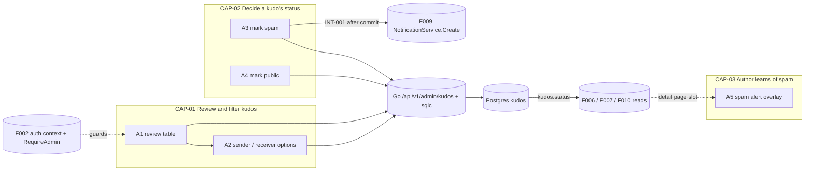
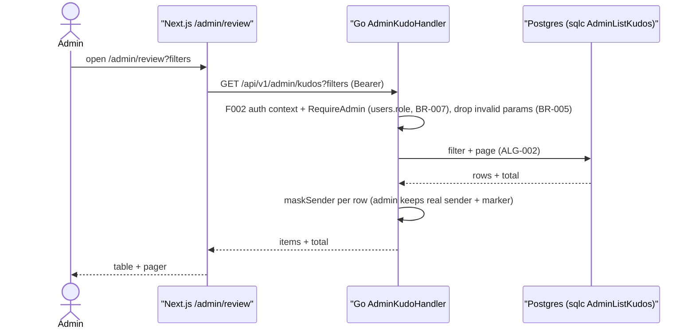
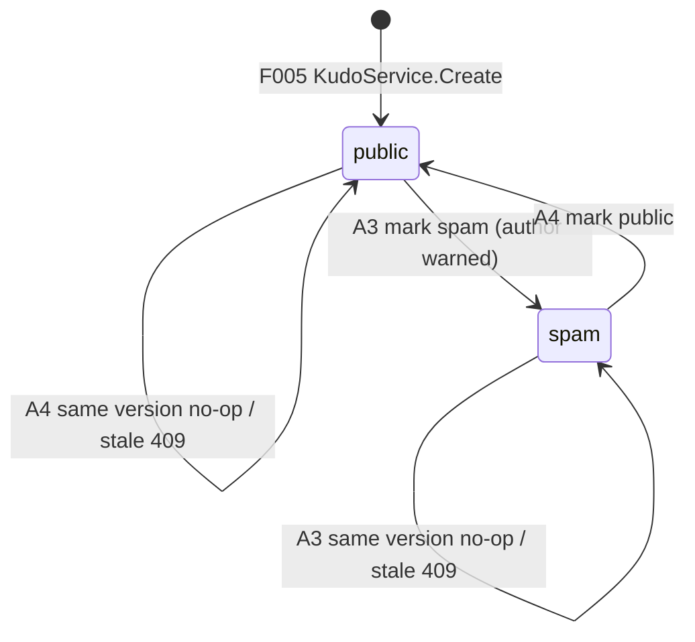

# F011_AdminKudoModeration — Technical Spec

**Priority**: P3
**Type**: mixed
**Generated**: 2026-11-10

**See also:** [`functional-spec.md`](./functional-spec.md) — plain-language overview, open decisions, requirements and business rules in one-liners, screens, user stories, scenarios, edge cases.

**How to read this file:** § 2 is the index — pick an action and read its block in § 3 top to bottom. § 4 is the shared appendix. Everything is a planned design: no code exists yet, so handler names are provisional identities and every `Source` is `TBD (draft)`.

## 1. Technical Overview

F011 adds the admin page Review content (`/admin/review`): a filterable, searchable, paged table of every kudo where an admin marks a kudo Spam or Public. The page is a Next.js 16 screen (frontend only); all data and decisions go through Go admin endpoints under `/api/v1/admin/kudos...` in `backend/internal/moderation`. F002's shared Go auth middleware verifies the Supabase access token against Supabase JWKS and puts the caller and `users.role` in the shared auth context; F002's `RequireAdmin` middleware refuses anyone whose `users.role` is not admin with 403 — F011 adds no role loader of its own (Codex R05); these Go handlers and sqlc queries replace the drafted `security definer` RPCs (`admin_review_list`, `admin_review_people`, `set_kudo_status`). The decision is one versioned compare-and-set on `kudos.status` (`public` ↔ `spam`) inside a Go transaction: the request carries `{ expectedVersion }`, the row changes only if `kudos.moderation_version` still equals it and the status differs, the version is incremented on every real change, and who decided and when is recorded; a stale version returns 409 `stale_decision` with the current row, the same target at the same version returns 200 `changed: false` (Codex R13), and an id with no kudo row returns 404 `kudo_not_found` (C03, Codex N08). The transaction follows the global lock order — the kudo row `for update` first, then the receiver's `users` row `for update`, then the versioned update — so a status change is serialized with F005's kudo-create tier transition on the same receiver; it still never emits a level-up notice (Codex N05). After commit, on Spam, the service calls F009's shared `NotificationService.Create` with its own 2 s context detached from the request to warn the author (best-effort; a failure is logged and never changes the response, Codex R23). Kudos are Public from creation: there is no pending status and no admin "Có <x> lời nhắn cần bạn xem xét!" notice (G10) — admins find kudos on this Review page. Admin responses carry the real sender of an anonymous kudo with an Anonymous marker, produced by the shared Go helper `maskSender(kudo, viewer)` (G04, X05). Other features already read `kudos.status`: spam kudos disappear from the live board, profile pages and Overview counts (F006, F007, F010) and stay visible only to the author and admins. The author-facing half is a spam alert overlay on the kudo detail page, shown to the sender of a spam kudo.



## 2. Action Index

| # | Action (handler) | Method · Path | Codes | Writes | Detail |
|---|---|---|---|---|---|
| **A0** | *cross-cutting — belongs to no single action* | — | FR-001, FR-304, FR-601, BR-007, BR-008 | — | § 4.4 |
| **A1** | `AdminKudoHandler#list` (planned) *(page `/admin/review`)* | `GET` `/api/v1/admin/kudos?sender&receiver&status&from&to&q&page` | FR-101, FR-102, FR-103, FR-203, FR-204, FR-205, FR-206, FR-305, BR-001, BR-004, BR-005, DEC-001, DEC-002, ALG-002, INT-002, US001, US002 | — *(read-only)* | § 3.1 |
| **A2** | `AdminKudoHandler#people` (planned) | `GET` `/api/v1/admin/kudos/people?role&q` | FR-201, FR-202, BR-009, INT-002, US002 | — *(read-only)* | § 3.1 |
| **A3** | `AdminKudoHandler#markSpam` (planned) | `POST` `/api/v1/admin/kudos/{id}/spam` | FR-301, FR-303, FR-602, FR-603, BR-002, BR-003, SM-001, ALG-001, INT-001, INT-002, US003, US005 | `kudos` (status, moderation_version, moderated_by, moderated_at); `notifications` via F009 `NotificationService.Create` after commit | § 3.2 |
| **A4** | `AdminKudoHandler#markPublic` (planned) | `POST` `/api/v1/admin/kudos/{id}/public` | FR-302, FR-602, FR-603, BR-002, SM-001, ALG-001, INT-002, US004 | `kudos` (status, moderation_version, moderated_by, moderated_at) | § 3.2 |
| **A5** | `SpamAlertOverlay#render` (planned) *(client only)* | — *(F006 page `/kudos/[id]`; data from F006's Go kudo detail endpoint)* | FR-401, FR-402, BR-006, DEC-003, US006 | — *(read-only)* | § 3.3 |

## 3. Actions

### 3.1 CAP-01 — Review and filter kudos

#### A1 · Show the review table with filters
`GET /api/v1/admin/kudos?sender&receiver&status&from&to&q&page` → `` `AdminKudoHandler#list` `` (planned) in `backend/internal/moderation`
`FR-101` `FR-102` `FR-103` `FR-203` `FR-204` `FR-205` `FR-206` `FR-305` `US001` `US002` · `SCR-admin-review-content`

**Who** · signed-in admin (Next.js proxy sends signed-out visitors to Login; F002's `RequireAdmin` returns 403 to non-admins and the page shows the no-access page). FR-101 = table columns; FR-102 = order and paging; FR-103 = empty and error states; FR-203/204/205 = status filter, date range, search; FR-206 = filters combine and live in the address; FR-305 = row action depends on status; US001 = see all kudos in a table; US002 = filter and search them
**FE** · Next.js page `/admin/review` (Server Component under the admin layout, F010's admin header reused) calls the Go endpoint server-side with the user's access token as `Authorization: Bearer`, passing the address params through: title "Review content", filter bar (Sender, Receiver, Status, date range, search), table with columns ID, Sender, Receiver, Content (title in capitals plus a body excerpt), Hashtags, Time, Status pill, Action; pager below; each row's Action button opens a menu offering the one decision that changes the status
**Request** · query `sender` *(user id)*, `receiver` *(user id)*, `status` *(`public` | `spam`)*, `from`, `to` *(`YYYY-MM-DD`)*, `q` *(text)*, `page` *(1-based, default 1)*; unknown or malformed values are dropped, not errors
**BE** · `AdminKudoHandler#list` (planned) — behind F002's `RequireAdmin` (BR-007) — parses and drops invalid params, then `ModerationService.List` runs the sqlc queries `AdminListKudos` and `AdminCountKudos` (ALG-002, INT-002); each row passes through `maskSender(kudo, viewer)`, which for an admin viewer keeps the real sender and sets `isAnonymous`; rows newest first; each item carries `status`, `moderationVersion`, `moderatedBy`, `moderatedAt` so the row action can send `expectedVersion` (Codex R13); returns `{ items, total, page }`
**Rule**
- **BR-001 — Filters combine with AND; search matches title or body.** Every filter present narrows the list; `q` is a case-insensitive "contains" on `kudos.title` or `kudos.content`; a missing filter means no restriction. *(inline — used only here)*
- **BR-004 — An admin sees the real sender of an anonymous kudo.** The Sender column and filter show the true sender with an "Anonymous" marker; no other role gets this — the shared Go `maskSender(kudo, viewer)` hides the sender for every non-admin viewer on every other endpoint (G04, X05). *(inline — used only here)*
- **BR-005 — The range start may not be after its end.** A request with `from > to`, or either value malformed, ignores the date filter entirely and shows no error. *(inline — used only here)*

| DEC | subtype | Condition | What the user sees | Source |
|---|---|---|---|---|
| **DEC-001** | render | row status is `public` | Action menu offers "Mark as Spam" | TBD (draft) |
| **DEC-001** | render | row status is `spam` | Action menu offers "Mark as Public" | TBD (draft) |
| **DEC-002** | render | no rows AND at least one filter or search is set | empty state "no kudo matches" with a Clear filters link | TBD (draft) |
| **DEC-002** | render | no rows AND no filter set | empty state "no kudos yet" | TBD (draft) |

**Result** · read-only — no DB write. Status pill reads Public or Spam. Content shows the title and the first `EXCERPT_LENGTH` characters of the body. Hashtags are read from `kudo_hashtags`/`hashtags`.
**Source:** TBD (draft)



---

#### A2 · Offer senders and receivers for the filter dropdowns
`GET /api/v1/admin/kudos/people?role&q` → `` `AdminKudoHandler#people` `` (planned) in `backend/internal/moderation`
`FR-201` `FR-202` `US002` · `SCR-admin-review-content`

**Who** · signed-in admin. FR-201 = Sender filter; FR-202 = Receiver filter; US002 = filter kudos
**FE** · the Sender and Receiver dropdowns (frames "Dropdown list người đã gửi" and "người nhận") list people with avatar and name; the Client Component calls the Go endpoint from the browser with the bearer token; typing narrows the list; picking one sets `sender` or `receiver` and reloads A1
**Request** · `role` *(`sender` | `receiver`)*, `q` *(optional text)*
**BE** · `AdminKudoHandler#people` (planned) — behind F002's `RequireAdmin` (BR-007) — calls `ModerationService.People`, which runs sqlc `AdminListKudoPeople(role, q, limit)` (INT-002)
**Rule**
- **BR-009 — Only people who actually sent (or received) a kudo are offered.** The Sender list holds users with at least one kudo as sender, the Receiver list users with at least one as receiver; `q` is a case-insensitive "contains" on name or email; at most `PEOPLE_OPTIONS_LIMIT` entries, ordered by name. *(inline — used only here)*

**Result** · read-only — list of `{ id, name, avatar_url }`; no email is returned. No DB write.
**Source:** TBD (draft)

---

### 3.2 CAP-02 — Decide a kudo's status

#### A3 · Mark a kudo as Spam
`POST /api/v1/admin/kudos/{id}/spam` → `` `AdminKudoHandler#markSpam` `` (planned) in `backend/internal/moderation`
`FR-301` `FR-303` `FR-602` `FR-603` `US003` `US005` · `SCR-admin-review-content`

**Who** · signed-in admin. FR-301 = an admin can mark a public kudo as spam; FR-303 = the author is warned; FR-602 = who decided and when is recorded; US003 = mark a kudo as spam; US005 = the author is told
**FE** · row menu item "Mark as Spam" (frame "Action - Spam"); an inline confirmation before sending (D003); the Client Component then calls the Go endpoint from the browser with the bearer token and the row's `moderationVersion` as `expectedVersion`; the action is disabled while the request is pending; on success the row's pill turns Spam and its menu now offers Public (the table is refreshed); on 409 `stale_decision` the row is replaced with the current row from the response and a short message says another admin changed it (Codex R13); on other failures a short error and the row stays unchanged
**Request** · `id` *(kudo uuid, path value)*; body `{ expectedVersion }` *(int, the `moderationVersion` the admin saw; required, malformed → 400)*; the target status is fixed by the route, never read from input (Codex R13)
**BE** · `AdminKudoHandler#markSpam` (planned) — behind F002's `RequireAdmin` (BR-007) — calls `ModerationService.SetStatus(ctx, admin, id, spam, expectedVersion)`, which runs ALG-001 in one Go transaction: lock the kudo row `for update` (no row → 404 `kudo_not_found`, Codex N08), lock the receiver's `users` row `for update` (global lock order kudo → receiver, Codex N05), then the versioned compare-and-set (sqlc `SetKudoStatus`); no `hero_level_up` is ever emitted from here (Codex N05); when the status really changed, after commit it calls F009's `NotificationService.Create` (INT-001) with a fresh 2 s context detached from the request to warn the author (Codex R23); returns `{ changed, kudo: { status, moderationVersion, moderatedBy, moderatedAt } }`
**Rule**
- **BR-003 — The author is warned once per change to Spam, and a warning failure never undoes the decision.** Recipient = the kudo's `sender_id`; kind `kudo_spam_warning`; dedupe key `kudo_spam:{kudoId}` so a Spam → Public → Spam flip while the first warning is still unread updates it instead of adding another; no sender, receiver or admin identity goes into the params; if the admin is the author, F009 skips the notice (self-action, `ActorID` = admin). The notification call happens after commit with its own detached 2 s context; its failure or timeout is only logged and never changes the 200 response (Codex R23). *(inline — used only here)*
- BR-002 — a stale `expectedVersion` is refused with 409 `stale_decision` and the current row; the same target at the current version is a no-op `changed: false`: no write, no notice (Codex R13). *(full block § 4.4 Bin 2; glossed in A4 too)*

**Result**
- Writes `kudos` ← `status = 'spam'`, `moderation_version = moderation_version + 1`, `moderated_by` = admin id, `moderated_at` = now — `TBD (draft)`
- Writes `notifications` ← one `kudo_spam_warning` row for the author via F009 `NotificationService.Create` after commit, unless unchanged, self-action or failure
- Returns 200 `{ changed: true | false, kudo }`; `false` means the kudo was already Spam at `expectedVersion`; 409 `stale_decision` with `{ status, moderationVersion, moderatedBy, moderatedAt }` when the version moved (Codex R13); 404 `kudo_not_found` when no kudo has this id — nothing written, no notice (C03, Codex N08)
**State** · `SM-001`: `public` → `spam` *(§ 4.3)*
**Source:** TBD (draft)

```mermaid
sequenceDiagram
    actor Adm as Admin
    participant S as "Go AdminKudoHandler#markSpam"
    participant DB as "Postgres (sqlc SetKudoStatus)"
    participant N as "F009 NotificationService.Create"
    Adm->>S: POST /api/v1/admin/kudos/{id}/spam (Bearer)
    S->>S: F002 auth context + RequireAdmin (users.role, BR-007)
    S->>DB: tx: lock kudo row for update (ALG-001)
    alt no kudo row (Codex N08)
        DB-->>S: none (rollback)
        S-->>Adm: 404 kudo_not_found
    end
    S->>DB: lock receiver users row for update (lock order kudo then receiver, Codex N05)
    S->>DB: update where moderation_version = expectedVersion and status <> 'spam'
    alt row changed
        DB-->>S: sender_id, new version (commit)
        S->>N: detached 2 s ctx: author, actor = admin, kudo_spam_warning, kudo, dedupe key
        N-->>S: done (failure or timeout only logged)
        S-->>Adm: 200 changed = true + row
    else version matches, already spam
        DB-->>S: no row updated; the locked kudo row is the current row
        S-->>Adm: 200 changed = false + row
    else version moved
        DB-->>S: no row updated; the locked kudo row is the current row
        S-->>Adm: 409 stale_decision + current row
    end
```

---

#### A4 · Mark a kudo as Public
`POST /api/v1/admin/kudos/{id}/public` → `` `AdminKudoHandler#markPublic` `` (planned) in `backend/internal/moderation`
`FR-302` `FR-602` `FR-603` `US004` · `SCR-admin-review-content`

**Who** · signed-in admin. FR-302 = an admin can restore a spam kudo to public; FR-602 = who decided and when is recorded; US004 = mark a kudo as public
**FE** · row menu item "Mark as Public" (frame "Action - Public"); no confirmation; the Client Component calls the Go endpoint from the browser with the bearer token and the row's `moderationVersion` as `expectedVersion`; disabled while pending; on success the pill turns Public and the menu offers Spam again; on 409 `stale_decision` the row is replaced with the returned current row and a short message is shown (Codex R13)
**Request** · `id` *(kudo uuid, path value)*; body `{ expectedVersion }` (Codex R13)
**BE** · `AdminKudoHandler#markPublic` (planned) — behind F002's `RequireAdmin` (BR-007) — calls `ModerationService.SetStatus(ctx, admin, id, public, expectedVersion)` (INT-002, ALG-001): kudo row `for update`, then the receiver's `users` row `for update`, then the versioned update — the same lock order as A3, so a restore that adds a distinct sender is serialized with F005's kudo-create tier transition for that receiver (Codex N05); no notification of any kind, including no `hero_level_up` (Codex N05); returns `{ changed, kudo }`, 409 `stale_decision`, or 404 `kudo_not_found` for an unknown id (Codex N08)
**Rule** · **BR-002** — a request whose `expectedVersion` is stale gets 409 `stale_decision` with the current row; a request at the current version whose target is already the status (already Public) writes nothing and reports `changed: false`; so a stale Public can never restore a kudo another admin has just marked Spam, and double clicks write once (Codex R13) *(§ 4.4 Bin 2)*. Marking Public sends no notice to the author (D002); the kudo returns to the board, profile pages and Overview counts because those read `kudos.status` (BR-008).
**Result**
- Writes `kudos` ← `status = 'public'`, `moderation_version = moderation_version + 1`, `moderated_by`, `moderated_at` — `TBD (draft)`
- Returns 200 `{ changed: true | false, kudo }`, or 409 `stale_decision` with the current row (Codex R13), or 404 `kudo_not_found` when no kudo has this id (C03, Codex N08)
**State** · `SM-001`: `spam` → `public` *(§ 4.3)*
**Source:** TBD (draft)

---

### 3.3 CAP-03 — Author learns of spam

#### A5 · Show the spam alert overlay to the kudo's author
`GET /kudos/[id]` → `` `SpamAlertOverlay#render` `` *(planned; fills the spam-notice slot of F006's detail page)*
`FR-401` `FR-402` `US006` · `SCR-kudo-spam-alert`

**Who** · signed-in Sunner who is the sender of this kudo. FR-401 = the author sees an alert when their kudo is spam; FR-402 = the alert points to the community standards; US006 = see why my kudo is hidden
**FE** · over the kudo detail an overlay (frames "KUDO spam" and "Alert Overlay") states the kudo is hidden for breaking community standards, has a link "Tiêu chuẩn cộng đồng" and a close control; closing leaves the detail page readable behind it; copy from the design notes, Vietnamese supplied before release (D014)
**BE** · none of its own — `SpamAlertOverlay#render` (planned, Next.js) receives the kudo's `status` and an `isOwnKudo` / viewer-is-admin flag from F006's Go kudo detail endpoint (which already admits only the sender and admins to a spam kudo and applies `maskSender`) and picks the variant
**Rule**
- **BR-006 — Only the sender sees the overlay, and only while the kudo is Spam.** An admin viewing the same kudo sees the neutral spam notice of F006's slot, not the author's alert; when an admin marks it Public the overlay stops appearing on the next load. *(inline — used only here)*

| DEC | subtype | Condition | What the user sees | Source |
|---|---|---|---|---|
| **DEC-003** | render | viewer is sender AND status `spam` | alert overlay, closable, standards link | TBD (draft) |
| **DEC-003** | render | viewer is admin AND status `spam` | neutral "marked as spam" notice only | TBD (draft) |
| **DEC-003** | render | status `public` | nothing | TBD (draft) |

**Result** · read-only — no DB write; the overlay is not remembered, it reappears on each open while the kudo stays Spam (D005). Editing the kudo stays blocked while Spam (F005).
**Source:** TBD (draft)

---

### 3.4 Edge cases

| Action | Scenario | Behavior |
|---|---|---|
| A3 · A4 | Two admins decide the same kudo at once (same or opposing targets, both holding version N) | The first commit wins and bumps the version to N+1; the second gets 409 `stale_decision` with the current row, and its row refreshes with a message (ALG-001, Codex R13) |
| A3 · A4 | Stale opposing decision (admin B still holds version N after admin A marked Spam → N+1) | B's Public is refused with 409; the kudo stays Spam; B's row refreshes (Codex R13) |
| A3 · A4 | Double click (second request carries the same, now old, version) | Action disabled while pending; if a second request still arrives it gets 409 and the row already shows the target; one write, one notice (Codex R13) |
| A3 · A4 | Same target at the current version (status already equals target) | 200 `changed: false`, no write, no notice (Codex R13) |
| A3 · A4 | Missing or malformed `expectedVersion` | 400; nothing changed (Codex R13) |
| A3 · A4 | Kudo id does not exist (e.g. a random UUID sent directly) | 404 `kudo_not_found` from ALG-001's missing-row branch; nothing written, no notice, no `changed: false` body; the row is removed from the table on refresh (orchestrator decision C03, Codex N08) |
| A3 · A4 | Restore (Spam → Public) of a fifth distinct sender's kudo races F005 creating a kudo from a repeat sender to the same receiver | Both transactions take the receiver's `users` row lock (F011 after the kudo row, F005 create only the receiver row), so they run one after the other: if the create runs first it counts 4 before and 4 after; if it runs second its before count already includes the restored sender (5 before, 5 after). Either way the repeat-sender create sees no tier change and no `hero_level_up` is emitted; the restore itself emits none — the badge simply follows on the next read (Codex N05) |
| A3 | Admin marks their own kudo as Spam | Status changes; no notice (F009 self-action rule) |
| A3 | Notification insert fails or stalls past its detached 2 s deadline | Status stays Spam (already committed); failure logged by `NotificationService`; admin sees the normal 200 success (BR-003, Codex R23) |
| A3 · A4 | Non-admin calls the endpoint directly | 403 from F002's `RequireAdmin` (`users.role`); nothing changed (BR-007) |
| A3 · A4 | Missing or expired access token | 401; the page asks the admin to sign in again |
| A1 | `page` beyond the last page | Clamp to the last page |
| A1 | `q` contains `%`, `_`, quotes | Plain text (parameterised, wildcards escaped) |
| A1 | Sender or receiver id is not a uuid | Filter dropped |
| A1 | Kudo has no hashtags or no images | Hashtag cell shows a dash |
| A1 | Admin changes a row while another filter hides it afterwards | Row stays until the next load; no flicker |
| A1 · A2 | Query fails | Inline error with Retry; no partial table |
| A5 | Author opens a kudo that an admin restored to Public | No overlay |
| A5 | A non-sender non-admin opens a spam kudo | F006 shows not-found; F011 renders nothing |

## 4. Shared Foundation

### 4.1 Components

| Component | Responsibility | Used in | File |
|---|---|---|---|
| `AdminReviewPage` | Next.js server page: pass address params to the Go list endpoint, render | A1 | TBD (draft) |
| `ReviewFilterBar` | Sender / Receiver / Status dropdowns, date range, search box | A1, A2 | TBD (draft) |
| `ReviewTable` + `StatusPill` + `KudoActionMenu` | table, status pill, per-row action menu, empty and error states | A1, A3, A4 | TBD (draft) |
| date range picker (reused from F010) | range field and calendar | A1 | TBD (draft) |
| `Pager` (reused from F010) | page links with clamp | A1 | TBD (draft) |
| `AdminKudoHandler` (Go, `backend/internal/moderation`) | `list`, `people`, `markSpam`, `markPublic` handlers registered under `/api/v1/admin/kudos` | A1, A2, A3, A4 | TBD (draft) |
| `ModerationService` (Go) | list, people and versioned compare-and-set logic; calls `NotificationService.Create` after commit with a detached 2 s context | A1, A2, A3, A4 | TBD (draft) |
| `SpamAlertOverlay` | author-facing overlay | A5 | TBD (draft) |
| F002 auth middleware + `RequireAdmin` (shared, owned by F002; also used by F010) | verifies the JWT, puts the caller and `users.role` in the shared auth context; `RequireAdmin` returns 403 unless `users.role` is admin, for every `/api/v1/admin/...` route; F011 adds no role loader (Codex R05) | A1, A2, A3, A4 | TBD (draft) |

### 4.2 Data Model

#### Key Entities

| Entity | Table | Key Columns | Purpose |
|--------|-------|-------------|---------|
| kudo | `kudos` | `id`, `sender_id`→users, `receiver_id`→users, `title`, `content`, `is_anonymous`, `status` (`public` \| `spam`), `created_at` *(owned by F005; `status` written only by F011)*; **added by F011:** `moderation_version` (int not null default 0, incremented on every real status change — Codex R13), `moderated_by`→users (nullable), `moderated_at` (nullable) `[EXPECTED]` | the row being reviewed; who and when of the last decision; version for stale-decision detection |
| user | `users` | `id`, `name`, `email`, `avatar_url`, `role` *(owned by F002; read only)* | sender and receiver names; `users.role` is the only role source, read by F002's auth context (Codex R05); the receiver's row is locked `for update` (never written) by A3/A4 after the kudo row, the shared serialization point with F005's tier transition (Codex N05) |
| hashtags | `kudo_hashtags`, `hashtags` | `kudo_id`, `hashtag_id`, `name` *(owned by F005; read only)* | Hashtags column |
| notification | `notifications` | *(owned by F009; written only through `NotificationService.Create`)* | spam warning to the author |

Indexes (planned) `[EXPECTED]`: `kudos(created_at desc)`, `kudos(status, created_at desc)`, `kudos(sender_id)`, `kudos(receiver_id)`. F011 adds three columns to `kudos` (`moderation_version`, `moderated_by`, `moderated_at`) (Supabase CLI migration in `supabase/migrations`) and three sqlc query groups in `backend/db/queries` (INT-002); no new table and no Postgres function. Browser roles have no table grants; RLS stays deny-all. MODEL### codes: `TBD (draft)`.

#### Polymorphic Behavior

`kudos.status` is a discriminator: `public` is listed everywhere; `spam` is hidden from board, profile pages and counts and visible to sender and admins (BR-008). DISC-### code: `TBD (draft)`. Only `public` and `spam` exist; no pending or removed value — new kudos are Public immediately (G10).

### 4.3 State Management

### A kudo moves between public and spam by admin decision only (SM-001)
**kind:** data
**Linked FR:** FR-301
**Source:** TBD (draft)



**Action transitions:** the guard (version must equal `expectedVersion` and status must differ, BR-002, Codex R13; every real transition increments `moderation_version`) and side effects of each edge live in the **Rule**/**Result** rungs of A3 and A4 (§ 3.2). No other feature may write `kudos.status`.

### 4.4 Shared Rules

#### Bin 2 — used by ≥2 named actions

**BR-002 — A decision applies only to the version the admin saw; a stale decision is refused and a no-change decision does nothing (Codex R13).**
Used in: **A3** · **A4**. The write happens only when `moderation_version` still equals the request's `expectedVersion` and the stored status differs from the target. If the version moved, the service returns 409 `stale_decision` with the current row (status, version, moderatedBy, moderatedAt) so the UI refreshes it; if the version matches and the status already equals the target, it returns 200 `changed: false`; if no kudo has the id, it returns 404 `kudo_not_found` — `changed: false` is never used for a missing id (C03, Codex N08). No notice is created unless the row changed.
**Source:** TBD (draft)
```text
-- after: select ... from kudos where id = :id for update      (missing → 404, Codex N08)
--        select id from users where id = kudo.receiver_id for update   (lock order kudo → receiver, Codex N05)
update kudos set status = :new, moderation_version = moderation_version + 1,
       moderated_by = :admin, moderated_at = now()
 where id = :id and moderation_version = :expectedVersion and status <> :new
changed = (rows updated = 1)
```

#### Bin 3 — cross-cutting, belongs to no single action

**A0 · BR-007 · FR-601 — Every admin endpoint checks the admin role on the server.**
All four routes are registered under `/api/v1/admin/` behind F002's shared auth middleware and `RequireAdmin`: the auth middleware verifies the Supabase access token against Supabase JWKS (missing or invalid → 401) and places the caller and `users.role` (never from request input) in the shared auth context; `RequireAdmin` returns 403 unless that role is admin. `users.role` is the single role source; there is no second identity table and no moderation-specific role loader (Codex R05). The Next.js proxy and admin layout only redirect for convenience; hiding a menu is not protection. Browser roles have no grants on `kudos`, so the table cannot be reached around the API. The status written is fixed by the route, never taken from the browser.
**Source:** TBD (draft)

**A0 · BR-008 · FR-304 — `kudos.status` is the single switch for visibility.**
F011 writes only the status; the board, detail, profile pages and Overview counts (F006, F007, F010) already filter on it. F011 adds no visibility logic of its own, so Spam hides a kudo everywhere those reads apply and Public restores it with no further work.
**Source:** TBD (draft)

**A0 · FR-001 — All page text comes from the VN/EN dictionaries.** Labels, column headers, status words, empty and error messages, and the overlay copy reuse F001's dictionary mechanism.
**Source:** TBD (draft)

### 4.5 Algorithms & Integrations

### A status change is one versioned compare-and-set, then a warning only if it took effect (ALG-001)
**Linked FR:** FR-301
**Used in:** A3, A4
**Source:** TBD (draft)
**Input:** `kudoId`, target status, `expectedVersion` · **Output:** 200 `{ changed, kudo }`, 409 `stale_decision` with the current row, or 404 `kudo_not_found` · **Complexity:** O(1) by primary key
**Description:** the update is conditional on both the version the admin saw and the current status inside one Go transaction, so a stale decision (including an opposing one) cannot overwrite a newer decision and concurrent decisions cannot double-fire the notice (Codex R13). The transaction takes locks in the global order shared with F005 — the kudo row `for update` first, then the receiver's `users` row `for update`, then the versioned update — so a Spam ↔ Public change that moves the receiver's distinct-sender count is serialized with F005's kudo-create tier transition (F005 create locks only the receiver row; F005 edit locks only the kudo row; F008's heart transaction locks a kudo row, then a `users` row; none inverts the order, so no lock cycle). ALG-001 never emits `hero_level_up`; the tier follows on the next read (Codex N05). A missing kudo row is answered 404 `kudo_not_found` (C03, Codex N08). The notice is requested only after the transaction commits, with a detached 2 s context, and its failure is only logged, so it cannot fail, delay beyond that bound, or roll back the decision (Codex R23).

**Pseudocode:**
```text
# F002 RequireAdmin has already checked users.role = admin  # BR-007
begin tx
k = select receiver_id, status, moderation_version, moderated_by, moderated_at
      from kudos where id = :id for update                  # lock 1: kudo row (Codex N05)
if k is null: rollback; return 404 { error: 'kudo_not_found' }   # C03, Codex N08
select id from users where id = k.receiver_id for update    # lock 2: receiver row (Codex N05)
row = SetKudoStatus: update kudos set status = :new, moderation_version = moderation_version + 1,
          moderated_by = caller, moderated_at = now()
      where id = :id and moderation_version = :expectedVersion and status <> :new
      returning sender_id, status, moderation_version, moderated_by, moderated_at  # BR-002
commit                                                     # no hero_level_up, ever (Codex N05)
if no row:
    if k.moderation_version <> :expectedVersion: return 409 { error: 'stale_decision', current: k }
    return 200 { changed: false, kudo: k }                   # same target, same version
if :new = 'spam':
    nctx = WithTimeout(WithoutCancel(reqCtx), 2s)            # detached, Codex R23
    NotificationService.Create(nctx, recipient = row.sender_id, actor = caller,
        kind = 'kudo_spam_warning', kudo = :id, dedupe = 'kudo_spam:' + :id)  # after commit, best-effort
return 200 { changed: true, kudo: row }
```

### The review list is one filtered, ordered, paged query (ALG-002)
**Linked FR:** FR-102
**Used in:** A1
**Source:** TBD (draft)
**Input:** filters, page, page size · **Output:** rows + total count · **Complexity:** O(matching rows) with the planned indexes
**Description:** sqlc queries `AdminListKudos` / `AdminCountKudos` join sender and receiver names, aggregate hashtags into one array per kudo, applies BR-001 filters, orders by `created_at` descending then `id`, and return one page plus the total for the pager, each row including `status` and `moderation_version` (Codex R13); the Go read layer then applies `maskSender` (admin viewer keeps the real sender and the Anonymous marker).

**Pseudocode:**
```text
window = date range [start_of_day(from, REPORT_TIMEZONE), start_of_day(to + 1 day, REPORT_TIMEZONE))
rows = kudos k join users s, users r
 where (sender is null or k.sender_id = sender) and (receiver is null or k.receiver_id = receiver)
   and (status is null or k.status = status) and (window is null or k.created_at in window)
   and (q is null or k.title ilike '%'||esc(q)||'%' or k.content ilike '%'||esc(q)||'%')
 order by k.created_at desc, k.id desc  offset (page-1)*size limit size
```

### F009 creates the spam warning for the author (INT-001)
**Linked FR:** FR-303
**Used in:** A3
**Source:** TBD (draft)
**Type:** in-process call
**Target:** Go method `NotificationService.Create(ctx, CreateNotificationInput)` from F009 (`backend/internal/notification`), injected into `ModerationService`; no HTTP route
**Payload:** recipient = kudo sender, actor = deciding admin (used only for the self-action check), kind `kudo_spam_warning`, no params, kudo id, dedupe key `kudo_spam:{kudoId}`
**Failure handling:** called after the status transaction commits with a fresh 2 s context detached from the request (`context.WithoutCancel` + timeout); `NotificationService` logs its own failure or timeout and returns nothing to act on, so the status change stays committed and the admin sees the normal success response (Codex R23). The kind is `kudo_spam_warning` (never the old name `spam_warning`); there is no Postgres producer function (Codex R14).

### The admin page reads and decides through Go admin endpoints backed by sqlc queries (INT-002)
**Linked FR:** FR-601
**Used in:** A1, A2, A3, A4
**Source:** TBD (draft)
**Type:** api-call
**Target:** `GET /api/v1/admin/kudos`, `GET /api/v1/admin/kudos/people`, `POST /api/v1/admin/kudos/{id}/spam`, `POST /api/v1/admin/kudos/{id}/public` (Go `AdminKudoHandler`), backed by sqlc queries `AdminListKudos`, `AdminCountKudos`, `AdminListKudoPeople`, `SetKudoStatus` over pgx *(names provisional; they replace the drafted `admin_review_list`, `admin_review_people` and `set_kudo_status` RPCs)*
**Payload:** JSON with typed parameters only (decision body `{ expectedVersion }`); no SQL built from strings; the browser sends only the Supabase access token as `Authorization: Bearer`, never a database key
**Failure handling:** a non-admin caller gets 403 (F002 `RequireAdmin`) and an expired token 401; the page shows an inline error with Retry; a 409 `stale_decision` replaces the row with the returned current row and shows a short message (Codex R13); any other failed action shows a short error and leaves the row as it was.

### 4.6 Configuration

```text
REVIEW_PAGE_SIZE      = 20                    # proposed
EXCERPT_LENGTH        = 120                   # characters of body shown in the Content column (proposed)
PEOPLE_OPTIONS_LIMIT  = 20                    # proposed
REPORT_TIMEZONE       = Asia/Ho_Chi_Minh      # proposed; day boundaries for the date filter
```

**Client behavior:** see behavior-logic.md, permissions.md, architecture.md

## 5. Verification & Technical Notes

### 5.1 Technical Verification

- **SC-001** *(A1)* seed public and spam kudos across dates and people: each filter and the combination return the exact set; paging and clamp work (covers FR-101, FR-102, FR-203, FR-204, FR-206, BR-001, BR-005)
- **SC-002** *(A1, A2)* an anonymous kudo shows its real sender with a marker to the admin; the people list holds only people who sent or received (covers FR-201, FR-202, BR-004, BR-009)
- **SC-003** *(A3)* mark a public kudo Spam: status, `moderated_by`, `moderated_at` set, exactly one `kudo_spam_warning` for the author, kudo gone from the board and profile counts (covers FR-301, FR-303, FR-304, FR-602, BR-003, BR-008)
- **SC-004** *(A3, A4)* Codex R13 — double click: two Spam requests with the same `expectedVersion` → one write, one notice, version +1, the second gets 409 `stale_decision` with the Spam row; same target at the current version → 200 `changed: false`, no write (covers BR-002)
- **SC-009** *(A3, A4)* Codex R13 — opposing stale decisions: admins X and Y both load version N (Public); X marks Spam (→ N+1); Y's stale Public with `expectedVersion = N` gets 409 with the Spam row and the kudo stays Spam; mirrored case: from Spam at N, X marks Public (→ N+1) and Y's stale Spam is refused, the kudo stays Public and no warning is created for Y's attempt (covers BR-002, SM-001)
- **SC-010** *(A3, A4)* Codex R13 — Spam → Public → Spam cycle with fresh versions each step: versions N → N+1 → N+2 → N+3, each step 200 `changed: true`; the author has one spam warning (the unread one updated by dedupe, or a second if the first was read); replaying the first Spam request (`expectedVersion = N`) gets 409 (covers BR-002, BR-003)
- **SC-011** *(A3)* Codex R23 — `NotificationService.Create` stalls past 2 s: the Spam endpoint returns 200 within the bound plus normal latency, the status is committed and a warning is logged (covers BR-003)
- **SC-005** *(A3)* force `NotificationService.Create` to fail: status still Spam and the endpoint returns success (covers BR-003)
- **SC-006** *(A4)* mark Spam then Public: kudo returns to the board; no new notice (covers FR-302)
- **SC-007** *(A1, A2, A3, A4)* a user-role token (`users.role = user`) and no token calling each `/api/v1/admin/kudos...` endpoint directly: 403 from `RequireAdmin` or 401, nothing changed; a browser-role direct table read of `kudos` is refused (covers FR-601, BR-007, Codex R05)
- **SC-008** *(A5)* sender sees the overlay on a spam kudo, admin sees the neutral notice, nobody sees it once Public (covers FR-401, FR-402, BR-006, DEC-003)
- **SC-012** *(A4, with F005)* Codex N05 — receiver R has four public distinct senders and a Spam kudo from a fifth sender; a barrier holds F005's kudo create from one of the four existing senders (repeat sender) and F011's restore of the fifth sender's kudo so both start together, in both release orders: the two transactions serialize on R's `users` row lock; the create emits no `hero_level_up` (4 → 4, or 5 → 5), the restore emits none, and R reads as Rising afterwards; no deadlock occurs (covers ALG-001, SM-001)
- **SC-013** *(A3, A4)* Codex N08 — `POST /api/v1/admin/kudos/{random uuid}/spam` and `.../public` with any `expectedVersion` → 404 `kudo_not_found`, never 200 `changed: false`; no row written, no notice (covers BR-002, C03)

#### US001 *(A1)*

**Independent Test:** with seeded kudos, open `/admin/review` as an admin and compare rows with the database.

**Acceptance Scenarios:**

1. **Given** 45 kudos, **When** the admin opens `/admin/review`, **Then** the newest 20 show with a pager of three pages.
2. **Given** a user-role account, **When** `/admin/review` is requested, **Then** the Go list call returns 403 and the no-access page appears.

#### US003 *(A3)*

**Independent Test:** mark one public kudo Spam and inspect the kudo, the board and the author's notifications.

**Acceptance Scenarios:**

1. **Given** a public kudo, **When** the admin marks it Spam, **Then** its pill reads Spam and the author has one spam warning.
2. **Given** an already-Spam kudo, **When** the same action is repeated with the old version, **Then** it gets 409 `stale_decision`, the row refreshes as Spam, nothing changes and no second warning exists (Codex R13).
3. **Given** another admin restored the kudo to Public after I loaded it, **When** I mark it Spam with my stale version, **Then** I get 409, my row refreshes to Public with a message, and the kudo stays Public (Codex R13).
4. **Given** a UUID that belongs to no kudo, **When** Mark as Spam is requested for it directly, **Then** the answer is 404 `kudo_not_found`, nothing is written and no warning exists (C03, Codex N08).

#### US004 *(A4)*

**Independent Test:** restore one Spam kudo and inspect the kudo, the board and the receiver's notifications.

**Acceptance Scenarios:**

1. **Given** a Spam kudo, **When** the admin marks it Public, **Then** its pill reads Public, it is back on the board and no notification is created.
2. **Given** a UUID that belongs to no kudo, **When** Mark as Public is requested for it directly, **Then** the answer is 404 `kudo_not_found` and nothing is written (C03, Codex N08).
3. **Given** the restored kudo's sender is the receiver's fifth distinct sender, **When** it is marked Public, **Then** the receiver's badge reads Rising on the next view and no level-up notice is created (Codex N05).

### 5.2 Assumptions

- *(A1)* Route is `/admin/review` as proposed in SCREENFLOW; F010's admin header already links to it.
- *(A1)* `searchParams` handling and server-side fetches with the bearer token follow the installed Next 16 docs `[UNVERIFIED]` — re-read `node_modules/next/dist/docs` before building. No Server Actions are used.
- *(A1–A4)* F002's auth middleware and `RequireAdmin` are shared with F010's admin endpoints; admins are seeded by email (G02) and the role is read from `users.role` on each request via F002's shared auth context (G17, Codex R05).
- *(A3)* F009's `NotificationService.Create` accepts `kudo_spam_warning` with no params and the dedupe key above; F009 owns the message text and the standards link.
- *(A1)* Kudo volume is in the low thousands; the planned indexes need no cache or search engine; "contains" search needs no full-text index.
- *(A3, A4)* Global lock order across features is kudo row, then receiver `users` row (Codex N05): F005 create locks only the receiver row and F005 edit only the kudo row, F008's heart transaction locks the kudo row and then the kudo sender's `users` row (the same kudo-then-user order), so ALG-001's two-lock sequence cannot form a lock cycle with them.
- *(A0)* `moderation_version`, `moderated_by` and `moderated_at` are added to F005's table by F011's migration `[EXPECTED]`; F005 never writes them (Codex R13).

### 5.3 Unresolved Questions

1. **Pending-review notice** *(A0)*: closed — not produced; F009's `review_requested` kind is removed, kudos publish as Public immediately and admins use the Review page (D001, G10, X03).
2. **Author notice on Public** *(A4)*: closed — no notice (D002, AD11).
3. **Confirmation before Spam** *(A3)*: closed — one inline confirmation, none for Public (D003, AD11).
4. **Hearts on a later-spam kudo** *(A3)*: closed — earned hearts and secret boxes stay; the kudo stops counting in visible totals (D006, AD11).
5. **How the author reaches the overlay** *(A5)*: closed — the spam-warning notice keeps its inline Community Standards link and its action button opens the kudo detail, where the overlay shows on every open while Spam (D005, AD11).
6. **Copy** *(A1, A5)*: Vietnamese text for the overlay, menu items and messages still to be supplied before release (D014).

### 5.4 Source References

No source code written yet — see `## 7. User Stories` in functional-spec.md for planned behavior.

#### Data Flow

```text
/admin/review?... (Next.js server page) -> GET /api/v1/admin/kudos?... (Bearer) -> F002 auth context + RequireAdmin (users.role) -> drop invalid params -> sqlc AdminListKudos/AdminCountKudos [ALG-002] -> maskSender (admin keeps sender + marker) -> table + pager
Sender/Receiver dropdown (browser) -> GET /api/v1/admin/kudos/people?role&q (Bearer) -> RequireAdmin -> sqlc AdminListKudoPeople -> [{id,name,avatar_url}]
Action menu (browser) -> POST /api/v1/admin/kudos/{id}/spam|public {expectedVersion} (Bearer) -> RequireAdmin -> tx: kudo row for update (none -> 404 kudo_not_found) -> receiver users row for update -> SetKudoStatus where version = expectedVersion [ALG-001] -> commit (never hero_level_up) -> (spam, changed) NotificationService.Create kudo_spam_warning (detached 2 s ctx) -> 200 {changed, kudo} | 409 stale_decision {current row} -> row refreshed
/kudos/[id] (F006) -> F006 Go detail endpoint -> status + own-kudo flag -> SpamAlertOverlay if viewer = sender and status = spam
```

### 5.5 Artifact References

| Artifact | File | Codes Used | Reviewed |
|----------|------|------------|----------|
| Feature List | [feature-list.md](../feature-list.md) | F011 | [x] |
| System Overview | TBD (draft) | — | [ ] |
| Architecture | TBD (draft) | — | [ ] |
| API Map | TBD (draft) | — | [ ] |
| Entities | TBD (draft) | — | [ ] |
| Screens | TBD (draft) | — | [ ] |
| Behavior Logic | TBD (draft) | — | [ ] |
| Permissions Matrix | TBD (draft) | — | [ ] |
| User Stories | TBD (draft) | — | [ ] |
