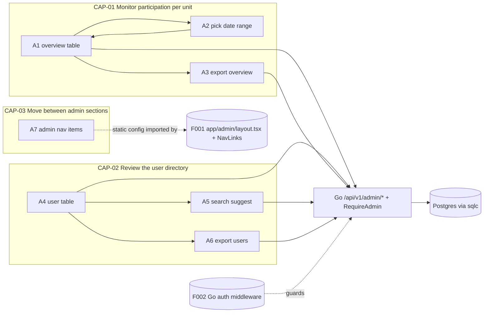
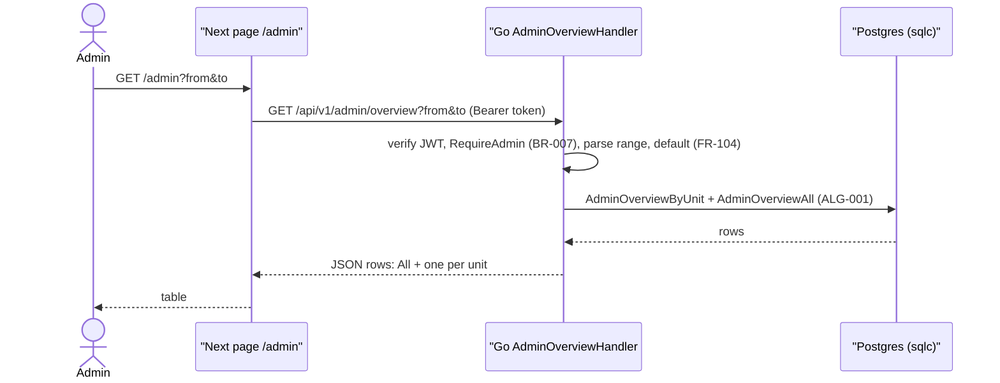
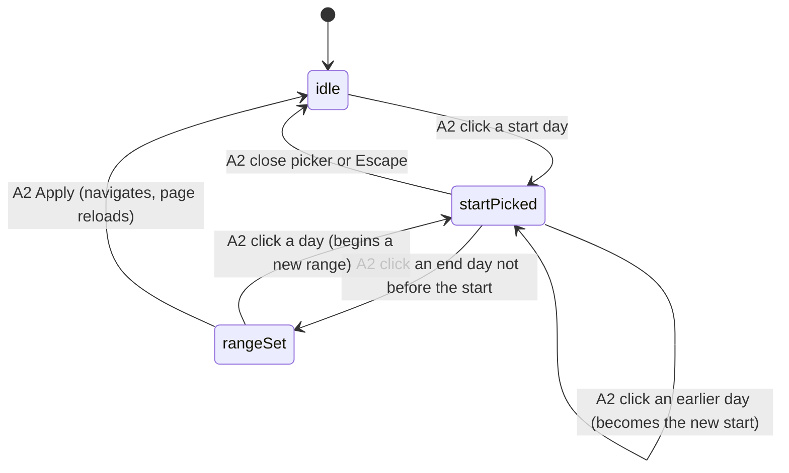

# F010_AdminOverviewUsers — Technical Spec

**Priority**: P3
**Type**: ui
**Generated**: 2026-11-09

**See also:** [`functional-spec.md`](./functional-spec.md) — plain-language overview, open decisions, requirements and business rules in one-liners, screens, user stories, scenarios, edge cases.

**How to read this file:** § 2 is the index — pick an action and read its block in § 3 top to bottom. § 4 is the shared appendix. Everything is a planned design: no code exists yet, so handler names are provisional identities and every `Source` is `TBD (draft)`. Backend paths are in the Go module `backend/` (`backend/cmd/api`, `backend/internal/<domain>`, `backend/db/queries` for sqlc); the Next.js app at the repo root is frontend only.

## 1. Technical Overview

F010 adds two read-only admin pages under the Next.js `/admin` segment — Overview (`/admin`) and User directory (`/admin/users`) — and the admin nav items, exported as a static config that F001's admin layout `app/admin/layout.tsx` imports and renders through F001's client `NavLinks` (Codex R07). All data and both CSV exports come from four Go endpoints in `backend/internal/admin`: `GET /api/v1/admin/overview`, `GET /api/v1/admin/overview/export`, `GET /api/v1/admin/users` and `GET /api/v1/admin/users/export`. They run sqlc-generated aggregate and list queries over `users`, `units`, `kudos`, `secret_boxes` and F008's `kudo_heart_state` view (weighted heart totals); F010 writes no table. Next.js never touches the database: the Server Component pages call Go server-side with the admin's Supabase access token, and the browser calls Go directly with the same token as `Authorization: Bearer` for suggestions and exports, relying on F002's browser transport contract (CORS before auth, `Content-Disposition` exposed, bearer only, no BFF; Codex R06). Every `/api/v1/admin/...` route sits behind F002's Go auth middleware (JWT verified against Supabase JWKS, role loaded from `users.role`, Codex R05) plus an admin-role check that answers HTTP 403 to anyone else (BR-007); the admin layout's Forbidden page in Next.js is convenience, not protection (Codex R07, R18).



## 2. Action Index

| # | Action (handler) | Method · Path | Codes | Writes | Detail |
|---|---|---|---|---|---|
| **A0** | *cross-cutting — belongs to no single action* | — | FR-002, FR-601, BR-007 | — | § 4.4 |
| **A1** | `AdminOverviewHandler#get` (planned) | `GET` `/api/v1/admin/overview?from&to` *(called by Next page `/admin`)* | FR-101, FR-102, FR-103, FR-104, BR-001, BR-002, BR-003, ALG-001, INT-001, US001 | — *(read-only)* | § 3.1 |
| **A2** | `OverviewDateRange#apply` (planned) | `GET` `/admin?from&to` *(client navigation)* | FR-401, BR-006, SM-001, US002 | — *(read-only)* | § 3.1 |
| **A3** | `AdminOverviewHandler#export` (planned) | `GET` `/api/v1/admin/overview/export?from&to` | FR-402, FR-602, BR-001, BR-002, BR-003, BR-004, ALG-001, ALG-002, US003 | — *(read-only)* | § 3.1 |
| **A4** | `AdminUsersHandler#list` (planned) | `GET` `/api/v1/admin/users?unit&level&role&q&page&pageSize` *(called by Next page `/admin/users`)* | FR-201, FR-202, FR-204, FR-205, FR-206, FR-207, BR-005, BR-008, DEC-002, DEC-003, INT-001, US004, US005 | — *(read-only)* | § 3.2 |
| **A5** | `AdminUsersHandler#list` (planned, suggest use) | `GET` `/api/v1/admin/users?q&pageSize=8` *(from the browser)* | FR-203, BR-005, US005 | — *(read-only)* | § 3.2 |
| **A6** | `AdminUsersHandler#export` (planned) | `GET` `/api/v1/admin/users/export?unit&level&role&q` | FR-403, FR-602, BR-004, BR-005, BR-008, ALG-002, US006 | — *(read-only)* | § 3.2 |
| **A7** | `adminNavItems` config (planned) | — *(static config imported by F001's `app/admin/layout.tsx`; targets `/admin`, `/admin/review`, `/admin/users`, `/admin/settings`)* | FR-001, DEC-001, US007 | — *(read-only)* | § 3.3 |

## 3. Actions

### 3.1 CAP-01 — Monitor participation per unit

#### A1 · Show the Overview table for a date range
`GET /api/v1/admin/overview?from&to` → `` `AdminOverviewHandler#get` `` (planned) in `backend/internal/admin`
`FR-101` `FR-102` `FR-103` `FR-104` `US001` · `SCR-admin-overview`

**Who** · signed-in admin (Go `RequireAdmin` middleware answers HTTP 403 to others; the Next admin layout shows the Forbidden page, accepted visually — Codex R18)
**FE** · Next.js Server Component page `/admin?from&to` (`AdminOverviewPage`) under the admin layout calls the Go endpoint server-side with the admin's access token (`cache: 'no-store'`, 5 s `AbortSignal.timeout`, Codex R23) and renders: title "Overview", date range control, Export button, table with columns No, Unit, Total member, Total sent kudos, Total received kudos, Total user have atleast kudos, Total received secret box; first row "All", then one row per unit
**Request** · query `from`, `to` *(`YYYY-MM-DD`, both optional)*; missing or invalid values fall back to the default range `OVERVIEW_DEFAULT_RANGE_DAYS` ending today (FR-104)
**BE** · `AdminOverviewHandler#get` (planned) parses and validates the range in Go (default on missing/invalid, FR-104), calls `AdminReportService.Overview(ctx, from, to)` which runs the sqlc queries `AdminOverviewByUnit` and `AdminOverviewAll` (INT-001, ALG-001) and returns JSON `{ from, to, rows: [All, ...units by name] }`
**Rule** · three counting rules apply, stated in full in § 4.4 and glossed here:
- **BR-001 — Activity counts only inside the chosen days; headcount does not.** Kudos sent/received and secret boxes are counted by their creation/grant date within `from..to` inclusive (report time zone); Total member is today's number of users in the unit whatever the range. *(full block § 4.4 Bin 2)*
- **BR-002 — Spam kudos are not counted.** A kudo with status `spam` (F011) adds nothing to sent, received or active-user counts. *(§ 4.4 Bin 2)*
- **BR-003 — The All row counts each person once.** "All" is computed over all users, not as the sum of the unit rows, so a person is never double counted and users without a unit still appear there. *(§ 4.4 Bin 2)*

**Result** · read-only — no DB write. User sees the table; a unit with no activity shows `0` in each activity column; when there are no units, only the All row shows.
**Source:** TBD (draft)



---

#### A2 · Choose the date range
`GET /admin?from&to` *(client navigation)* → `` `OverviewDateRange#apply` ``
`FR-401` `SM-001` `US002` · `SCR-admin-overview`

**Who** · signed-in admin
**FE** · the range field shows `YYYY-MM-DD → YYYY-MM-DD`; click opens a dropdown of quick ranges (frame "Dropdown chọn thời gian") and a calendar (date picker frames); the admin clicks a start day, then an end day; Apply puts both in the URL
**Request** · none until Apply; then navigation to `/admin?from=…&to=…`
**BE** · none — `OverviewDateRange#apply` (planned) is a client component; the server work is A1 on the new URL (the page re-calls the Go overview endpoint)
**Rule**
- **BR-006 — Start may not be after end.** The picker disables an end day earlier than the chosen start; a hand-edited URL with `from > to` is treated as invalid and falls back to the default range (A1). *(inline — used only here)*

**Result** · read-only — page reloads the table for the new range; the Export button (A3) now uses the same range.
**State** · `SM-001`: `idle` → `startPicked` → `rangeSet` *(§ 4.3)*
**Source:** TBD (draft)

---

#### A3 · Export the Overview table
`GET /api/v1/admin/overview/export?from&to` → `` `AdminOverviewHandler#export` `` (planned) in `backend/internal/admin`
`FR-402` `FR-602` `US003` · `SCR-admin-overview`

**Who** · signed-in admin
**FE** · Export button next to the date range (client component); click fetches the Go endpoint from the browser with the access token as `Authorization: Bearer`, reads the whole body with `response.blob()` and only after the body has fully arrived saves it under the filename read from the `Content-Disposition` response header (readable cross-origin only because F002's CORS policy exposes it, Codex R06); a non-2xx status, a network error or an aborted body (the read rejects) saves nothing and shows the export error with retry (Codex N11); button shows a busy state until the file is saved or the error shows
**Request** · same `from`, `to` as A1 *(the page passes its current range)*
**BE** · `AdminOverviewHandler#export` (planned) sits behind the same `RequireAdmin` middleware (BR-007), calls the same `AdminReportService.Overview` as A1 (INT-001, ALG-001), writes the CSV in Go with ALG-002 (UTF-8 BOM, `encoding/csv`) and returns it as an attachment, following the export streaming contract in ALG-002 (headers only after the first page of rows is read; Codex N11); the export's DB context deadline is 20 s instead of the 5 s request default (Codex R23)
**Rule** · the numbers must equal what A1 shows for the same range, so the same counting rules apply: BR-001 (range inclusive, headcount fixed), BR-002 (spam not counted), BR-003 (All counted once); BR-004 — **cells that start like a spreadsheet formula are neutralised** before the file is written *(§ 4.4 Bin 2)*. FR-602 = formula-neutralisation requirement.
**Result** · read-only — a CSV file `saa-overview-{from}_{to}.csv` with the same columns as the table, All row first. No DB write.
**Source:** TBD (draft)

---

### 3.2 CAP-02 — Review the user directory

#### A4 · Show the user table with filters
`GET /api/v1/admin/users?unit&level&role&q&page&pageSize` → `` `AdminUsersHandler#list` `` (planned) in `backend/internal/admin`
`FR-201` `FR-202` `FR-204` `FR-205` `US004` `US005` · `SCR-admin-users`

**Who** · signed-in admin
**FE** · Next.js Server Component page `/admin/users?unit&level&role&q&page` (`AdminUsersPage`) calls the Go endpoint server-side with the admin's access token (`cache: 'no-store'`, 5 s `AbortSignal.timeout`, Codex R23) and renders page "User": filter dropdowns Unit ("Chọn phòng ban"), Level ("Chọn level"), Role ("Chọn Role"), a search box, Export; table columns ID, User (avatar + name), Email, Σ sent Kudos, Σ received Kudos, Total Heart, Level, Number of Badges, Time to get 6 Badges, Last Logged in, Role, Actions (⋯); pager under the table
**Request** · query `unit` *(unit id)*, `level` *(tier)*, `role` *(`user` | `admin`)*, `q` *(text)*, `page` *(1-based, default 1)*; unknown values are dropped, not errors
**BE** · `AdminUsersHandler#list` (planned) behind `RequireAdmin` validates the params in Go, calls `AdminReportService.Users(ctx, filter, page, pageSize)` which runs sqlc `AdminListUsers` and `AdminCountUsers` (INT-001); filter semantics in BR-005; rows ordered by `name` ascending; response `{ rows, total, page, pageSize }`. Per row: `totalHeart` = sum of F008's `kudo_heart_state` weighted total over the user's received kudos (BR-008); `level` = F008 hero tier; `badges` and `timeToSixBadges` from opened `secret_boxes.icon` (ALG-003); `role` as stored (display only, FR-206)
**Rule**
- **BR-005 — Filters combine with AND; search matches name or email.** Every filter present narrows the list; `q` is a case-insensitive "contains" match on `users.name` or `users.email`; empty or missing filter means no restriction. Export (A6) and suggestions (A5) use the same matching. *(full block § 4.4 Bin 2)*
- **BR-008 — Total Heart is the weighted total.** Each received heart counts with the weight fixed when it was given (`hearts.weight`: campaign multiplier or 1), read through F008's `kudo_heart_state` view; a later campaign deletion leaves it unchanged. *(full block § 4.4 Bin 2)*

| DEC | subtype | Condition | What the user sees | Source |
|---|---|---|---|---|
| **DEC-002** | render | no rows AND at least one filter or search is set | empty state "no user matches" with a Clear filters link | TBD (draft) |
| **DEC-002** | render | no rows AND no filter set | empty state "no users yet" | TBD (draft) |
| **DEC-003** | render | user has collected all 6 badges | "Time to get 6 Badges" shows the elapsed duration | TBD (draft) |
| **DEC-003** | render | user has fewer than 6 badges | "Time to get 6 Badges" shows a dash | TBD (draft) |

**Result** · read-only — no DB write. Sent/received/hearts/badges/level are all-time values (no date range on this page). `Last Logged in` shows `users.last_login_at` or a dash when null. Role is plain text with no edit control (admins are seeded by email, FR-206). Each Actions ⋯ opens the row menu with one item, View profile (FR-205, functional-spec D008).
**Source:** TBD (draft)

---

#### A5 · Suggest users while typing in the search box
`GET /api/v1/admin/users?q&pageSize=8` → `` `AdminUsersHandler#list` `` (planned) in `backend/internal/admin`
`FR-203` `BR-005` `US005` · `SCR-admin-users`

**Who** · signed-in admin
**FE** · search box with a dropdown (frame "Dropdown search user admin") that lists up to `SUGGEST_LIMIT` matching users (avatar, name, email) after `SUGGEST_MIN_CHARS` characters, debounced, fetched from the browser with the access token as `Authorization: Bearer`; picking one sets `q` to that user's email and reloads A4; pressing Enter searches the typed text
**Request** · `q` *(string)*, `pageSize` = `SUGGEST_LIMIT`
**BE** · the same `AdminUsersHandler#list` (planned) as A4, behind `RequireAdmin` (BR-007), with a small page size — no separate suggest endpoint; the client keeps only `{ id, name, email, avatarUrl }` (INT-001)
**Rule** · matching is BR-005 (name or email contains, case-insensitive); the client sends no request for fewer than `SUGGEST_MIN_CHARS` characters
**Result** · read-only — list of `{ id, name, email, avatar_url }`; no DB write.
**Source:** TBD (draft)

---

#### A6 · Export the filtered user list
`GET /api/v1/admin/users/export?unit&level&role&q` → `` `AdminUsersHandler#export` `` (planned) in `backend/internal/admin`
`FR-403` `US006` · `SCR-admin-users`

**Who** · signed-in admin
**FE** · Export button on the filter bar; fetches the Go endpoint from the browser with the access token as `Authorization: Bearer`, reads the whole body with `response.blob()` and only after the body has fully arrived saves it under the filename read from the `Content-Disposition` response header (exposed by F002's CORS policy, Codex R06) — a file for the filters currently applied (not just the visible page); an aborted or failed download saves nothing and offers retry (Codex N11)
**Request** · same filter params as A4, no `page`
**BE** · `AdminUsersHandler#export` (planned) behind `RequireAdmin` (BR-007) calls `AdminReportService.Users` with the BR-005 filters and no paging (sqlc `AdminListUsers` with no limit, INT-001), and streams the CSV in Go with ALG-002 as rows are read, under the 20 s export DB deadline (Codex R23): status, headers and the first bytes are written only after the first page of rows is read successfully; a failure before that → 500 JSON; a failure after streaming started aborts the connection (Codex N11)
**Rule** · BR-005 — same filter semantics as A4, so the file matches the on-screen list; BR-004 — **name, email and unit text cells that start like a formula are neutralised** *(§ 4.4 Bin 2)*
**Result** · read-only — CSV `saa-users-{YYYY-MM-DD}.csv`, same columns as the table minus Actions. No DB write.
**Source:** TBD (draft)

---

### 3.3 CAP-03 — Move between admin sections

#### A7 · Supply the admin header navigation
`` `adminNavItems` `` (planned static config)
`FR-001` `DEC-001` `US007` · `SCR-admin-overview` · `SCR-admin-users`

**Who** · signed-in admin on any `/admin/*` page
**FE** · header shows logo with the word "ADMIN", nav items Overview / Review content / User / Settings, then bell, language control, avatar (F001 pieces); the item matching the current page is highlighted
**BE** · `adminNavItems` (planned) is a static array `{ href, labelKey, match }[]` exported by F010 and imported by F001's admin layout `app/admin/layout.tsx`, which passes it to F001's client `NavLinks`; `NavLinks` reads `usePathname()` and applies DEC-001 to pick the selected item. A layout cannot compute the active item itself because it does not re-render on navigation and cannot read the pathname (`node_modules/next/dist/docs/01-app/03-api-reference/03-file-conventions/layout.md`; Codex R07). The targets are F010's own pages and the F011 and F012 pages
**Rule**

| DEC | subtype | Condition | What the user sees | Source |
|---|---|---|---|---|
| **DEC-001** | render | path is `/admin` | Overview highlighted | TBD (draft) |
| **DEC-001** | render | path starts with `/admin/review` | Review content highlighted | TBD (draft) |
| **DEC-001** | render | path starts with `/admin/users` | User highlighted | TBD (draft) |
| **DEC-001** | render | path starts with `/admin/settings` | Settings highlighted | TBD (draft) |

**Result** · read-only — no DB write; clicking an item is plain navigation. Until F011/F012 ship their routes, their items lead to the 404 page (F001 A8).
**Source:** TBD (draft)

---

### 3.4 Edge cases

| Action | Scenario | Behavior |
|---|---|---|
| A1 · A3 | Range covers days with no kudos | All counts `0`; table still lists every unit |
| A1 | `from`/`to` missing, malformed or `from > to` | Default range applied; no error shown (BR-006) |
| A1 · A3 | A user has no unit (`unit_id` null) | Counted in the All row only; no row of their own (functional-spec D003) |
| A1 | Admin opens `/admin` with a user-role session | The admin layout reads `role` from Go `GET /api/v1/me` and renders the Forbidden page (F001 A9) instead of the page, so no admin query is sent; acceptance is visual (Codex R07, R18) |
| A1 · A3 · A4 · A5 · A6 | Direct request to a `/api/v1/admin/...` URL by a non-admin | Go middleware refuses (BR-007): 401 without a valid token, HTTP 403 for a user-role token; no file or list returned |
| A3 · A6 | Export read fails or runs past 20 s before the first page of rows is read | Go cancels the DB context and returns 500 with a short JSON error; no header or CSV byte has been written; UI shows the export error with retry (Codex R23, N11) |
| A3 · A6 | Export read fails or the 20 s deadline hits after streaming started (some rows already sent) | Go aborts the connection (`panic(http.ErrAbortHandler)`): no trailer, no closing chunk, never a normal end that would look like success; the browser's body read rejects, nothing is saved and the UI shows the export error with retry (Codex N11) |
| A3 · A6 | Export called from a browser origin not in `FRONTEND_ORIGINS` | Browser blocks the call (no CORS headers); no file (Codex R06) |
| A4 | `page` beyond the last page | Clamp to the last page |
| A4 | Name or email contains `%`, `_`, quotes | Treated as plain text in search (parameterised query, wildcard characters escaped) |
| A4 | Heavy filter on a large user set | Server-side paging keeps the response to one page; export streams all matches (§ 5.3 item 3) |
| A6 | Name starts with `=`, `+`, `-`, `@` | Cell prefixed with `'` (BR-004) |
| A2 | Admin picks only a start day and closes the picker | Nothing applied; previous range stays (`SM-001` returns to `idle`) |
| A1 · A4 | Query fails (database down, Go error) | Go returns 500; page shows an inline error with a Retry; no partial table |
| A4 · A6 | User received hearts during a campaign that was later deleted | Total Heart keeps those hearts at their stored weight (`hearts.campaign_id` set null, weight unchanged) |

## 4. Shared Foundation

### 4.1 Components

| Component | Responsibility | Used in | File |
|---|---|---|---|
| `AdminOverviewPage` | Next Server Component: parse range, call Go overview endpoint, render table | A1 | TBD (draft) |
| `OverviewTable` | stats table with All row first | A1 | TBD (draft) |
| `DateRangePicker` | range field, quick-range dropdown, calendar, Apply | A2 | TBD (draft) |
| `ExportButton` | client `fetch` of a Go export endpoint with Bearer token; reads the full body as a blob and saves it (filename from the exposed `Content-Disposition` header) only after the body completes; non-2xx, network error or aborted body → no save, error with retry (Codex N11); busy state | A3, A6 | TBD (draft) |
| `AdminUsersPage` | Next Server Component: parse filters, call Go users endpoint, render table | A4 | TBD (draft) |
| `UserFilterBar` | Unit / Level / Role dropdowns, search box, Export | A4, A5 | TBD (draft) |
| `UserSearchBox` | debounced suggest dropdown calling the Go users endpoint | A5 | TBD (draft) |
| `UsersTable` + `UserRowMenu` | table, ⋯ menu (View profile), empty/error states | A4 | TBD (draft) |
| `Pager` | page links with clamp | A4 | TBD (draft) |
| `adminNavItems` | static nav config (href, label key, match rule) imported by F001's `app/admin/layout.tsx` and rendered by F001's client `NavLinks` | A7 | TBD (draft) |
| `AdminOverviewHandler`, `AdminUsersHandler` (Go) | HTTP handlers in `backend/internal/admin`, registered on the stdlib `net/http` ServeMux under `/api/v1/admin/` | A1, A3, A4, A5, A6 | TBD (draft) |
| `AdminReportService` (Go) | overview and user-list reads; calls sqlc queries | A1, A3, A4, A5, A6 | TBD (draft) |
| `RequireAdmin` middleware (Go, from F002) | role check on every `/api/v1/admin/...` route | A1, A3, A4, A5, A6 | TBD (draft) |
| `backend/db/queries/admin_reports.sql` | sqlc queries `AdminOverviewByUnit`, `AdminOverviewAll`, `AdminListUsers`, `AdminCountUsers` | A1, A3, A4, A5, A6 | TBD (draft) |
| CSV writer (Go) | ALG-002 | A3, A6 | TBD (draft) |

### 4.2 Data Model

#### Key Entities

| Entity | Table | Key Columns | Purpose |
|--------|-------|-------------|---------|
| users | `users` | `id`, `email`, `name`, `avatar_url`, `role` (`user` \| `admin`), `unit_id`, `last_login_at` *(owned by F002; read only)* | rows of the directory; headcount per unit; role filter |
| units | `units` | `id`, `name`, `code` *(owned by F002; read only; Codex R15)* | Overview rows; Unit filter list |
| kudos | `kudos` | `id`, `sender_id`, `receiver_id`, `status` (`public` \| `spam`), `created_at` *(owned by F005; status written by F011; read only)* | sent/received counts; counted regardless of `is_anonymous` — admin sees counts per person |
| heart totals | `kudo_heart_state` *(SQL view over `hearts.weight`, owned by F008; read only)* | `kudo_id`, `heart_total` | Total Heart per user = sum over the user's received public kudos (BR-008; same figure as F007 "hearts received") |
| secret_boxes | `secret_boxes` | `user_id`, `earned_at`, `opened_at`, `icon` (one of 6, null while unopened) *(owned by F008; read only)* | Total received secret box (by `earned_at`); distinct opened icons for badge count and time to 6 (ALG-003) |
| hero tier | derived by F008's shared query (distinct senders of public kudos received → New, Rising, Super, Legend) | tier per user | Level column and Level filter |

F010 adds no table, column or Postgres function. It adds sqlc queries in `backend/db/queries/admin_reports.sql` (INT-001) and, if the plan shows slow scans, indexes on `kudos(created_at)`, `kudos(sender_id)`, `kudos(receiver_id)` via a Supabase CLI migration `[EXPECTED]`.

#### Polymorphic Behavior

N/A — no discriminator codes allocated yet (draft). `users.role` (`user` | `admin`) and the hero tier (F008) will be registered as discriminators at reconcile; F010 only filters by them.

### 4.3 State Management

### The date range picker moves from idle to picking an end day to a complete range (SM-001)
**kind:** ui
**Linked FR:** FR-401
**Source:** TBD (draft)



**Action transitions:** guard and side effect for each edge live in the **Rule**/**Result** rungs of A2 (§ 3.1). The applied range lives in the URL (`from`, `to`), not in client state; filters on the users page live in the URL too.

### 4.4 Shared Rules

#### Bin 2 — used by ≥2 named actions

**BR-001 — Activity counts only inside the chosen days; headcount does not.**
Used in: **A1** · **A3**. Sent kudos, received kudos, users with at least one kudo and secret boxes are filtered by their date (`kudos.created_at`, secret-box grant date) within `from..to`, both days inclusive, in the report time zone; Total member is the current user count of the unit.
**Source:** TBD (draft)
```text
window = [start_of_day(from, REPORT_TIMEZONE), start_of_day(to + 1 day, REPORT_TIMEZONE))
activity rows: where event_time >= window.start and event_time < window.end
total_member: count(users where unit_id = unit)   # no window
```

**BR-002 — Spam kudos are not counted.**
Used in: **A1** · **A3**. A kudo with `status = 'spam'` is excluded from sent, received and active-user counts.
**Source:** TBD (draft)
```text
where kudos.status <> 'spam'
```

**BR-003 — The All row counts each person once.**
Used in: **A1** · **A3**. All is computed over every user (including users with no unit) with distinct counting; it is not the sum of the unit rows.
**Source:** TBD (draft)
```text
all.total_member  = count(distinct users.id)
all.users_active  = count(distinct user in any counted kudo as sender or receiver)
```

**BR-004 — Cells that start like a spreadsheet formula are neutralised in exports.**
Used in: **A3** · **A6**. Text cells (unit name, user name, email) whose first character is `=`, `+`, `-`, `@`, tab or carriage return are written with a leading `'` so a spreadsheet shows them as text; numbers generated by the system are never altered.
**Source:** TBD (draft)
```text
if cell[0] in "=+-@\t\r": cell = "'" + cell
```

**BR-005 — Filters combine with AND; search matches name or email.**
Used in: **A4** · **A5** · **A6**. Present filters (unit, level, role) all must match; `q` is a case-insensitive "contains" on `users.name` or `users.email` with `%`/`_` escaped; an absent filter does not restrict.
**Source:** TBD (draft)
```text
where (unit is null or users.unit_id = unit)
  and (level is null or tier(users) = level)
  and (role is null or users.role = role)
  and (q is null or name ilike '%'||esc(q)||'%' or email ilike '%'||esc(q)||'%')
```

**BR-008 — Total Heart is the weighted total.**
Used in: **A4** · **A6**. Total Heart sums F008's `kudo_heart_state` weighted total over the kudos the user received; each heart keeps the weight fixed when it was given, so deleting a campaign (`hearts.campaign_id` set null) does not change it.
**Source:** TBD (draft)
```text
total_heart(u) = sum(kudo_heart_state.heart_total for kudos where receiver_id = u and status = 'public')
```

#### Bin 3 — cross-cutting, belongs to no single action

**A0 · BR-007 · FR-601 — Every admin read path checks the admin role by itself.**
Every `/api/v1/admin/...` route is registered behind F002's CORS middleware, then F002's Go auth middleware (JWT verified against Supabase JWKS; role loaded from `users.role` on each request, Codex R05) and `RequireAdmin` (no or invalid token → 401; role `user` → HTTP 403). Role comes from the database, never from request input; admins exist only by email seeding (no role endpoint). The Next.js admin layout's Forbidden page is convenience; the Go check is the protection (Codex R07). The `security definer` functions of the earlier draft are dropped.
**Source:** TBD (draft)

**A0 · FR-002 — All admin page text comes from the VN/EN dictionaries.** Labels, column headers, empty and error messages reuse F001's dictionary mechanism; column header text such as "Total user have atleast kudos" is a copy decision (functional-spec D007).
**Source:** TBD (draft)

### 4.5 Algorithms & Integrations

### Overview rows are produced by one grouped aggregation plus one distinct "All" pass (ALG-001)
**Linked FR:** FR-102
**Used in:** A1, A3
**Source:** TBD (draft)
**Input:** `from`, `to` · **Output:** rows `{ unit_id, unit_name, total_member, sent, received, users_with_kudo, secret_boxes }`, All first · **Complexity:** O(users + kudos in window)
**Description:** counts per unit by joining kudos to the sender's and receiver's unit; a user is "with kudo" when they sent or received at least one counted kudo in the window; the All row repeats the logic without grouping so users are counted once and users without unit are included.

**Pseudocode:**
```text
k = kudos where created_at in window and status <> 'spam'            # BR-001, BR-002
per_unit.sent      = count(k) group by sender.unit_id
per_unit.received  = count(k) group by receiver.unit_id
per_unit.active    = count(distinct u) for u in senders(k) U receivers(k) group by u.unit_id
per_unit.boxes     = count(secret_boxes granted in window) group by owner.unit_id
per_unit.members   = count(users) group by unit_id
all = same five measures without grouping, distinct over users        # BR-003
return [all] + per_unit joined to units order by units.name           # units with no rows -> zeros
```

### A CSV file is built with a header row, escaped cells and a UTF-8 byte-order mark (ALG-002)
**Linked FR:** FR-402
**Used in:** A3, A6
**Source:** TBD (draft)
**Input:** column headers, a row iterator read page by page · **Output:** a streamed CSV response · **Complexity:** O(rows)
**Description:** the byte-order mark lets Excel read Vietnamese text correctly; fields containing comma, quote or newline are wrapped in quotes with inner quotes doubled; BR-004 runs on text cells first; response headers set `Content-Type: text/csv; charset=utf-8` and a `Content-Disposition` attachment filename.

**Export streaming contract (Codex N11):** nothing is written to the response — not the status, headers or BOM — until the first page of rows has been read successfully (for A3 the aggregated overview is that first page). A read error or deadline before that point returns 500 with a short JSON error. Once the status and headers are sent the status can no longer change, so a later read error or deadline aborts the connection instead (`panic(http.ErrAbortHandler)` in the handler, which `net/http` treats as an abort): no trailer, no partial "success". The browser saves a file only after the whole body has arrived (A3/A6 FE).

**Pseudocode:**
```text
first, err = rows.nextPage()                      # read before writing anything
if err: return 500 json { error }                 # pre-stream failure (Codex N11)
set headers (text/csv, attachment filename); write status 200
write BOM + join(headers, ",") + "\r\n"
page = first
loop:
    for row in page:
        cells = [ quote_if_needed(neutralise(text) or number) for each column ]   # BR-004
        write join(cells, ",") + "\r\n"
    page, err = rows.nextPage()
    if err: abort connection (panic http.ErrAbortHandler)   # late failure (Codex N11)
    if page is empty: break
end response normally
```

### Number of Badges and Time to get 6 Badges come from opened box icons (ALG-003)
**Linked FR:** FR-207
**Used in:** A4, A6
**Source:** TBD (draft)
**Input:** the user's opened `secret_boxes` rows · **Output:** `badges` (0-6), `timeToSixBadges` (duration or null) · **Complexity:** O(boxes of the user)
**Description:** each opened box holds exactly one of six icons drawn with equal odds, repeats allowed (F008), so badges count distinct icons; the sixth badge arrives at the latest of the per-icon first-open times.

**Pseudocode:**
```text
opened = secret_boxes where user_id = u and opened_at is not null
first_by_icon = min(opened_at) group by icon
badges = count(first_by_icon)                                   # 0..6
time_to_six = badges = 6 ? max(first_by_icon) - min(opened.opened_at) : null   # dash when null
```

### The admin endpoints read data through Go services and sqlc queries (INT-001)
**Linked FR:** FR-601
**Used in:** A1, A3, A4, A5, A6
**Source:** TBD (draft)
**Type:** internal-service
**Target:** `AdminReportService` in `backend/internal/admin` → sqlc queries `AdminOverviewByUnit`, `AdminOverviewAll`, `AdminListUsers`, `AdminCountUsers` (`backend/db/queries/admin_reports.sql`) over pgx; heart totals and hero tier reuse F008's shared queries / `kudo_heart_state` view
**Payload:** typed, validated parameters only; no SQL built from strings; browser roles have no table grants (RLS deny-all)
**Failure handling:** `RequireAdmin` refuses non-admins before any query (BR-007); every query runs under the per-request DB deadline (5 s for A1/A4/A5, 20 s for the A3/A6 exports, Codex R23); a query error or deadline returns 500 with a short JSON error; the page shows an inline error with Retry; export returns 500 JSON when the read fails before the first page of rows is read (nothing written yet), and aborts the connection when a read fails after streaming started; in both cases the browser saves no file (Codex N11, ALG-002).

### 4.6 Configuration

```text
REPORT_TIMEZONE            = Asia/Ho_Chi_Minh   # AD10; day boundaries for BR-001
OVERVIEW_DEFAULT_RANGE_DAYS = 30                # AD10; last 30 days ending today (FR-104)
USERS_PAGE_SIZE            = 20                 # AD10
SUGGEST_MIN_CHARS          = 2                  # proposed
SUGGEST_LIMIT              = 8                  # proposed
SUGGEST_DEBOUNCE_MS        = 250                # proposed
EXPORT_FORMAT              = csv (UTF-8 + BOM)  # written in Go; XLSX not planned (functional-spec D004)
DB_REQUEST_TIMEOUT         = 5 s                # A1, A4, A5 (F002 server default, Codex R23)
EXPORT_DB_TIMEOUT          = 20 s               # A3, A6 (Codex R23)
```

**Client behavior:** see behavior-logic.md, permissions.md, architecture.md

## 5. Verification & Technical Notes

### 5.1 Technical Verification

- **SC-001** *(A1, A3)* seed two units and a few kudos, one spam: overview shows spam excluded, All equals distinct people, an empty unit shows zeros (covers FR-101, FR-102, FR-103, BR-002, BR-003)
- **SC-002** *(A1, A2, A3)* pick a range whose edge days hold kudos: both edge days counted; exported CSV numbers equal the table (covers FR-401, FR-402, BR-001, BR-006)
- **SC-003** *(A4, A5, A6)* filter unit + role + `q`: table, suggestions and export all return the same set (covers FR-202, FR-203, FR-403, BR-005)
- **SC-004** *(A1, A3, A4, A5, A6)* user-role token and no token calling each `/api/v1/admin/...` endpoint directly: HTTP 403 and 401, no data; the `/admin` and `/admin/users` pages for a user-role session show the Forbidden page (visual check only, Codex R18) (covers FR-601, BR-007)
- **SC-008** *(A3, A6)* from the frontend origin against a separate Go origin, both exports download with the server's filename read from `Content-Disposition` (Codex R06)
- **SC-007** *(A4, A6)* a receiver with one weight-1 and one weight-2 heart shows Total Heart 3, unchanged after the campaign is deleted; a user with 7 opened boxes and 5 distinct icons shows 5 badges and a dash (covers FR-207, BR-008, ALG-003)
- **SC-005** *(A3, A6)* a name starting with `=` is exported with a leading `'`; the file starts with the UTF-8 BOM (covers FR-602, BR-004)
- **SC-006** *(A7)* each admin path highlights exactly one nav item (covers FR-001, DEC-001)
- **SC-009** *(A3, A6)* late export failure: with a user set larger than one read page, inject a read error (or let the 20 s deadline hit) after several rows have been streamed — the connection is aborted with no normal end, the browser saves no file (no truncated CSV in downloads), the export error shows with retry, and a retry with the fault removed downloads the complete file; a failure before the first page is read returns 500 JSON with no CSV byte (Codex N11)

#### US001 *(A1)*

**Independent Test:** with seeded data, open `/admin` as an admin and compare each cell with a hand count.

**Acceptance Scenarios:**

1. **Given** two units with kudos in the last 30 days, **When** the admin opens `/admin`, **Then** the first row is All and each unit row shows its own counts.
2. **Given** a user-role session, **When** `/admin` is requested, **Then** the Forbidden page appears (visual acceptance; status code not asserted, Codex R18).

#### US004 *(A4)*

**Independent Test:** open `/admin/users` as an admin; apply Unit and Role filters; compare the rows with the database.

**Acceptance Scenarios:**

1. **Given** 45 users, **When** the admin opens `/admin/users`, **Then** the first 20 show ordered by name with a pager for three pages.
2. **Given** a user with 6 badges, **When** the row renders, **Then** "Time to get 6 Badges" shows a duration; other rows show a dash.

### 5.2 Assumptions

- *(A1, A4)* Next routes are `/admin` and `/admin/users`; Review content and Settings routes are F011's and F012's (`/admin/review`, `/admin/settings`).
- *(A0)* F002 provides the Go auth middleware and `RequireAdmin`; admins are seeded by email (no role-management endpoint); the user table name follows F002 (`users` here).
- *(A1)* Page `searchParams` follow the installed Next 16 docs `[UNVERIFIED]` — re-read `node_modules/next/dist/docs` before building. Next.js has no route handlers here; exports are Go endpoints.
- *(A4)* Level is the F008 hero tier (New, Rising, Super, Legend), derived by F008's shared query; Number of Badges is the count of distinct opened icons (0-6) (functional-spec D005).
- *(A1)* Event data volume is in the low thousands of users; one grouped query per request needs no cache or materialised view (no Redis; responses `no-store`).
- *(A0)* The `units` table exists and is seeded by F002; F010 does not create or edit units.

### 5.3 Unresolved Questions

1. **Counting definitions** *(A1, A3)* — closed: spam excluded, "with kudo" = sent or received, Total member = current headcount, All includes users without a unit (functional-spec D002, D003; AD10).
2. **Source of Level and badges** *(A4, A6)* — closed: Level from F008's derived hero tier query; badges and time to 6 from opened `secret_boxes.icon` (ALG-003; G09).
3. **Export size** *(A6)* — closed: stream the full match set without a cap at current scale (AD10); headers only after the first page is read, late failure aborts the connection, browser saves only a complete body (Codex N11).
4. **Total Heart meaning** *(A4)* — closed: weighted total from `kudo_heart_state` (G08, X02).
5. **Admin data protection** *(A0)* — closed: Go `RequireAdmin` middleware replaces `security definer` functions; browser roles have no table grants (G17, G18).

### 5.4 Source References

No source code written yet — see `## 7. User Stories` in functional-spec.md for planned behavior.

#### Data Flow

```text
GET /admin?from&to (Next page) -> GET /api/v1/admin/overview?from&to (Bearer) -> Go auth + RequireAdmin -> parse range (default 30 days) -> AdminReportService.Overview -> sqlc AdminOverviewByUnit/All [ALG-001] -> JSON rows (All + units) -> table
GET /admin/users?... (Next page) -> GET /api/v1/admin/users?... (Bearer) -> RequireAdmin -> AdminReportService.Users -> sqlc AdminListUsers/AdminCountUsers [BR-005, BR-008, ALG-003] -> one page + total -> table + pager
browser Export -> GET /api/v1/admin/overview/export | /api/v1/admin/users/export (Bearer) -> CORS (F002) -> RequireAdmin -> same service, no paging, 20 s DB deadline -> read first page (fail -> 500 JSON) -> headers + Go CSV writer streams [ALG-002, BOM] (late fail -> connection abort) -> browser reads full body as blob -> save only on complete body (abort/non-2xx -> error + retry, Codex N11)
/admin/* -> F001 app/admin/layout.tsx: GET /api/v1/me (no-store) -> admin: admin chrome + adminNavItems via client NavLinks | else: Forbidden page (minimal chrome)
browser suggest -> GET /api/v1/admin/users?q&pageSize=8 (Bearer) -> RequireAdmin -> AdminListUsers -> [{id,name,email,avatarUrl}]
```

### 5.5 Artifact References

| Artifact | File | Codes Used | Reviewed |
|----------|------|------------|----------|
| Feature List | [feature-list.md](../feature-list.md) | F010 | [x] |
| Codex resolution contract | [codex-findings-resolution-contract.md](../../reports/codex-findings-resolution-contract.md) | R05, R06, R07, R15, R17, R18, R23, N11 | [x] |
| System Overview | TBD (draft) | — | [ ] |
| Architecture | TBD (draft) | — | [ ] |
| API Map | TBD (draft) | — | [ ] |
| Entities | TBD (draft) | — | [ ] |
| Screens | TBD (draft) | — | [ ] |
| Behavior Logic | TBD (draft) | — | [ ] |
| Permissions Matrix | TBD (draft) | — | [ ] |
| User Stories | TBD (draft) | — | [ ] |
