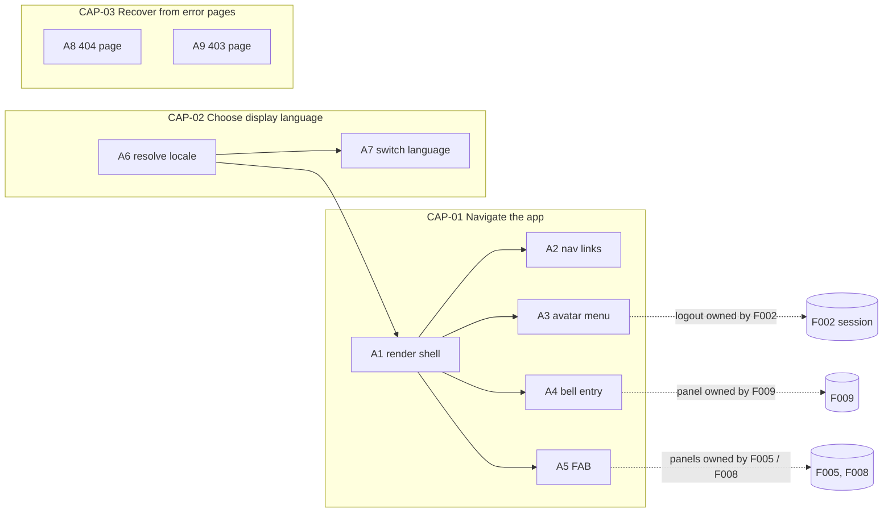
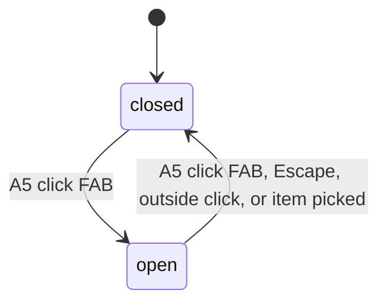

# F001_AppShellI18n — Technical Spec

**Priority**: P0
**Type**: ui
**Generated**: 2026-11-09

**See also:** [`functional-spec.md`](./functional-spec.md) — plain-language overview, open decisions, requirements and business rules in one-liners, screens, user stories, scenarios, edge cases.

**How to read this file:** § 2 is the index — pick an action and read its block in § 3 top to bottom. § 4 is the shared appendix. Everything is a planned design: no code exists yet, so handler names are provisional identities and every `Source` is `TBD (draft)`.

## 1. Technical Overview

F001 is the shared frame of the SAA 2025 web app and lives entirely in the Next.js 16 frontend (G16). It owns the App Router layout tree (Codex R07), built on the installed guides: layouts are reused and do not re-render on navigation, cannot read the pathname, and cannot see the child segments below them (`node_modules/next/dist/docs/01-app/03-api-reference/03-file-conventions/layout.md`, "Layouts do not re-render…" and "Accessing child segments"); route groups `(name)` organise routes without changing the URL and let some segments share a layout while others stay out (`.../03-file-conventions/route-groups.md`, "Use cases"). Navigating across *multiple root layouts* forces a full page load, so the app keeps **one** root layout and puts the chrome in nested layouts; countdown → `/` therefore stays a client navigation.

| Layout file | Contents | Routes |
|---|---|---|
| `app/layout.tsx` (root) | `<html lang>` / `<body>`, fonts, locale provider (A6) only — no chrome, no `/me` call | everything |
| `app/(shell)/layout.tsx` | full chrome: header, footer, FAB; server-side `GET /api/v1/me` with `cache: 'no-store'` | Homepage, Awards, Kudos, Community Standards, profiles, … |
| `app/(minimal)/layout.tsx` | minimal chrome: language switch + copyright | Login |
| `app/countdown/` | no layout of its own: bare page under the root layout | `/countdown` |
| `app/admin/layout.tsx` | admin chrome (admin header with F010's nav config, bell, language, avatar); server-side `GET /api/v1/me` with `cache: 'no-store'`; non-admin → plain Forbidden page with minimal chrome (F002 A7, AD15) | `/admin/*` |
| `app/not-found.tsx` | 404 content wrapped in the same minimal chrome component | unmatched URLs |

Active-link highlighting is done by a client `NavLinks` component using `usePathname()` (layout.md, "Accessing child segments" / active nav links example). The client header re-fetches `/me` on window focus so the avatar, name and Admin item follow role changes without a reload; every admin API call is still enforced by Go `RequireAdmin` (F002). F001 also owns the VN/EN JSON dictionaries (no i18n library), the Tailwind v4 design-token base, and the 403/404 error pages (AD01). It has no Go endpoint and no table of its own and never touches the database: the language choice lives in a cookie (D001), and name, avatar and role come only from Go (`users.role`, Codex R05). F001 adds nothing to `proxy.ts` — that file only routes (F002 sign-in redirect, F003 launch gate); locale is resolved in the root layout. It exposes mount points (bell, FAB items, admin nav config) that F005, F008, F009 and F010 fill. Release acceptance is desktop only, minimum viewport width 1280 px (Codex R17).



## 2. Action Index

| # | Action (handler) | Method · Path | Codes | Writes | Detail |
|---|---|---|---|---|---|
| **A0** | *cross-cutting — belongs to no single action* | — | FR-001, FR-002 | — | § 4.4 |
| **A1** | `ShellLayout#render` · `MinimalLayout#render` · `AdminLayout#render` (planned) | `GET` `any page route` *(nested layouts under one root layout)* | FR-003, FR-004, FR-602, DEC-002 | — *(read-only)* | § 3.1 |
| **A2** | `NavLinks#navigate` (planned, client) | `GET` `Home · Awards · Kudos · Community Standards routes` | FR-101, FR-102, FR-103, US001 | — *(read-only)* | § 3.1 |
| **A3** | `AvatarMenu#open` (planned) | `GET` `Profile · Admin routes` (Logout → F002) | FR-201, FR-601, BR-002, DEC-001, US002 | — *(read-only)* | § 3.1 |
| **A4** | `NotificationBell#open` (planned) | — *(client toggle; panel route owned by F009)* | FR-202, US003 | — *(read-only)* | § 3.1 |
| **A5** | `FloatingActionButton#toggle` (planned) | — *(client toggle)* | FR-104, SM-001, US004 | — *(read-only)* | § 3.1 |
| **A6** | `LocaleResolver#resolve` (planned) *(background, no FE)* | root-layout (`app/layout.tsx`) step before render *(not in `proxy.ts`)* | FR-401, BR-001, BR-003, US005 | — *(read-only)* | § 3.2 |
| **A7** | `LocaleSwitcher#select` (planned) | — *(client: set locale cookie, `router.refresh()`)* | FR-203, FR-401, US005 | — *(cookie only)* | § 3.2 |
| **A8** | `NotFoundPage#render` (planned) | `GET` `any unmatched route` | FR-402, US006 | — *(read-only)* | § 3.3 |
| **A9** | `ForbiddenPage#render` (planned) | `GET` `any admin route whose role check fails (F002 A7, rendered by app/admin/layout.tsx)` | FR-403, US007 | — *(read-only)* | § 3.3 |

## 3. Actions

### 3.1 CAP-01 — Navigate the app

#### A1 · Render the shared shell around a page
`GET any page route` → `` `ShellLayout#render` `` · `` `MinimalLayout#render` `` · `` `AdminLayout#render` `` (planned)
`FR-003` `FR-602` `DEC-002` · `SCR-app-shell`

**Who** · every visitor; the chrome depends on which route group the page lives in *(§ 3.1 DEC-002)*
**FE** · the variant is chosen by file placement, not by a runtime check in the root layout (Codex R07): the root layout `app/layout.tsx` renders only `<html lang>`/`<body>`, fonts and the locale provider; `app/(shell)/layout.tsx` adds header, footer and FAB; `app/(minimal)/layout.tsx` adds the language switch and copyright; `app/countdown/` sits under the root layout alone; `app/admin/layout.tsx` adds the admin chrome. Header and footer are Server Components; `NavLinks`, avatar menu, bell, FAB and the `/me` focus refresh are client islands.
**Request** · locale from A6; in `(shell)` and admin layouts only, a session summary `{ signedIn, role, displayName, avatarUrl }` built from Go `GET /api/v1/me` → `` `MeHandler#get` `` (planned, F002, `backend/internal/auth`), called server-side with the Supabase access token from the session cookie as `Authorization: Bearer`, `cache: 'no-store'` and a 5 s `AbortSignal.timeout` (Codex R23); no session cookie → no call, `signedIn = false`. The client header re-fetches `/me` on window `focus` and updates avatar, name and the Admin item (Codex R07).
**BE** · each layout is a Next.js Server Component that loads the JSON dictionary for the locale and, for `(shell)`/admin, passes the session summary to the header. It reads no table. `/me` outcomes: 200 → signed-in chrome; 401 → treated as signed out; 403 `profile_not_provisioned` → F002's missing-profile recovery (provision once, Codex R22); if that fails the layout renders only the client `ProfileRecoveryRedirect` (no header, footer or children), which awaits browser Supabase `signOut()` and then `location.replace('/login?error=profile_unavailable')` — the layout itself never sets or deletes cookies, because Next.js does not allow cookie writes during Server Component rendering (`node_modules/next/dist/docs/01-app/03-api-reference/04-functions/cookies.md`, lines 71–83; Codex N06); 5xx or timeout → `error` state of SCR-app-shell (links and language only).
**Rule** · decides which chrome each route class gets (FR-003 shell variants; FR-602 hides the avatar menu and bell when there is no session):

| DEC | subtype | Condition | What the user sees | Source |
|---|---|---|---|---|
| **DEC-002** | render | route in `(minimal)` (Login) | minimal chrome: language switch + copyright only | TBD (draft) |
| **DEC-002** | render | route is `/countdown` | bare page: no header, no footer, no FAB | TBD (draft) |
| **DEC-002** | render | route in `(shell)` with a session | full chrome: header, footer, FAB | TBD (draft) |
| **DEC-002** | render | route under `/admin` with admin role | admin chrome with F010's nav config | TBD (draft) |
| **DEC-002** | render | 403 or 404 page | minimal chrome, with or without a session (Codex R07; replaces the earlier D003 split) | TBD (draft) |

**Result** · read-only — no DB write; the page body renders inside its group's chrome. Because there is one root layout, moving between groups (for example countdown → `/`) is a client navigation, not a full page load (route-groups.md, "Caveats").
**Source:** TBD (draft)

<!-- No diagram: below threshold — read-only, no table write, synchronous. -->

---

#### A2 · Follow a header or footer navigation link
`GET Home · Awards · Kudos · Community Standards routes` → `` `NavLinks#navigate` ``
`FR-101` `FR-102` `FR-103` `US001` · `SCR-app-shell`

**Who** · signed-in Sunner or admin
**FE** · header nav links About SAA 2025 / Awards Information / Sun* Kudos, logo link, footer links Home / Awards / Kudos / Community Standards; the link matching the current route carries the selected style (FR-101 active state). `NavLinks` is a Client Component (`'use client'`) that reads `usePathname()` and marks the matching item with the selected style and `aria-current="page"`; a layout cannot do this because it does not re-render on navigation and has no pathname (layout.md, Codex R07). The same component renders the admin items from F010's static config inside `app/admin/layout.tsx`.
**Request** · client-side link navigation to the target route
**BE** · `NavLinks#navigate` (planned) is a pure link set taking an items array; targets are the Homepage, Awards Information, Kudos live board and Community Standards routes owned by F004 and F006
**Rule** · the logo (FR-103) always goes to Homepage; the footer (FR-102) repeats the same destinations plus Community Standards and shows the copyright line; route protection is F002's, so a link to a page the visitor may not open lands on the 403 page (A9)
**Result** · read-only — no DB write; the browser moves to the target route.
**Source:** TBD (draft)

---

#### A3 · Open the avatar menu
`GET Profile · Admin routes` → `` `AvatarMenu#open` ``
`FR-201` `FR-601` `BR-002` `DEC-001` `US002` · `SCR-app-shell`

**Who** · signed-in Sunner; admin sees one extra item
**FE** · avatar button in the header opens a dropdown; closes on outside click, Escape, or item pick
**Request** · none on open; role comes from the session summary (A1), i.e. from `users.role` as returned by Go `GET /api/v1/me`, refreshed on window focus (Codex R05, R07)
**BE** · `AvatarMenu#open` (planned) builds the item list from the role
**Rule**
- **BR-002 — The Admin item is a convenience, not a gate.** Hiding it from non-admins is cosmetic; the real block is in Go (F002 `RequireAdmin` on `/api/v1/admin/...`) and the admin layout's role check (a pasted admin URL still ends on the 403 page).

| DEC | subtype | Condition | What the user sees | Source |
|---|---|---|---|---|
| **DEC-001** | render | role is user | items: Profile, Logout | TBD (draft) |
| **DEC-001** | render | role is admin | items: Profile, Admin, Logout | TBD (draft) |

**Result** · read-only — no DB write on this action; Profile goes to the own-profile route (F007), Admin to the admin overview (F010), Logout invokes F002's sign-out (Supabase browser client `signOut`, then Login).
**Source:** TBD (draft)

---

#### A4 · Open the notification panel from the bell
`` `NotificationBell#open` ``
`FR-202` `US003` · `SCR-app-shell`

**Who** · signed-in Sunner
**FE** · bell button in the header with an unread-dot slot; click calls the panel opener exposed by F009
**BE** · `NotificationBell#open` (planned) only toggles F009's panel; unread count and list are F009's data, served by Go under `/api/v1/...` (F009)
**Result** · read-only — no DB write; until F009 ships the bell renders without a dot and opens nothing.
**Source:** TBD (draft)

---

#### A5 · Toggle the floating action button
`` `FloatingActionButton#toggle` ``
`FR-104` `SM-001` `US004` · `SCR-app-shell`

**Who** · signed-in Sunner on any full-shell page
**FE** · fixed-position FAB bottom-right; closed state shows one button, open state shows two items: Thể lệ (rules) and Viết KUDOS (write kudo)
**BE** · `FloatingActionButton#toggle` (planned) is client state only; item clicks call the openers exposed by F008 (rules panel) and F005 (write-kudo modal)
**Rule** · open/close follows the state machine in § 4.3; picking an item closes the FAB and hands focus to the opened panel
**Result** · read-only — no DB write.
**State** · `SM-001`: `closed` → `open` *(§ 4.3)*
**Source:** TBD (draft)

---

### 3.2 CAP-02 — Choose display language

#### A6 · Resolve the request locale *(background, no FE)*
`per-request step` → `` `LocaleResolver#resolve` ``
`FR-401` `BR-001` `BR-003` `US005` · `SCR-app-shell`

**Who** · *no human actor — runs on every page render, inside the root layout `app/layout.tsx`, which feeds the locale provider and `<html lang>` for every route group (A1)*
**Request** · *no body* — reads the locale cookie, then the `Accept-Language` header, through the Next.js request APIs
**BE** · `LocaleResolver#resolve` (planned) is a Next.js server helper (no Go call, not part of `proxy.ts`); returns `vi` or `en`
**Rule**
- **BR-001 — The saved choice wins, then the browser, then Vietnamese.** Order: locale cookie → `Accept-Language` first match → default `vi`.
- **BR-003 — Only the two supported languages are accepted.** A cookie or header value outside `vi`/`en` is ignored and resolution moves to the next source.

**Result** · read-only — selected locale handed to A1 and to the `<html lang>` attribute.
**Source:** TBD (draft)

---

#### A7 · Switch language from the header
client-side cookie write → `` `LocaleSwitcher#select` ``
`FR-203` `FR-401` `US005` · `SCR-app-shell`

**Who** · any visitor, including the Login page
**FE** · language control (Client Component) shows current code (VN / EN) with flag; click opens a two-item dropdown; picking an item closes it, writes the locale cookie and calls `router.refresh()` so Server Components re-render in the new language
**Request** · value `locale` *(`vi` | `en`)*
**BE** · none — no Server Action, no Next route handler, no Go endpoint (G16 keeps business data in Go; the locale is a browser preference, not business data). `LocaleSwitcher#select` (planned) validates against the allowlist (BR-003) before writing.
**Rule** · **D005 — No switching while the write-kudo form is open.** The control is disabled while F005's write-kudo modal is open (F005 exposes an "open" flag through the shell's mount point), so a refresh can never discard typed text.
**Result** · writes the locale cookie only (no table); every following render resolves to the chosen language through A6. Cookie lifetime and name: § 4.6.
**Source:** TBD (draft)

---

### 3.3 CAP-03 — Recover from not-found and forbidden pages

#### A8 · Show the 404 page
`GET any unmatched route` → `` `NotFoundPage#render` ``
`FR-402` `US006` · `SCR-error-not-found`

**Who** · any visitor
**FE** · localized "page not found" message with a button back to Homepage
**BE** · the root `app/not-found.tsx` (handles every unmatched URL, per `node_modules/next/dist/docs/01-app/03-api-reference/03-file-conventions/not-found.md`) renders `NotFoundPage#render` (planned) wrapped in the minimal chrome component (language switch + copyright), with or without a session; it makes no `/me` call (Codex R07)
**Result** · read-only — no DB write. Next returns status 404 when the not-found UI is decided before streaming starts (not-found.md); acceptance checks the page visually.
**Source:** TBD (draft)

---

#### A9 · Show the 403 page
`GET any admin route whose role check fails` → `` `ForbiddenPage#render` ``
`FR-403` `US007` · `SCR-error-forbidden`

**Who** · signed-in Sunner without the required role
**FE** · localized "you do not have access" message with a button back to Homepage
**BE** · `ForbiddenPage#render` (planned) is a plain component (AD15) that `app/admin/layout.tsx` renders inside the minimal chrome, instead of the admin chrome and children, when Go `GET /api/v1/me` returns `role` ≠ `admin`; a Client Component that gets HTTP 403 from a Go `/api/v1/admin/...` call shows the same component. F001 only renders the page, F002 and Go decide when. `forbidden()` and `experimental.authInterrupts` are not used (Codex R18).
**Result** · read-only — no DB write. Acceptance for this page is visual only; the document's HTTP status code is not asserted. HTTP 403 acceptance belongs to the Go admin endpoints (Codex R18).
**Source:** TBD (draft)

---

### 3.4 Edge cases

| Action | Scenario | Behavior |
|---|---|---|
| A1 | Session expires while the page is open | Header keeps last rendered state; next navigation hits the `proxy.ts` sign-in redirect (F002) and lands on Login |
| A1 | Go `GET /api/v1/me` fails or exceeds the 5 s timeout (Codex R23) | Shell renders the `error` state: links and language control only, no avatar or bell; page content is unaffected |
| A1 | Go `GET /api/v1/me` answers 403 `profile_not_provisioned` | F002 missing-profile recovery: one `POST /api/v1/me/provision`; success → retry; failure → the layout renders `ProfileRecoveryRedirect` (no chrome), which awaits browser `signOut()` then `location.replace('/login?error=profile_unavailable')`, which `proxy.ts` does not bounce back (Codex R22, N06); no Next route handler is added |
| A1 · A3 | Role changed while the tab stays open | Next window focus re-fetches `/me` and the Admin item appears or disappears; admin data was already guarded by Go on every call (Codex R07) |
| A1 | Window narrower than 1280 px | Desktop layout kept; page scrolls horizontally (Codex R17) |
| A1 · A6 | Cookie holds an unsupported locale | Ignored (BR-003); falls through to browser language, then `vi` |
| A3 | Non-admin opens an admin URL directly | Admin item absent (DEC-001); `app/admin/layout.tsx` renders the Forbidden page (A9, visual acceptance); Go answers HTTP 403 to any admin data call (Codex R18) |
| A5 | FAB open and user presses Escape or clicks elsewhere | FAB closes (`SM-001` open → closed) |
| A7 | Write-kudo modal is open | Language control is disabled until the modal closes (D005), so no typed text is lost |
| A2 | Link target belongs to a feature not yet shipped | Route resolves to 404 (A8) until the feature ships |
| A1-A9 | Dictionary key missing in the active language | Falls back to `vi` text for that key; never renders the raw key |

## 4. Shared Foundation

### 4.1 Components

| Component | Responsibility | Used in | File |
|---|---|---|---|
| `RootLayout` (`app/layout.tsx`) | `<html lang>`/`<body>`, fonts, locale provider only; no chrome, no `/me` call (Codex R07) | A1, A6 | TBD (draft) |
| `ShellLayout` (`app/(shell)/layout.tsx`) | full chrome; server-side Go `GET /api/v1/me` (`no-store`, 5 s timeout) → session summary | A1 | TBD (draft) |
| `MinimalLayout` (`app/(minimal)/layout.tsx`) + `MinimalChrome` | language switch + copyright; `MinimalChrome` is reused by `app/not-found.tsx` and by the admin layout's Forbidden branch | A1, A8, A9 | TBD (draft) |
| `AdminLayout` (`app/admin/layout.tsx`, gate logic owned by F002 A7) | admin chrome; server-side Go `GET /api/v1/me` (`no-store`); imports F010's static admin nav config; non-admin → `MinimalChrome` + `ForbiddenPage` | A1, A9 | TBD (draft) |
| `Header` / `NavLinks` | logo, nav links, right-side controls; `NavLinks` is a client component using `usePathname()` for the active item and takes an items array (shell items or F010's admin items) | A1, A2 | TBD (draft) |
| `MeRefresher` | client island in the header: re-fetches Go `GET /api/v1/me` with the browser access token on window `focus` and updates avatar, name, Admin item | A1, A3 | TBD (draft) |
| `LocaleSwitcher` | language control + dropdown | A7 | TBD (draft) |
| `AvatarMenu` | role-based dropdown | A3 | TBD (draft) |
| `NotificationBell` | bell + unread-dot slot | A4 | TBD (draft) |
| `Footer` | link row + copyright | A1, A2 | TBD (draft) |
| `FloatingActionButton` | closed/open FAB, item slots | A5 | TBD (draft) |
| `NotFoundPage` / `ForbiddenPage` | error pages | A8, A9 | TBD (draft) |
| dictionary module (`vi.json`, `en.json`) | one JSON dictionary per locale, `vi` is the key master; lookup with `vi` fallback; no i18n library (AD01) | A0, A1-A9 | TBD (draft) |
| design-token base (Tailwind v4 theme block) | colors, fonts, spacing, radius tokens | A0 | TBD (draft) |

### 4.2 Data Model

#### Key Entities

| Entity | Table | Key Columns | Purpose |
|--------|-------|-------------|---------|
| user profile | `users` | `role`, `name`, `avatar_url` *(owned by F002; never read directly — reached only through Go `GET /api/v1/me`)* | decides Admin menu item (A3) and header avatar; F001 adds no column, the language stays cookie-only (D001) |

#### Polymorphic Behavior

N/A — no discriminator fields in Key Entities.

### 4.3 State Management

### Floating action button is either closed or open (SM-001)
**kind:** ui
**Linked FR:** FR-104
**Source:** TBD (draft)



**Action transitions:** guard and side effect for each edge live in the **Result**/**Rule** rung of A5 (§ 3.1). Locale is not a state machine: it is a cookie read on each render (A6).

### 4.4 Shared Rules

#### Bin 3 — cross-cutting, belongs to no single action

**A0 · FR-001 — one design-token base serves every page.** Colors, typography, spacing, radius live once in the Tailwind v4 theme block; no page hard-codes a hex value. Exact token values come from the Figma file per screen (not readable yet).
**Source:** TBD (draft)

**A0 · FR-002 — all chrome text comes from the VN/EN JSON dictionaries.** No shell string is hard-coded in a component; other features reuse the same dictionary mechanism for their own copy. Missing key falls back to `vi`. Text stored by users (kudo bodies, names) is not translated.
**Source:** TBD (draft)

### 4.5 Algorithms & Integrations

None.

### 4.6 Configuration

```text
SUPPORTED_LOCALES    = vi, en          # allowlist for BR-003
DEFAULT_LOCALE       = vi              # last fallback in BR-001
LOCALE_COOKIE_NAME   = saa_locale      # proposed name
LOCALE_COOKIE_MAXAGE = 1 year          # written by the browser (A7), so not httpOnly; holds no secret; SameSite=Lax
API_BASE_URL         = (env)           # Go API base URL used by the (shell) and admin layouts for GET /api/v1/me (shared with F002)
NEXT_PUBLIC_API_BASE_URL = (env)       # Go API base URL for the client /me focus refresh (shared with F002)
ME_FETCH_TIMEOUT     = 5 s             # AbortSignal.timeout on the server-side /me call (Codex R23)
MIN_VIEWPORT_WIDTH   = 1280 px         # release acceptance; narrower windows scroll horizontally (Codex R17)
```

**Client behavior:** see behavior-logic.md, permissions.md, architecture.md

## 5. Verification & Technical Notes

### 5.1 Technical Verification

- **SC-001** *(A6, A7)* choosing EN, reloading, and opening another page keeps EN (covers FR-401, BR-001)
- **SC-002** *(A6)* a cookie value `xx` is ignored and the page renders in `vi` or the browser language (covers BR-003)
- **SC-003** *(A3)* admin session shows Admin item, user session does not (covers DEC-001, FR-601)
- **SC-004** *(A1)* Countdown renders without header/footer; Login renders language switch + copyright only; navigating countdown → `/` is a client navigation (no full reload) (covers DEC-002, FR-003; Codex R07)
- **SC-005** *(A8, A9)* unknown URL shows the 404 page, rejected admin URL shows the Forbidden page, both localized and in minimal chrome — visual checks only; the Forbidden document's status code is not asserted (covers FR-402, FR-403; Codex R18)
- **SC-006** *(A1)* with Go `GET /api/v1/me` returning 401 the header shows no avatar or bell; with it failing or stalling past 5 s the shell shows links and language only; with 403 `profile_not_provisioned` and a failing re-provision the user ends on `/login?error=profile_unavailable` without a bounce; on a direct full-page load of a shell page in that state the response renders only `ProfileRecoveryRedirect` (no header/footer), the Supabase session cookies are cleared in the browser, and reloading the Login URL keeps Login with no redirect to Home (covers FR-602; Codex R22, R23, N06)
- **SC-007** *(A7)* while the write-kudo modal is open the language control is disabled (covers D005)
- **SC-008** *(A1, A2, A3)* on each of Homepage, Awards and Kudos exactly one header link is selected after client navigation; promoting/demoting a test account's `users.role` and refocusing the tab adds/removes the Admin item without a reload (covers FR-101, FR-601; Codex R07)
- **SC-009** *(A1)* at 1280 px wide every page fits without a horizontal scrollbar; at 1024 px the desktop layout is kept and the page scrolls horizontally (Codex R17)

#### US005 *(A6, A7)*

**Independent Test:** switch language on the Login page, sign in, observe language is kept.

**Acceptance Scenarios:**

1. **Given** Vietnamese is active, **When** the visitor picks EN in the header, **Then** the page re-renders in English and the language control shows EN.
2. **Given** EN was chosen earlier, **When** the visitor returns in a new tab, **Then** the page opens in English.

### 5.2 Assumptions

- *(A6, A7)* Language preference lives in a cookie only (D001); no URL locale prefix, so routes stay `/kudos`, `/awards` as in SCREENFLOW; `proxy.ts` does not touch the locale.
- *(A1)* F002's Go endpoint `GET /api/v1/me` returns `{ id, email, name, avatarUrl, role, unit: { id, name, code } | null }` (Codex R15); F001 maps it to the session summary and never queries Supabase tables or Postgres itself.
- *(A1, A2)* Layout behaviour is taken from the installed guides, read before writing this spec: `node_modules/next/dist/docs/01-app/03-api-reference/03-file-conventions/layout.md` (layouts do not re-render and do not access pathname; layouts cannot access child segments; active links via `usePathname` in a Client Component; multiple root layouts cause a full page load) and `.../route-groups.md` (groups do not affect the URL; opt segments into a shared layout; full-page-load caveat applies only to multiple root layouts) (Codex R07).
- *(A8)* The root `app/not-found.tsx` handles unmatched URLs (`.../03-file-conventions/not-found.md`); the 403 page is a plain component (AD15, § 5.3).
- *(A0)* Two languages only; JSON dictionaries in the repo are enough, no i18n library (AD01).

### 5.3 Unresolved Questions

1. ~~**403 mechanism** *(A9)*~~ — closed (applied default AD15): Next 16 `forbidden()` needs the experimental `authInterrupts` flag (verified in the bundled docs, see `reports/shared-spec-context-for-wave-2.md`), so the 403 page is a plain page component that the admin layout `app/admin/layout.tsx` (gate owned by F002) renders after Go `GET /api/v1/me` returns a non-admin role; Go's `RequireAdmin` still returns HTTP 403 on every admin endpoint. The page's own HTTP status is not asserted and `experimental.authInterrupts` stays off (Codex R18).
4. ~~Layout structure~~ *(A1, A2)* — resolved: one root layout plus `(shell)`, `(minimal)`, bare `countdown`, and `admin` layouts; client `NavLinks`; `/me` no-store in `(shell)`/admin layouts plus focus refresh (Codex R07).
5. ~~Viewport scope~~ *(A1)* — resolved: desktop only, minimum 1280 px, horizontal scroll below (AD01, Codex R17).
2. ~~Refresh on language switch~~ *(A7)* — resolved: switching is blocked while the write-kudo form is open (D005, AD01).
3. ~~Dictionary typing~~ *(A0)* — resolved: one JSON dictionary per locale, `vi` as key master, no i18n library (AD01).

### 5.4 Source References

No source code written yet — see `## 7. User Stories` in functional-spec.md for planned behavior.

#### Data Flow

```text
request -> proxy.ts routing only (F003 launch gate, F002 sign-in redirect) -> app/layout.tsx: resolve locale (cookie > Accept-Language > vi), <html lang>, locale provider
        -> (shell) | admin layout: Go GET /api/v1/me (Bearer, no-store, 5 s) -> chrome with JSON dictionary strings
           (minimal) layout / not-found: minimal chrome, no /me call; countdown: no chrome
        -> client NavLinks: usePathname() -> selected item; MeRefresher: window focus -> GET /api/v1/me -> update avatar/Admin item
        -> /me 403 profile_not_provisioned -> provision once -> fail: render ProfileRecoveryRedirect (no chrome) -> await browser signOut() -> location.replace(/login?error=profile_unavailable) (F002, Codex N06)
language pick -> validate against allowlist -> browser writes locale cookie -> router.refresh() -> request flow above
```

### 5.5 Artifact References

| Artifact | File | Codes Used | Reviewed |
|----------|------|------------|----------|
| Feature List | [feature-list.md](../feature-list.md) | F001 | [x] |
| Gap Resolution Log | [gap-resolution-log.md](../gap-resolution-log.md) | AD01, AD15, G16, G17 | [x] |
| Codex resolution contract | [codex-findings-resolution-contract.md](../../reports/codex-findings-resolution-contract.md) | R05, R07, R15, R17, R18, R22, R23, N06 | [x] |
| System Overview | TBD (draft) | — | [ ] |
| Architecture | TBD (draft) | — | [ ] |
| API Map | TBD (draft) | — | [ ] |
| Entities | TBD (draft) | — | [ ] |
| Screens | TBD (draft) | — | [ ] |
| Behavior Logic | TBD (draft) | — | [ ] |
| Permissions Matrix | TBD (draft) | — | [ ] |
| User Stories | TBD (draft) | — | [ ] |
