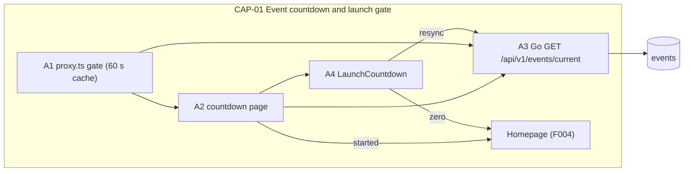
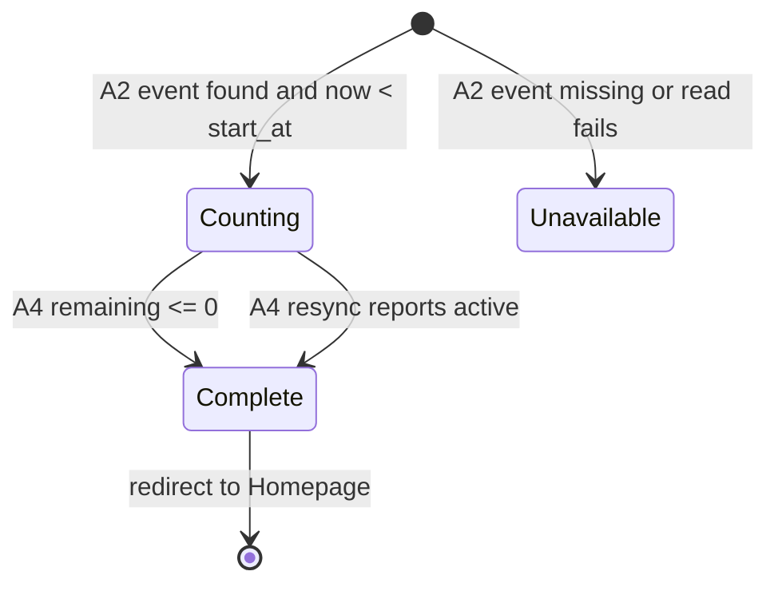

# F003_EventCountdownGate

**Priority**: P1
**Type**: mixed
**Generated**: 2026-11-09

**See also:** [`functional-spec.md`](./functional-spec.md) — plain-language overview, open
decisions, requirements/business rules stated in one-liners, screens, user stories, scenarios,
edge cases, and configuration for a BA/QA audience.

**How to read this file:** § 2 is the index — pick the action you care about and read its block
in § 3 straight through. § 4 is the shared appendix — jump in only when a § 3 block points you there.

## 1. Technical Overview

Before the event start time (`events.start_at`, a seeded row in Supabase Postgres), a request-level launch gate in the Next.js `proxy.ts` redirects every non-exempt page request to a standalone full-screen countdown page; once the start time passes, the countdown page redirects to the Homepage and the gate stands aside. The same row carries `ceremony_at`, which this feature only serves; the Homepage countdown (F004) counts to it. Next.js never touches the database: the event is read only through the public Go endpoint `GET /api/v1/events/current` (no auth), which returns the start time, the ceremony time and the server clock reading. The countdown is computed on the client against that server clock reading so a wrong device clock cannot change the launch moment. Countdown code is split into two modes (Codex R08): this feature owns the shared, pure `CountdownDisplay` component and the `useCountdown(targetIso, serverNowIso)` arithmetic hook, plus the launch-mode wrapper `LaunchCountdown` (target `startAt`, redirects to `/` at 0 ms or when a resync returns `status: "active"`); F004 owns the ceremony-mode wrapper `CeremonyCountdown` (target `ceremonyAt`, never redirects). Subsystems touched: Go backend (`backend/internal/events` handler, service and sqlc query over pgx), Next.js 16 App Router frontend (`proxy.ts` with a 60 s in-process cache and a 1.5 s lookup deadline, one server-rendered page, the shared countdown display/hook and the launch wrapper), Supabase Postgres (one seeded `events` row, deterministic seed scenarios), TailwindCSS v4 (glass-morphism digit boxes).



## 2. Action Index

| # | Action (handler) | Method · Path | Codes | Writes | Detail |
|---|---|---|---|---|---|
| **A0** | *cross-cutting — belongs to no single action* | — | FR-001, FR-002, FR-601 | — | § 4.4 |
| **A1** | `LaunchGate#evaluate` (planned) | `ANY` `/*` (request proxy, non-exempt pages) | FR-101, FR-103, BR-001, DEC-001, DEC-002, DEC-003, US001 | — *(read-only)* | § 3.1 |
| **A2** | `CountdownPage#render` (planned) | `GET` `/countdown` | FR-102, FR-201, FR-203, FR-204, BR-001, BR-003, DEC-004, SM-001, US001, US003 | — *(read-only)* | § 3.1 |
| **A3** | `EventsHandler#getCurrent` (planned) *(Go, `backend/internal/events`)* | `GET` `/api/v1/events/current` | FR-001, FR-402, FR-601, BR-001, BR-003, US002 | — *(read-only)* | § 3.1 |
| **A4** | `LaunchCountdown#tick` (planned) *(client-side, no BE)* | — | FR-202, FR-401, FR-402, FR-403, BR-002, BR-003, ALG-001, SM-001, US002 | — *(read-only)* | § 3.1 |

## 3. Actions

### 3.1 CAP-01 — Event countdown and launch gate

#### A1 · Gate decides where a page request goes
`ANY /*` (non-exempt pages) → `LaunchGate#evaluate` (planned)
`FR-101` `FR-103` `BR-001` `DEC-001` `DEC-002` `DEC-003` `US001` · `SCR-countdown-prelaunch` (draft)

**Who** · any visitor, signed in or not *(gate A0 — § 4.4)*
**FE** · Next.js `proxy.ts` (Next 16 name for middleware; routing only) — runs before any page renders; the visitor only sees the redirect result.
**Request** · incoming page request path *(string)*; no body. Static assets, the countdown page itself, the sign-in page and the Supabase OAuth callback route are excluded by matcher (D002). The Go endpoint lives on the Go service, not on a Next.js path, so it needs no exemption.
**BE** · none in Next.js. `LaunchGate#evaluate` (planned) gets `startAt` and `serverNow` from `EventsApiClient#getCurrent` (planned, § 4.1), which calls the Go endpoint A3 with a `LAUNCH_GATE_LOOKUP_TIMEOUT_MS` (1.5 s) deadline (`AbortSignal.timeout`, Codex R23) and caches a successful result in-process for `LAUNCH_GATE_CACHE_TTL_S` (60 s). It compares `startAt` with the current time (`serverNow` of the last read advanced by the elapsed time) and returns either pass-through or a redirect to `/countdown`.
**Rule** · decides whether the request proceeds or is sent to the countdown. `BR-001` (event counts as launched only when server `now` is at or after `start_at`; before that it is "upcoming") applies *(§ 4.4)*.

| DEC | subtype | Condition | What the user sees | Source |
|---|---|---|---|---|
| **DEC-001** | flow | path is on the exempt list (D002: sign-in page, OAuth callback, assets, the countdown page) | request proceeds untouched even before launch | TBD (draft) |
| **DEC-002** | flow | not exempt AND `now < start_at` | redirected to the countdown page | TBD (draft) |
| **DEC-003** | flow | Go endpoint returns 404 (no event row), an error, or does not answer within 1.5 s (D003: fail open; deadline per Codex R23) | request proceeds as if launched, so a data fault never locks every visitor out; the failure is logged | TBD (draft) |

**Result** · read-only — **no DB write**. Redirect uses a temporary (307) status so browsers never cache the gate decision. The Go response is cached in-process for `LAUNCH_GATE_CACHE_TTL_S` (§ 4.6) so the gate adds no backend round trip to most requests; a failed read is not cached, so the next request retries.
**Source:** TBD (draft)

<!-- No diagram: below threshold — read-only, no table written, synchronous, branching is a 3-row table. -->

---

#### A2 · Countdown page renders, or sends the visitor home
`GET /countdown` → `CountdownPage#render` (planned)
`FR-102` `FR-201` `FR-203` `FR-204` `BR-001` `BR-003` `DEC-004` `SM-001` `US001` `US003` · `SCR-countdown-prelaunch` (draft)

**Who** · any visitor, signed in or not *(gate A0 — § 4.4)*
**FE** · server-rendered page that mounts the client `LaunchCountdown` (planned) with `startAt` and `serverNow`; renders no shared header, footer or navigation (`FR-203`). Layout and elements: `screens/SCR-countdown-prelaunch/spec.md`.
**Request** · no params.
**BE** · none in Next.js. The Server Component calls the Go endpoint A3 server-side through `EventsApiClient#getCurrent` with no caching (`no-store`) and a 5 s timeout (`AbortSignal.timeout`, Codex R23), so `startAt` and `serverNow` are fresh on every render; the Go service is the only database reader.
**Rule** · decides which of three outcomes the visitor gets. `BR-001` (launched only when server `now` >= `start_at`) and `BR-003` (the server clock reading, not the device clock, is the reference for remaining time) apply *(§ 4.4)*.

| DEC | subtype | Condition | What the user sees | Source |
|---|---|---|---|---|
| **DEC-004** | render | event found and `serverNow < start_at` → countdown; event found and `serverNow >= start_at` → redirect to Homepage; Go returns 404, an error, or does not answer within 5 s → "Coming soon" message with no digits (`FR-204`) | countdown page, Homepage, or the Coming soon message respectively | TBD (draft) |

**Result** · read-only — **no DB write**. Response is marked non-cacheable so `serverNow` is always fresh. Initial `SM-001` state is `Counting` or `Unavailable` according to DEC-004 *(§ 4.3)*.
**State** · [UNVERIFIED] `SM-001`: initial state selection not yet confirmed from source *(§ 4.3)*
**Source:** TBD (draft)

<!-- No diagram: below threshold — read-only, single table, synchronous. -->

---

#### A3 · Current event status API (clock resync)
`GET /api/v1/events/current` → `EventsHandler#getCurrent` (planned) *(Go, `backend/internal/events`)*
`FR-001` `FR-402` `FR-601` `BR-001` `BR-003` `US002` · `SCR-countdown-prelaunch` (draft)

**Who** · public — no sign-in, no bearer token. In F002's route-class contract this is the one PUBLIC route: it sits inside the shared CORS middleware that wraps the whole mux, and is registered without the JWT/profile chain (F002 § 4.4 A0, Codex N09) *(gate A0)*. Callers: the Next.js proxy (A1) and countdown page (A2) server-side, `LaunchCountdown` (A4) and F004's `CeremonyCountdown` from the browser on refocus, and the F004 Homepage server-side.
**FE** · called by `LaunchCountdown` (planned) when the browser tab becomes visible again, so a throttled or sleeping tab corrects drift before it renders. F004's `CeremonyCountdown` may call it on refocus too, but uses only `serverNow` and ignores `status` (Codex R08).
**Request** · no params.
**BE** · `EventsHandler#getCurrent` (planned, registered on the stdlib `net/http` ServeMux as `GET /api/v1/events/current`) → `EventService#Current` (planned) → sqlc query `GetCurrentEvent` (planned, `backend/db/queries/events.sql`) over pgx. The service stamps `serverNow` from the Go server clock and derives `status`.
**Rule** · `BR-003` (remaining time is measured from the server clock reading returned here) and `BR-001` (status `upcoming` iff `serverNow < start_at`, else `active`) apply *(§ 4.4)*.
**Result**
- 200 `{ id, name, startAt, ceremonyAt, venue, livestreamNote, serverNow, status: "upcoming" | "active" }` — timestamps ISO 8601 with offset, mapped from `events.start_at` and `events.ceremony_at`; `venue` and `livestreamNote` are the event-info fields F004 reads; `Cache-Control: no-store`.
- 404 when no event row exists (callers treat it per D003: the gate fails open, the countdown page shows "Coming soon").
- 500 on a database error, or when the per-request 5 s database deadline expires (Codex R23); logged in Go; callers treat it like 404.
- No DB write.
**Source:** TBD (draft)

---

#### A4 · Launch countdown counts down and hands over at the start moment
`—` → `LaunchCountdown#tick` (planned) *(client-side, no BE)*
`FR-202` `FR-401` `FR-402` `FR-403` `BR-002` `BR-003` `ALG-001` `SM-001` `US002` · `SCR-countdown-prelaunch` (draft)

**Who** · the visitor's browser *(gate A0)*
**FE** · client wrapper `LaunchCountdown` (launch mode, Codex R08) around the shared pure `CountdownDisplay` (six digit boxes plus DAYS / HOURS / MINUTES labels; an `aria-live="polite"` region announces minute changes). The arithmetic comes from the shared hook `useCountdown(targetIso, serverNowIso)` with `targetIso = startAt`, ticking every `COUNTDOWN_TICK_MS` (§ 4.6). `CountdownDisplay` and `useCountdown` know nothing about redirects or event status; only this wrapper does.
**Request** · props `startAt`, `serverNow`; on mount the hook computes `offsetMs = Date.parse(serverNow) - Date.now()`; on tab re-focus the wrapper calls A3 and feeds the new `serverNow` back into the hook.
**BE** · none — pure client computation using `ALG-001` (splits remaining milliseconds into days, hours, minutes; floors, never rounds up) *(§ 4.5)*.
**Rule** · **BR-002 — only days, hours and minutes are shown, each value rounded down, zero-padded to two digits.** Seconds are never displayed. Redirect is triggered by remaining milliseconds reaching 0 (not by the display reading 00:00:00), see D001; during the last minute the display already reads 00 00 00 while the page stays put. `BR-003` (reference clock is the server reading plus offset) *(§ 4.4)*.
**Result**
- Re-renders digits each tick.
- When remaining reaches 0 ms: `SM-001` moves `Counting` → `Complete` and the wrapper performs `router.replace("/")` (no full reload) to the Homepage.
- If an A3 resync returns `status: "active"`, the wrapper redirects immediately. This status check exists only in launch mode; the ceremony-mode wrapper (F004) never redirects and ignores `status` (Codex R08).
**State** · `SM-001`: `Counting` → `Complete` *(§ 4.3)*
**Source:** TBD (draft)

<!-- No diagram: below threshold — read-only, no table, single client thread; ALG-001 and SM-001 carry the logic. -->

### 3.2 Edge cases

| Action | Scenario | Behavior |
|---|---|---|
| A1 | Event row missing, database unreachable, or Go service down | Fail open per DEC-003 (D003); the proxy logs the error and does not cache the failure. |
| A1 | Go endpoint stalls (accepts the connection, never answers) | The proxy aborts the lookup after 1.5 s and fails open (Codex R23); a stalled call never holds the page request longer than that. |
| A1 | Request lands exactly at `start_at` | `now >= start_at` counts as launched; no redirect. |
| A1 · A2 | Cached `start_at` is stale after an operator changes it in the database | Gate may be wrong for up to `LAUNCH_GATE_CACHE_TTL_S`; A2 always calls Go fresh (`no-store`). |
| A3 | Browser call to the Go endpoint from `LaunchCountdown` or `CeremonyCountdown` | Covered by the shared Go CORS middleware owned by F002 (origins from `FRONTEND_ORIGINS`, runs before auth, Codex R06); this public `GET` sends no bearer token and no credentials. |
| A2 · A4 | Visitor opens the countdown page after the start moment | A2 redirects to Homepage before any markup renders. |
| A4 | Visitor's device clock is wrong by hours | No effect: offset from `serverNow` corrects it (BR-003). |
| A4 | Tab suspended in background, resumes after start | On visibility change A3 is called; `status: "active"` redirects at once. |
| A4 | `start_at` is less than one minute away (e.g. `start_at = now() + 30 s`) | Display reads 00 00 00 and the page stays; the redirect fires only when remaining reaches 0 ms (D001, Codex R16). |
| A2 · A4 | Server time is in `start_at <= now < ceremony_at` | Launch is over: A2 redirects to Homepage; the Homepage's `CeremonyCountdown` (F004) keeps counting to `ceremonyAt` without redirecting (Codex R08). |
| A4 | More than 99 days remain | Days unit widens to three digits (D005). |
| A1-A4 | Unauthenticated access | Allowed; see A0 § 4.4 (FR-601). |

## 4. Shared Foundation

### 4.1 Components

| Component | Responsibility | Used in | File |
|---|---|---|---|
| `LaunchGate` (planned) | Next.js `proxy.ts` function: exemption check + redirect to `/countdown`; composed with the F002 sign-in redirect in the same proxy entry, gate first | A1 | `proxy.ts` (planned) |
| `EventsApiClient` (planned) | Next.js server-side client for Go `GET /api/v1/events/current`; proxy path: 1.5 s deadline, fail open, in-process 60 s cache of successes; page path: `no-store`, 5 s deadline (Codex R23) | A1, A2 | TBD (draft) |
| `CountdownPage` (planned) | Next.js server page `/countdown` | A2 | TBD (draft) |
| `CountdownDisplay` (planned) | Shared pure client component: renders the days / hours / minutes boxes, labels and the polite live region from `{ days, hours, minutes }`; no timers, no redirects, no event status (Codex R08). Reused by F004 | A4, F004 | TBD (draft) |
| `useCountdown` (planned) | Shared client hook `useCountdown(targetIso, serverNowIso)`: server offset, tick every `COUNTDOWN_TICK_MS`, ALG-001 split, `remainingMs`; accepts a refreshed `serverNowIso` on resync; never navigates (Codex R08). Reused by F004 | A4, F004 | TBD (draft) |
| `LaunchCountdown` (planned) | Launch-mode client wrapper: `useCountdown(startAt, serverNow)` + `CountdownDisplay`; refocus resync via A3; `router.replace("/")` at 0 ms or on resync `status: "active"` (Codex R08) | A4 | TBD (draft) |
| `EventsHandler` (planned) | Go HTTP handler `GET /api/v1/events/current`, public | A3 | `backend/internal/events` (planned) |
| `EventService` (planned) | Go service: reads the current event, stamps `serverNow`, derives `status` | A3 | `backend/internal/events` (planned) |
| `GetCurrentEvent` (planned) | sqlc query: the single current `events` row | A3 | `backend/db/queries/events.sql` (planned) |

### 4.2 Data Model

#### Key Entities

| Entity | Table | Key Columns | Purpose |
|--------|-------|-------------|---------|
| Event | `events` | `id`, `name`, `start_at` (timestamptz, not null — site opens; countdown page and gate target), `ceremony_at` (timestamptz, not null — Homepage countdown target, read by F004), `venue` (text), `livestream_note` (text) — the last two are the event-info fields F004 shows | one current row for SAA 2025 |

Access: only the Go backend reads the table, through the sqlc query `GetCurrentEvent` over pgx; browser roles have no table grants and RLS is enabled deny-all as defence in depth. The table comes from a Supabase CLI migration under `supabase/migrations`. No runtime write path and no prelaunch on/off column (D006).

**Seed scenarios (Codex R16).** The event row is written by seed scripts in `backend/db/seeds/`, selected by env `SEED_SCENARIO`; times are relative to the moment the seed runs, so every scenario is reproducible on any date:

| `SEED_SCENARIO` | `start_at` | `ceremony_at` | Demonstrates |
|---|---|---|---|
| `prelaunch` | `now() + 2 days` | `now() + 20 days` | gate redirect, live countdown page (F003) |
| `live` (default) | `now() - 1 day` | `now() + 14 days` | open site, Homepage ceremony countdown running (F004) |
| `after-ceremony` | `now() - 30 days` | `now() - 1 day` | Homepage ceremony countdown stopped at 00 (F004) |

Demo activity seeded with the event (users, kudos, hearts, boxes) is dated within the last 14 days so the admin Overview's last-30-days default shows data. Two test-only setups complement the scenarios: a sub-minute launch boundary (`start_at = now() + 30 s`) and the event-unavailable fallback (no `events` row). The design sample 15 Dec 2025 18:00 Asia/Ho_Chi_Minh (AD03, D009) stays documented as the **production placeholder** value until the real date is given; it is not the development default.

#### Polymorphic Behavior

N/A — no discriminator fields in Key Entities.

### 4.3 State Management

### Countdown page moves from counting to launched, or stays unavailable (SM-001)
**kind:** ui
**Linked FR:** FR-401
**Source:** TBD (draft)



**Action transitions:** the guard and side effect for each edge live in the **State** rung of A2 and A4 (§ 3.1).

### 4.4 Shared Rules

#### Bin 3 — cross-cutting, belongs to no single action

**A0 · FR-001 / FR-002 — one current `events` row exists with timezone-aware `start_at` and `ceremony_at`, seeded at setup.** Prerequisite for every action; created by Supabase migration/seed, not by any runtime action. **Source:** TBD (draft)

**A0 · FR-601 — the countdown page, the gate and the Go events endpoint require no sign-in.** The gate runs before the F002 sign-in redirect and must never bounce an unauthenticated visitor to sign-in ahead of the countdown; `GET /api/v1/events/current` is registered in F002's PUBLIC route class — inside the CORS middleware that wraps the whole mux, outside the JWT/profile chain (Codex N09). **Source:** TBD (draft)

#### Bin 2 — used by ≥2 named actions

**BR-001 — The event counts as launched only when server time is at or after `start_at`.**
Used in: **A1** · **A2** · **A3**. Before that moment status is `upcoming`; the comparison is the single definition of "launched" everywhere. **Source:** TBD (draft)
```text
launched = server_now >= events.start_at
```

**BR-003 — Remaining time is always measured against the server clock, never the device clock.**
Used in: **A2** · **A3** · **A4**. The Go service stamps `serverNow`; the client keeps `offsetMs` and uses `Date.now() + offsetMs`. **Source:** TBD (draft)
```text
offsetMs = Date.parse(serverNow) - Date.now()   # on mount and on each resync
now_effective = Date.now() + offsetMs
```

### 4.5 Algorithms & Integrations

### Remaining time split into days, hours and minutes (ALG-001)
**Linked FR:** FR-202
**Used in:** A4 (launch mode, target `startAt`); F004 ceremony mode (target `ceremonyAt`) through the shared `useCountdown` hook (Codex R08)
**Source:** TBD (draft)
**Input:** `targetMs`, `nowEffectiveMs` · **Output:** `{ days, hours, minutes }` · **Complexity:** O(1)
**Description:** Floors each unit; never negative; seconds are dropped (BR-002). Days is not capped at two digits (D005).

**Pseudocode:**
```text
r = max(0, targetMs - nowEffectiveMs)
days    = floor(r / 86_400_000)
hours   = floor((r % 86_400_000) / 3_600_000)
minutes = floor((r % 3_600_000) / 60_000)
reached_zero = (r == 0)   # the wrapper decides what zero means: launch mode redirects, ceremony mode stops at 00
```

### 4.6 Configuration

```text
LAUNCH_GATE_CACHE_TTL_S = 60     # in-process cache of the Go events response in proxy.ts (A1); trade-off: change lag vs backend calls
COUNTDOWN_TICK_MS = 1000         # tick interval of the shared useCountdown hook (A4, F004)
LAUNCH_GATE_LOOKUP_TIMEOUT_MS = 1500  # proxy.ts deadline for the Go events lookup; on expiry the gate fails open (Codex R23)
EVENTS_FETCH_TIMEOUT_MS = 5000   # Next.js server-side fetches to Go, e.g. the countdown page (A2) (Codex R23)
SEED_SCENARIO = live             # prelaunch | live (default) | after-ceremony; seeds in backend/db/seeds/ (Codex R16)
```

**Client behavior:** see
[`behavior-logic.md`](../../docs/generated/behavior-logic.md) (client-side patterns — debounce, optimistic UI, polling, upload, realtime),
[`permissions.md`](../../docs/system/permissions.md) (feature flags / experiments / env / locale gates),
[`architecture.md`](../../docs/system/architecture.md) (guards / deep-link state restoration / unsaved-changes protection).

## 5. Verification & Technical Notes

### 5.1 Technical Verification

- **SC-001** *(A1)* a non-exempt page request before `start_at` is redirected to the countdown page; the same request at or after `start_at` is not (covers FR-101, BR-001)
- **SC-002** *(A1)* sign-in entry points and assets stay reachable before launch (covers FR-103)
- **SC-003** *(A2)* the countdown page after `start_at` redirects to Homepage and renders no countdown markup (covers FR-102)
- **SC-004** *(A4)* with the device clock shifted, the displayed remaining time still matches server time (covers FR-402, BR-003)
- **SC-005** *(A4)* at remaining <= 0 the browser lands on Homepage without a full page reload (covers FR-403)
- **SC-006** *(A3)* run against the assembled Go router from `backend/cmd/api` (CORS + route-class wiring), not an isolated handler: an unauthenticated `GET /api/v1/events/current` with no `Authorization` header returns 200 with `startAt`, `ceremonyAt` and `serverNow`, and 404 when the row is absent; an allowed-origin browser call gets the CORS headers (covers FR-001, FR-601; Codex N09)
- **SC-007** *(A2, A4)* with `start_at <= now < ceremony_at` (seed `live`), `/countdown` redirects to Homepage and a `LaunchCountdown` resync returning `status: "active"` redirects; the Homepage `CeremonyCountdown` (F004) keeps counting and does not redirect (Codex R08)
- **SC-008** *(A4)* launch zero boundary: with `start_at = now() + 30 s` the display reads 00 00 00 and the page stays until remaining reaches 0 ms, then lands on Homepage (covers D001, Codex R08, R16)
- **SC-009** *(A4)* refocus: hide the tab past `start_at`, show it again — the A3 resync redirects at once; hide and show before `start_at` — digits correct to server time (Codex R08)
- **SC-010** *(A1)* a stalled Go events endpoint (no answer) lets the page load after at most 1.5 s, and the failure is not cached (covers DEC-003, Codex R23)
- **SC-011** *(A1, A2)* event-unavailable fallback: with no `events` row, pages load normally and `/countdown` shows "Coming soon" without digits (covers FR-204, D003, Codex R16)
- **SC-012** *(A1, A2)* seed scenario `prelaunch` gates non-exempt pages and shows a running countdown on any run date (Codex R16)

#### US001 *(A1, A2)*

**Independent Test:** run seed scenario `prelaunch` (`start_at` in the future, Codex R16) and request any protected page URL.

**Acceptance Scenarios:**

1. **Given** `start_at` is in the future, **When** a visitor requests the Homepage, **Then** they receive the countdown page showing days, hours and minutes.
2. **Given** the Go events endpoint fails or returns 404, **When** a visitor requests any page, **Then** the page loads normally (fail open, D003).

#### US002 *(A3, A4)*

**Independent Test:** seed `start_at = now() + 30 s` (sub-minute boundary, Codex R16) or about 2 minutes ahead and keep the countdown page open.

**Acceptance Scenarios:**

1. **Given** the countdown page is open, **When** server time reaches `start_at`, **Then** the browser moves to the Homepage without a full reload.

#### US003 *(A2)*

**Independent Test:** run seed scenario `live` (`start_at` in the past, Codex R16) and open `/countdown` directly.

**Acceptance Scenarios:**

1. **Given** the event has started, **When** a visitor opens the countdown URL, **Then** they land on the Homepage.

### 5.2 Assumptions

- *(A1)* Next.js 16 names the request-interception file `proxy.ts` (formerly `middleware.ts`) and its runtime can make an outbound `fetch` to the Go API and hold a module-level cache; [INFERRED] from release knowledge — confirm against the project's bundled Next.js docs before implementation (see AGENTS.md).
- *(A1)* The F002 sign-in redirect lives in the same proxy entry; ordering is gate first, then sign-in.
- *(A2, A4)* Event start is a single instant (`timestamptz`); display is relative time, so no timezone formatting is needed.
- *(A2)* Release acceptance is desktop only: minimum viewport width 1280 px; narrower windows keep the desktop layout with horizontal scroll (AD01, Codex R17).

### 5.3 Unresolved Questions

1. **Proxy data access** *(A1)*: resolved — the proxy never reads the database; it calls Go `GET /api/v1/events/current` and caches the answer in-process for 60 s (G16, AD13).
2. **Cache scope** *(A1)*: accepted trade-off — the in-process cache is per instance, so on multi-instance hosting each instance may lag a start-time change by up to `LAUNCH_GATE_CACHE_TTL_S`; no shared cache (no Redis, AD13).
3. **Digit font delivery** *(A4)*: preload strategy for the "Digital Numbers" font with `next/font/local` if licensing is confirmed; otherwise the free LED/monospace fallback is used (D008).

### 5.4 Source References

No source code written yet — see `## 7. User Stories` in functional-spec.md for planned behavior and `screens/SCR-countdown-prelaunch/spec.md` for the planned screen.

#### Data Flow

```text
page request -> proxy.ts A1 -> cached (60 s) Go GET /api/v1/events/current (1.5 s deadline) -> now < startAt ? redirect /countdown : pass (error/404/timeout -> pass)
/countdown -> A2 Server Component -> Go GET /api/v1/events/current (no-store, 5 s) -> { startAt, serverNow } props -> A4 LaunchCountdown -> useCountdown(startAt, serverNow) -> ALG-001 -> CountdownDisplay
Go A3: EventsHandler#getCurrent -> EventService#Current -> sqlc GetCurrentEvent (pgx) -> events row + serverNow
remaining reaches 0 ms (or A3 resync status active) -> LaunchCountdown router.replace("/") -> Homepage
```

### 5.5 Artifact References

| Artifact | File | Codes Used | Reviewed |
|----------|------|------------|----------|
| System Overview | TBD (draft) | — | [ ] |
| Architecture | TBD (draft) | — | [ ] |
| Feature List | [feature-list.md](../feature-list.md) | F003 | [x] |
| Codex resolution contract | [codex-findings-resolution-contract.md](../../reports/codex-findings-resolution-contract.md) | N09 | [x] |
| API Map | TBD (draft) | — | [ ] |
| Entities | TBD (draft) | — | [ ] |
| Screens | TBD (draft) | — | [ ] |
| Behavior Logic | TBD (draft) | — | [ ] |
| Permissions Matrix | TBD (draft) | — | [ ] |
| User Stories | TBD (draft) | — | [ ] |
