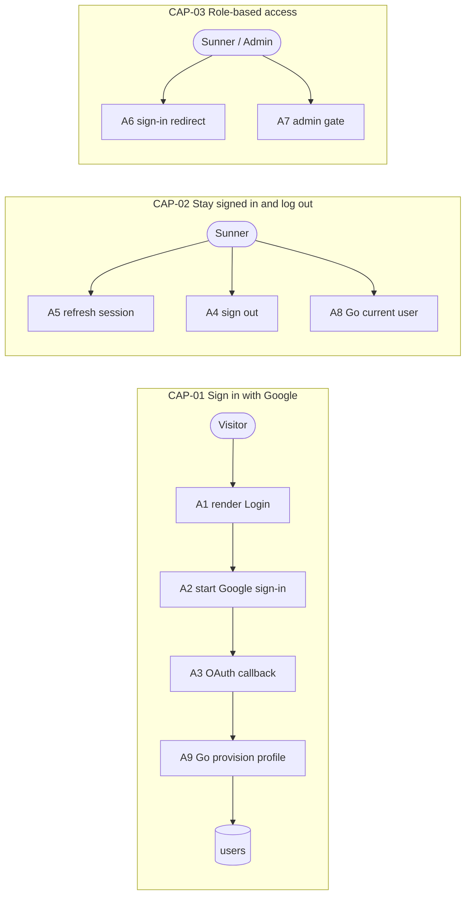
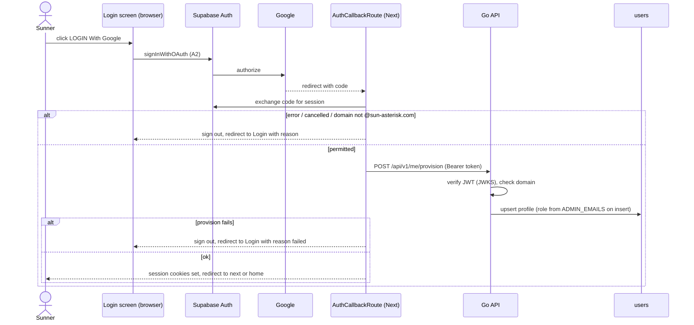
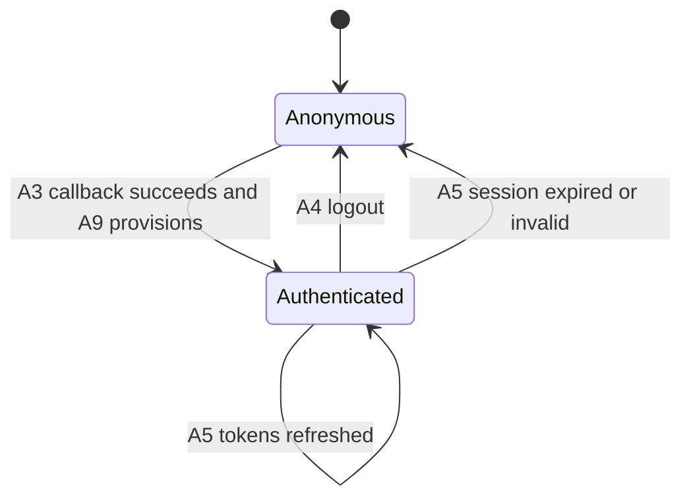

# F002_GoogleAuth — Technical Spec

## 1. Technical Overview

Sunners sign in with Google through Supabase Auth (OAuth, PKCE), driven by the Next.js 16 frontend: the browser starts the flow with the Supabase browser client, and the one Next route handler kept in the app, `/auth/callback`, exchanges the returned code for a cookie-based Supabase session. The callback refuses any email outside `@sun-asterisk.com` (G01) and then calls the Go backend `POST /api/v1/me/provision`, which creates or refreshes the caller's `users` row (G17). Admins are seeded by email: Go gives the admin role to emails on its `ADMIN_EMAILS` list (G02).

One CORS middleware wraps the whole Go mux and runs first, answering browser preflights without a token (Codex R06, § 4.4 Transport). Behind it, every route belongs to exactly one route class (Codex N09, § 4.4 A0): PUBLIC `GET /api/v1/events/current` (F003; no JWT), IDENTITY-ONLY `POST /api/v1/me/provision` (verified JWT, no profile required), PROFILE for every other `/api/v1/*` route (verified JWT + existing profile), and ADMIN for `/api/v1/admin/*` (PROFILE + `RequireAdmin`). The auth middleware in `backend/internal/auth` verifies the Supabase access token (`Authorization: Bearer`) against the Supabase JWKS (asymmetric keys only, Codex R21), refuses non-company emails, and loads `users.role` on every request; `/api/v1/admin/...` additionally requires role `admin` (403 otherwise). `users.role` is the only role source; there is no `profiles` table (Codex R05). Next.js never reads the database: Server Components forward the session's access token to Go, Client Components send it from the browser. There is no BFF (Codex R06). `proxy.ts` only routes — the sign-in redirect (this feature) and the launch-gate redirect (F003). Header/avatar-dropdown UI belongs to F001, the countdown gate to F003; this feature owns identity, session, roles, the Login screen, the browser transport contract (Codex R06) and the auth/database bootstrap contract (Codex R21, § 4.6).



## 2. Action Index

| # | Action (handler) | Method · Path | Codes | Writes | Detail |
|---|---|---|---|---|---|
| **A0** | *cross-cutting — belongs to no single action* | every `/api/v1/...` request: Go CORS middleware, then the route-class chain (PUBLIC · IDENTITY-ONLY · PROFILE · ADMIN; Codex N09) | FR-601, FR-604 | — | § 4.4 |
| **A1** | `LoginPage#render` (planned) | `GET` `/login` *(Next page)* | FR-201, FR-203, US001 | — *(read-only)* | § 3.1 |
| **A2** | `LoginButton#signInWithGoogle` (planned) | — *(browser call to Supabase Auth)* | FR-002, FR-202, FR-605, BR-002, INT-001, US001 | — *(PKCE verifier cookie only)* | § 3.1 |
| **A3** | `AuthCallbackRoute#GET` (planned) | `GET` `/auth/callback` *(the only Next route handler)* | FR-102, FR-203, FR-604, BR-002, BR-003, INT-001, SM-001, US001 | — *(session cookies; profile written by A9)* | § 3.1 ▸ **diagram** |
| **A9** | `MeHandler#provision` (planned) | `POST` `/api/v1/me/provision` *(Go)* | FR-001, FR-401, BR-001, BR-003, US001 | `users` | § 3.1 |
| **A4** | `AvatarMenu#signOut` (planned) | — *(browser call to Supabase Auth)* | FR-104, FR-402, SM-001, US003 | — *(clears session cookies)* | § 3.2 |
| **A5** | `SessionProxy#refreshSession` (planned) | every non-static request *(`proxy.ts`)* | FR-003, FR-403, SM-001, US006 | — *(refreshes session cookies)* | § 3.2 |
| **A8** | `MeHandler#get` (planned) | `GET` `/api/v1/me` *(Go)* | FR-404 | — *(read-only)* | § 3.2 |
| **A6** | `RouteGuard#authorize` (planned) | every non-static request *(`proxy.ts`)* | FR-101, FR-103, FR-602, BR-002, DEC-001, DEC-002, US002 | — *(read-only)* | § 3.3 |
| **A7** | `AdminLayout#requireAdmin` (planned) + `RequireAdmin` middleware (planned) | `GET` `/admin/*` *(Next)* · `/api/v1/admin/...` *(Go)* | FR-603, BR-004, DEC-003, US004, US005 | — *(read-only)* | § 3.3 |

## 3. Actions

### 3.1 CAP-01 — Sign in with Google

#### A1 · Show the Login screen
`GET /login` → `LoginPage#render` (planned)
`FR-201` `FR-203` `US001` · `SCR-login`

**Who** · Sunner who is not signed in
**FE** · Next.js page renders the Login screen (key visual, "LOGIN With Google" button, language switch hosted by F001, footer copyright); shows an error message when the callback sent back a failure reason.
**Request** · query param `error` *(optional, one of a fixed set of reason keys — `cancelled`, `domain_not_allowed`, `failed`, `profile_unavailable` (Codex R22) — never free text)*
**Rule** · decides only which message to show for a given reason key; unknown keys show the generic failure message.
**Result** · read-only — **no DB write**, no backend call.
**Source:** TBD (draft)

<!-- No diagram: below threshold — read-only, no table write, synchronous. A signed-in visitor without an `error` param never reaches this render: A6 (DEC-002) redirects first; with an `error` param the page renders (Codex R22). -->

---

#### A2 · Start Google sign-in
browser → Supabase Auth → `LoginButton#signInWithGoogle` (planned)
`FR-002` `FR-202` `FR-605` `BR-002` `INT-001` `US001` · `SCR-login`

**Who** · Sunner who is not signed in *(public page)*
**FE** · the "LOGIN With Google" button (Client Component) disables itself, shows a loading state and calls the Supabase browser client `signInWithOAuth` with provider `google`, `redirectTo` = `<site origin>/auth/callback?next=<safeNext(next)>` and the Google hint `hd=sun-asterisk.com`; the browser then leaves for Google.
**Request** · `next` *(requested path to return to, taken from the Login URL)*
**BE** · none in Go; Supabase Auth builds the Google authorization URL (INT-001, § 4.5).
**Rule** · **BR-002 — A return path is honoured only when it is an internal path.** `next` goes through `safeNext` before it is put in the redirect target *(§ 4.4)*. The `hd` hint only pre-selects company accounts in Google's chooser; it is not the domain check (that is BR-003 in A3, A9 and A0). **INT-001** is the Supabase-to-Google OAuth handshake *(§ 4.5)*.
**Result** · writes nothing to the database; the Supabase client stores the PKCE code verifier in a short-lived cookie. User sees the Google account chooser.
**Source:** TBD (draft)

<!-- No diagram: below threshold — no table write, one external redirect (the OAuth order is drawn once in A3). -->

---

#### A3 · Complete sign-in at the OAuth callback
`GET /auth/callback` → `AuthCallbackRoute#GET` (planned)
`FR-102` `FR-203` `FR-604` `BR-002` `BR-003` `INT-001` `SM-001` `US001`

**Who** · Sunner returning from Google *(public path)*
**Request** · query params `code` *(one-time authorization code)*, `next` *(optional return path)*, `error` *(set by the provider on cancel/deny)*
**BE** · `AuthCallbackRoute#GET` is a Next.js route handler — the only one kept in the app (G16). It exchanges `code` for a session with the Supabase server client (INT-001), reads the email from the new session, applies BR-003, then calls Go `POST /api/v1/me/provision` (A9) with the new access token as `Authorization: Bearer` and a 5 s timeout (`AbortSignal.timeout(5000)`, Codex R23), then redirects. A timeout counts as a non-2xx answer.
**Rule**
- **BR-003 — Only `@sun-asterisk.com` may sign in.** If the email (lower-cased) does not end with `@sun-asterisk.com`, the callback signs the session out and redirects to `/login?error=domain_not_allowed`; no provision call is made. Go repeats this check in A9 and in A0, so the frontend check is a fast path, not the only guard.
- **BR-002 — Return path must be internal.** `next` is re-validated with `safeNext` before the redirect; invalid falls back to `/`. *(§ 4.4)*
**Result**
- Writes no table itself; the profile row is written by Go in A9.
- Moves the session lifecycle (SM-001: anonymous → authenticated) *(§ 4.3)*; session cookies are set.
- User sees: Homepage via redirect to `safeNext(next)` (F003's launch gate may divert to the countdown), or Login with a reason key on cancel (`cancelled`), domain rejection (`domain_not_allowed`), code-exchange failure or a non-2xx from A9 (`failed`; the session is signed out first).
**Source:** TBD (draft)



---

#### A9 · Create or refresh the caller's profile
`POST /api/v1/me/provision` → `` `MeHandler#provision` `` (planned) in `backend/internal/auth`
`FR-001` `FR-401` `BR-001` `BR-003` `US001`

**Who** · a caller with a valid Supabase access token *(A0 verifies it; this is the one IDENTITY-ONLY route — verified JWT, no existing profile row required; Codex N09)*
**Request** · no body. Identity comes only from the verified token claims: `sub` (auth user id), `email`, the identity provider (`app_metadata.provider`), the verified-email flag (`user_metadata.email_verified`), and `user_metadata` name and avatar URL from Google. *(Claim locations are re-checked against a token from the local Supabase at build.)*
**BE** · `MeHandler#provision` → `ProfileService.Provision` (planned) runs in one Go transaction the sqlc query `UpsertProfileOnSignIn` (planned) over pgx, under the per-request DB deadline of 5 s (Codex R23).
**Rule**
- **BR-003 — Only `@sun-asterisk.com` may sign in.** Provisioning requires all three of: `email_verified = true`, provider `google`, and an email ending with `@sun-asterisk.com` compared case-insensitively (Codex R21). A token failing any of them gets 403 `domain_not_allowed` (the one refusal key for an ineligible identity) and nothing is written.
- **BR-001 — Role on sign-in comes from the seeded admin list, never from the request.** On insert, `role` = `admin` when the lower-cased email is in `ADMIN_EMAILS`, else `user`. On a later sign-in a listed email is promoted to `admin`; sign-in never demotes, so removing an admin means changing the stored role (G02). *(inline — used only here)*
**Result**
- Writes `users` ← insert on first sign-in (`id` = `sub`, `email`, `name`, `avatar_url`, `role`, `unit_id` = null per D003); on later sign-ins updates `name`, `avatar_url`, `last_login_at` and the promote-only role rule. Idempotent: calling twice yields one row.
- Returns 200 with the same body as A8.
**Source:** TBD (draft)

<!-- No diagram: single-row upsert, synchronous; the surrounding flow is drawn in A3. -->

### 3.2 CAP-02 — Stay signed in and log out

#### A4 · Log out
browser → Supabase Auth → `AvatarMenu#signOut` (planned)
`FR-104` `FR-402` `SM-001` `US003`

**Who** · signed-in Sunner or Admin
**FE** · the "Logout" entry of the avatar menu (UI owned by F001) calls the Supabase browser client `signOut` (scope: this browser), which clears the session cookies, then navigates to `/login` with a full reload so no Server Component output stays cached.
**BE** · none in Go; access tokens already issued expire on their own short lifetime.
**Rule** · logout is idempotent: an already-expired session still ends on Login without error.
**Result** · writes nothing to the database. Moves the session lifecycle (SM-001) from authenticated to anonymous *(§ 4.3)*. User sees the Login screen.
**Source:** TBD (draft)

<!-- No diagram: below threshold — no table write, synchronous. -->

---

#### A5 · Refresh the session on each request
every non-static request → `SessionProxy#refreshSession` (planned) in `proxy.ts`
`FR-003` `FR-403` `SM-001` `US006`

**Who** · any visitor; no human trigger *(background step of every request)*
**BE** · inside `proxy.ts`, before the routing decision of A6, the Supabase server client reads the session cookies, verifies the access token locally against the Supabase JWKS, renews it with the refresh token when close to expiry, and writes the renewed cookies onto the response; an invalid or expired session clears the cookies so A6 sees "anonymous". No database access and no Go call — this only keeps the bearer token that Server Components forward to Go valid.
**Rule** · identity is taken only from the verified token, never from a client-supplied field *(see A0 — § 4.4)*.
**Result** · writes nothing to the database. Keeps the session lifecycle (SM-001) in authenticated, or drops it to anonymous on expiry *(§ 4.3)*.
**Source:** TBD (draft)

<!-- Diagram not needed: no table write; the OAuth order is drawn in A3. -->

---

#### A8 · Read the current user
`GET /api/v1/me` → `` `MeHandler#get` `` (planned) in `backend/internal/auth`
`FR-404`

**Who** · signed-in Sunner or Admin *(gate A0)*
**FE** · consumed server-side, with `cache: 'no-store'` and a 5 s timeout (Codex R23), by F001's `app/(shell)/layout.tsx` and by the admin layout `app/admin/layout.tsx` (A7) — not by the root layout (Codex R07); the client header re-fetches it on window focus so role-dependent chrome catches up without a reload (F001 A1). No UI of its own.
**Request** · none; identity comes from the verified token.
**BE** · `MeHandler#get` → sqlc query `GetMe` (planned): the caller's own `users` row joined with its unit (`id`, `name`, `code`; Codex R15).
**Result** · read-only — **no DB write**. 200 `{ id, email, name, avatarUrl, role, unit: { id, name, code } | null }`, `role` read from `users.role` (Codex R05); 401 for a missing or invalid token; 403 `profile_not_provisioned` when the token is valid but no profile row exists — the frontend then runs the missing-profile recovery (§ 4.4, Codex R22).
**Source:** TBD (draft)

---

### 3.3 CAP-03 — Role-based access to pages

#### A6 · Decide whether a request may proceed
every non-static request → `RouteGuard#authorize` (planned) in `proxy.ts`
`FR-101` `FR-103` `FR-602` `BR-002` `DEC-001` `DEC-002` `US002`

**Who** · any visitor *(background step of every request; runs after A5 and after F003's launch-gate redirect)*
**Request** · request path, session state from A5
**BE** · `RouteGuard#authorize` classifies the path as public (`/login`, `/countdown`, `/auth/callback`, static assets) or protected (all others) and chooses a redirect or pass-through. It is routing only: no role check, no Go call, no database.
**Rule** · decides the outcome by path class and session:

| DEC | subtype | Condition | What the user sees | Source |
|---|---|---|---|---|
| **DEC-001** | flow | protected path AND no valid session | redirected to Login, with the requested path kept as the return path (only if it passes **BR-002**: internal paths only) | TBD (draft) |
| **DEC-002** | flow | `/login` AND valid session AND no `error` query param | redirected to Homepage instead of seeing Login again; with an `error` param Login renders, so the missing-profile recovery cannot bounce between Login and Home (Codex R22) | TBD (draft) |

**BR-002** is the internal-path-only rule for return paths *(§ 4.4)*; here it keeps the stored return path from becoming an open redirect. Order inside `proxy.ts`: F003's launch-gate redirect runs first, then A6 — both are plain redirects, so before launch a signed-out visitor on `/` lands on the countdown, which D005 keeps public.
**Result** · read-only — **no DB write**. The role is not decided here; admin access is checked in A7.
**Source:** TBD (draft)

<!-- No diagram: below threshold — the content is a branching table (DEC-001/002), a diagram would be harder to read. -->

---

#### A7 · Admit only admins to `/admin/*`
`GET /admin/*` → `AdminLayout#requireAdmin` (planned) · `/api/v1/admin/...` → `` `RequireAdmin` `` middleware (planned) in `backend/internal/auth`
`FR-603` `BR-004` `DEC-003` `US004` `US005`

**Who** · signed-in Sunner or Admin *(gate A0)*
**FE** · the Next.js admin layout `app/admin/layout.tsx` (Server Component, Codex R07) calls Go `GET /api/v1/me` (A8) with the session's access token, `cache: 'no-store'` and a 5 s timeout, and when `role` ≠ `admin` renders F001's plain Forbidden page with the minimal chrome instead of the admin chrome and children (AD15); otherwise it renders the admin chrome with F010's admin nav config. On 403 `profile_not_provisioned` with a failed re-provision it renders only `ProfileRecoveryRedirect` (§ 4.4, Codex N06). It wraps every admin page (F010–F012). The Forbidden page is accepted visually; its HTTP status code is not asserted, and `experimental.authInterrupts` / `forbidden()` is not enabled (Codex R18).
**BE** · the authoritative check is in Go: `RequireAdmin` wraps every handler under `/api/v1/admin/...` and returns HTTP 403 `forbidden` unless the role loaded by A0 for this request is `admin`. HTTP 403 acceptance applies to these Go endpoints only (Codex R18). The Next layout check only decides which page to render; no admin data is served without the Go check (Codex R07).
**Rule** · **BR-004 — Admin access is decided by the backend from the stored role, on every request.** A0 loads `users.role` per request; no cached or client-sent role is trusted, so a role change takes effect on the next request.

| DEC | subtype | Condition | What the user sees | Source |
|---|---|---|---|---|
| **DEC-003** | render | session valid AND `users.role` ≠ `admin` | the Forbidden page (visual acceptance, Codex R18), not Login and not a redirect loop | TBD (draft) |

**Result** · read-only — **no DB write**. Admin passes through to the requested admin page.
**Source:** TBD (draft)

<!-- No diagram: below threshold — read-only, single table. -->

---

### 3.4 Edge cases

| Action | Scenario | Behavior |
|---|---|---|
| A2 · A3 | User cancels or denies on the Google consent screen | Callback receives `error`; redirect to Login with `cancelled`; no session, no provision call. |
| A3 · A9 · A0 | Email not on `@sun-asterisk.com` (BR-003) | Callback signs out and redirects with `domain_not_allowed`; if a token for such an account reaches Go anyway, A9 and A0 answer 403 and nothing is written. |
| A3 · A9 | Provision call fails or times out (5 s, Codex R23) after Google succeeded | Callback signs the session out, redirects to Login with `failed`; user can retry; a retried provision is idempotent. |
| A0 · A9 | Google identity with `email_verified` false or a provider other than `google` | A9 and A0 answer 403 `domain_not_allowed`; nothing is written (Codex R21). Other Supabase sign-in methods are disabled, so such a token should not exist. |
| A0 | Browser preflight `OPTIONS` to any `/api/v1/...` path from an allowed origin | 204 from the CORS middleware without a JWT check (Codex R06); a disallowed origin gets no CORS headers and the browser blocks the call. |
| A3 | Callback opened twice / `code` reused | Second exchange fails; redirect to Login with `failed`; first session unaffected. |
| A3 | `next` is an absolute or protocol-relative URL | BR-002 replaces it with `/`. |
| A2 | Double-click on the button | Button is disabled after the first click; only one OAuth start. |
| A5 · A6 | Session expires while the tab is open | Next request is anonymous; DEC-001 redirects to Login with return path. A Client Component call to Go with an expired token gets 401 and sends the user to Login the same way. |
| A6 | Signed-in user opens `/login` | DEC-002 redirects to Homepage. |
| A6 · A7 | Role changed on the profile while the user is signed in | Takes effect on the next request (BR-004); session itself is not invalidated. |
| A0 | Valid token but no profile row (provision never succeeded) | Every PROFILE and ADMIN route answers 403 `profile_not_provisioned` (the IDENTITY-ONLY A9 and the PUBLIC event route do not; Codex N09); the frontend runs the missing-profile recovery once — `POST /api/v1/me/provision`, and if that fails, the browser signs out and goes to `/login?error=profile_unavailable` (Codex R22, § 4.4). When the failure happens while a Server Component layout renders, the layout renders `ProfileRecoveryRedirect`, which performs that browser sign-out (Codex N06). No Login/Home bounce (DEC-002). |
| A0 | Unauthenticated `GET /api/v1/events/current` (countdown, launch gate) | PUBLIC route: CORS applies, no JWT is read and no profile is loaded; 200 with the event (F003; Codex N09). |
| A0-A9 | Request with a client-supplied role/user id in body, header or query | Ignored; identity comes only from the verified token and role only from `users` (A0 — § 4.4). |
| A4 | Logout with an expired session | Still ends on Login without error. |

## 4. Shared Foundation

### 4.1 Components

| Component | Responsibility | Used in | File |
|---|---|---|---|
| `LoginPage` + `LoginButton` (planned) | Login route (Next page) and the Client Component that starts OAuth | A1, A2 | TBD (draft) |
| `AuthCallbackRoute` (planned) | Next route handler `/auth/callback`: code exchange, domain fast-path, provision call | A3 | TBD (draft) |
| `SessionProxy` + `RouteGuard` (planned) | `proxy.ts`: session cookie refresh and the sign-in redirect only | A5, A6 | TBD (draft) |
| `AdminLayout` (planned) | `app/admin/layout.tsx`: reads role from Go `GET /api/v1/me` (no-store), renders the Forbidden page with minimal chrome for non-admins, else admin chrome + F010 nav config (Codex R07, R18) | A7 | TBD (draft) |
| Supabase clients (planned) | browser client (publishable key) for OAuth start, sign-out and reading the access token; server client (cookies) for the callback and `proxy.ts` | A2-A5 | TBD (draft) |
| Go API client (planned) | Next helper that calls Go with `Authorization: Bearer <access token>` from Server or Client Components; server-side calls use a 5 s `AbortSignal.timeout` (Codex R23); on 403 `profile_not_provisioned` runs the missing-profile recovery (Codex R22). It never writes or deletes cookies on the server; a failed server-side recovery returns a "recovery failed" result that the calling layout turns into `ProfileRecoveryRedirect` (Codex N06) | A3, A7, A8 | TBD (draft) |
| `ProfileRecoveryRedirect` (planned) | Client Component rendered by a Server Component layout (F001 `(shell)`, admin A7) in place of its chrome and children when the server-side missing-profile recovery failed: awaits browser Supabase `signOut()`, then `location.replace('/login?error=profile_unavailable')` (Codex N06) | A0, A4 | TBD (draft) |
| `CORSMiddleware` (planned) | wired in `backend/cmd/api` around the whole mux: browser transport policy, runs before every route-class chain (Codex R06, N09); the same file sets the HTTP server timeouts (Codex R23) | A0 | TBD (draft) |
| `AuthMiddleware` + `RequireAdmin` (planned) | `backend/internal/auth`: JWKS verification, domain check, role load per request; admin-only wrapper. Registered per route class in `backend/cmd/api` (PUBLIC none · IDENTITY-ONLY verify only · PROFILE verify + profile · ADMIN profile + `RequireAdmin`; Codex N09) | A0, A7 | TBD (draft) |
| `MeHandler` + `ProfileService` (planned) | `backend/internal/auth`: `GET /api/v1/me`, `POST /api/v1/me/provision` | A8, A9 | TBD (draft) |
| sqlc queries (planned) | `backend/db/queries`: `UpsertProfileOnSignIn`, `GetProfileAuth`, `GetMe` | A0, A8, A9 | TBD (draft) |

### 4.2 Data Model

#### Key Entities

| Entity | Table | Key Columns | Purpose |
|--------|-------|-------------|---------|
| User profile | `users` | `id` (= Supabase auth user id, FK to `auth.users` on delete cascade), `email` (unique), `name`, `avatar_url`, `role` (`user` \| `admin`, default `user`), `unit_id` → `units` (nullable), `last_login_at`, `created_at` | One row per Sunner; identity, role and unit. Written only by Go A9; role read by Go A0 on every request; other features read it through Go services. |
| Unit (department) | `units` | `id`, `name`, `code` (`text not null unique`, short display code such as `CECV2`; Codex R15) | Referenced by `users.unit_id`; created by this feature's migration and seeded with `name` and `code` in `supabase/seed.sql` (D003). Profile headers and kudo cards show `unit.code`. |

Both tables are created by Supabase CLI migrations (`supabase/migrations`). `users.role` is the single role source for every feature; there is no `profiles` table (Codex R05). RLS is enabled with no policies (deny-all) on every business table and browser roles (`anon`, `authenticated`) get no grants on business tables or the `kudo_heart_state` view; only the Go service's database role `saa_api` reads and writes them (G18; bootstrap contract in § 4.6, Codex R21).

#### Polymorphic Behavior

N/A — no discriminator codes allocated yet (draft); `users.role` (`user` | `admin`) will be registered as a discriminator at reconcile.

### 4.3 State Management

### Session lifecycle: a visitor becomes authenticated and returns to anonymous on logout or expiry (SM-001)
**kind:** entity
**Linked FR:** FR-003
**Source:** TBD (draft)



**Action transitions:** the guard and side effect for each edge live in the **Result** rung of the action named on that edge (§ 3) — not repeated here.

### 4.4 Shared Rules

#### Bin 3 — cross-cutting, belongs to no single action

**A0 · FR-601, FR-604 — Identity comes only from a verified Supabase token and role only from the stored profile, checked by Go on every request.**
Route-class registration contract (Codex N09) — `backend/cmd/api` builds one mux and wraps it whole in `CORSMiddleware` (Transport block below); each route is registered in exactly one class:

| Class | Routes | Chain after CORS | Without a token | Valid token, no profile row |
|---|---|---|---|---|
| PUBLIC | `GET /api/v1/events/current` (F003) | handler only — no JWT read, no profile load | 200 | 200 |
| IDENTITY-ONLY | `POST /api/v1/me/provision` (A9) | `AuthMiddleware#verify` steps 1–3 and 5 (no step 4) | 401 | handler runs (creates the row) |
| PROFILE | every other `/api/v1/*` route | `AuthMiddleware#verify` steps 1–5 | 401 | 403 `profile_not_provisioned` |
| ADMIN | `/api/v1/admin/*` | PROFILE chain, then `RequireAdmin` (A7) | 401 | 403 `profile_not_provisioned` |

A new route defaults to PROFILE; adding a route to PUBLIC or IDENTITY-ONLY is a contract change made here first.

`AuthMiddleware#verify` (planned) in `backend/internal/auth` wraps every IDENTITY-ONLY, PROFILE and ADMIN handler, after the CORS middleware:
1. Read `Authorization: Bearer <token>`; missing → 401.
2. Verify the JWT signature against the Supabase JWKS (`<SUPABASE_URL>/auth/v1/.well-known/jwks.json`, keys cached in process and refetched on an unknown `kid`). Only the asymmetric algorithms `ES256` and `RS256` are accepted (no `HS256`, no `none`); `iss` must equal `${SUPABASE_URL}/auth/v1`, `aud` must equal `authenticated`, and `exp`/`nbf` are enforced; any failure → 401 (Codex R21).
3. Email claim not ending with `@sun-asterisk.com` (case-insensitive) → 403 `domain_not_allowed` (G01).
4. Load `id`, `role` from `users` with sqlc `GetProfileAuth` by `sub` (the only role source, Codex R05); no row → 403 `profile_not_provisioned`. Skipped for the IDENTITY-ONLY `POST /api/v1/me/provision` (Codex N09).
5. Put `{ userID, email, role }` on the request context for services; body fields, headers or query params claiming a user id or role are ignored.
Denial behavior in the frontend: 401 → Login (DEC-001 path); 403 `profile_not_provisioned` → missing-profile recovery (below); 403 on an admin endpoint → Forbidden page (A7).
**Source:** TBD (draft)

**Transport · FR-601 — Browsers call Go directly with a bearer token through one CORS policy (Codex R06).**
`CORSMiddleware` (planned) wraps the whole Go mux — all four route classes — and runs **before** `AuthMiddleware`, so preflights never need a JWT (Codex N09):
- Allowed origins: exact match against env `FRONTEND_ORIGINS` (comma list, e.g. `http://localhost:3000`); any other origin gets no CORS headers.
- `OPTIONS` preflight from an allowed origin → 204 with no JWT check.
- `Access-Control-Allow-Methods: GET, POST, PUT, PATCH, DELETE`.
- `Access-Control-Allow-Headers: Authorization, Content-Type, Idempotency-Key`.
- `Access-Control-Expose-Headers: Content-Disposition` (F010 CSV exports read the filename).
- No `Access-Control-Allow-Credentials`: no cookies go to Go; every browser call sends `Authorization: Bearer <Supabase access token>`.
- `Access-Control-Max-Age: 600`.
There is no BFF: Next.js does not proxy API calls; Server Components and Client Components call Go directly with the same bearer token. The PUBLIC event endpoint (F003) sits inside the same CORS policy; it is simply registered without the auth chain (Codex N09).
**Source:** TBD (draft)

**Missing-profile recovery · FR-403 — A valid session without a profile ends on Login, never in a loop (Codex R22, N06).**
When any Go call answers 403 `profile_not_provisioned`, the frontend calls `POST /api/v1/me/provision` (A9) exactly once. Success → the original request is retried once. Failure (any non-2xx or timeout) ends the session in the browser, by one of two branches:
- **Browser branch** (Client Component call) — the Go API client awaits the Supabase browser client `signOut()`, which removes the session cookies, then calls `location.replace('/login?error=profile_unavailable')`.
- **Server-render branch** (Server Component layout: F001 `(shell)` layout, admin layout A7) — the layout does **not** try to clear cookies: per the installed Next.js guide, cookie `.set`/`.delete` work only in a Server Function or Route Handler and "Setting cookies is not supported during Server Component rendering" (`node_modules/next/dist/docs/01-app/03-api-reference/04-functions/cookies.md`, lines 71–83). Instead the layout renders the Client Component `ProfileRecoveryRedirect` alone — no header, footer, nav or children — which awaits browser `supabase.auth.signOut()` and then calls `location.replace('/login?error=profile_unavailable')` (Codex N06). No new Next route handler and no Server Function are added; `/auth/callback` stays the only route handler.
Because `proxy.ts` does not redirect a signed-in visitor away from `/login` when an `error` param is present (DEC-002), the recovery always terminates on Login, and after sign-out a reload of that Login URL renders Login again (anonymous). F001's `/me` handling names this case.
**Source:** TBD (draft)

#### Bin 2 — used by ≥2 named actions

**BR-002 — A return path is honoured only when it is an internal path.**
Used in: **A2** · **A3** · **A6**. Prevents an open redirect: the value carried through Google and back is re-validated at each use.
**Source:** TBD (draft)
```text
safeNext(value):
  if value is empty                  -> "/"
  if value does not start with "/"   -> "/"
  if value starts with "//" or "/\"  -> "/"
  if value contains "://" or "\"     -> "/"
  return value
```

### 4.5 Algorithms & Integrations

### Supabase Auth signs the user in through Google OAuth with PKCE (INT-001)
**Linked FR:** FR-002
**Used in:** A2 → A3
**Source:** TBD (draft)
**Type:** api-call
**Target:** Supabase Auth (local Supabase per the course repo) → Google OAuth
**Payload:** provider = google, redirect target = the callback path, Google hint `hd=sun-asterisk.com`, PKCE code challenge; returns an authorization code, then a session whose access token is the bearer token Go verifies. No secrets in the payload.
**Failure handling:** none retried automatically — any error redirects to Login with a reason key; the user retries manually.

### 4.6 Configuration

```text
[Next.js frontend]
NEXT_PUBLIC_SUPABASE_URL              # Supabase project API URL (browser and server clients)
NEXT_PUBLIC_SUPABASE_PUBLISHABLE_KEY  # public-safe key for the Supabase clients (A2-A5); no secret key in Next.js
API_BASE_URL                          # Go API base URL for Server Components and the callback
NEXT_PUBLIC_API_BASE_URL              # Go API base URL for Client Components
SERVER_FETCH_TIMEOUT  = 5 s           # AbortSignal.timeout on every server-side fetch to Go (Codex R23)
                                      # proxy.ts launch-gate lookup (F003): 1.5 s, then fail open (Codex R23)
                                      # no DATABASE_URL and no Storage service key here, ever (Codex R21)

[Go backend: backend/cmd/api]
SUPABASE_URL                          # JWKS location; issuer = ${SUPABASE_URL}/auth/v1 (A0)
SUPABASE_JWT_AUDIENCE = authenticated # expected `aud` claim (A0)
JWT_ALGORITHMS        = ES256, RS256  # only asymmetric algorithms accepted (A0, Codex R21)
FRONTEND_ORIGINS                      # comma list of allowed browser origins, e.g. http://localhost:3000 (CORS, Codex R06)
DATABASE_URL                          # Postgres connection as role saa_api for pgx/sqlc; Go env only (Codex R21)
SUPABASE_SERVICE_KEY                  # Storage service key (F005 uploads); Go env only (Codex R21)
ALLOWED_EMAIL_DOMAIN  = sun-asterisk.com  # fixed by G01; checked in A0, A9 (and mirrored in A3)
ADMIN_EMAILS                          # comma-separated, lower-cased admin emails seeded per G02 (A9)
HTTP_READ_HEADER_TIMEOUT = 5 s        # Go http.Server (Codex R23)
HTTP_READ_TIMEOUT        = 15 s       # Go http.Server (Codex R23)
HTTP_WRITE_TIMEOUT       = 30 s       # Go http.Server (Codex R23)
DB_REQUEST_TIMEOUT       = 5 s        # per-request DB context; CSV exports (F010) use 20 s (Codex R23)

[Supabase Auth provider config: supabase/config.toml]
GOOGLE_CLIENT_ID                      # Google OAuth client; consumed by Supabase Auth only
GOOGLE_CLIENT_SECRET                  # Google OAuth secret; consumed by Supabase Auth only; never in app code
```

#### Auth and database bootstrap contract (Codex R21)

Shared setup contract owned by F002; every Go feature relies on it.

| Area | Requirement | Verified by |
|---|---|---|
| JWT signing | Supabase project uses asymmetric signing keys (ES256 or RS256) published at its JWKS endpoint; no shared JWT secret anywhere | SC-008, SC-010 |
| JWT acceptance | Go accepts only `ES256`/`RS256`, issuer `${SUPABASE_URL}/auth/v1`, audience `authenticated`, and enforces `exp`/`nbf` (A0 step 2) | SC-008 |
| Sign-in methods | Supabase Auth has only the Google provider enabled; email/password, magic link and every other provider are disabled in `supabase/config.toml` | SC-010 |
| Provisioning eligibility | `email_verified = true`, provider `google`, email domain `@sun-asterisk.com` case-insensitive (A9 BR-003) | SC-007 |
| Go database role | Go connects as dedicated Postgres role `saa_api` with `BYPASSRLS` and `SELECT, INSERT, UPDATE, DELETE` on the business tables (created by a Supabase CLI migration) | SC-010 |
| RLS | RLS enabled with no policies (deny-all) on every business table | SC-010 |
| Browser roles | `anon` and `authenticated` hold no grants on business tables or the `kudo_heart_state` view | SC-010 |
| Secrets | `DATABASE_URL` and the Storage service key live only in the Go env; Next.js holds only the Supabase URL and publishable key | SC-010 |

**Client behavior:** see behavior-logic.md, permissions.md, architecture.md

## 5. Verification & Technical Notes

### 5.1 Technical Verification

- **SC-001** *(A2, A3, A9)* A Google sign-in for a new `@sun-asterisk.com` account ends on `/` with a session and exactly one `users` row with `role` = `user` (covers FR-001, FR-102, BR-001).
- **SC-002** *(A9)* A second sign-in for the same account creates no new row, updates `last_login_at`, and leaves `role` unchanged; an email on `ADMIN_EMAILS` gets `role` = `admin` on insert (covers FR-401, BR-001).
- **SC-003** *(A6)* An anonymous request to a protected path redirects to `/login` with an internal return path; `/login`, `/countdown`, `/auth/callback` answer without a session (covers FR-101, FR-602, DEC-001).
- **SC-004** *(A7)* A signed-in `user` sees the Forbidden page on `/admin` (visual check only; the document status code is not asserted, Codex R18) and gets HTTP 403 from any `/api/v1/admin/...` endpoint; an `admin` gets both the page and the data (covers FR-603, BR-004, DEC-003).
- **SC-005** *(A2, A3, A6)* A `next` value of an external URL never reaches the redirect (covers FR-605, BR-002).
- **SC-006** *(A4)* After logout, a protected request redirects to Login (covers FR-104, FR-402).
- **SC-007** *(A0, A3, A9)* A non-company Google account is sent back to Login with `domain_not_allowed`; a token for it gets 403 from Go and no `users` row exists (covers FR-604, BR-003).
- **SC-008** *(A0)* A request with a forged, expired, not-yet-valid, wrong-issuer, wrong-audience, `HS256`-signed or `alg: none` token gets 401; a request body claiming `role: admin` changes nothing (covers FR-601; Codex R21).
- **SC-009** *(A0 Transport)* From a browser page on an origin in `FRONTEND_ORIGINS` and a separate Go origin: an authenticated `OPTIONS` preflight gets 204 without a JWT; kudo create (POST), edit (PATCH), heart (PUT/DELETE), box open with `Idempotency-Key`, and an F010 CSV export all succeed, and the export's `Content-Disposition` filename is readable from JS; an origin not in the list is blocked by the browser (covers FR-601; Codex R06).
- **SC-010** *(bootstrap)* With the local Supabase: the JWKS serves ES256/RS256 keys; only the Google provider is enabled; Go as `saa_api` can run the A0/A8/A9 queries under RLS deny-all; a direct PostgREST/SQL read as `anon` or `authenticated` on `users`, any other business table and `kudo_heart_state` is refused; the Next.js env contains no `DATABASE_URL` or service key (Codex R21).
- **SC-011** *(A0, A6, A9)* A valid JWT whose `users` row was deleted and whose re-provision fails: the frontend calls provision once, signs out, and lands on `/login?error=profile_unavailable` with no Login/Home bounce; when re-provision succeeds the page loads normally (covers FR-403, DEC-002; Codex R22). **Direct page load (Codex N06):** with a valid token, no `users` row and a failing provision, open a protected page directly (full document request, server-rendered `(shell)` layout): the response shows only `ProfileRecoveryRedirect` (no chrome), the browser ends on `/login?error=profile_unavailable`, the Supabase session cookies are gone from the browser, and reloading that URL renders Login again with no redirect to Home and no further provision call.
- **SC-013** *(A0, against the assembled `backend/cmd/api` router, Codex N09)* No token: `GET /api/v1/events/current` → 200; `POST /api/v1/me/provision`, `GET /api/v1/me`, `GET /api/v1/admin/overview` → 401. Valid token, no profile row: events/current → 200, provision → 200 (row created), a PROFILE route → 403 `profile_not_provisioned` before provisioning. `user` role: `/api/v1/admin/*` → 403 `forbidden`. An allowed-origin preflight to any of these → 204 with CORS headers.
- **SC-012** *(A3, A8)* A stalled Go provision or `/me` call is abandoned after 5 s: the callback ends on Login with `failed`; a layout renders its error state instead of hanging (Codex R23).

#### US001 *(A1, A2, A3, A9)*

**Independent Test:** from a signed-out browser, press the Google button and finish consent with a company account; the Homepage (or countdown pre-launch) loads and the header shows the user.

**Acceptance Scenarios:**

1. **Given** a signed-out Sunner, **When** consent completes, **Then** a session exists, a profile row exists and the user is redirected away from Login.
2. **Given** a signed-out Sunner, **When** consent is cancelled, **Then** Login shows a failure message and no session or profile is created.

#### US004 *(A7)*

**Independent Test:** put a test account's email on `ADMIN_EMAILS`, sign in and open `/admin`; then set its `users.role` back to `user` and reload.

**Acceptance Scenarios:**

1. **Given** an admin session, **When** `/admin` is opened, **Then** the Overview page renders.
2. **Given** a regular user session, **When** `/admin` is opened, **Then** the Forbidden page renders (visual acceptance; status code not asserted, Codex R18).

### 5.2 Assumptions

- *(A5, A6)* Next.js 16 replaced `middleware` with the `proxy.ts` file convention; it holds only the session-cookie refresh and the sign-in / launch-gate redirects, and must be re-checked against the installed Next docs before build.
- *(A2, A4)* The browser uses the Supabase client with the publishable key for OAuth start, sign-out and reading the access token it sends to Go; it never reads or writes database tables (no table grants).
- *(A3)* Google client id/secret are configured on the Supabase Auth Google provider (local Supabase config), not read at runtime by Next.js or Go.
- *(A0)* Asymmetric signing is a requirement, not an assumption: the bootstrap contract (§ 4.6, Codex R21) configures and SC-010 verifies it, so Go needs no shared JWT secret.
- *(A7)* Layout structure follows the installed Next.js 16 guides: layouts do not re-render on navigation and cannot read the pathname or child segments (`node_modules/next/dist/docs/01-app/03-api-reference/03-file-conventions/layout.md`, "Accessing child segments"), so admin gating lives in `app/admin/layout.tsx` and active links in a client component; F001 owns the full layout tree (Codex R07).
- *(A9)* `user_metadata` in the Google-issued Supabase token carries the display name and avatar URL; if a claim is missing, the profile keeps the email's local part as name and no avatar.

### 5.3 Unresolved Questions

None open. Resolved by the spec review:

1. **Provisioning mechanism** *(A3, A9)*: Go `POST /api/v1/me/provision`, called by the callback right after the code exchange (G17); no database trigger.
2. **Admin data protection** *(A7)*: Go `RequireAdmin` on every `/api/v1/admin/...` handler; tables are RLS deny-all with no browser grants (G17, G18).
3. **Proxy composition** *(A5, A6)*: inside `proxy.ts`, F003's launch-gate redirect runs before A6 (D005, G16).
4. **`units` ownership** *(A9, A8)*: this feature's migration creates `units` with `id`, `name` and `code text not null unique`; rows (name and code) come from `supabase/seed.sql` (D003, Codex R15).
5. **Browser transport** *(A0)*: one CORS policy before auth, bearer only, no BFF (Codex R06).
6. **Bootstrap** *(A0, A9)*: asymmetric JWT, Google-only Auth, `saa_api` role, deny-all RLS (Codex R21).
7. **Missing profile** *(A0, A6)*: provision once, else sign out in the browser to `/login?error=profile_unavailable` (Codex R22); a server-rendered layout hands off to the client `ProfileRecoveryRedirect`, no new route handler (Codex N06).
9. **Route classes** *(A0, A7, A9)*: CORS around the whole mux; PUBLIC events/current, IDENTITY-ONLY provision, PROFILE everything else, ADMIN `/api/v1/admin/*` (Codex N09).
8. **Deadlines** *(A3, A8, A9)*: Go server and DB timeouts, 5 s Next server fetch, 1.5 s proxy gate (Codex R23).

### 5.4 Source References

No source code written yet — see `## 7. User Stories` in functional-spec.md for planned behavior.

#### Data Flow

```text
Sign-in:  click -> A2 Supabase signInWithOAuth -> Google consent -> A3 code exchange -> session cookies
          -> domain fast-path -> A9 Go POST /api/v1/me/provision (verify JWT, upsert users) -> redirect (internal next or "/")
Request:  any page request -> proxy.ts: A5 refresh session cookies -> F003 launch gate -> A6 path class + session -> allow | redirect Login | redirect Home
API:      Next Server/Client Component -> Go /api/v1/... (Bearer, no cookies) -> CORS on whole mux (OPTIONS -> 204, no JWT)
          -> PUBLIC events/current: handler | IDENTITY-ONLY provision: verify JWT + domain -> handler
          | PROFILE: verify JWT (ES256/RS256, iss, aud, exp/nbf) + domain + load users.role -> handler | ADMIN: PROFILE + RequireAdmin -> handler
          403 profile_not_provisioned -> POST /api/v1/me/provision once -> ok: retry
            | fail (browser): await signOut() -> location.replace(/login?error=profile_unavailable)
            | fail (server layout): render ProfileRecoveryRedirect (no chrome) -> await signOut() -> location.replace(...)
Admin:    /admin/* -> app/admin/layout.tsx reads role via Go GET /api/v1/me (no-store) -> admin: admin chrome + page | else: Forbidden page (minimal chrome, visual only); /api/v1/admin/... -> RequireAdmin -> HTTP 403 unless admin
```

### 5.5 Artifact References

| Artifact | File | Codes Used | Reviewed |
|----------|------|------------|----------|
| System Overview | TBD (draft) | TBD (draft) | [ ] |
| Architecture | TBD (draft) | TBD (draft) | [ ] |
| Feature List | [feature-list.md](../feature-list.md) | F002 | [x] |
| Gap Resolution Log | [gap-resolution-log.md](../gap-resolution-log.md) | G01, G02, G16, G17, G18, AD02, AD15 | [x] |
| Codex resolution contract | [codex-findings-resolution-contract.md](../../reports/codex-findings-resolution-contract.md) | R05, R06, R07, R15, R18, R21, R22, R23, N06, N09 | [x] |
| API Map | TBD (draft) | TBD (draft) | [ ] |
| Entities | TBD (draft) | TBD (draft) | [ ] |
| Screens | TBD (draft) | TBD (draft) | [ ] |
| Behavior Logic | TBD (draft) | TBD (draft) | [ ] |
| Permissions Matrix | TBD (draft) | TBD (draft) | [ ] |
| User Stories | TBD (draft) | TBD (draft) | [ ] |
