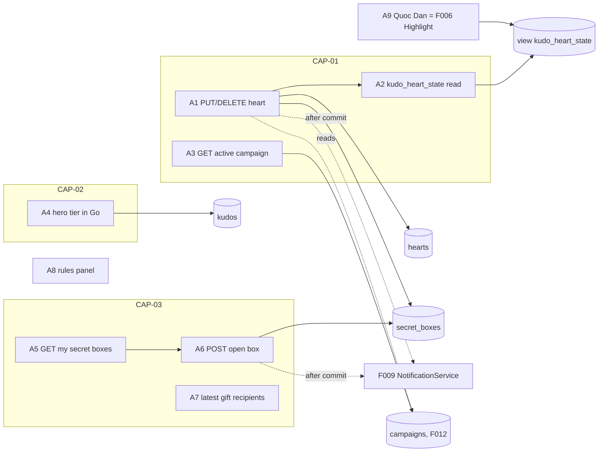
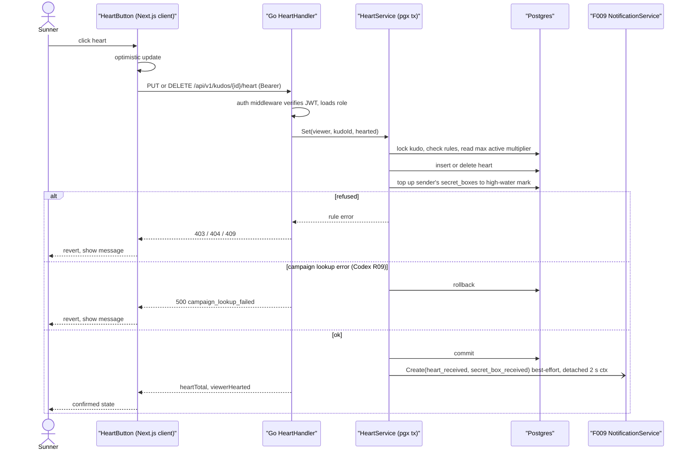
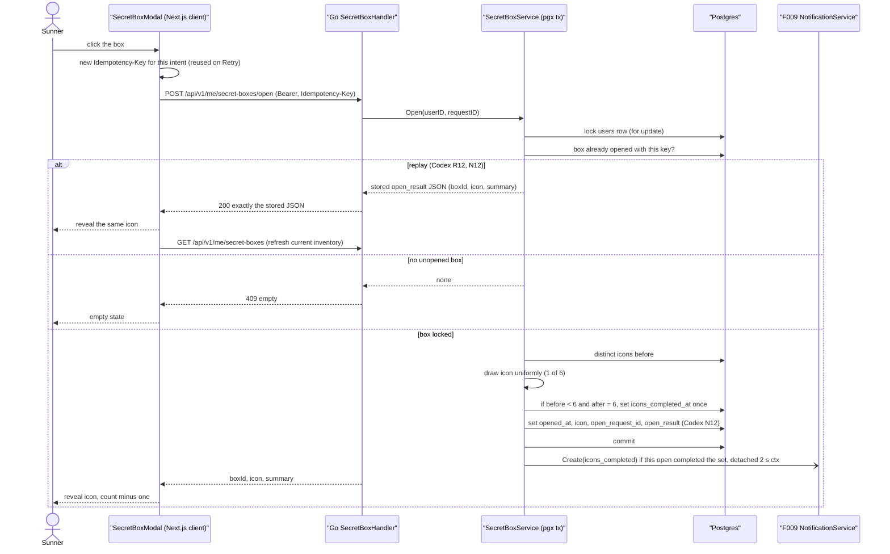
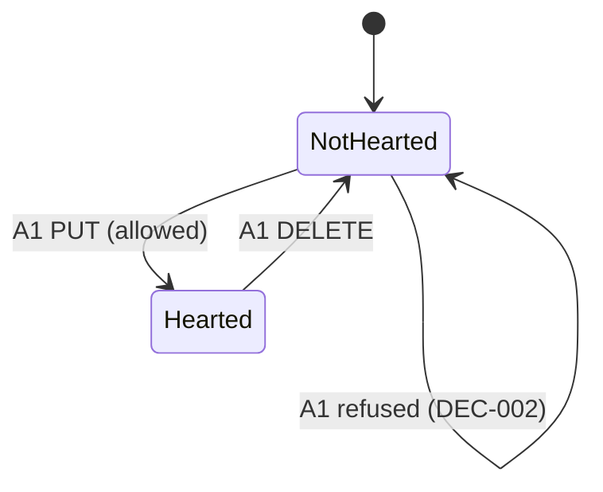
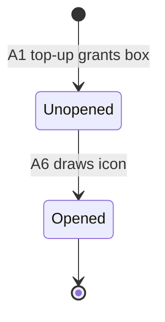

# F008_KudosGamification — Technical Spec

**Priority**: P2
**Type**: mixed

**See also:** [`functional-spec.md`](./functional-spec.md) — plain-language overview, open decisions, requirements and business rules, screens, user stories, scenarios, edge cases.

## 1. Technical Overview

F008 is the reward loop on top of F005 kudos. All business logic lives in the Go backend module `backend/internal/gamification` (planned), served as REST JSON under `/api/v1/...` by the Go stdlib `net/http` ServeMux; Next.js 16 (App Router, repo root) is frontend only and never touches the database. Client Components call Go from the browser with the Supabase access token as `Authorization: Bearer`; F002's Go auth middleware verifies the JWT against Supabase JWKS and loads `users.role` on every request.

Giving or withdrawing a heart is `PUT` / `DELETE /api/v1/kudos/{id}/heart`. `HeartService.Set` runs one pgx transaction (sqlc queries in `backend/db/queries/gamification.sql`): lock the kudo, check the rules (sender may not heart, public only), resolve the weight as the highest multiplier among campaigns active right now (weight 1 only when that lookup succeeds and finds no active campaign; a failed lookup rolls the transaction back with `500 campaign_lookup_failed` and no heart is recorded — Codex R09), insert or delete the caller's `hearts` row, then top up the kudo sender's `secret_boxes` to the high-water mark of floor(weighted hearts / 5). After commit it calls F009's shared `NotificationService.Create(...)` best-effort, under its own 2 s context detached from the request (Codex R23). The weighted total per kudo is the plain SQL view `kudo_heart_state` (sum of `hearts.weight`), read by Go through sqlc by F006, F007, F010 and this feature — the one heart number everywhere; it is a view, never a Postgres function or RPC (Codex R14). Hero tier is computed in Go on read from distinct senders (nothing stored); a tier *transition* is detected only inside F005's kudo-create transaction, using F008's thresholds and mapping function (Codex R10). Opening a box is `POST /api/v1/me/secret-boxes/open` with an `Idempotency-Key` header: one transaction locks the caller's `users` row, replays the stored result when that key already opened a box, otherwise opens the oldest unopened box, draws one of 6 icons uniformly in Go, stores the full response `{boxId, icon, summary}` in `secret_boxes.open_result` (jsonb) in the same transaction, and records the first completion of the icon set once in `users.icons_completed_at` (Codex R11, R12, N12). A replay returns exactly that stored JSON; the current inventory is refreshed separately via `GET /api/v1/me/secret-boxes` (Codex N12). Kudos Quốc Dân has no endpoint of its own: it is the unfiltered Highlight ranking served by F006. The rules panel is a static client overlay. Postgres functions and `security definer` RPCs from the earlier draft are replaced by Go service methods; browser roles have no table grants and RLS is enabled deny-all as defence in depth. Nothing is implemented yet; every handler name is a provisional identity.



## 2. Action Index

| # | Action (handler) | Method · Path | Codes | Writes | Detail |
|---|---|---|---|---|---|
| **A0** | *cross-cutting — belongs to no single action* | — | FR-601, FR-603 | — | § 4.4 |
| **A1** | `HeartHandler#put` / `HeartHandler#delete` (planned) | `PUT` / `DELETE` `/api/v1/kudos/{id}/heart` | FR-001, FR-401, FR-402, FR-403, FR-409, FR-601, FR-604, BR-001, BR-002, BR-003, BR-004, BR-006, DEC-001, DEC-002, SM-001, ALG-002, US001, US002, US006 | `hearts`, `secret_boxes` | § 3.1 ▸ **diagram** |
| **A2** | `HeartReader.StateFor` (planned shared Go read) over SQL view `kudo_heart_state` | sqlc · `ListKudoHeartState` | FR-001, FR-401, FR-408, US001 | — *(read-only)* | § 3.1 |
| **A3** | `ActiveCampaignHandler#get` (planned) | `GET` `/api/v1/campaigns/active` | FR-204, FR-402, BR-004, INT-001, US004 | — *(read-only)* | § 3.1 |
| **A4** | `HeroTierService.TiersFor` (planned shared Go read) + `HeroBadge` hover; pure `heroTier(n)` also used by F005's kudo-create transition (F005 ALG-003) | sqlc · `CountDistinctSendersByReceivers` | FR-002, FR-203, FR-405, FR-409, BR-005, DEC-003, ALG-001, US003 | — *(read-only)* | § 3.2 |
| **A5** | `SecretBoxHandler#get` (planned) | `GET` `/api/v1/me/secret-boxes` | FR-003, FR-102, FR-205, FR-206, US007, US008 | — *(read-only)* | § 3.3 |
| **A6** | `SecretBoxHandler#open` (planned) | `POST` `/api/v1/me/secret-boxes/open` | FR-003, FR-102, FR-206, FR-207, FR-404, FR-409, FR-602, BR-007, BR-008, DEC-004, DEC-005, SM-002, ALG-003, ALG-004, US007, US008 | `secret_boxes`, `users.icons_completed_at` | § 3.3 ▸ **diagram** |
| **A7** | `SecretBoxService.LatestRecipients` (planned shared Go read) | sqlc · `ListLatestGiftRecipients` | FR-407 | — *(read-only)* | § 3.3 |
| **A8** | `RulesPanel#open` (planned) *(client only)* | — | FR-101, FR-103, FR-201, FR-202, BR-005, US005 | — *(read-only)* | § 3.4 |
| **A9** | Kudos Quốc Dân = F006 Highlight ranking (no own endpoint) | sqlc · ranking over `kudo_heart_state` (F006 Highlight read) | FR-406, BR-009, US009 | — *(read-only)* | § 3.5 |

## 3. Actions

### 3.1 CAP-01 — Give and withdraw a heart

#### A1 · Set or withdraw my heart on a kudo
`PUT /api/v1/kudos/{id}/heart` · `DELETE /api/v1/kudos/{id}/heart` → `HeartHandler#put` / `HeartHandler#delete` (planned) in `backend/internal/gamification`
`FR-001` `FR-401` `FR-402` `FR-403` `FR-409` `FR-601` `FR-604` `BR-001` `BR-002` `BR-003` `BR-004` `BR-006` `DEC-001` `DEC-002` `SM-001` `ALG-002` `US001` `US002` `US006`

**Who** · signed-in Sunner other than the kudo's sender (the recipient may heart). US001 = heart a kudo; US002 = press again to withdraw; US006 = (system effect) the kudo's sender earns a secret box when their weighted received hearts reach a new multiple of 5.
**FE** · heart control is a slot on F006 cards/detail and F007 lists, rendered by F008's `HeartButton` (planned Next.js Client Component). FR-401: filled when hearted, outline otherwise, plus the weighted total. A click on outline sends `PUT`, a click on filled sends `DELETE` — idempotent setters, not a blind toggle, so a double click cannot flip twice. Optimistic update, rolled back on failure. Control state per DEC-001. The request carries the Supabase access token as `Authorization: Bearer`; dynamic data is fetched `no-store`.
**Request** · path `id` *(kudo uuid)*; no body. The caller comes from the verified JWT, never from the payload.
**BE** · `HeartHandler` → `HeartService.Set(ctx, viewer, kudoID, hearted)` — one pgx transaction using sqlc queries: `GetKudoForHeartForUpdate` (lock kudo row, read `sender_id`, `status`), check BR-002 / BR-003, `GetActiveCampaignWithMaxMultiplier` (INT-001), then `InsertHeart ... on conflict (kudo_id, user_id) do nothing` with `weight` and `campaign_id`, or `DeleteHeart`; on a new heart run the box top-up for the kudo's `sender_id` (ALG-002). If the campaign lookup returns an error (anything other than "no row"), the transaction rolls back and the handler answers `500` `{error: "campaign_lookup_failed"}`: no heart, no box, no notification. Weight 1 is used only when the lookup succeeds and finds no active campaign — there is no weight-1 fallback on error (Codex R09). Commit, then (best-effort, failures logged, never returned to the caller) call F009 `NotificationService.Create` under a fresh context of 2 s detached from the request (`context.WithoutCancel` + `context.WithTimeout`), so a slow or cancelled notification never delays or changes the committed response (Codex R23): `heart_received` to the kudo sender (dedupe key `heart:{kudoId}`, only when a heart was actually added) and `secret_box_received` to the sender when boxes were granted. Returns `{heartTotal, viewerHearted}` read from `kudo_heart_state`, so an anonymous sender is never exposed (`maskSender`, X05, is not needed because no sender data is returned).
**Rule** · **BR-001 — A Sunner has at most one heart per kudo; pressing again withdraws it.** Unique `(kudo_id, user_id)`; `PUT` twice is a no-op, `DELETE` removes the row; `DELETE` without a heart is a no-op (G07).
**BR-002 — A Sunner cannot heart a kudo they sent; the recipient may.** `kudo.sender_id != viewer.id` is checked in Go against the real sender, including for anonymous kudos (G06).
**BR-003 — Hearts are accepted only on public kudos.** Spam or missing kudo is refused (F011 owns the status).
**BR-004 — A heart's weight is the highest multiplier among campaigns active when it is given, 1 when a successful lookup finds none; a failed lookup records no heart; stored on the row and never recalculated.** *(§ 4.4, shared with A3; Codex R09)*
**BR-006 — Boxes granted are the high-water mark of floor(weighted hearts received on a Sunner's sent kudos / 5); granted boxes are never revoked.** `should = floor(sum(weight) / HEARTS_PER_BOX)`; the top-up inserts only sequence numbers above the current maximum, so withdraw + re-heart cannot farm boxes (G07).

| DEC | subtype | Condition | What the user sees | Source |
|---|---|---|---|---|
| **DEC-001** | render, interaction | `kudo.sender_id == viewer` (`canHeart = false`) → disabled; `viewerHearted` → filled; else outline | own kudo: heart shown with count, not clickable; hearted: filled, click withdraws; otherwise outline, click hearts | `TBD (draft)` |
| **DEC-002** | flow | kudo not public → `409`; missing → `404`; viewer is sender → `403` (BR-002/BR-003); campaign lookup error → `500 campaign_lookup_failed` (Codex R09) | nothing written; control reverts and a short message appears | `TBD (draft)` |

**Result**
- Writes `hearts` ← one row `(kudo_id, user_id, weight, campaign_id, created_at)` on `PUT`; row deleted on `DELETE` — `TBD (draft)`
- Writes `secret_boxes` ← new unopened rows `(user_id = kudo sender, seq, earned_at)` for each newly reached multiple of 5 above the high-water mark (ALG-002)
- After commit: F009 notifications `heart_received`, `secret_box_received` (best-effort, detached 2 s context — Codex R23)
- Response `200` `{heartTotal, viewerHearted}`; `401` without a valid token; `500 campaign_lookup_failed` with nothing written when the in-transaction campaign lookup fails (Codex R09)
- User sees: control updates, total changes by the weight (2 during a x2 campaign; G08)
**Source:** `TBD (draft)`



---

#### A2 · Read heart totals and my state for a list of kudos
`sqlc · ListKudoHeartState` → `HeartReader.StateFor(ctx, kudoIDs, viewer)` (planned shared Go read) over the SQL view `kudo_heart_state`
`FR-001` `FR-401` `FR-408` `US001`

**Who** · signed-in Sunner viewing kudos; US001 = see and use the heart on a kudo.
**FE** · F006 feed/highlight/detail and F007 lists receive `heartTotal`, `viewerHearted` and `canHeart` inside their own Go responses; no extra browser call.
**Request** · `kudoIDs[]`, viewer from the verified JWT
**BE** · `kudo_heart_state` stays a plain SQL view read by Go through sqlc — not a Postgres function or RPC, and browser roles (`anon`, `authenticated`) have no grant on it (Codex R14): `select kudo_id, sum(weight) as heart_total from hearts group by kudo_id`. sqlc `ListKudoHeartState` joins it with `kudos` and the viewer's own `hearts` row: `heart_total` (0 when none), `viewer_hearted`, and `can_heart = kudos.status = 'public' and kudos.sender_id <> viewer`. F006, F007 and F010 call this shared Go reader (or the view through their own sqlc queries) instead of counting `hearts` rows, so the weighted total is the one heart number everywhere (G08, X02, FR-408).
**Result** · read-only — **no DB write**. Returns `[{kudoId, heartTotal, viewerHearted, canHeart}]`.
**Source:** `TBD (draft)`

---

#### A3 · Read the active campaign
`GET /api/v1/campaigns/active` → `ActiveCampaignHandler#get` (planned) in `backend/internal/gamification`
`FR-204` `FR-402` `BR-004` `INT-001` `US004`

**Who** · signed-in Sunner; US004 = see that a heart-boost campaign is running and for how long.
**FE** · campaign badge (e.g. "Campaign x2 heart") next to the heart control shows the hover overlay `3241:15021` with name, multiplier and window (FR-204; placement per functional D013, resolved). Fetched `no-store` by the Live board.
**Request** · none
**BE** · `ActiveCampaignHandler#get` — auth middleware, then the shared lookup `CampaignReader.Active(ctx, now)` (INT-001, sqlc `GetActiveCampaignWithMaxMultiplier`); returns `null` when none. A database error answers `500`; the client then only hides the badge. This display request is separate from A1's authoritative lookup inside the heart transaction, so its failure never changes a heart's weight (Codex R09).
**Rule** · BR-004 — the multiplier shown is the one `HeartService.Set` will apply *(§ 4.4)*.
**Result** · read-only — **no DB write**. Returns `{name, multiplier, startsAt, endsAt}` or `null`.
**Source:** `TBD (draft)`

### 3.2 CAP-02 — Hero badge from distinct senders

#### A4 · Show a Sunner's hero badge and its hover
`sqlc · CountDistinctSendersByReceivers` → `HeroTierService.TiersFor(ctx, userIDs)` (planned shared Go read) + `HeroBadge` (planned component)
`FR-002` `FR-203` `FR-405` `FR-409` `BR-005` `DEC-003` `ALG-001` `US003`

**Who** · signed-in Sunner. US003 = see another Sunner's (or my own) hero badge and learn what it means by hovering.
**FE** · `HeroBadge` fills the badge slots on kudo cards (F006 board, and the kudo lists on F007 profile pages), the avatar hover card and the F010 user table, using the `heroTier` field those features' Go responses carry. There is no hero badge in the F007 profile header and no header hover entry point (F007 D006, Codex N10). Hover (or keyboard focus) opens one of four overlays: New `3241:14991`, Rising `3241:14995`, Super `3241:14999`, Legend `3241:15003` (FR-203); text = tier name and its sender range.
**Request** · `userIDs[]` (Go-internal)
**BE** · `HeroTierService.TiersFor` — sqlc `CountDistinctSendersByReceivers` counts distinct `kudos.sender_id` among public kudos received (anonymous included, counted without being revealed), then the Go function `heroTier(n)` maps the count (ALG-001). Computed in Go on every read; nothing stored (FR-405 holds automatically). For FR-409, F008 does not detect tier transitions itself (Codex R10). The transition is computed inside F005's kudo-create transaction (F005 ALG-003): lock the receiver's `users` row, count distinct real senders over public kudos before and after the insert, map both with F008's pure `heroTier(n)`; when the tier rose, F005 — the producer of `hero_level_up` (Codex N04) — hands `{receiverId, fromTier, toTier, sendersCount}` (`sendersCount` = the after-count captured under the lock) to the post-commit notifier, which calls F009 `NotificationService.Create(hero_level_up)`; F009 maps `params.levelKey = toTier`, `params.fromLevelKey = fromTier`, `params.sendersCount = sendersCount` with dedupe key `hero_level:{receiverId}:{toTier}` (one notice per tier ever), best-effort under a detached 2 s context (Codex R23, N04). F008 owns only the thresholds (BR-005), the pure `heroTier(n)` mapping and the read-side tiers; it is not a producer of `hero_level_up` — F005 owns the transaction, the event and the notifier call (Codex N04). Moderation changes (F011, Spam ↔ Public) never emit level-up notices; the tier still follows them on the next read. F011 takes the receiver's `users` row lock after the kudo row (global lock order kudo → receiver), so a restore and a create for the same receiver are serialized and a repeat-sender create never reports a rise caused by moderation (Codex N05).
**Rule** · **BR-005 — Hero tier thresholds: New 1–4, Rising 5–9, Super 10–20, Legend more than 20 distinct senders.** *(§ 4.4, shared with A8 rules panel)* FR-002 = tier only ever derives from this count.

| DEC | subtype | Condition | What the user sees | Source |
|---|---|---|---|---|
| **DEC-003** | render | `distinctSenders == 0` | no badge, slot stays empty | `TBD (draft)` |

**Result** · read-only — **no DB write**. Returns `[{userId, senderCount, tier|null}]`.
**Source:** `TBD (draft)`

### 3.3 CAP-03 — Earn and open secret boxes

#### A5 · Read my secret box summary
`GET /api/v1/me/secret-boxes` → `SecretBoxHandler#get` (planned) in `backend/internal/gamification`
`FR-003` `FR-102` `FR-205` `FR-206` `US007` `US008`

**Who** · signed-in Sunner; US007 = open a box; US008 = see which of the 6 icons I have.
**FE** · "Mở Secret Box" button (F006 sidebar, F007 profile; placement by those features) opens the secret box window (FR-102), a Client Component that calls this endpoint with the bearer token. The window shows "KHÁM PHÁ SECRET BOX CỦA BẠN", "Click vào box để mở" and the unopened count "Secretbox chưa mở 05" (FR-205); collected icons out of 6 appear in the same window and on F007 (FR-206).
**Request** · none (caller from the verified JWT)
**BE** · `SecretBoxHandler#get` → `SecretBoxService.Summary(ctx, userID, includeBoxes)` — sqlc `CountUnopenedSecretBoxes`, `CountOpenedSecretBoxes`, `ListCollectedIcons` (distinct opened `icon`s). F007's profile service calls the same Go method (box figures only when the viewer is the owner).
**Result** · read-only — **no DB write**. Returns `{unopened, opened, collectedIcons[], totalIcons: 6, completed}`; `collectedIcons` is the same distinct icon list A6 returns as `summary.distinctIcons` (A6's figure is a snapshot taken at that open and replayed verbatim; this endpoint is the source of the current inventory, Codex N12), and `completed` = `users.icons_completed_at is not null` (Codex R11).
**Source:** `TBD (draft)`

---

#### A6 · Open one secret box
`POST /api/v1/me/secret-boxes/open` → `SecretBoxHandler#open` (planned) in `backend/internal/gamification`
`FR-003` `FR-102` `FR-206` `FR-207` `FR-404` `FR-409` `FR-602` `BR-007` `BR-008` `DEC-004` `SM-002` `ALG-003` `US007` `US008`

**Who** · signed-in Sunner owning at least one unopened box. US007 = open a box and see the icon; US008 = grow my collection towards all 6.
**FE** · click on the box (`1466:7024`, `1466:7593`) sends the `POST`, plays the opening state, then shows the result frame (`2995:15708`, `2995:15733`, `2995:15754`) with the revealed icon and updated collection; the remaining count drops by one (FR-206). With zero unopened boxes the window shows the empty state (FR-207, DEC-004). Standby frames show the box per collected-icon state; result frames show the revealed icon and the updated collection (functional D012, resolved).
**Request** · header `Idempotency-Key: <uuid>` (required) — the client generates one UUID per opening intent and reuses it for every retry of that intent (Codex R12); a missing or malformed key is rejected with `400` and nothing is written. No body — the server picks which of the caller's boxes to open.
**BE** · `SecretBoxService.Open(ctx, userID, requestID)` — one pgx transaction (ALG-004):
1. sqlc `LockUserForSecretBoxOpen` (`select … from users where id = $1 for update`) — every open of one user is serialized for the whole transaction (Codex R11).
2. sqlc `GetSecretBoxByOpenRequest(user_id, open_request_id)` — if a box was already opened with this key, return its stored `open_result` JSON byte-for-byte with `200` (the original `boxId`, `icon` and the summary as it was right after that open — never a recomputed summary); nothing is consumed (Codex R12, N12).
3. `ListCollectedIcons` → the distinct icon set **before** the draw.
4. sqlc `LockOldestUnopenedSecretBox` (`order by seq limit 1 for update`); none → `409` (DEC-004).
5. Draw an icon in Go (ALG-003).
6. Distinct icon set **after** = before ∪ {icon}. When before < 6 and after = 6, sqlc `SetIconsCompletedAt` runs `update users set icons_completed_at = now() where id = $1 and icons_completed_at is null`; only when it updated a row does this open carry a completion event.
6a. Build the response `{boxId, icon, summary: {unopened, opened, distinctIcons}}` inside the transaction (counts after this open, `distinctIcons` = after) and `MarkSecretBoxOpened` sets `opened_at`, `icon`, `open_request_id = requestID` (`secret_boxes.open_request_id uuid unique null`) and `open_result` = that JSON (`secret_boxes.open_result jsonb null`) on the box row (Codex N12).
7. Commit, then (best-effort, detached 2 s context — Codex R23) F009 `NotificationService.Create(icons_completed)` with dedupe key `icons_completed:{userId}` when step 6 produced the completion event (Codex R11).
**Rule** · **BR-007 — A box can be opened only by its owner and only once.** FR-602: the caller's own boxes only, no box id accepted from the client; the user-row lock, the box row lock and `opened_at is null` make each opening intent open at most one box, and a repeated `Idempotency-Key` replays instead of opening another (Codex R12).
**BR-008 — Each opened box reveals exactly one of the 6 icons, each with equal 1/6 odds, repeats allowed, never empty** (G09).
**BR-010 — The icon set is completed at most once per Sunner: `users.icons_completed_at` is set from null to now in the open that first reaches 6 distinct icons, and only that open emits `icons_completed`** (Codex R11).

| DEC | subtype | Condition | What the user sees | Source |
|---|---|---|---|---|
| **DEC-004** | flow | caller has no unopened box (and the key matches no opened box) → `409` | nothing written; empty state "no box to open" | `TBD (draft)` |
| **DEC-005** | flow | `Idempotency-Key` already used by an opened box of the caller → `200` with the stored `open_result` exactly | the same box, icon and summary as the first attempt, even if other boxes were opened since; count unchanged by the retry; the window refreshes current figures with `GET /api/v1/me/secret-boxes` (Codex R12, N12) | `TBD (draft)` |

**Result**
- Writes `secret_boxes` ← `opened_at = now()`, `icon` = drawn value, `open_request_id` = the key, `open_result` = the full response JSON, on one existing row (Codex N12) — `TBD (draft)`
- Writes `users.icons_completed_at` ← `now()` once, in the open that first completes the set (Codex R11)
- After commit: F009 `icons_completed` (dedupe `icons_completed:{userId}`) only for that open (best-effort, detached 2 s context)
- Response `200` `{ boxId, icon, summary: { unopened, opened, distinctIcons[] } }` — `distinctIcons` is the caller's distinct collected icons after the open (n of 6); a replay returns exactly the stored `open_result` (same `boxId`, `icon` and `summary` as the original open), and current inventory is read separately via `GET /api/v1/me/secret-boxes` (Codex R12, N12)
- User sees: reveal animation, icon, collection count (n/6); when all 6 are held, a completion message (prize is handed out offline at SAA 2025, functional D010)
**Source:** `TBD (draft)`



---

#### A7 · List the Sunners who most recently received a gift
`sqlc · ListLatestGiftRecipients` → `SecretBoxService.LatestRecipients(ctx, limit)` (planned shared Go read)
`FR-407`

**Who** · signed-in Sunner looking at the F006 sidebar list "10 Sunner nhận quà mới nhất".
**FE** · F006 renders avatar + name per row linking to the profile; F008 only supplies the rows through F006's sidebar Go response.
**Request** · `limit` *(default `GIFT_RECIPIENTS_LIMIT`)*
**BE** · `ListLatestGiftRecipients` — distinct users ordered by their most recent `secret_boxes.opened_at`, joined to `users` for name and avatar. "Gift" = opened box.
**Result** · read-only — **no DB write**. Returns `[{userId, name, avatarUrl}]`.
**Source:** `TBD (draft)`

### 3.4 CAP-04 — Read the rules

#### A8 · Open the Thể lệ rules panel
`—` → `RulesPanel#open` (planned)
`FR-101` `FR-103` `FR-201` `FR-202` `BR-005` `US005`

**Who** · signed-in Sunner. US005 = read how hero badges, secret boxes and Kudos Quốc Dân work, then optionally start a kudo.
**FE** · the F001 floating button's "Thể lệ" choice calls `openRulesPanel()` (exposed by F008) and the panel slides over the current page (`3204:6051`, FR-101). Content (FR-201): block "NGƯỜI NHẬN KUDOS: HUY HIỆU HERO…" with four tiers from the shared threshold config, block "NGƯỜI GỬI KUDOS: SƯU TẬP TRỌN BỘ 6 ICON…" with the 6 icon names and 5 hearts per box, block "KUDOS QUỐC DÂN". Buttons: Đóng closes; Viết KUDOS closes the panel and calls F005's opener (FR-103). Copy comes from the i18n dictionary (F001), vi and en.
**Result** · read-only — client state only (open/closed); thresholds and counts rendered from the frontend copy of `HERO_TIERS`, `HEARTS_PER_BOX`, `ICON_NAMES`, which must equal the Go constants (BR-005).
**Source:** `TBD (draft)`

### 3.5 CAP-05 — Kudos Quốc Dân

#### A9 · List the 5 most-hearted kudos
`sqlc · ranking over kudo_heart_state` → served by F006's Highlight Go endpoint (no F008 endpoint)
`FR-406` `BR-009` `US009`

**Who** · signed-in Sunner; US009 = see which 5 kudos are the national favourites.
**FE** · the unfiltered Highlight section of the Live board (F006) is Kudos Quốc Dân; there is no separate surface (G12). Reuses F006's `KudoCard`.
**Request** · F006 Highlight request without filters
**BE** · F006's Highlight read ranks all public kudos — including those with zero hearts (`heart_total` 0 via a left join on the view, G12) — by `kudo_heart_state.heart_total` desc, `created_at` desc on ties, limit 5; Hashtag / Phòng ban filters rank inside the filtered set. Senders pass through the shared `maskSender(kudo, viewer)` in `backend/internal/kudo` (X05). F008 owns only the ranking rule and the view.
**Rule** · **BR-009 — Kudos Quốc Dân are the 5 public kudos with the highest weighted heart total, newer wins a tie; it is the unfiltered Highlight.**
**Result** · read-only — **no DB write**. Up to 5 card DTOs with `heartTotal`. The special prize is handled offline.
**Source:** `TBD (draft)`

### 3.6 Edge cases

| Action | Scenario | Behavior |
|---|---|---|
| A1 | Double click or two tabs set the same heart | `PUT`/`DELETE` are idempotent; unique `(kudo_id, user_id)`; one row, one weight |
| A1 | Withdraw and re-heart repeatedly to farm boxes | Top-up only inserts above the high-water mark `max(seq)`; no extra box (BR-006) |
| A1 | Recipient hearts a kudo they received | Allowed (BR-002); counts toward the sender's boxes |
| A1 | Campaign ends between click and commit | Weight uses the campaigns read inside the transaction; whichever were active at that instant win |
| A1 | Campaign lookup inside the heart transaction fails | Transaction rolls back; `500 campaign_lookup_failed`; no heart, no box, no notification; control reverts. Never weight 1 on error (Codex R09) |
| A3 | `GET /api/v1/campaigns/active` fails | Only the campaign badge is hidden; hearting is unaffected because A1 does its own lookup (Codex R09) |
| A1 | Two campaigns active (x2, x3) | Weight 3, `campaign_id` = the x3 campaign |
| A1 | Campaign deleted later | `hearts.campaign_id` set null by the foreign key; `weight` unchanged |
| A1 | Kudo flagged spam after hearts exist | Existing hearts stay; new hearts refused (BR-003); Highlight ranking drops it (BR-009, public only) |
| A1 · A6 | Two hearts arrive together (same or different kudos of one sender) and cross the 5 boundary | Top-up locks the sender's `users` row first, so both see each other's heart; unique `(user_id, seq)` with `on conflict do nothing` as a second guard; exactly one box per multiple of 5 |
| A1 | Heart on an anonymous kudo | Allowed; response contains totals only, never the sender |
| A1 · A6 | Notification service fails or stalls | Runs after commit under its own 2 s context detached from the request; failure or timeout is logged; the heart or open stays committed and the response is unchanged (Codex R23) |
| A1 | Token missing or expired | Go auth middleware answers `401` before any write (FR-601); control reverts |
| A6 | Two tabs open the last box (different keys) | The user-row lock serializes them: one succeeds, the other then finds no unopened box and gets `409` and the empty state (DEC-004) |
| A6 | Request while zero unopened | `409`, nothing written (DEC-004) |
| A6 | Open commits but the response is lost; Retry with the same `Idempotency-Key` while ≥ 2 boxes remain | `200` with the stored `open_result` (same `boxId`, `icon` and summary); only one box consumed (DEC-005, Codex R12, N12) |
| A6 | Open A commits (response lost), then open B with a new key commits, then A is retried with A's key | `200` with A's stored `open_result` exactly — A's box, icon and the summary as it was right after A — not B's later counts; nothing consumed by the retry; the window refreshes current figures via `GET /api/v1/me/secret-boxes` (Codex N12) |
| A6 | Two boxes opened at once by a Sunner missing two icons, each draw a missing icon | Serialized by the user-row lock; the second open sees 5 before and 6 after; exactly one sets `icons_completed_at` and emits `icons_completed` (Codex R11) |
| A6 | Further opens after the set is complete | `icons_completed_at` already set; no second completion event (BR-010) |
| A4 | Sunner with exactly 4 / 5 / 10 / 20 / 21 senders | New / Rising / Super / Super / Legend (ALG-001 boundaries) |
| A4 | Several kudos from one sender to the same receiver | Counted once (distinct senders); a second kudo from an existing sender causes no transition (F005 ALG-003) |
| A4 | Two new distinct senders commit kudos to a receiver with 4 senders at the same time | F005's transaction locks the receiver row, so only the transaction that moves 4 → 5 sees New → Rising; exactly one `hero_level_up` (dedupe `hero_level:{receiverId}:Rising`) (Codex R10) |
| A4 | A kudo flipped Spam → Public (or back) by F011 changes the sender count across a boundary | Tier follows on the next read; no level-up notice (Codex R10) |
| A4 | F011 restores a fifth distinct sender's kudo while F005 creates a kudo from a repeat sender to the same receiver | Both take the receiver's `users` row lock (F011 after the kudo row), so they serialize; the create sees 4 → 4 or 5 → 5 and emits no `hero_level_up` (Codex N05, F011 ALG-001) |
| A5 | Summary while a box opens elsewhere | Eventually consistent on next read; open itself is authoritative |
| A8 | Rules panel opened over another overlay | Panel replaces the FAB menu only; opening over the write-kudo modal is not offered (FAB lives on pages, not in modals) |
| A9 | Fewer than 5 public kudos have hearts | Zero-heart public kudos still rank (by `created_at` desc among equal totals), so 5 are returned whenever ≥ 5 public kudos exist (G12) |
| A9 | Fewer than 5 public kudos exist at all | Returns whatever exists (0–4), never padded |
| A0 | Any write without a session | Rejected before validation (FR-601) |

## 4. Shared Foundation

### 4.1 Components

| Component | Responsibility | Used in | File |
|---|---|---|---|
| `HeartButton` | Next.js Client Component: heart control with optimistic state calling `PUT`/`DELETE` heart; slot content for F006/F007 | A1, A2 | `TBD (draft)` |
| `HeroBadge` | Tier badge plus hover overlay (4 tiers) | A4 | `TBD (draft)` |
| `CampaignBadge` | Campaign pill plus hover overlay | A3 | `TBD (draft)` |
| `RulesPanel` | Static Thể lệ side panel, `openRulesPanel()` opener | A8 | `TBD (draft)` |
| `SecretBoxModal` | Box window: unopened, opening, revealed, empty states; holds one `Idempotency-Key` per opening intent and reuses it on Retry (Codex R12) | A5, A6 | `TBD (draft)` |
| `HeartService`, `HeartReader` | Go: heart transaction, box top-up, weighted state read | A1, A2 | `backend/internal/gamification` (planned) |
| `HeroTierService` | Go: read-side distinct-sender count and the pure `heroTier(n)` threshold mapping; `heroTier(n)` is reused by F005's kudo-create transition (F005 ALG-003, Codex R10) | A4 | `backend/internal/gamification` (planned) |
| `SecretBoxService` | Go: summary, idempotent open-and-draw transaction with first-completion marker, latest recipients | A5, A6, A7 | `backend/internal/gamification` (planned) |
| `CampaignReader` | Go: highest active multiplier lookup (INT-001); returns "none" or an error, never a default on error | A1, A3 | `backend/internal/gamification` (planned) |
| `gamification` sqlc queries | `ListKudoHeartState`, `InsertHeart`, `DeleteHeart`, `GetActiveCampaignWithMaxMultiplier`, `InsertSecretBox`, `LockUserForSecretBoxOpen`, `GetSecretBoxByOpenRequest`, `LockOldestUnopenedSecretBox`, `MarkSecretBoxOpened`, `SetIconsCompletedAt`, … | A1–A7 | `backend/db/queries/gamification.sql` (planned) |
| `gamificationConfig` | Thresholds, icon names, hearts per box: Go constants plus the frontend copy used by the panel | A1, A4, A6, A8 | `TBD (draft)` |

### 4.2 Data Model

#### Key Entities

| Entity | Table | Key Columns | Purpose |
|--------|-------|-------------|---------|
| heart | `hearts` | `id`, `kudo_id`→kudos, `user_id`→users, `weight` (int ≥ 1), `campaign_id`→campaigns (nullable, `on delete set null`), `created_at`; unique `(kudo_id, user_id)` | One Sunner's heart on one kudo; written by A1 |
| heart state | `kudo_heart_state` *(SQL view — not a function or RPC; Codex R14)* | `kudo_id`, `heart_total` = `sum(hearts.weight)` | The weighted total per kudo; read by Go through sqlc by A2, A9 and by F006, F007, F010 |
| secret box | `secret_boxes` | `id`, `user_id`→users, `seq` (int), `earned_at`, `opened_at` (nullable), `icon` (nullable enum of 6), `open_request_id` (`uuid unique null`, the `Idempotency-Key` of the open; Codex R12), `open_result` (`jsonb null`, the full `{boxId, icon, summary}` response computed in the opening transaction and returned verbatim on replay; Codex N12); unique `(user_id, seq)` | One earned box; created by A1, opened by A6 |
| kudo | `kudos` | `id`, `sender_id`, `receiver_id`, `status`, `is_anonymous`, `created_at` | Read only: public check, sender check, distinct senders, ranking (owned by F005/F011) |
| user | `users` | `id`, `name`, `avatar_url`; `icons_completed_at` (`timestamptz null`, added by F008's migration, set once by A6; Codex R11) | Gift recipient rows; row lock serializing a user's box opens (A6) and box top-ups (A1); first-completion marker |
| campaign | `campaigns` | `id`, `name`, `starts_at`, `ends_at`, `multiplier` (int 2–10, default 2) | Read only: highest active multiplier (owned and written by F012) |

Migrations for `hearts`, `secret_boxes` and the view go through the Supabase CLI (`supabase/migrations`). RLS is enabled deny-all on both tables; browser roles (`anon`, `authenticated`) get no grants on the tables or the view; only the Go backend's database role reads and writes. MODEL### codes: `TBD (draft)` (allocated at promote). `users.badges`/`users.level` mentioned in the feature list are NOT written by this feature: tier is computed on read in Go (functional D009).

#### Polymorphic Behavior

| Field | Values | Behavior that differs |
|---|---|---|
| `secret_boxes.icon` | REVIVAL, TOUCH_OF_LIGHT, STAY_GOLD, FLOW_TO_HORIZON, BEYOND_THE_BOUNDARY, ROOT_FURTHER, null (unopened) | null = unopened box; non-null = revealed icon counted into the collection |

DISC-### code: `TBD (draft)`.

### 4.3 State Management

### A Sunner's heart on a kudo is either given or not given (SM-001)
**kind:** data
**Linked FR:** FR-401
**Source:** `TBD (draft)`



### A secret box is earned unopened, then opened once with an icon (SM-002)
**kind:** data
**Linked FR:** FR-404
**Source:** `TBD (draft)`



### 4.4 Shared Rules

#### Bin 3 — cross-cutting, belongs to no single action

**A0 · FR-601 / FR-603 — every write requires a signed-in session and every total, grant and draw is computed on the server.**
The caller comes from F002's Go auth middleware (Supabase JWT verified against JWKS, role loaded from `users`), never the payload; heart totals, box counts, tiers and icons are never accepted from the browser. Next.js never touches the database; browser roles have no table grants and RLS is deny-all as defence in depth. **Cross-cutting — not a rule of one action.**
**Source:** `TBD (draft)`

#### Bin 2 — used by ≥2 named actions

**BR-004 — A heart's weight is the highest multiplier among campaigns active when it is given, otherwise 1; a failed lookup records no heart.**
Used in: **A1** · **A3**. A3 shows the multiplier that A1 will apply; both call `CampaignReader.Active` (INT-001). `campaigns.multiplier` is an integer 2–10 (default 2) entered in F012's form. Weight and `campaign_id` are stored on the heart and never recalculated when the campaign changes or is deleted (G08, G14, X04). "Otherwise 1" means the lookup succeeded and found no active campaign; a lookup error inside A1 rolls back with `500 campaign_lookup_failed`, while an A3 error only hides the badge (Codex R09).
**Source:** `TBD (draft)`
```text
c, err = campaign with max(multiplier) where starts_at <= now < ends_at
if err: rollback; return 500 campaign_lookup_failed      # A1; never a weight-1 fallback
heart.weight = c ? c.multiplier : DEFAULT_HEART_WEIGHT   # c == none only after a successful lookup
heart.campaign_id = c ? c.id : null
```

**BR-005 — Hero tier thresholds: New 1–4, Rising 5–9, Super 10–20, Legend more than 20 distinct senders.**
Used in: **A4** · **A8**, and by F005's kudo-create transition (F005 ALG-003). One config feeds the Go derivation, the transition check and the rules panel text.
**Source:** `TBD (draft)`
```text
heroTier(n): n==0 -> none; n<=4 -> New; n<=9 -> Rising; n<=20 -> Super; else Legend
```

### 4.5 Algorithms & Integrations

### A hero tier is derived from the number of distinct senders (ALG-001)
**Linked FR:** FR-002
**Used in:** A4
**Source:** `TBD (draft)`
**Input:** receiver ids · **Output:** tier or none per receiver · **Complexity:** O(k) per user over received public kudos
**Description:** sqlc counts distinct `sender_id` over each user's received public kudos (anonymous included, functional D008); Go maps the count with BR-005.

**Pseudocode:**
```text
n = count(distinct k.sender_id) where k.receiver_id = u and k.status = 'public'
return heroTier(n)
```

### Secret boxes are topped up to the high-water mark of the received heart total (ALG-002)
**Linked FR:** FR-403
**Used in:** A1
**Source:** `TBD (draft)`
**Input:** kudo sender id · **Output:** new box rows · **Complexity:** O(boxes added)
**Description:** inside the heart transaction, after a heart insert, lock the sender's `users` row (sqlc `LockUserForBoxTopUp`, `for update`) so concurrent hearts on any of their kudos serialise, then recompute the sender's weighted total and insert only box sequence numbers above the highest one already granted; the unique `(user_id, seq)` makes concurrent calls safe. Never deletes, so a withdrawal lowers the total but not the boxes, and a re-heart only climbs back to the existing mark.

**Pseudocode:**
```text
total  = sum(kudo_heart_state.heart_total) over kudos where kudo.sender_id = s
should = floor(total / HEARTS_PER_BOX)
have   = max(seq) of s's boxes, else 0          # high-water mark
for seq in have+1 .. should: insert box(s, seq) on conflict do nothing
return newly inserted count                     # drives secret_box_received after commit
```

### An opened box draws one of the 6 icons (ALG-003)
**Linked FR:** FR-404
**Used in:** A6
**Source:** `TBD (draft)`
**Input:** none · **Output:** one icon · **Complexity:** O(1)
**Description:** uniform draw over the 6 icons in the Go service with a cryptographically seeded source (`crypto/rand`), so the client cannot influence it. Equal 1/6 odds, repeats allowed, never empty (G09).

**Pseudocode:**
```text
icon = ICONS[uniformInt(0, 5)]
```


### Opening a box is serialized per user, idempotent per request and marks the first completion once (ALG-004)
**Linked FR:** FR-404, FR-409, FR-602
**Used in:** A6
**Source:** `TBD (draft)`
**Input:** user id, `Idempotency-Key` · **Output:** `{boxId, icon, summary}` and an optional completion event · **Complexity:** O(1) rows plus one distinct-icon read
**Description:** Codex R11, R12. The user-row lock makes every open of one Sunner run one at a time, so the before/after icon sets are exact and two concurrent opens cannot both miss the completion. `open_request_id` (unique) ties one opening intent to one box, so a retry after a lost response replays instead of consuming another box; `open_result` stores the exact response computed in the opening transaction, so the replay returns that JSON, not a summary recomputed now (Codex N12). `icons_completed_at` is the persisted first-completion marker; its `is null` guard makes the completion event fire at most once.

**Pseudocode:**
```text
lock users where id = u for update
b = box where user_id = u and open_request_id = key
if b: return b.open_result                                   # replay stored JSON, nothing consumed (Codex N12)
before = distinct icons of u's opened boxes
b = oldest unopened box of u for update; if none: 409
icon = ALG-003 draw
after = before ∪ {icon}
completed = |before| < 6 and |after| = 6 and
            (update users set icons_completed_at = now() where id = u and icons_completed_at is null) = 1 row
result = {b.id, icon, summary: {unopened(u) - 1, opened(u) + 1, after}}   # computed in this tx (Codex N12)
update b set opened_at = now(), icon = icon, open_request_id = key, open_result = result
commit
if completed: NotificationService.Create(icons_completed, dedupe = "icons_completed:{userId}")   # best-effort
return result
```

### Active campaign is read from the campaigns table owned by F012 (INT-001)
**Linked FR:** FR-402
**Used in:** A1, A3
**Source:** `TBD (draft)`
**Type:** database-read
**Target:** `campaigns` (written only by F012's Go admin endpoints)
**Payload:** `starts_at <= now() < ends_at`, highest `multiplier`; no write access
**Failure handling:** inside A1 the read is part of the transaction, so a database failure rolls the transaction back and fails the heart with `500 campaign_lookup_failed` (nothing recorded, control reverts); there is no weight-1 fallback on error. Weight 1 applies only when the lookup succeeds and finds no active campaign. A3's separate display request failing only hides the badge and never affects any heart's weight (Codex R09).

### 4.6 Configuration

```text
HEARTS_PER_BOX = 5               # BR-006
HERO_TIERS = New 1-4, Rising 5-9, Super 10-20, Legend 21+   # BR-005
ICON_NAMES = REVIVAL, TOUCH OF LIGHT, STAY GOLD, FLOW TO HORIZON, BEYOND THE BOUNDARY, ROOT FURTHER   # BR-008
NATIONAL_KUDOS_COUNT = 5         # BR-009 (unfiltered Highlight size, F006)
GIFT_RECIPIENTS_LIMIT = 10       # A7 (F006 list size)
BADGE_HOVER_DELAY_MS = TBD (draft)   # A4
DEFAULT_HEART_WEIGHT = 1         # BR-004 only when the lookup succeeds and finds no active campaign (Codex R09)
ICON_COUNT = 6                   # BR-010 completion threshold
NOTIFY_TIMEOUT = 2s              # post-commit notification context, detached from the request (Codex R23)
```

Go constants in `backend/internal/gamification`; the panel's frontend copy must match them. No cache layer: dynamic reads are `no-store`.

**Client behavior:** see behavior-logic.md, permissions.md, architecture.md

## 5. Verification & Technical Notes

### 5.1 Technical Verification

- **SC-001** *(A1)* with no active campaign (lookup succeeds, no row), first `PUT` writes one row with weight 1; a second `PUT` changes nothing; `DELETE` removes it (covers BR-001, FR-401)
- **SC-002** *(A1)* `PUT` by the kudo's sender → `403`, on a spam kudo → `409`, nothing written; the recipient's `PUT` succeeds (covers BR-002, BR-003, DEC-002)
- **SC-003** *(A1)* with an active x2 campaign the stored weight is 2; with x2 and x3 overlapping it is 3; after they end new hearts store 1 and old rows keep theirs; deleting a campaign sets `campaign_id` null and keeps `weight` (covers BR-004, FR-402)
- **SC-004** *(A1)* the 5th weighted heart on a sender's kudos creates exactly one box; two simultaneous hearts crossing 5 create one; withdraw then re-heart of that heart creates none (covers BR-006, ALG-002)
- **SC-005** *(A4)* senders 0, 1, 4, 5, 9, 10, 20, 21 map to none, New, New, Rising, Rising, Super, Super, Legend (covers BR-005, ALG-001)
- **SC-006** *(A6)* opening sets `opened_at`, `icon` and `open_request_id` on one box; a second open with a new key and zero left → `409`, nothing written; a request without `Idempotency-Key` → `400` (covers BR-007, DEC-004)
- **SC-007** *(A0, A6)* call without a valid bearer token → `401`; a browser role has no grant on `secret_boxes`, `hearts` or the `kudo_heart_state` view (covers FR-601, FR-602, FR-603)
- **SC-008** *(A9)* the unfiltered Highlight returns at most 5 public kudos by weighted total, newer first on ties; with only 2 hearted kudos among ≥ 5 public ones, zero-heart kudos fill the remaining places (covers BR-009, G12)
- **SC-009** *(A1, A6)* with the notification service failing — and separately stalling past 2 s — the heart and the open still commit and return `200` without waiting on it (covers FR-409, Codex R23)
- **SC-010** *(A1, A3)* inject a campaign-lookup error inside the heart transaction: `500 campaign_lookup_failed`, no `hearts` row, no box, no notification. Separately, make `GET /api/v1/campaigns/active` fail while the transaction lookup works: badge hidden, heart recorded with the correct multiplier (covers BR-004, FR-402, Codex R09)
- **SC-011** *(A4 via F005)* same sender sends a second kudo → no transition; two new distinct senders commit concurrently to a receiver at 4 senders → exactly one `hero_level_up` (dedupe `hero_level:{receiverId}:Rising`); a kudo flipped Spam → Public → Spam across a boundary → no notice (covers FR-409, F005 ALG-003, Codex R10)
- **SC-012** *(A6)* a Sunner holding 4 distinct icons with two unopened boxes opens both concurrently with two keys, each draw forced to a different missing icon: exactly one sets `icons_completed_at` and emits `icons_completed`; a later open → no second completion (covers BR-010, ALG-004, Codex R11)
- **SC-013** *(A6)* with ≥ 2 unopened boxes, commit an open and drop its response; retry with the same `Idempotency-Key` → `200` with the same `boxId`, `icon` and summary; exactly one box consumed (covers DEC-005, ALG-004, Codex R12)
- **SC-014** *(A6)* Codex N12 — with 3 unopened boxes: open A (key KA) and drop its response; open B (key KB) succeeds; retry A with KA → `200` whose body equals A's stored `open_result` byte-for-byte (A's `boxId`, `icon`, and `summary` with the counts and `distinctIcons` right after A, not after B); exactly two boxes consumed in total; a following `GET /api/v1/me/secret-boxes` shows the current inventory (covers DEC-005, ALG-004)

#### US001 *(A1, A2)*

**Independent Test:** heart a teammate's kudo, reload, withdraw.

**Acceptance Scenarios:**

1. **Given** a public kudo I did not send, **When** I click the heart, **Then** it shows filled with the total raised by my weight and stays after reload.
2. **Given** my own kudo, **When** I look at the heart, **Then** it is not clickable.

#### US006 *(A1)*

**Independent Test:** give 5 weighted hearts across the sender's kudos with 5 different Sunners.

**Acceptance Scenarios:**

1. **Given** a Sunner with 4 weighted hearts received, **When** the 5th arrives, **Then** one unopened box exists for them.
2. **Given** a x2 campaign, **When** 3 Sunners heart, **Then** 6 weighted hearts count and one box is granted.

#### US007 *(A5, A6)*

**Independent Test:** open a box from an account holding one.

**Acceptance Scenarios:**

1. **Given** one unopened box, **When** I click it, **Then** one icon is revealed and the count shows 0.
2. **Given** zero unopened boxes, **When** I open the window, **Then** I see the empty state and nothing can be opened.

### 5.2 Assumptions

- *(A1, A6)* Go services own the transactions (pgx + sqlc); the earlier Postgres functions `set_kudo_heart`, `open_secret_box`, `hero_tiers`, `latest_gift_recipients` are replaced (G18). `kudo_heart_state` stays a plain SQL view.
- *(A2)* F006, F007 and F010 read the weighted total from `kudo_heart_state` (X02), never by counting `hearts` rows.
- *(A4)* F006/F007/F010 embed `heroTier` from `HeroTierService` and box figures from `SecretBoxService` in their own Go responses instead of computing them.
- *(A4)* The `hero_level_up` transition is computed inside F005's kudo-create transaction (receiver row lock, before/after distinct senders) (F005 ALG-003) using F008's pure `heroTier(n)`, and passed by F005 (the producer, Codex N04) to the post-commit notifier as `{receiverId, fromTier, toTier, sendersCount}`, which F009 maps to `levelKey`, `fromLevelKey`, `sendersCount` with dedupe `hero_level:{receiverId}:{toTier}` (Codex R10, N04, superseding the X07 post-commit trigger wording); F008 exposes no transition-detection method and produces no `hero_level_up`.
- *(A1, A6)* Notifications use F009's `NotificationService.Create` after commit, best-effort, under a 2 s context detached from the request (kinds `heart_received`, `secret_box_received`, `icons_completed`; Codex R23); F008 never writes `notifications` directly.
- *(A6)* `users.icons_completed_at` is added by F008's migration on F002's `users` table; F002 still owns the rest of the row.
- *(A9)* The Highlight Go endpoint and its filters belong to F006; F008 owns only the ranking rule and the view.

### 5.3 Unresolved Questions

None — heart rules, withdrawal, box basis, draw odds, multiplier, Kudos Quốc Dân placement and spam handling are resolved (G06–G09, G12, G14, AD08). Heart-swapping rings are accepted for release one (D017).

### 5.4 Source References

No source code written yet — see `## 7. User Stories` in functional-spec.md for planned behavior.

#### Data Flow

```text
click heart -> HeartButton -> PUT|DELETE /api/v1/kudos/{id}/heart (Bearer) -> Go auth middleware
    -> HeartService.Set tx: lock kudo -> check rules -> max active multiplier (error -> rollback, 500 campaign_lookup_failed)
       -> insert/delete hearts -> top up secret_boxes(sender) to high-water mark -> commit
    -> NotificationService.Create (best-effort, detached 2 s ctx) -> {heartTotal, viewerHearted} -> control updates
Open box: click -> POST /api/v1/me/secret-boxes/open (Idempotency-Key) -> SecretBoxService.Open tx: lock users row
    -> replay stored open_result if key already used | lock oldest unopened box -> draw icon (1/6) -> set opened_at, icon, open_request_id, open_result
    -> first 6/6 sets icons_completed_at -> commit -> icons_completed (best-effort, detached 2 s ctx) -> reveal frame
Kudo create (F005 tx): lock receiver -> distinct senders before/after -> heroTier -> commit -> hero_level_up if risen
Reads: F006/F007/F010 Go services -> kudo_heart_state view / HeroTierService / SecretBoxService -> slots render
```

### 5.5 Artifact References

| Artifact | File | Codes Used | Reviewed |
|----------|------|------------|----------|
| Feature List | [feature-list.md](../feature-list.md) | F008 | [x] |
| Gap Resolution Log | [gap-resolution-log.md](../gap-resolution-log.md) | G06, G07, G08, G09, G12, G14, G15–G19, AD08, X02, X04, X05, X07 | [x] |
| Codex resolution contract | [codex-findings-resolution-contract.md](../../reports/codex-findings-resolution-contract.md) | R09, R10, R11, R12, R14, R23 | [x] |
| API Map | `TBD (draft)` | TBD (draft) | [ ] |
| Entities | `TBD (draft)` | TBD (draft) | [ ] |
| Screens | [functional-spec.md § 6](./functional-spec.md) | TBD (draft) | [ ] |
| Behavior Logic | `TBD (draft)` | TBD (draft) | [ ] |
| Permissions Matrix | `TBD (draft)` | TBD (draft) | [ ] |
| User Stories | [functional-spec.md § 7](./functional-spec.md) | US001, US002, US003, US004, US005, US006, US007, US008, US009 | [ ] |
