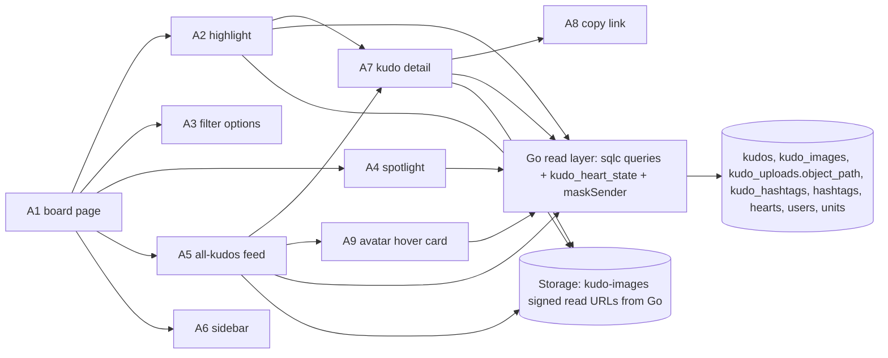
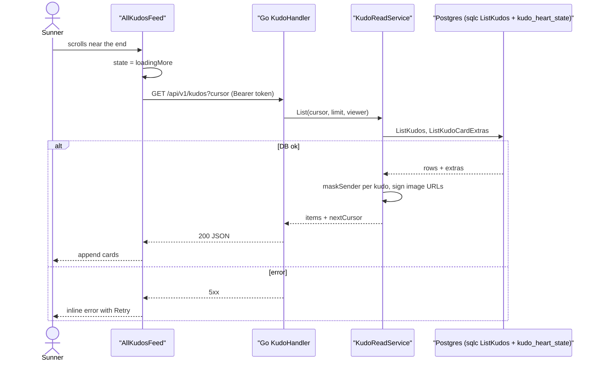
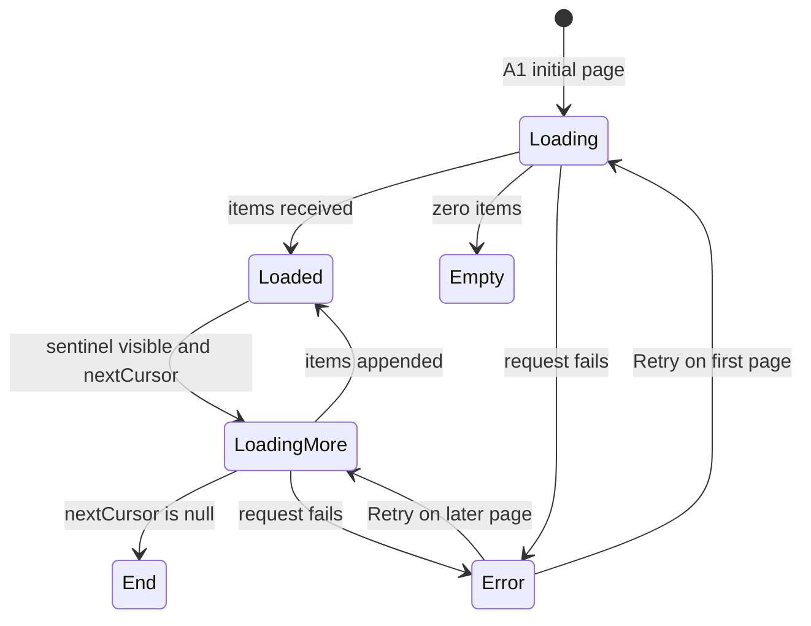

# F006_KudosLiveBoard — Technical Spec

**Priority**: P1
**Type**: ui

**See also:** [`functional-spec.md`](./functional-spec.md) — plain-language overview, open decisions, requirements and business rules, screens, user stories, scenarios, edge cases.

## 1. Technical Overview

The Live board (`/kudos`) and the kudo detail view (`/kudos/[id]`) are read-only Next.js 16 App Router pages; Next.js is frontend only and never touches the database. Server Components call the Go REST API server-side for the first paint (key visual, Highlight, Spotlight, first feed page, sidebar); client components call the same Go endpoints from the browser with the Supabase access token as `Authorization: Bearer` for every interaction that changes data on screen — filters, infinite scroll, avatar hover card. All dynamic data is fetched `no-store`. In Go (`backend/internal/kudo`, stdlib `net/http` ServeMux), every endpoint that returns kudos goes through one read layer: sqlc-generated queries over pgx, the weighted heart total from F008's `kudo_heart_state` SQL view, the shared `maskSender(kudo, viewer)` helper that hides anonymous senders from everyone except admins, and Go-issued signed read URLs for images stored under opaque keys `kudo-images/{uploadId}.{ext}` (Codex R01). Every kudo-returning endpoint emits the one `KudoCard` DTO and list envelope defined in § 4.2 (Codex R15). *Historical note (Codex R14):* the first draft planned Postgres read functions (`highlight_kudos`, `list_kudos`, `get_kudo`, `spotlight_counts`); that design is superseded by G18 — there is no Postgres read function or RPC in this feature, only sqlc queries run by Go, and `kudo_heart_state` is a plain SQL view (owned by F008) that Go reads. Writes (kudos, hearts, secret boxes) belong to F005 and F008; this feature only reads and renders their slots. Nothing is implemented yet; every handler name is a provisional identity.



## 2. Action Index

| # | Action (handler) | Method · Path | Codes | Writes | Detail |
|---|---|---|---|---|---|
| **A0** | *cross-cutting — belongs to no single action* | — | FR-601, FR-602, FR-603 | — | § 4.4 |
| **A1** | `KudosBoardPage#render` (planned) | `GET` `/kudos` | FR-101, FR-201, FR-403, US001 | — *(read-only)* | § 3.1 |
| **A2** | `KudoHandler#highlight` (planned) | `GET` `/api/v1/kudos/highlight` | FR-001, FR-002, FR-202, FR-203, FR-204, FR-211, BR-001, BR-002, BR-003, DEC-001, INT-001, US002, US003 | — *(read-only)* | § 3.1 |
| **A3** | `KudoHandler#filterOptions` (planned) | `GET` `/api/v1/kudos/filter-options` | FR-203, FR-204, US003 | — *(read-only)* | § 3.1 |
| **A4** | `KudoHandler#spotlight` (planned) | `GET` `/api/v1/kudos/spotlight` | FR-205, FR-206, BR-001, BR-004, ALG-002, US004 | — *(read-only)* | § 3.1 |
| **A5** | `KudoHandler#list` (planned) | `GET` `/api/v1/kudos` | FR-001, FR-002, FR-003, FR-207, FR-211, FR-403, BR-001, BR-002, BR-005, DEC-002, DEC-003, SM-001, ALG-001, INT-001, US005 | — *(read-only)* | § 3.1 ▸ **diagram** |
| **A6** | `KudoHandler#sidebar` (planned) | `GET` `/api/v1/kudos/sidebar` | FR-208, FR-209, FR-210, US006 | — *(read-only)* | § 3.1 |
| **A7** | `KudoHandler#get` (planned), rendered by `KudoDetailPage#render` | `GET` `/api/v1/kudos/{id}` (page `/kudos/[id]`) | FR-002, FR-003, FR-102, FR-404, FR-405, FR-104, BR-001, BR-002, BR-006, DEC-004, INT-001, US007 | — *(read-only)* | § 3.2 |
| **A8** | `CopyKudoLink#click` (planned) *(client only)* | — | FR-401, BR-007, US007 | — *(read-only)* | § 3.2 |
| **A9** | `UserHandler#hoverCard` (planned) | `GET` `/api/v1/users/{id}/hover-card` | FR-103, FR-402, BR-002, US008, US009 | — *(read-only)* | § 3.2 |

## 3. Actions

### 3.1 CAP-01 — Browse the Live board

#### A1 · Open the Live board
`GET /kudos` → `KudosBoardPage#render` (planned)
`FR-101` `FR-201` `FR-403` `US001` · `SCR-kudos-live-board`

**Who** · signed-in Sunner. US001 = open Sun* Kudos from the header and see the board.
**FE** · server component composes, top to bottom: key visual "Hệ thống ghi nhận và cảm ơn" KUDOS (FR-201, static), HIGHLIGHT KUDOS (A2), SPOTLIGHT BOARD (A4), ALL KUDOS feed (A5) beside the right sidebar (A6). Header, footer, floating "Viết KUDOS" button and Thể lệ panel come from the F001 shell. Each section has its own loading, empty and error state so one failed section does not blank the page (FR-403). Data refreshes on page load and when the tab regains focus; there is no live push.
**Request** · none from the browser (the Supabase session cookie is read server-side to get the access token)
**BE** · `KudosBoardPage#render` — the sign-in redirect is done by `proxy.ts` (F002); the page calls Go `GET /api/v1/kudos/highlight`, `/filter-options`, `/spotlight`, `/kudos`, `/sidebar` in parallel server-side with the viewer's bearer token (`no-store`) and passes the results to the client section components as initial data.
**Rule** · signed-in only (route guarded by `proxy.ts`; every Go call also verifies the JWT); no per-section dependency — a failing section renders its error state while the rest stay usable.
**Result** · read-only — no DB write. Page HTML plus initial data for each section.
**Source:** `TBD (draft)`

---

#### A2 · Page through Highlight Kudos, with filters
`GET /api/v1/kudos/highlight?hashtagId=&unitId=` → `KudoHandler#highlight` (planned)
`FR-001` `FR-002` `FR-202` `FR-203` `FR-204` `FR-211` `BR-001` `BR-002` `BR-003` `DEC-001` `INT-001` `US002` `US003` · `SCR-kudos-live-board`

**Who** · signed-in Sunner. US002 = browse the standout kudos one at a time; US003 = narrow them by hashtag or department (Phòng ban).
**FE** · HIGHLIGHT KUDOS carousel shows one enlarged kudo card at a time with previous/next and an "n/5" indicator (FR-202). Two dropdowns: Hashtag (`721:5580`) and Phòng ban (`721:5684`) (FR-203, FR-204); picking a value refetches from Go and resets to page 1. Each card carries a heart slot filled by F008 and badge slots filled by F008 (FR-211). This carousel is the only "Kudos Quốc Dân" surface.
**Request** · optional `hashtagId` *(hashtag id)*, optional `unitId` *(unit id)*
**BE** · `KudoHandler#highlight` — `KudoReadService.Highlight` runs sqlc query `HighlightKudos`: public kudos, both filters applied first, left-joined to the `kudo_heart_state` view for the weighted heart total (a kudo with no heart counts as 0), ordered `weighted_hearts desc, created_at desc, id desc`, limit `HIGHLIGHT_MAX`; then builds `KudoCard` DTOs (§ 4.2) through the shared read layer (`maskSender`, signed image URLs — INT-001).
**Rule** · **BR-003 — Highlight (Kudos Quốc Dân) shows at most 5 public kudos ranked by weighted heart total (most first, newer wins ties).** The weighted total is F008's `kudo_heart_state` number (campaign multiplier applied when each heart was given). Every public kudo is a candidate, including kudos with zero hearts (G12), so the carousel holds 5 cards whenever at least 5 public kudos match. Hashtag and unit filters combine with AND and the ranking is done inside the filtered set; the unit filter matches the receiver's unit. BR-001 — only public kudos *(§ 4.4)*; BR-002 — anonymous senders masked *(§ 4.4)*.

| DEC | subtype | Condition | What the user sees | Source |
|---|---|---|---|---|
| **DEC-001** | render | `page == 1` / `page == total` / `total == 0` | previous disabled on first page; next disabled on last page; with no result the carousel shows an empty state and the indicator is hidden | `TBD (draft)` |

**Result** · read-only — **no DB write**. Returns the list envelope `{ items: KudoCard[] (≤5), nextCursor: null }` (§ 4.2, Codex R15); Highlight is not paged, so `nextCursor` is always null and the indicator total is `items.length`.
**Source:** `TBD (draft)`

---

#### A3 · Load filter options
`GET /api/v1/kudos/filter-options` → `KudoHandler#filterOptions` (planned)
`FR-203` `FR-204` `US003` · `SCR-kudos-live-board`

**Who** · signed-in Sunner opening a filter dropdown (US003).
**FE** · the Hashtag dropdown lists hashtags that appear on at least one public kudo; the Phòng ban dropdown lists units. Each has an "all" choice that clears the filter. Options are fetched once per page visit and kept on the client.
**Request** · none
**BE** · `KudoHandler#filterOptions` — sqlc queries `ListPublicKudoHashtags` (distinct `hashtags` linked through `kudo_hashtags` to public kudos) and `ListUnits`, both ordered by name.
**Result** · read-only — **no DB write**. Returns `{hashtags: [{id, name}], units: [{id, name}]}`.
**Source:** `TBD (draft)`

---

#### A4 · Show the Spotlight board
`GET /api/v1/kudos/spotlight` → `KudoHandler#spotlight` (planned)
`FR-205` `FR-206` `BR-001` `BR-004` `ALG-002` `US004` · `SCR-kudos-live-board`

**Who** · signed-in Sunner. US004 = see who is recognized most and look up a colleague by name.
**FE** · SPOTLIGHT BOARD draws a word cloud of Sunner names, larger name = more kudos received (FR-205), with the total counter "388 KUDOS" above it. A search box (FR-206) finds a name in the loaded list: matching names are emphasized, others dimmed; no match shows "no result". Each name is also a link to that Sunner's profile (F007).
**Request** · none (search runs on the client)
**BE** · `KudoHandler#spotlight` — sqlc query `SpotlightCounts` returns the top `SPOTLIGHT_MAX_NAMES` receivers by public kudos received, plus `CountPublicKudos` for the total.
**Rule** · **BR-004 — Spotlight search matches names case-insensitively and ignoring Vietnamese diacritics, on the names already loaded.** No extra request per keystroke. BR-001 — counts only public kudos *(§ 4.4)*. ALG-002 turns counts into name sizes *(§ 4.5)*.
**Result** · read-only — **no DB write**. Returns `{total, names: [{userId, name, count}]}`.
**Source:** `TBD (draft)`

---

#### A5 · Scroll through All Kudos
`GET /api/v1/kudos?cursor=&limit=` → `KudoHandler#list` (planned)
`FR-001` `FR-002` `FR-003` `FR-207` `FR-211` `FR-403` `BR-001` `BR-002` `BR-005` `DEC-002` `DEC-003` `SM-001` `ALG-001` `INT-001` `US005` · `SCR-kudos-live-board`

**Who** · signed-in Sunner. US005 = keep scrolling to read every public kudo, newest first.
**FE** · ALL KUDOS list of kudo cards: sender → receiver (avatar, name, unit code, hero badge slot), timestamp "HH:mm - MM/dd/yyyy", title (Danh hiệu), content, up to 5 images, hashtag group (`1002:13094`), weighted heart count and heart slot (F008), Copy Link (A8). A sentinel near the end of the list asks Go for the next page; clicking a card opens A7. Anonymous cards render the masked sender block (DEC-002).
**Request** · `cursor` *(opaque, from the previous page)*, optional `limit` *(default `FEED_PAGE_SIZE`)*
**BE** · `KudoHandler#list` — `KudoReadService.List` runs sqlc query `ListKudos` (public kudos ordered `created_at desc, id desc`, keyset cursor) and `ListKudoCardExtras` (hashtags, opaque image object keys `kudo_uploads.object_path` joined through `kudo_images.upload_id` in `position` order, only uploads with `kudo_uploads.state = 'attached'` (Codex N02), weighted total from the `kudo_heart_state` view, viewer's own heart from `hearts`) for the page; builds `KudoCard` DTOs (§ 4.2) with `maskSender` and `isOwn`, signs the image keys (INT-001), and returns the next cursor.
**Rule** · **BR-005 — The feed lists public kudos newest first, in pages of `FEED_PAGE_SIZE`, using a keyset cursor (not offset).** A kudo posted while the user scrolls never causes a repeated or skipped card (ALG-001). BR-001 — public only *(§ 4.4)*; BR-002 — masking *(§ 4.4)*.

| DEC | subtype | Condition | What the user sees | Source |
|---|---|---|---|---|
| **DEC-002** | render | `kudo.is_anonymous && viewer.role != 'admin'` | sender block shows a placeholder avatar and the label "Ẩn danh"; no profile link and no hover card | `TBD (draft)` |
| **DEC-003** | render | `items.length == 0` on page 1 / `nextCursor == null` after page 1 | empty-state message / a quiet "end of list" marker, no more requests | `TBD (draft)` |

**Result** · read-only — **no DB write**. Returns the list envelope `{ items: KudoCard[], nextCursor: string | null }` (§ 4.2, Codex R15). `KudoCard` carries `isOwn` (true when the viewer is the sender) and `sender = null` when the sender is masked.
**Source:** `TBD (draft)`



---

#### A6 · Load the right sidebar
`GET /api/v1/kudos/sidebar` → `KudoHandler#sidebar` (planned)
`FR-208` `FR-209` `FR-210` `US006` · `SCR-kudos-live-board`

**Who** · signed-in Sunner. US006 = see my own kudos numbers and who recently received gifts.
**FE** · sidebar shows (a) my stats block — kudos received, kudos sent, weighted hearts received, secret boxes (FR-208); (b) the "Mở Secret Box" button (FR-209), a slot whose behavior and overlay F008 owns — F006 only places it and disables it when F008 reports zero unopened boxes; (c) "10 Sunner nhận quà mới nhất" list of the 10 Sunners who most recently opened a secret box, each avatar + name linking to the profile (FR-210).
**Request** · none
**BE** · `KudoHandler#sidebar` — viewer from the verified JWT; sqlc query `GetViewerKudoStats` counts own public kudos sent/received and sums the weighted hearts received from `kudo_heart_state`; secret-box counts and the latest recipients come from F008's Go service (`SecretBoxService`, planned), not from a separate query here.
**Rule** · stats are always about the signed-in viewer, never taken from a query parameter.
**Result** · read-only — **no DB write**. Returns `{stats: {...}, latestRecipients: [{userId, name, avatarUrl}]}`.
**Source:** `TBD (draft)`

### 3.2 CAP-02 — Read one kudo and interact with it

#### A7 · Open a kudo in detail
`GET /api/v1/kudos/{id}` → `KudoHandler#get` (planned), rendered by `KudoDetailPage#render` at `/kudos/[id]`
`FR-002` `FR-003` `FR-102` `FR-104` `FR-404` `FR-405` `BR-001` `BR-002` `BR-006` `DEC-004` `INT-001` `US007` · `SCR-kudo-detail`

**Who** · signed-in Sunner. US007 = read one kudo enlarged, copy its link, and close it.
**FE** · same card as the feed, enlarged, with "Copy Link" (A8) and "Đóng" (FR-404). From the board it opens as an overlay (intercepting route) and Đóng returns to the board with scroll position kept (FR-102); opened directly from a pasted link it renders as a full page over a fresh board. When `isOwn` is true and the kudo is not marked spam, an edit entry next to Đóng opens F005's modal (FR-104).
**Request** · path param `id` *(kudo uuid; awaited `params` in Next.js 16)*
**BE** · `KudoDetailPage#render` calls Go server-side; `KudoHandler#get` — `KudoReadService.Get` runs sqlc query `GetKudo`, applies BR-006, builds one `KudoCard` DTO (§ 4.2) through `maskSender` with `isOwn` and signed image URLs (INT-001); returns 404 when the kudo is missing or not viewable. The page calls `notFound()` on 404.
**Rule** · **BR-006 — A kudo is viewable only if it is public, or the viewer is its sender or an admin.** Anyone else gets the same 404 as a missing id, so ids cannot be probed. BR-001 — public-only *(§ 4.4)*; BR-002 — masking *(§ 4.4)*.

| DEC | subtype | Condition | What the user sees | Source |
|---|---|---|---|---|
| **DEC-004** | flow | Go returns 404 | the shell's not-found page (F001) instead of the card | `TBD (draft)` |

**Result** · read-only — **no DB write**. Go returns one `KudoCard` (§ 4.2, Codex R15); the page renders it. FR-405 = an unavailable kudo shows the not-found page, never a half card.
**Source:** `TBD (draft)`

---

#### A8 · Copy a kudo's link
`—` → `CopyKudoLink#click` (planned)
`FR-401` `BR-007` `US007` · `SCR-kudo-detail`

**Who** · signed-in Sunner clicking "Copy Link" on a card or in the detail view.
**FE** · button writes the link to the clipboard and swaps its label for a short "Link copied" confirmation that clears itself; if the clipboard is unavailable the full link is selected in a small field instead.
**Rule** · **BR-007 — The shared link is always the absolute detail address `{origin}/kudos/{id}`.** It carries no filters or scroll state, and opening it follows the same access rule as A7.
**Result** · read-only — nothing leaves the browser.
**Source:** `TBD (draft)`

---

#### A9 · Preview a Sunner by hovering an avatar
`GET /api/v1/users/{id}/hover-card` → `UserHandler#hoverCard` (planned)
`FR-103` `FR-402` `BR-002` `US008` `US009` · `SCR-kudos-live-board`

**Who** · signed-in Sunner. US008 = hover a card avatar and see who that is; US009 = click it to open that Sunner's profile.
**FE** · hovering (or keyboard-focusing) an avatar for `HOVER_CARD_DELAY_MS` shows the info card (`721:5827`, `2268:35101`): avatar, name, unit code, hero badge slot (F008), kudos received/sent counts. Clicking avatar or name goes to the profile (F007) (FR-103). Masked anonymous senders have neither hover nor link (DEC-002), so no request is made for them.
**Request** · path param `id` *(user uuid)*
**BE** · `UserHandler#hoverCard` in `backend/internal/user` — viewer from JWT; sqlc query `GetUserHoverCard` reads `users` + `units` (`units.code`, owned by F002) and counts public kudos sent/received; hero tier from F008's Go service.
**Rule** · BR-002 — the endpoint never returns data that would reveal an anonymous sender: the sent-count excludes the user's anonymous kudos unless the viewer is an admin *(§ 4.4)*.
**Result** · read-only — **no DB write**. Returns `{name, avatarUrl, unitCode, heroTier, receivedCount, sentCount}` — `unitCode` from `units.code`, null when the user has no unit, the same field the `KudoCard` people blocks carry (Codex R15); 404 for an unknown id.
**Source:** `TBD (draft)`

### 3.3 Edge cases

| Action | Scenario | Behavior |
|---|---|---|
| A2 · A5 | A kudo is marked spam by an admin while the board is open | It disappears on the next fetch; already rendered cards stay until refresh |
| A2 | Filters match nothing | Empty state (DEC-001); other sections unaffected |
| A2 | Fewer than 5 public kudos match | Indicator shows "1/n" with the real n |
| A2 | Some or all candidates have zero hearts | They still rank (weighted total 0), ordered newer first, then `id` (G12) |
| A2 | Two kudos have the same weighted heart total | The newer kudo ranks first; `id` breaks exact time ties |
| A4 | Search matches nobody | "No result" under the box; cloud shows no emphasized name |
| A4 | Fewer names than cloud capacity | Cloud still renders; size scale clamps (ALG-002) |
| A5 | Two kudos share the same timestamp | Cursor includes `id`, so order is stable (ALG-001) |
| A5 | Page request fails | Inline error with Retry; already loaded cards stay (SM-001) |
| A5 · A7 | Image signed URL expires while page is open | Image fails; client refetches the card once, else shows a placeholder |
| A5 · A7 | Kudo has 0 images | Image row is omitted |
| A7 | Id is not a valid uuid | Go returns 404; treated as not found (DEC-004) |
| A7 | Direct link opened by a signed-out visitor | `proxy.ts` redirects to Login, then returns to the link |
| A8 | Clipboard permission denied | Fallback selectable field (A8) |
| A9 | Hover on a masked anonymous sender | No card, no request |
| A9 | Hover moves away before the delay | Request is not sent |
| A0 | Any call without a valid bearer token | Go auth middleware rejects with 401 before querying |

## 4. Shared Foundation

### 4.1 Components

| Component | Responsibility | Used in | File |
|---|---|---|---|
| `KudoCard` | One kudo: sender → receiver, time, title, content, images, hashtags, heart slot, Copy Link; variants `feed`, `highlight`, `detail` | A2, A5, A7 | `TBD (draft)` |
| `HighlightCarousel` | Paged carousel with n/5 indicator and two filter dropdowns | A2, A3 | `TBD (draft)` |
| `FilterDropdown` | Single-select list with an "all" choice (Hashtag, Phòng ban) | A3 | `TBD (draft)` |
| `SpotlightBoard` | Word cloud, total counter, name search | A4 | `TBD (draft)` |
| `AllKudosFeed` | Infinite list, sentinel, loading/empty/end/error | A5 | `TBD (draft)` |
| `BoardSidebar` | Stats block, secret-box button slot, latest recipients | A6 | `TBD (draft)` |
| `SunnerAvatarHover` | Avatar with delayed hover card and profile link | A5, A9 | `TBD (draft)` |
| `HashtagGroup` | Row of hashtag chips on a card | A2, A5, A7 | `TBD (draft)` |
| `CopyLinkButton` | Clipboard write and confirmation | A8 | `TBD (draft)` |
| `HeartSlot`, `HeroBadgeSlot` | Placeholders filled by F008 components | A2, A5, A7, A9 | `TBD (draft)` |
| `KudoHandler` / `KudoReadService` | Go read endpoints and `KudoCard` DTO assembly (hearts, images, masking) — the one producer of the shared DTO in § 4.2, also called by F007 | A2–A7 | `backend/internal/kudo` (planned) |
| `maskSender(kudo, viewer)` | Shared Go helper: nulls sender fields for anonymous kudos unless the viewer is an admin; sets `isOwn` | A2, A5, A7 | `backend/internal/kudo` (planned, shared with F005, F007, F008, F009, F011) |
| `UserHandler#hoverCard` | Go hover-card endpoint | A9 | `backend/internal/user` (planned) |
| sqlc queries | `HighlightKudos`, `ListPublicKudoHashtags`, `ListUnits`, `SpotlightCounts`, `CountPublicKudos`, `ListKudos`, `ListKudoCardExtras`, `GetViewerKudoStats`, `GetKudo`, `GetUserHoverCard` | A2–A7, A9 | `backend/db/queries` (planned) |

### 4.2 Data Model

#### Key Entities

| Entity | Table | Key Columns | Purpose |
|--------|-------|-------------|---------|
| kudo | `kudos` | `id`, `sender_id`, `receiver_id`, `title`, `content`, `is_anonymous`, `status`, `created_at` | Read only here; F005 writes, F011 changes `status` |
| kudo image | `kudo_images` (F005) | `kudo_id`, `upload_id` (unique → `kudo_uploads.id`), `position` | Read only; shown in `position` order. Holds no path: the object key is read by joining `kudo_uploads` on `upload_id` (Codex R01). The current `kudo_images` rows are the only source of a kudo's images — F006 never finds images through `kudo_uploads.kudo_id`, which stays set on removed (`pending_delete`) uploads (Codex N02) |
| upload record | `kudo_uploads` (F005, server-only) | `id`, `object_path`, `owner_id`, `kudo_id`, `state` (`pending` \| `attached` \| `pending_delete`) | Read only, via the `kudo_images.upload_id` join filtered to `state = 'attached'` (Codex N02): F006 selects only `object_path` (`kudo-images/{uploadId}.{ext}`, random `uploadId`, no user id) to sign it. **`owner_id` is never selected by F006 queries**; it is the only link from an image to its uploader and stays server-side (Codex R01) |
| hashtag | `hashtags` | `id`, `name` | Read only; filter options and card chips |
| kudo hashtag | `kudo_hashtags` | `kudo_id`, `hashtag_id` | Read only; hashtag filter join |
| heart | `hearts` | `kudo_id`, `user_id`, `weight`, `campaign_id` | Read only here: the viewer's own heart; F008 writes |
| kudo heart state | `kudo_heart_state` (SQL view, F008) | `kudo_id`, weighted total (`sum(hearts.weight)`) | Read only: the one heart number shown on cards, used for Highlight ranking and sidebar totals |
| secret box | `secret_boxes` | `user_id`, `opened_at`, `icon` | Read only here via F008's Go service: sidebar counts and latest recipients |
| user | `users` | `id`, `name`, `avatar_url`, `unit_id`, `role` | Read only: names, avatars, admin check |
| unit | `units` (F002) | `id`, `name`, `code` | Read only: `name` labels the Phòng ban filter; `code` (for example `CECV2`, `text not null unique`, owned and seeded by F002) is the unit shown on cards and hover cards (Codex R15) |

This feature owns no table, no view and no database function or RPC (Codex R14). It adds sqlc queries in `backend/db/queries` only; browser roles have no table grants and RLS is deny-all as defence in depth. MODEL### codes: `TBD (draft)` (allocated at promote).

#### KudoCard DTO and list envelope (shared contract, Codex R15)

F006 owns this one DTO. Every Go response that returns kudos — board (A2, A5), detail (A7) and F007's profile lists — emits exactly this shape; consumers do not add or rename fields.

```text
KudoCard {
  id: uuid
  createdAt: ISO-8601 timestamp
  title: string
  contentHtml: string                      # sanitized HTML as stored by F005
  isAnonymous: boolean
  sender: { id, name, avatarUrl, unitCode, heroTier } | null   # null when masked (BR-002)
  receiver: { id, name, avatarUrl, unitCode, heroTier }
  hashtags: string[]
  images: [{ url, width?, height? }]       # Go-signed read URLs of opaque keys (INT-001)
  heart: { total, viewerHearted, viewerCanHeart }
  isOwn: boolean
  status: 'public' | 'spam'
}

List envelope { items: KudoCard[], nextCursor: string | null }
  nextCursor = opaque base64 keyset of (created_at, id) of the last returned row; null on the last page
```

- `unitCode` comes from `units.code` (F002); null when the person has no unit. `heroTier` is F008's derived tier for that person (values owned by F008).
- `heart.total` is `kudo_heart_state.heart_total` (weighted, 0 when no heart); `viewerHearted` is whether the viewer has a `hearts` row; `viewerCanHeart` is false when the viewer is the real sender (G06). Heart behavior belongs to F008.
- `status` is `public` everywhere except A7, where the sender or an admin may receive `spam` (BR-006).
- **No stable author identifier in an anonymous card (Codex R01).** When `maskSender` masks a card, `sender` is null and no other field, URL, HTML attribute or file name carries the sender's id: image URLs sign opaque `kudo-images/{uploadId}.{ext}` keys, `contentHtml` is the stored text with no author metadata added, and `isOwn` is true only for the sender viewing their own kudo. The same applies to every consumer of this DTO (board, detail, profile lists).

#### Polymorphic Behavior

| DISC | Entity.field | Values | Effect here |
|---|---|---|---|
| `TBD (draft)` | `kudos.status` | `public` / `spam` | Only `public` is listed (BR-001); owned and written by F011 |
| `TBD (draft)` | `kudos.is_anonymous` | `true` / `false` | `true` masks the sender for non-admin readers (BR-002) |
| `TBD (draft)` | `users.role` | `user` / `admin` | `admin` sees the real sender (functional-spec D003, G04) |

DISC-### codes: `TBD (draft)` (assigned by the data-model pass).

### 4.3 State Management

### The All Kudos feed moves between loading, loaded, loading more, end and error (SM-001)
**kind:** ui
**Linked FR:** FR-207
**Source:** `TBD (draft)`



### 4.4 Shared Rules

#### Bin 3 — cross-cutting, belongs to no single action

**A0 · FR-601 / FR-602 / FR-603 — every read needs a verified bearer token, every kudo read goes through one Go read layer with `maskSender`, and images are served by Go-signed URLs.**
The Go auth middleware (F002) verifies the Supabase JWT against Supabase JWKS and loads the viewer's role on every request; missing or invalid tokens get 401, and `proxy.ts` redirects signed-out page visits to sign-in. Next.js never reads the database; browser roles have no table grants. Every Go endpoint that returns kudos builds its DTOs through `KudoReadService`, which calls `maskSender(kudo, viewer)` — the single place that hides anonymous senders (X05). Signed image read URLs are created in Go only. **Cross-cutting — not a rule of one action.**
**Source:** `TBD (draft)`

#### Bin 2 — used by ≥2 named actions

**BR-001 — Only public kudos are shown.**
Used in: **A2** · **A4** · **A5** · **A7**. Kudos with `status = 'spam'` (F011) never appear in lists, counters or the word cloud. A7 widens this only for the sender and admins (BR-006).
**Source:** `TBD (draft)`
```text
where kudos.status = 'public'
```

**BR-002 — The sender of an anonymous kudo is hidden from everyone except admins.**
Used in: **A2** · **A5** · **A7** · **A9**. `maskSender` returns no sender id, name, avatar, unit code or hero tier for such a kudo unless the viewer is an admin; `isOwn` is returned instead so the sender's own UI can still offer edit. Image URLs of the kudo sign opaque keys that hold no user id, so a masked card carries no stable author identifier in any field or URL (Codex R01). Counts that would let a viewer deduce the sender (A9 sent-count) skip anonymous kudos for non-admins.
**Source:** `TBD (draft)`
```text
func maskSender(kudo, viewer):
    kudo.isOwn = (kudo.sender_id == viewer.id)
    if kudo.is_anonymous and viewer.role != 'admin':
        kudo.sender = null
    return kudo
```

### 4.5 Algorithms & Integrations

### The feed cursor is the last row's time and id, so paging never repeats or skips (ALG-001)
**Linked FR:** FR-207
**Used in:** A5
**Source:** `TBD (draft)`
**Input:** cursor `(created_at, id)` or none, limit · **Output:** items, next cursor · **Complexity:** O(limit) with an index on `(created_at desc, id desc)` for public kudos
**Description:** keyset pagination in the sqlc query `ListKudos`; the cursor is the opaque base64 encoding of the last row's `(created_at, id)` (the `nextCursor` of the § 4.2 list envelope, Codex R15); clients pass it back unchanged and a malformed cursor is rejected with 400.

**Pseudocode:**
```text
rows = select ... where status='public' and (created_at, id) < cursor
       order by created_at desc, id desc limit n+1
next = rows.length > n ? encode(rows[n-1].created_at, rows[n-1].id) : null
return rows[0..n-1], next
```

### Name sizes in the word cloud scale with kudos received (ALG-002)
**Linked FR:** FR-205
**Used in:** A4
**Source:** `TBD (draft)`
**Input:** names with counts · **Output:** size step per name · **Complexity:** O(n)
**Description:** maps each count linearly between min and max count onto `SPOTLIGHT_SIZE_STEPS` buckets so the busiest name is largest; all equal counts give the middle size; placement is a simple packed layout, not physics (YAGNI).

**Pseudocode:**
```text
for n in names:
    t = (n.count - min) / max(1, max - min)
    n.step = 1 + round(t * (SPOTLIGHT_SIZE_STEPS - 1))
```

### Card images are served by short-lived signed URLs issued by Go from the private bucket (INT-001)
**Linked FR:** FR-002
**Used in:** A2, A5, A7
**Source:** `TBD (draft)`
**Type:** api-call
**Target:** Supabase Storage bucket `kudo-images` (private, created by F005); Go holds the service key
**Payload:** opaque object keys `kudo-images/{uploadId}.{ext}` in — read from `kudo_uploads.object_path` via the `kudo_images.upload_id` join, `state = 'attached'` only (Codex N02) (random `uploadId` UUID, written by F005; no user id in any key, URL or file name) — signed read URLs out as `KudoCard.images[].url`, created by `KudoReadService` in one batch per response. Upload ownership lives only in F005's server-side `kudo_uploads.owner_id`, which F006 never returns (Codex R01).
**Failure handling:** a key that cannot be signed yields no URL; the card shows an image placeholder instead of failing the whole response.

### 4.6 Configuration

```text
HIGHLIGHT_MAX = 5                  # BR-003
FEED_PAGE_SIZE = 10                # BR-005
SPOTLIGHT_MAX_NAMES = 100          # A4 cloud capacity (assumed)
SPOTLIGHT_SIZE_STEPS = 5           # ALG-002 (assumed)
SIDEBAR_RECIPIENTS = 10            # FR-210
HOVER_CARD_DELAY_MS = 300          # A9 (assumed)
SIGNED_URL_TTL_SECONDS = 3600      # INT-001 (assumed)
STORAGE_BUCKET = kudo-images       # INT-001
```

**Client behavior:** see behavior-logic.md, permissions.md, architecture.md

## 5. Verification & Technical Notes

### 5.1 Technical Verification

- **SC-001** *(A2, A5, A7)* a spam kudo never appears in highlight, feed, spotlight counts or detail for a plain Sunner (covers BR-001, BR-006, FR-001)
- **SC-002** *(A2, A5, A7, A9)* for an anonymous kudo, no Go response body for a non-admin contains the sender's id, name, avatar, unit code or hero tier; the sender gets `isOwn = true`; an admin gets the real sender (covers BR-002, FR-003, FR-602)
- **SC-007** *(A2, A5, A7; Codex R01)* third-user inspection: user S sends an anonymous kudo with images to R; user T (neither S, R nor admin) reads it through Highlight, the feed and the detail; every field of each `KudoCard`, every image URL (path and query) and the rendered HTML (attributes, `alt`, file names) are inspected — none contains S's user id, name, email or any other stable identifier of S, and each image key matches `kudo-images/{uuid}.{ext}` (covers BR-002, FR-003, FR-602, FR-603, INT-001)
- **SC-008** *(A2, A5, A7; Codex R15)* responses validate against the § 4.2 `KudoCard` shape and list envelope: `nextCursor` is null on the last page and on Highlight, `unitCode` equals `units.code` of each person (null without a unit)
- **SC-009** *(A2)* with fewer than 5 hearted public kudos, Highlight still fills up to 5 cards from zero-heart public kudos, newer first (covers BR-003, G12)
- **SC-003** *(A5)* paging through 25 kudos with a new kudo inserted midway yields no duplicate and no gap in the already-started sequence (covers ALG-001, BR-005)
- **SC-004** *(A2)* the top 5 are ordered by weighted heart total from `kudo_heart_state` with newer winning ties, and with a filter the ranking is taken inside the filtered set (covers BR-003, FR-202..FR-204)
- **SC-005** *(A0)* every Go endpoint returns 401 without a valid bearer token (covers FR-601)
- **SC-006** *(A7)* a missing id, a non-uuid id and another person's spam kudo all end in the same not-found page (covers BR-006, FR-405)

#### US005 *(A5)*

**Independent Test:** open `/kudos` with 25 public kudos and scroll to the bottom.

**Acceptance Scenarios:**

1. **Given** 25 public kudos, **When** I scroll to the end twice, **Then** 10 + 10 + 5 cards show in newest-first order and an end marker appears.
2. **Given** no kudos, **When** the board opens, **Then** the feed shows its empty state.

#### US007 *(A7, A8)*

**Independent Test:** open a kudo, press Copy Link, paste in a new tab, press Đóng.

**Acceptance Scenarios:**

1. **Given** a public kudo, **When** I press Copy Link, **Then** the clipboard holds `{origin}/kudos/{id}` and "Link copied" shows.
2. **Given** the copied link, **When** another signed-in Sunner opens it, **Then** the same kudo shows.

#### US008 *(A9)*

**Independent Test:** hover the avatar of a non-anonymous sender, then an anonymous one.

**Acceptance Scenarios:**

1. **Given** a named sender, **When** I hover the avatar for 300 ms, **Then** the info card shows name, unit, badge and counts.
2. **Given** an anonymous kudo, **When** I hover the sender block, **Then** no card appears.

### 5.2 Assumptions

- *(A0)* Masking is enforced in the Go read layer by `maskSender` (X05; the earlier database-function plan is historical only, superseded by G18 — Codex R14); the browser has no table access, so no column-level revoke is needed.
- *(A2, A5, A7)* F005 stores image object keys as `kudo_uploads.object_path` = `kudo-images/{uploadId}.{ext}` and links them to kudos through `kudo_images(kudo_id, upload_id, position)` (Codex R01); F006 joins, signs `object_path` and never returns `owner_id`. Upload lifecycle is `kudo_uploads.state` (`pending` → `attached` → `pending_delete`); F006 reads only `attached` uploads referenced by a current `kudo_images` row, never `kudo_id` alone (Codex N02).
- *(A1, A7)* Next.js 16: `params` is a Promise to await; `notFound()` renders the F001 not-found page; opening detail over the board uses an intercepting route with a full-page fallback. Confirm against `node_modules/next/dist/docs/` before building (AGENTS.md warns of breaking changes).
- *(A2, A5)* Filters apply to Highlight only; the feed and Spotlight are unfiltered (functional-spec D002).
- *(A2, A5, A6)* F008 provides the `kudo_heart_state` view (weighted totals) and a Go service for unopened secret-box count, hero tier and latest gift recipients; F006 does not compute them.
- *(A5)* Data refreshes on page load and on tab refocus; no live push in v1 (YAGNI); no Redis cache.
- *(A4)* Total counter and counts come from public kudos only, so a spam flag lowers them.

### 5.3 Unresolved Questions

1. **Cost of aggregate counts** *(A4, A9)*: public-kudo counts per user on every request — index or materialized view needed once volume is known?
2. **Feed hearts count freshness** *(A5)*: stale until refresh after F008 toggles a heart — is optimistic local update from the F008 slot enough?

Resolved: Highlight ranking = weighted hearts over all public kudos including zero-heart ones, newer wins ties, top 5, ranked inside filters (G12, G08); card DTO shape, list envelope and unit code (`units.code`) fixed in § 4.2 (Codex R15); opaque image keys (Codex R01); gift = secret box opened (D006, AD06); overlay from the board with full-page fallback for direct links (D005, AD06).

### 5.4 Source References

No source code written yet — see `## 7. User Stories` in functional-spec.md for planned behavior.

#### Data Flow

```text
/kudos -> KudosBoardPage (server) -> Go GET /api/v1/kudos/{highlight|filter-options|spotlight|sidebar} + /api/v1/kudos (Bearer, no-store)
       -> Go auth middleware (JWT, role) -> KudoReadService: sqlc queries + kudo_heart_state
       -> public only (BR-001) + maskSender (BR-002) + signed URLs of opaque image keys -> KudoCard DTOs ({items, nextCursor}) -> client sections
filters/scroll/hover (browser) -> same Go endpoints with Bearer -> DTOs
/kudos/[id] -> Go GET /api/v1/kudos/{id} -> DTO | 404 -> notFound()
```

### 5.5 Artifact References

| Artifact | File | Codes Used | Reviewed |
|----------|------|------------|----------|
| Feature List | [feature-list.md](../feature-list.md) | F006 | [x] |
| Gap Resolution Log | [gap-resolution-log.md](../gap-resolution-log.md) | G04, G06, G08, G12, G15–G19, AD06, AD13, X02, X05 | [x] |
| Codex Resolution Contract | [codex-findings-resolution-contract.md](../../reports/codex-findings-resolution-contract.md) | R01, R14, R15; addendum N02 | [x] |
| API Map | `TBD (draft)` | TBD (draft) | [ ] |
| Entities | `TBD (draft)` | TBD (draft) | [ ] |
| Screens | [functional-spec.md § 6](./functional-spec.md) | TBD (draft) | [ ] |
| Behavior Logic | `TBD (draft)` | TBD (draft) | [ ] |
| Permissions Matrix | `TBD (draft)` | TBD (draft) | [ ] |
| User Stories | [functional-spec.md § 7](./functional-spec.md) | US001, US002, US003, US004, US005, US006, US007, US008, US009 | [ ] |
