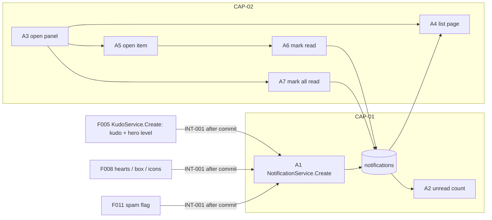
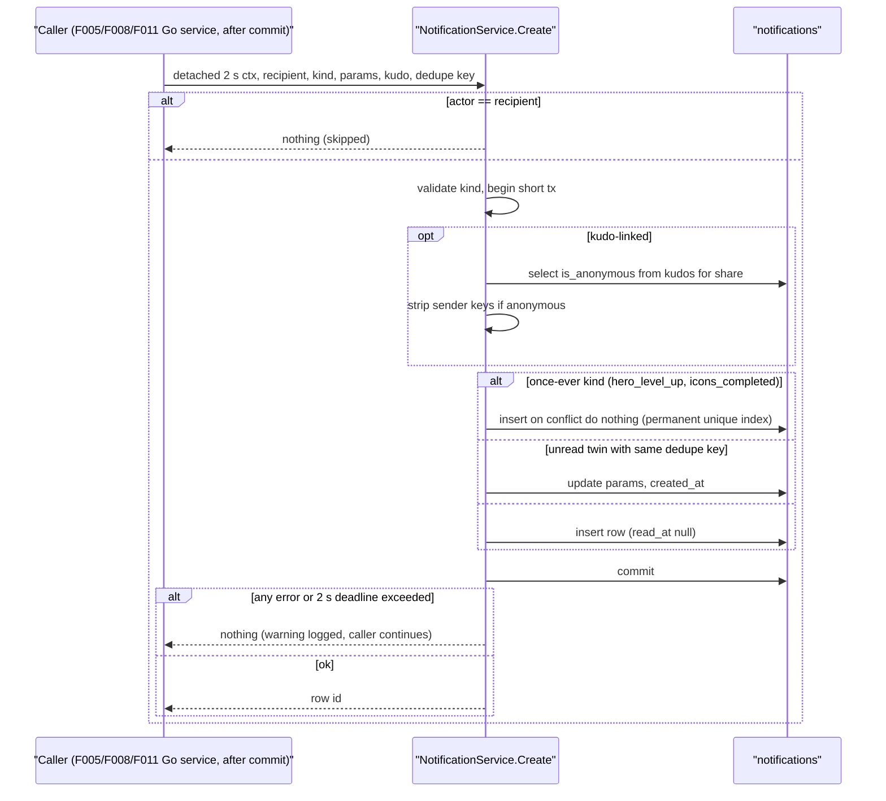
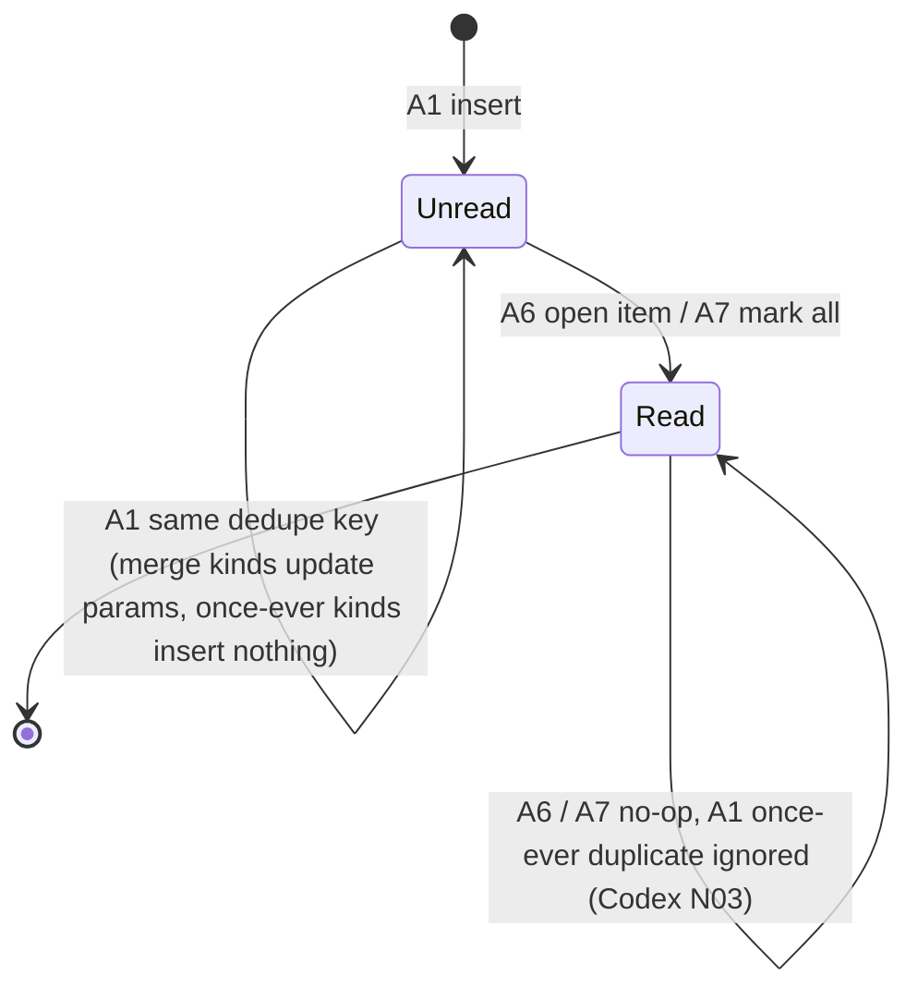

# F009_Notifications — Technical Spec

**Priority**: P2
**Type**: mixed

**See also:** [`functional-spec.md`](./functional-spec.md) — plain-language overview, open decisions, requirements and business rules, screens, user stories, scenarios, edge cases.

## 1. Technical Overview

One Postgres table, `notifications`, holds a row per recipient with a `kind`, a small `params` JSON, an optional `kudo_id`, `read_at` and `created_at`; message text is never stored but built in the browser from `kind` + `params` in the active VN/EN locale. The Go backend (`backend/internal/notification`) owns the table: other Go services write rows through one shared `NotificationService.Create` method, called after their own transaction commits (F005 `kudo_received`, `hero_level_up` (Codex N04); F008 `heart_received`, `secret_box_received`, `icons_completed`; F011 `kudo_spam_warning`); there is no Postgres producer function (Codex R14). The two once-ever kinds `hero_level_up` and `icons_completed` are stored at most once per recipient and dedupe key, ever, whatever their read state (Codex N03). The kinds are exactly these seven: `kudo_received`, `heart_received`, `secret_box_received`, `hero_level_up`, `kudo_spam_warning`, `icons_completed`, `generic`. Post-commit creation runs with its own 2 s context detached from the request; a failure or timeout is logged and never changes the caller's successful response (Codex R23). Anonymity is enforced three times: a kudo-linked create runs in a short transaction that reads the kudo's `is_anonymous` under `for share` and strips sender fields before insert when it is anonymous (serialized with F005's edit, which holds `for update` on the same kudo row — Codex N01); when F005's edit turns a kudo anonymous, the same Go transaction redacts the sender fields from every notification with that `kudo_id`; and every list read re-masks sender fields by the kudo's CURRENT `is_anonymous` for non-admin viewers (Codex R02). No stored row ever carries a sender for a kudo that was anonymous at any time after that row's insert, and turning anonymity off never re-adds names (Codex N01). Sunners only read their own rows and flip `read_at` through four Go REST endpoints under `/api/v1/me/notifications`, called from Next.js Client Components with the Supabase access token as `Authorization: Bearer`; Go middleware verifies the token against Supabase JWKS and every query is filtered by the verified user id (sqlc over pgx). Next.js never touches the database and uses no Server Actions or route handlers here. The bell (F001) reads the unread count and opens a panel and detail window owned here. There is no admin review notice and no `review_requested` kind (G10). Nothing is implemented yet; every handler name is a provisional identity.



## 2. Action Index

| # | Action (handler) | Method · Path | Codes | Writes | Detail |
|---|---|---|---|---|---|
| **A0** | *cross-cutting — belongs to no single action* | — | FR-601, FR-602 | — | § 4.4 |
| **A1** | `NotificationService#Create` (planned) *(internal Go method, no HTTP route)* | Go call · `NotificationService.Create` | FR-001, FR-002, FR-003, FR-603, BR-002, BR-003, BR-004, BR-006, INT-001, US006 | `notifications` | § 3.1 ▸ **diagram** |
| **A2** | `NotificationHandler#unreadCount` (planned) | `GET` `/api/v1/me/notifications/unread-count` | FR-205, FR-404, BR-001, US001 | — *(read-only)* | § 3.1 |
| **A3** | `NotificationPanel#open` (planned) *(client only)* | — | FR-004, FR-101, FR-201, FR-202, FR-203, FR-204, DEC-001, DEC-003, ALG-001, US002, US005 | — *(read-only)* | § 3.2 |
| **A4** | `NotificationHandler#list` (planned) | `GET` `/api/v1/me/notifications` | FR-203, FR-403, FR-603, BR-001, BR-007, US002, US005 | — *(read-only)* | § 3.2 |
| **A5** | `NotificationItem#open` (planned) *(client only)* | — | FR-004, FR-102, FR-103, FR-206, DEC-002, ALG-001, US003 | — *(read-only; calls A6)* | § 3.2 |
| **A6** | `NotificationHandler#markRead` (planned) | `POST` `/api/v1/me/notifications/{id}/read` | FR-401, FR-405, BR-001, BR-005, SM-001, US003 | `notifications` | § 3.2 |
| **A7** | `NotificationHandler#markAllRead` (planned) | `POST` `/api/v1/me/notifications/read-all` | FR-402, FR-405, BR-001, BR-005, SM-001, US004 | `notifications` | § 3.2 |

## 3. Actions

### 3.1 CAP-01 — Get notified of events about me

#### A1 · Create a notification (shared entry point for other features)
`Go call · NotificationService.Create` → `NotificationService#Create` (planned) in `backend/internal/notification`
`FR-001` `FR-002` `FR-003` `FR-603` `BR-002` `BR-003` `BR-004` `BR-006` `INT-001` `US006`

**Who** · the system on behalf of another feature, never a Sunner; there is no HTTP route and no Postgres producer function for it (Codex R14). US006 = a Sunner is told about kudos, hearts, boxes, levels, icons and warnings about them. FR-001 = one row per recipient with kind, message values, optional kudo link, read state, time; FR-002 = `kind` is one of the seven fixed kinds in § 4.2 (Codex R14); FR-003 = every producing Go service uses this one method (INT-001); FR-603 = anonymous kudos never expose the sender.
**Request** · Go struct `CreateNotificationInput{RecipientID, ActorID, Kind, Params, KudoID *(optional)*, DedupeKey *(optional)*}`; `Params` is kind-specific and carries no sender identity for anonymous kudos. Callers and kinds (each after its own transaction commits): F005 `KudoService.Create` → `kudo_received`, and `hero_level_up` when the receiver's tier rose (Codex N04); F008 heart → `heart_received`, box grant → `secret_box_received`, first 6th icon → `icons_completed` (dedupe `icons_completed:{userId}`); F011 spam flag → `kudo_spam_warning` (F011 never emits tier notices); `generic` is seeded by the team only (D007). There is no `review_requested` kind (G10, D003).
**BE** · `NotificationService#Create` — validates `Kind` against the allowed set, applies the rules below, then writes in its own short transaction: when `KudoID` is set it first runs sqlc `LockKudoAnonymity` (`select is_anonymous from kudos where id = $1 for share`) and strips the sender fields when it is true (BR-002, Codex N01); then for a once-ever kind (`hero_level_up`, `icons_completed`) it runs sqlc `InsertOnceNotification` (insert `on conflict do nothing` on the permanent once-ever unique index, Codex N03), and for every other kind sqlc `UpsertNotification` (insert, or update the unread twin when a dedupe key matches via `on conflict` on the unread-merge partial unique index); it commits and returns the row id or nothing.
**Hero event mapping (Codex N04)** · F005 hands the post-commit notifier `{receiverId, fromTier, toTier, sendersCount}` (`sendersCount` = the receiver's distinct-sender after-count captured under F005's receiver row lock). The notifier calls `Create` with `RecipientID = receiverId`, `Kind = hero_level_up`, `Params = {levelKey: toTier, fromLevelKey: fromTier, sendersCount: sendersCount}`, `DedupeKey = hero_level:{receiverId}:{toTier}`, no `KudoID`. `buildNotificationMessage` renders it from `levelKey` (translated tier name) and `sendersCount` in VN and EN; `fromLevelKey` is kept for wording that names the previous tier.
**Rule** · **BR-002 — A notification about an anonymous kudo never names or points to its sender.** The caller passes `senderName = nil` and no sender id when `kudos.is_anonymous`; the caller's view can be stale, so the service decides by the kudo row itself: inside its own transaction it takes `select is_anonymous from kudos where id = $1 for share` and, when true, drops the sender fields (`senderId`, `senderName`, `senderAvatarUrl`) from `Params` before the insert (Codex N01). F005's edit holds `for update` on the same kudo row, so a create and an anonymity edit are serialized: a create that commits before the edit is redacted by the edit's own statement below, and a create that runs after the edit sees `is_anonymous = true` and stores no sender. When F005's `PATCH /api/v1/kudos/{id}` turns `is_anonymous` on, the same Go transaction redacts those sender fields from `notifications.params` of every row with that `kudo_id` (read and unread), and A4 re-masks on read by the kudo's current `is_anonymous` (BR-007, Codex R02). Together no stored row ever carries a sender for a kudo that was anonymous at any time after that row's insert; turning anonymity off never re-adds names, to old or late notices (Codex N01). **BR-003 — A Sunner is not notified about their own action.** The service returns without inserting when `ActorID` equals `RecipientID` (`ActorID` is never stored). **BR-004 — A repeat of the same event updates the earlier unread notification instead of adding one; a once-ever event is never stored twice.** For the once-ever kinds `hero_level_up` and `icons_completed`, a second event with the same recipient and `DedupeKey` (`hero_level:{receiverId}:{toTier}`, `icons_completed:{userId}`) inserts nothing (`on conflict do nothing`), whether the first notice is read or unread (Codex N03). For every other kind, when `DedupeKey` is set and an unread row exists for the same recipient and key (e.g. `heart:{kudoId}`), the row's `params` are replaced and `created_at` is bumped to now; once read, the next event creates a new row. **BR-006 — A failure here never blocks the action that caused it.** The caller invokes the method only after its own transaction (kudo, heart, box, flag) has committed, passing a fresh context with a 2 s deadline detached from the request context (`context.WithoutCancel(reqCtx)` + `context.WithTimeout(..., 2*time.Second)`), so a client disconnect does not cancel it and a stalled database cannot hold the response beyond that bound; the method recovers from any error (including a panic or deadline exceeded), logs a warning with recipient and kind, and returns no error the caller must act on, so the caller's successful mutation response is never changed (Codex R23).
**Result**
- Writes `notifications` ← one new row (`read_at = null`), or updates the unread twin's `params` and `created_at` (merge kinds), or nothing for a once-ever duplicate (Codex N03) — `TBD (draft)`
- Returns the row id, or nothing when skipped (self-action, once-ever duplicate) or failed
- User sees: nothing directly; the bell dot appears on the recipient's next refresh (A2)
**Source:** `TBD (draft)`



---

#### A2 · Get the unread count for the bell
`GET /api/v1/me/notifications/unread-count` → `NotificationHandler#unreadCount` (planned) in `backend/internal/notification`
`FR-205` `FR-404` `BR-001` `US001`

**Who** · signed-in Sunner on any full-shell page. US001 = see from anywhere that something is unread.
**FE** · the bell (F001 `NotificationBell`) shows its dot when `unreadCount > 0` (FR-205). The count is fetched from the browser (Client Component, bearer token) on page load, when the window regains focus, and every `UNREAD_REFRESH_INTERVAL_MS` while visible (FR-404: new notifications light the bell without a reload; D010 default, live push optional later). The panel (A3) also refreshes it after every mark-read.
**Request** · none; the recipient is the verified token user.
**BE** · `NotificationHandler#unreadCount` — auth middleware verifies the Supabase JWT and puts the user id in the request context; `NotificationService.UnreadCount` runs sqlc `CountUnreadNotifications` (`recipient_id = $user and read_at is null`, partial index), returns `{unreadCount}`.
**Rule** · BR-001 — only the caller's own rows are counted *(§ 4.4)*; a missing or invalid token returns 401.
**Result** · read-only — **no DB write**. Returns `{unreadCount: number}`. On failure the bell keeps its last known state and does not show an error.
**Source:** `TBD (draft)`

### 3.2 CAP-02 — Read and manage my notifications

#### A3 · Open the notification panel from the bell (client)
`—` → `NotificationPanel#open` (planned)
`FR-004` `FR-101` `FR-201` `FR-202` `FR-203` `FR-204` `DEC-001` `DEC-003` `ALG-001` `US002` `US005` · `SCR-notification-panel`

**Who** · signed-in Sunner. US002 = browse my notifications; US005 = see older ones.
**FE** · F001's bell calls this opener (FR-101: panel over the current page). Panel "Thông báo" has "Đánh dấu đọc tất cả" (→ A7) and "Xem tất cả" (FR-201). On open it calls A4 for the first page and renders items newest first (FR-203) with type icon, message text built from `kind` + `params` in the active locale (FR-004), relative time (ALG-001) (FR-202). "Xem tất cả" keeps the same panel and loads further pages via A4 as the Sunner scrolls (D001). Opening the panel does not mark anything read (D011). Panel states per `SCR-notification-panel`: loading skeleton, empty, error + retry (FR-204).
**Rule**

| DEC | subtype | Condition | What the user sees | Source |
|---|---|---|---|---|
| **DEC-001** | render | `item.readAt == null` | dot on the item; the bell dot also shows while `unreadCount > 0`; no dot once read | `TBD (draft)` |
| **DEC-003** | render | `items.length == 0` after first page loads ok | empty message instead of the list; "Đánh dấu đọc tất cả" disabled | `TBD (draft)` |

**Result** · read-only — **no DB write** here; writes happen via A5/A6 and A7.
**Source:** `TBD (draft)`

---

#### A4 · Load one page of my notifications
`GET /api/v1/me/notifications?cursor=&limit=` → `NotificationHandler#list` (planned) in `backend/internal/notification`
`FR-203` `FR-403` `FR-603` `BR-001` `BR-007` `US002` `US005`

**Who** · signed-in Sunner (US002 first page, US005 older pages).
**FE** · called from the browser (bearer token) by A3 on open and whenever the list scrolls near its end ("Xem tất cả"); FR-403 = the list loads in pages.
**Request** · `cursor` *(opaque, from the previous page; omitted for the first page)*, `limit` *(default `NOTIFICATIONS_PAGE_SIZE`, capped)*
**BE** · `NotificationHandler#list` → `NotificationService.List` — verified token user only; sqlc `ListNotifications` selects `id, kind, params, kudo_id, read_at, created_at` plus `kudos.is_anonymous` (left join on `kudo_id`) ordered by `created_at desc, id desc` with keyset pagination (FR-203: newest first); fetches `limit + 1` rows to know if another page exists. Before returning, the Go read layer re-masks each row (BR-007).
**Rule** · BR-001 — rows are filtered by the verified recipient id in the query *(§ 4.4)*. BR-007 — for a non-admin viewer, when the joined kudo is currently anonymous the sender fields (`senderId`, `senderName`, avatar) are removed from `params` regardless of what is stored *(§ 4.4)* (Codex R02).
**Result** · read-only — **no DB write**. Returns `{items:[{id, kind, params, kudoId, readAt, createdAt}], nextCursor|null}`; message text is built by the client, not returned.
**Source:** `TBD (draft)`

---

#### A5 · Open one notification (client)
`—` → `NotificationItem#open` (planned)
`FR-004` `FR-102` `FR-103` `FR-206` `DEC-002` `ALG-001` `US003` · `SCR-notification-detail`

**Who** · signed-in Sunner. US003 = read one notification in full and follow it.
**FE** · clicking an item first calls A6, then routes by kind; the detail window (or Secret Box flow) opens whether A6 succeeds or fails — on failure the unread dot stays and the failure is announced, exactly as in the panel (Codex R19). FR-102 = selecting opens the detail window (`589:9152`) except for the Secret Box notice. FR-206 = the detail shows full message (FR-004), absolute time (ALG-001 variant), the inline link where the kind has one (spam warning → "Tiêu chuẩn cộng đồng"), and one action button to the target. FR-103 targets: `secret_box_received` → F008 Secret Box flow; `kudo_spam_warning` → inline link to F004 Community Standards, action button to the author's own kudo detail F006 where the F011 spam alert overlay shows (F011 D005); `kudo_received`, `heart_received` → F006 kudo detail for `kudoId`; `hero_level_up`, `icons_completed` → own profile F007 (D008); `generic` → no target. Exact URLs: `TBD (draft)` (owned by those features).
**Rule**

| DEC | subtype | Condition | What the user sees | Source |
|---|---|---|---|---|
| **DEC-002** | flow | `kind == secret_box_received` | goes straight to the Secret Box flow, no detail window | `TBD (draft)` |
| **DEC-002** | flow | any other `kind` | detail window opens over the panel with the action button for its target | `TBD (draft)` |

**Result** · read-only on its own — the only write is A6. If the target kudo is no longer visible (hidden as spam, removed) the action button shows "this kudo is no longer available" and the message stays readable.
**Source:** `TBD (draft)`

---

#### A6 · Mark one notification as read
`POST /api/v1/me/notifications/{id}/read` → `NotificationHandler#markRead` (planned) in `backend/internal/notification`
`FR-401` `FR-405` `BR-001` `BR-005` `SM-001` `US003`

**Who** · signed-in Sunner opening an item (US003).
**FE** · called from the browser (bearer token) by A5 when an item is opened (FR-401). On failure the detail still opens, the item keeps its unread dot, the bell count is not decremented, and the failure is announced (short message in a polite live region) — the same behavior in the panel and the detail window (FR-405, Codex R19). On success the client decrements the local unread count (and re-checks A2).
**Request** · `id` *(notification uuid, path value)*
**BE** · `NotificationHandler#markRead` → `NotificationService.MarkRead` — user id from the verified token, then sqlc `MarkNotificationRead`: `update notifications set read_at = coalesce(read_at, now()) where id = $id and recipient_id = $user`; returns 204.
**Rule** · BR-001 — a Sunner can change only their own rows; zero rows affected returns 404 whether the id is missing or someone else's, so ids cannot be probed *(§ 4.4)*. BR-005 — read is one-way: `coalesce` keeps the first read time and no action sets `read_at` back to null *(§ 4.4)*.
**Result**
- Writes `notifications` ← `read_at` only (SM-001: unread → read; already read = no change) — `TBD (draft)`
- User sees: dot disappears from the item; bell dot clears when the last unread is read
**Source:** `TBD (draft)`

---

#### A7 · Mark all notifications as read
`POST /api/v1/me/notifications/read-all` → `NotificationHandler#markAllRead` (planned) in `backend/internal/notification`
`FR-402` `FR-405` `BR-001` `BR-005` `SM-001` `US004`

**Who** · signed-in Sunner pressing "Đánh dấu đọc tất cả" (US004).
**FE** · button in the panel header, disabled while nothing is unread or while saving (DEC-003 also disables it on the empty state). Success clears all item dots and the bell dot (FR-402); failure keeps the dots and shows a message (FR-405).
**Request** · none; recipient is the verified token user.
**BE** · `NotificationHandler#markAllRead` → `NotificationService.MarkAllRead` — user id from the verified token, then sqlc `MarkAllNotificationsRead`: `update notifications set read_at = now() where recipient_id = $user and read_at is null`; returns the affected count. Idempotent.
**Rule** · BR-001 — only the caller's rows are touched *(§ 4.4)*. BR-005 — only rows with `read_at is null` change; nothing becomes unread *(§ 4.4)*.
**Result**
- Writes `notifications` ← `read_at = now()` for every unread row of the caller — `TBD (draft)`
- User sees: all dots and the bell dot disappear
**Source:** `TBD (draft)`

### 3.3 Edge cases

| Action | Scenario | Behavior |
|---|---|---|
| A1 | Actor equals recipient (self-heart, self-kudo) | Skipped, returns nothing (BR-003) |
| A1 | Many hearts on one kudo before reading | One unread row updated and bumped (BR-004) |
| A1 | Insert fails (constraint, deadlock, database down) | Warning logged, nothing returned, caller's already-committed action is kept (BR-006) |
| A1 | Unknown `Kind` (including the removed `review_requested` and the old name `spam_warning`, now `kudo_spam_warning`) | Rejected and logged; treated as a failure under BR-006 (Codex R14) |
| A1 | Database stalls past the 2 s detached deadline | Context deadline exceeded, warning logged; caller's committed mutation returns its normal success response (BR-006, Codex R23) |
| A1 · A4 | Kudo turned anonymous by its author after the notice was created | F005's edit transaction redacts sender fields from every notice with that `kudo_id`; A4 also re-masks by current `is_anonymous`; read and unread notices both show no sender (BR-002, BR-007, Codex R02) |
| A1 · A4 | `kudo_received` created concurrently with an edit that turns the kudo anonymous (late insert holding the original named params) | A1's `for share` read waits for the edit's `for update` lock; after the edit commits it sees `is_anonymous = true` and stores the row without sender fields. A create that wins the lock first commits before the edit, whose redaction then cleans it. No stored row names the sender (BR-002, BR-007, Codex N01) |
| A1 · A4 | Named create → anonymous edit (redaction) → late notice insert → edit back to named → read | Neither notice has stored sender fields, and A4 returns no sender for either, although the kudo is named now (Codex N01) |
| A4 | Kudo turned anonymous after the recipient already viewed the named notice | Later reads show no sender; what the recipient already saw cannot be recalled (stated limitation, Codex R02) |
| A4 | Kudo turned back from anonymous to named | Old and late notices stay redacted; names are never re-added (Codex R02, N01) |
| A1 | Receiver reaches a tier, reads the notice, is moderated below the tier, later reaches the same tier again | Same dedupe key `hero_level:{receiverId}:{toTier}` hits the permanent once-ever index; insert does nothing; no second notice (BR-004, Codex N03) |
| A1 | Second `icons_completed` event for the same user (read or unread first notice) | `on conflict do nothing`; no second notice (BR-004, Codex N03) |
| A2 · A4 | Missing or expired access token | 401; bell keeps last state, panel shows error with sign-in hint |
| A4 | Two notifications with identical `created_at` | Ordered by `id` as tie-break; keyset cursor stays stable |
| A4 | New notification arrives while paging | Keyset cursor never repeats or skips older rows; new one appears on next refresh |
| A5 | Target kudo hidden or removed | Detail stays; action button shows unavailable message |
| A5 | Language changed while panel open | Items re-render from `kind` + `params`; `generic` text unchanged |
| A6 · A7 | Notification already read | No-op; success returned |
| A6 | Id belongs to another user | 404, nothing changes |
| A6 · A7 | Server error | Item stays unread; message shown (FR-405) |
| A5 · A6 | Mark-read fails when opening an item | Detail window (or Secret Box flow) still opens; unread dot stays; failure announced — identical in panel and detail (FR-405, Codex R19) |

## 4. Shared Foundation

### 4.1 Components

| Component | Responsibility | Used in | File |
|---|---|---|---|
| `NotificationPanel` | Panel shell, header actions, paging, states | A3, A7 | `TBD (draft)` |
| `NotificationItemRow` | Icon, message, relative time, unread dot | A3 | `TBD (draft)` |
| `NotificationDetailDialog` | Full message, time, inline link, action button | A5 | `TBD (draft)` |
| `buildNotificationMessage` | Maps `kind` + `params` + locale to text and icon (one switch, DRY across row and detail) | A3, A5 | `TBD (draft)` |
| `useUnreadCount` | Fetch + focus/interval refresh, shared with F001's bell | A2, A6, A7 | `TBD (draft)` |

### 4.2 Data Model

#### Key Entities

| Entity | Table | Key Columns | Purpose |
|--------|-------|-------------|---------|
| notification | `notifications` | `id`, `recipient_id`→users, `kind`, `params` (jsonb), `kudo_id`→kudos (nullable, on delete set null), `dedupe_key` (nullable), `read_at` (nullable), `created_at` | One notification for one recipient; written only by A1, `read_at` changed by A6/A7 (all through the Go backend) |
| user | `users` | `id`, `name` | Read only here: recipient identity |
| kudo | `kudos` | `id`, `sender_id`, `receiver_id`, `is_anonymous` | Read by A1 under `for share` inside its transaction to decide anonymity at insert time (Codex N01); joined on `kudo_id` by A4 to re-mask by the current `is_anonymous` (BR-007, Codex R02) |

Indexes (planned): `(recipient_id, created_at desc, id desc)` for A4; partial `(recipient_id) where read_at is null` for A2 and A7; permanent unique partial `(recipient_id, dedupe_key) where kind in ('hero_level_up','icons_completed')` for the once-ever kinds, independent of `read_at` (BR-004, Codex N03); unique partial `(recipient_id, dedupe_key) where read_at is null and dedupe_key is not null and kind not in ('hero_level_up','icons_completed')` for the unread merge of every other kind (BR-004). Access (planned): browser roles (`anon`, `authenticated`) get no table grants and RLS is enabled deny-all as defence in depth; only the Go backend's database role reads and writes, through sqlc queries `LockKudoAnonymity`, `InsertOnceNotification`, `UpsertNotification`, `CountUnreadNotifications`, `ListNotifications`, `MarkNotificationRead`, `MarkAllNotificationsRead` in `backend/db/queries`. Migration via Supabase CLI (`supabase/migrations`). The `kind` check constraint lists exactly the seven kinds below; there is no `review_requested` and no `spam_warning` (renamed `kudo_spam_warning`) (Codex R14). MODEL### codes: `TBD (draft)` (allocated at promote).

#### Polymorphic Behavior

`notifications.kind` drives message text, icon, target and `params` shape. DISC-### code: `TBD (draft)`.

| kind | `params` | Link target | Raised by |
|---|---|---|---|
| `kudo_received` | `senderName` and other sender fields (absent if the kudo is anonymous at insert time, checked under `for share` — Codex N01; redacted by F005's edit when the kudo turns anonymous; re-masked on read — Codex R02) | kudo detail (F006) | F005 on create |
| `heart_received` | `receiverName` (the kudo's recipient, shown as "Sunner <tên>") | kudo detail (F006) | F008 on heart |
| `secret_box_received` | — | Secret Box flow (F008) | F008 on grant |
| `hero_level_up` | `levelKey` = F005 `toTier`, `fromLevelKey` = F005 `fromTier`, `sendersCount` = F005 `sendersCount` (tier keys New/Rising/Super/Legend, translated on render); once-ever, dedupe `hero_level:{receiverId}:{toTier}` (Codex N03, N04) | own profile (F007) | F005 on kudo create when the receiver's tier rose (Codex N04) |
| `kudo_spam_warning` | — | inline "Tiêu chuẩn cộng đồng" link (F004); action button to the flagged kudo (F006, F011 overlay) | F011 on spam flag |
| `icons_completed` | —; once-ever, dedupe `icons_completed:{userId}` (Codex N03) | own profile (F007) | F008 on first 6th icon |
| `generic` | `message` | none | seeded by the team (D007) |

### 4.3 State Management

### A notification moves from unread to read and never back (SM-001)
**kind:** data
**Linked FR:** FR-401
**Source:** `TBD (draft)`



### 4.4 Shared Rules

#### Bin 3 — cross-cutting, belongs to no single action

**A0 · FR-601 / FR-602 — only signed-in Sunners read, only their own rows, and only the system writes.**
Every `/api/v1/me/notifications` endpoint passes Go auth middleware, which verifies the Supabase access token against Supabase JWKS and puts the user id in the request context (never taken from the body or query); every sqlc query filters by that id. There is no HTTP route that creates, edits or deletes notifications; `NotificationService.Create` is only callable in-process by other Go services. Browser roles have no table grants and RLS is deny-all, so the database cannot be reached around the API. **Cross-cutting — not a rule of one action.**
**Source:** `TBD (draft)`

#### Bin 2 — used by ≥2 named actions

**BR-007 — A notice about a kudo that is anonymous now never shows its sender to a non-admin viewer (Codex R02).**
Used in: **A1** (insert-time check under `for share`; stored params redacted by F005's edit transaction) · **A4** (re-mask on read). The edit-time redaction cleans rows inserted before the edit, read and unread; A1's `for share` read, serialized with the edit's `for update` on the same kudo row, strips the sender from any row inserted after it (Codex N01); the read-time re-mask by the kudo's current `is_anonymous` is the last guard. No stored row ever carries a sender for a kudo that was anonymous at any time after that row's insert, and turning anonymity off never re-adds names. Limitation: a name the recipient already saw before the edit cannot be recalled.
**Source:** `TBD (draft)`
```text
-- A1 tx, kudo-linked create (Codex N01):
select is_anonymous from kudos where id = $kudo for share
if is_anonymous: params = params - 'senderId' - 'senderName' - 'senderAvatarUrl'
insert ...; commit
-- F005 edit tx (holds kudos row for update), when is_anonymous turns true:
update notifications set params = params - 'senderId' - 'senderName' - 'senderAvatarUrl' where kudo_id = $kudo
-- A4 read layer (Go, shared maskSender rule):
if row.kudo_is_anonymous and not viewer.isAdmin: drop sender fields from row.params
```

**BR-001 — A Sunner can see and change only their own notifications.**
Used in: **A2** · **A4** · **A6** · **A7**. Each sqlc query filters by the verified token user, so a guessed id returns nothing.
**Source:** `TBD (draft)`
```text
where recipient_id = $user   -- $user = id from the verified Supabase JWT (Go middleware)
```

**BR-005 — Read is one-way; a read notification never becomes unread.**
Used in: **A6** · **A7**. Updates set `read_at` only where it is null (or keep the first value); no action clears it.
**Source:** `TBD (draft)`
```text
set read_at = coalesce(read_at, now())
```

### 4.5 Algorithms & Integrations

### A timestamp is shown as the largest whole unit that fits, in the Sunner's language (ALG-001)
**Linked FR:** FR-202
**Used in:** A3, A5
**Source:** `TBD (draft)`
**Input:** `createdAt`, `now`, locale · **Output:** text such as "2 giờ trước" · **Complexity:** O(1)
**Description:** picks minute, hour, day, month or year by thresholds and formats with `Intl.RelativeTimeFormat` for the active locale; a time slightly in the future is treated as "just now". The detail view shows the absolute date and time instead.

**Pseudocode:**
```text
diff = max(0, now - createdAt)
if diff < 1 min: "just now"
elif diff < 60 min: minutes
elif diff < 24 h: hours
elif diff < 30 d: days
elif diff < 12 months: months
else years
format(-value, unit, locale)
```

### Other features create notifications through one shared Go service method (INT-001)
**Linked FR:** FR-003
**Used in:** A1
**Source:** `TBD (draft)`
**Type:** in-process call
**Target:** Go method `NotificationService.Create(ctx, CreateNotificationInput)` in `backend/internal/notification`; not exposed over HTTP
**Payload:** ids and small JSON values only; no secrets; no sender identity for anonymous kudos
**Failure handling:** never returns an error the caller must handle; logs a warning and returns nothing (BR-006). Producers (F005 `KudoService.Create` for `kudo_received` and `hero_level_up` (Codex N04), F008 heart / box grant / icon services, F011 spam-flag service) call it after their own transaction commits with a fresh 2 s context detached from the request, so a notification failure or stall can never roll back the triggering action, never delay its response beyond that bound, and never change its successful response (Codex R23). No queue, outbox or Postgres producer function (Codex R14).

### 4.6 Configuration

```text
NOTIFICATIONS_PAGE_SIZE = 20          # A4 default page size (assumed)
NOTIFICATIONS_PAGE_SIZE_MAX = 50      # A4 cap (assumed)
UNREAD_REFRESH_INTERVAL_MS = 60000    # A2 polling while visible (assumed, D010)
```

**Client behavior:** see behavior-logic.md, permissions.md, architecture.md

## 5. Verification & Technical Notes

### 5.1 Technical Verification

- **SC-001** *(A1)* each caller event creates exactly one row for the right recipient with the right `kind` (covers FR-001, FR-002, FR-003)
- **SC-002** *(A1)* anonymous kudo creates a `kudo_received` row whose `params` contain no sender name or id (covers FR-603, BR-002)
- **SC-003** *(A1)* self-action creates nothing; repeated hearts while unread leave one row with a newer `created_at` (covers BR-003, BR-004)
- **SC-004** *(A1)* a forced failure inside `NotificationService.Create` leaves the caller's kudo or heart committed and its response successful (covers BR-006)
- **SC-005** *(A0, A6)* another user's id returns 404 and changes nothing; no HTTP route creates or deletes a notification and a direct browser-role table access is refused (covers FR-601, FR-602, BR-001)
- **SC-006** *(A6, A7)* read rows keep their first `read_at`; nothing returns to unread (covers BR-005, SM-001)
- **SC-007** *(A2, A4)* count equals the number of unread rows; paging returns each row once, newest first (covers FR-203, FR-205, FR-403)
- **SC-008** *(A1, A4)* Codex R02: two named kudos give the recipient one read and one unread `kudo_received` notice; the author edits both kudos to anonymous → stored `params` of both notices have no sender fields and A4 returns none for the read and the unread notice; turning anonymity off again does not restore the name (covers FR-603, BR-002, BR-007)
- **SC-012** *(A1, A4)* Codex N01: sequence named create (notice 1 stored named) → anonymous edit (redaction of notice 1) → late `kudo_received` insert carrying the original named params (notice 2) → edit back to named → A4 read: stored `params` of both notices have no sender fields and A4 returns no sender for either; a barrier-controlled run where the late insert's `for share` read waits on the edit's `for update` lock stores notice 2 without sender fields (covers FR-603, BR-002, BR-007)
- **SC-013** *(A1)* Codex N03: receiver reaches Rising (one `hero_level_up`) → notice marked read → a kudo moderated to Spam drops the receiver below Rising → a later new kudo reaches Rising again → still exactly one `hero_level_up` row for `hero_level:{receiverId}:Rising`; a repeated `icons_completed:{userId}` after the first notice is read inserts nothing; two `heart_received` events for one kudo still merge while unread and create a new row after read (covers BR-004)
- **SC-014** *(A1, A3)* Codex N04: the F005 transition `{receiverId, fromTier: New, toTier: Rising, sendersCount: 5}` sent through the notifier into `NotificationService.Create` stores `kind = hero_level_up`, `params = {levelKey: Rising, fromLevelKey: New, sendersCount: 5}`, dedupe `hero_level:{receiverId}:Rising`; `buildNotificationMessage` renders it in VN and in EN with the translated tier name and the count, no missing values (covers FR-002, FR-003, FR-004)
- **SC-009** *(A5, A6)* Codex R19: with `POST .../{id}/read` forced to fail, opening an item from the panel opens the detail window, keeps the unread dot and bell count, and announces the failure; the detail-window acceptance uses the same failed response and expects the same result (covers FR-405)
- **SC-010** *(A1)* Codex R23: a producer whose `NotificationService.Create` meets a stalled database returns its normal success response within the 2 s bound plus normal latency, and a warning is logged; an immediate error behaves the same (covers BR-006)
- **SC-011** *(A1)* Codex R14: each of the seven kinds is accepted; `review_requested` and `spam_warning` are rejected and logged (covers FR-002)

#### US003 *(A5, A6)*

**Independent Test:** create a `heart_received` and a `secret_box_received` notification for a user, open each.

**Acceptance Scenarios:**

1. **Given** an unread `heart_received`, **When** it is opened, **Then** the detail window shows the message and the row has a `read_at`.
2. **Given** an unread `secret_box_received`, **When** it is opened, **Then** the Secret Box flow opens and the row is read.

#### US004 *(A7)*

**Independent Test:** seed five unread rows plus two read rows, call mark all.

**Acceptance Scenarios:**

1. **Given** five unread rows, **When** mark all runs, **Then** all seven rows are read and the unread count is 0.
2. **Given** the two earlier read rows, **Then** their `read_at` values are unchanged.

#### US006 *(A1)*

**Independent Test:** send an anonymous kudo and a normal kudo to a user, heart one, flag one as spam.

**Acceptance Scenarios:**

1. **Given** an anonymous kudo, **When** it is created, **Then** the recipient has a notice with no sender name.
2. **Given** a kudo marked spam, **Then** its author has a `kudo_spam_warning` notice.

### 5.2 Assumptions

- *(A1)* A direct insert right after the caller's commit is enough; no queue or outbox (YAGNI) — volume is one notification per user event, and a lost notification is acceptable (best-effort, X01).
- *(A1)* All producers are Go services in the same process, so `NotificationService` is injected into F005 (kudo and hero level, Codex N04), F008 and F011 services; no database function or service-role client is needed.
- *(A2)* Polling the Go endpoint on focus plus a 60 s interval is enough (D010); live push can be added later without changing the REST contract.
- *(A3)* The panel reuses the bell's open/close contract from F001 (`NotificationBell#open`); until F009 ships the bell renders without a dot.
- *(A4)* Next.js 16 Client Component data-fetching conventions to be confirmed against `node_modules/next/dist/docs/` before building (AGENTS.md warns of breaking changes); the bearer token comes from the Supabase browser client session.
- *(A1)* `params.senderName` is a snapshot; a later rename of the sender is not reflected in old notifications (acceptable). Anonymity is the exception: it is checked at insert under `for share`, redacted on edit and re-applied on every read by the kudo's current `is_anonymous` (BR-007, Codex R02, N01).
- *(A1)* The `for share` read is the only lock A1 takes, on one kudo row for one short transaction; F005's edit takes `for update` on that row, so the two serialize without a new lock order for other features (Codex N01).
- *(A1)* Once-ever uniqueness lives in the existing `notifications` table (permanent partial unique index); no outbox or guaranteed delivery — a lost first notice is still acceptable best-effort (X01, Codex N03).
- *(A4)* A sender name the recipient already saw before the kudo became anonymous cannot be recalled; the spec only guarantees it is not served again (Codex R02).

### 5.3 Unresolved Questions

1. **Review notice outcomes** *(A1, A5)*: closed — the admin notice and `review_requested` kind are removed; kudos publish as Public immediately (G10, X03).
2. **Kudo-received producer** *(A1)*: closed — F005 `KudoService.Create` calls `NotificationService.Create` with `kudo_received` after commit, best-effort (X01, D004).
3. **Link targets** *(A5)*: URLs of Secret Box flow, own profile and kudo detail are owned by F008, F007, F006 and not yet drafted in detail.
4. **Retention** *(A4)*: D009 resolved — kept indefinitely, list paged (AD09); a purge would be a later decision once volume is known.
5. **Generic message language** *(A1)*: `generic` carries one text; per-locale text would need a `{vi, en}` shape.

### 5.4 Source References

No source code written yet — see `## 7. User Stories` in functional-spec.md for planned behavior.

#### Data Flow

```text
Event (F005 create, hero level rise / F008 heart, box, icon / F011 flag)
  -> (after commit) NotificationService.Create(recipient, actor, kind, params, kudo, dedupeKey)
  -> (detached 2 s ctx, short tx) skip self | kudo-linked: select is_anonymous for share, strip sender if anonymous
     | once-ever kind: insert on conflict do nothing | other kinds: insert or update unread twin -> notifications
F005 hero rise {receiverId, fromTier, toTier, sendersCount} -> params {levelKey, fromLevelKey, sendersCount}, dedupe hero_level:{receiverId}:{toTier}
F005 edit (is_anonymous -> true, same tx) -> redact sender fields in notifications where kudo_id = kudo
Bell:   page load / focus / 60 s -> GET /api/v1/me/notifications/unread-count (Bearer) -> dot
Panel:  open -> GET /api/v1/me/notifications?cursor (Bearer) -> join kudos.is_anonymous, re-mask sender (non-admin) -> items -> buildNotificationMessage(kind, params, locale) + ALG-001 time
Open:   click item -> POST /api/v1/me/notifications/{id}/read -> detail window or Secret Box flow (opens even if read fails; dot stays, failure announced)
Mark all: POST /api/v1/me/notifications/read-all -> update read_at where unread -> dots cleared
```

### 5.5 Artifact References

| Artifact | File | Codes Used | Reviewed |
|----------|------|------------|----------|
| Feature List | [feature-list.md](../feature-list.md) | F009 | [x] |
| API Map | `TBD (draft)` | TBD (draft) | [ ] |
| Entities | `TBD (draft)` | TBD (draft) | [ ] |
| Screens | [functional-spec.md § 6](./functional-spec.md) | TBD (draft) | [ ] |
| Behavior Logic | `TBD (draft)` | TBD (draft) | [ ] |
| Permissions Matrix | `TBD (draft)` | TBD (draft) | [ ] |
| User Stories | [functional-spec.md § 7](./functional-spec.md) | TBD (draft) | [ ] |
