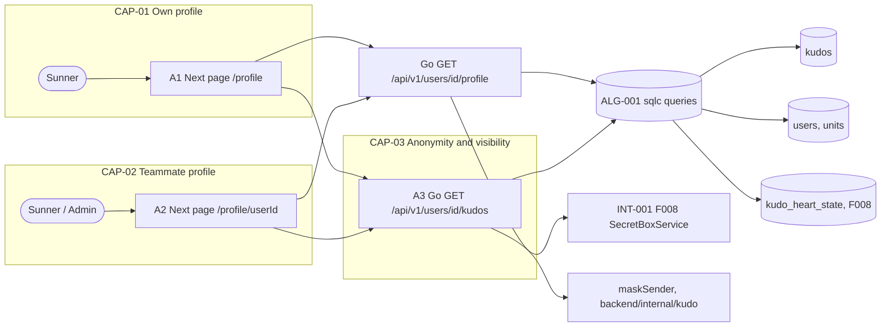

# F007_SunnerProfile

## 1. Technical Overview

Two Next.js 16 App Router pages (frontend only, repo root), `/profile` (own) and `/profile/[userId]` (teammate), render the profile. Their Server Components never touch the database: they call the Go backend server-side with the viewer's Supabase access token as `Authorization: Bearer`. The Go module `backend/internal/profile` (planned) serves two read-only REST endpoints on the stdlib `net/http` ServeMux: `GET /api/v1/users/{id}/profile` (identity, kudos counts, weighted hearts received, collected icons, and box figures only for the owner) and `GET /api/v1/users/{id}/kudos?filter=received|sent&cursor=` (one page of kudo cards, returned as F006's `KudoCard` list envelope `{ items: KudoCard[], nextCursor }` verbatim — Codex R15). F002's Go auth middleware verifies the JWT against Supabase JWKS and loads `users.role` on every request. `ProfileService` runs sqlc-generated queries over pgx (`backend/db/queries/profile.sql`) and applies the anonymity, spam and ordering rules once: every returned kudo passes through the shared `maskSender(kudo, viewer)` helper in `backend/internal/kudo` (X05). Hearts are F008's weighted total read by Go from the `kudo_heart_state` SQL view (a view, not a Postgres function or RPC — Codex R14); box figures and icons come from F008's Go `SecretBoxService`. The browser's list component calls the kudos endpoint directly with the bearer token for filter changes and "load more". The feature writes nothing; the filter lives in the address (`?filter=`) so reload and share keep it. Dynamic data is fetched `no-store`.



## 2. Action Index

| # | Action (handler) | Method · Path | Codes | Writes | Detail |
|---|---|---|---|---|---|
| **A0** | *cross-cutting — belongs to no single action* | — | FR-601, FR-605 | — | § 4.4 |
| **A1** | `OwnProfilePage#render` (planned Next.js page) → `ProfileHandler#get` (planned) | `GET` `/profile` → Go `GET` `/api/v1/users/{id}/profile` | FR-001, FR-002, FR-101, FR-105, FR-201, FR-202, FR-203, FR-204, FR-205, FR-206, FR-403, FR-404, FR-602, FR-604, BR-001, BR-003, BR-005, DEC-002, ALG-001, INT-001, INT-002, US001, US002, US005 | — *(read-only)* | § 3.1 |
| **A2** | `OtherProfilePage#render` (planned Next.js page) → `ProfileHandler#get` (planned) | `GET` `/profile/[userId]` → Go `GET` `/api/v1/users/{id}/profile` | FR-102, FR-103, FR-104, FR-301, FR-302, FR-602, FR-603, FR-604, BR-001, BR-002, BR-003, BR-004, BR-005, DEC-001, ALG-001, INT-001, INT-002, US003, US004 | — *(read-only)* | § 3.2 |
| **A3** | `ProfileHandler#listKudos` (planned) | `GET` `/api/v1/users/{id}/kudos?filter=received\|sent` | FR-205, FR-302, FR-401, FR-402, FR-602, FR-603, FR-604, BR-001, BR-002, BR-003, BR-005, ALG-001, INT-002, US002, US004, US006 | — *(read-only)* | § 3.3 |

## 3. Actions

### 3.1 CAP-01 — View my own profile

#### A1 · Show my own profile
`GET /profile` → `OwnProfilePage#render` (planned) → Go `GET /api/v1/users/{id}/profile` → `ProfileHandler#get` (planned) in `backend/internal/profile`
`FR-001` `FR-002` `FR-101` `FR-105` `FR-201`–`FR-206` `FR-403` `FR-404` `FR-602` `FR-604` `BR-001` `BR-003` `BR-005` `DEC-002` `ALG-001` `INT-001` `INT-002` `US001` `US002` `US005` · `SCR-own-profile`

**Who** · signed-in Sunner or Admin opening their own profile *(gate A0 — § 4.4)*
**FE** · Server Component reads the Supabase session for the viewer's id and access token, then calls Go `GET /api/v1/users/{viewerId}/profile` and `GET /api/v1/users/{viewerId}/kudos?filter=…` (first page) server-side with `Authorization: Bearer`. Renders header (avatar, name, unit code, collected icons), counts block with the "Mở Secret Box" button, the filter dropdown and the first page of kudo cards. A Client Component list handles filter change and "load more" by calling A3 from the browser with the bearer token; closing the F008 secret-box overlay triggers `router.refresh()` so counts and icons reload (FR-404).
**Request** · query param `filter` *(optional, `received` | `sent`; anything else falls back to `received`)*; `params` and `searchParams` are Promises in Next.js 16 and are awaited. Identity comes from the session only.
**BE** · `ProfileHandler#get` → `ProfileService.Get(ctx, viewer, userID)`: sqlc `GetUserProfile` (`users` joined with `units` for `units.code`, owned by F002; never `email`), `CountProfileKudos` (received and sent, ALG-001), `SumWeightedHeartsOnReceivedKudos` (sum of `kudo_heart_state.heart_total` over the owner's received public kudos, G08), and F008's `SecretBoxService.Summary(ctx, userID, includeBoxes = viewer.id == userID)` for opened/unopened boxes and collected icons (INT-001).
**Rule**
- **BR-001 — An anonymous kudo hides its sender from every viewer except admins.** Every card goes through `maskSender(kudo, viewer)` in `backend/internal/kudo`. *(§ 4.4)*
- **BR-003 — Kudos marked spam are left out of lists and counts.** *(§ 4.4)*
- **BR-005 — The list is newest first, 10 per page.** Page size is `PROFILE_KUDOS_PAGE_SIZE` (§ 4.6). *(§ 4.4)*
- **ALG-001** is the one set of sqlc queries that applies those three rules *(§ 4.5)*; **INT-001** is the F008 summary read *(§ 4.5)*; **INT-002** is the F006 kudo card used to draw each row *(§ 4.5)*.

| DEC | subtype | Condition | What the user sees | Source |
|---|---|---|---|---|
| **DEC-002** | render | `boxesUnopened > 0` | "Mở Secret Box" enabled and opens the F008 overlay; otherwise disabled with unopened count 0 shown (D009, resolved) | TBD (draft) |

**Result** · read-only — **no DB write**. Go response `200` `{user: {id, name, avatarUrl, unitCode}, counts: {kudosReceived, kudosSent, heartsReceived, boxesOpened, boxesUnopened} | null, countsUnavailable: boolean, collectedIcons[] | null, isOwner: true}`. `unitCode` = `units.code` (null without a unit). When the count queries or the F008 summary fail, Go still answers `200` with `counts: null` and `countsUnavailable: true` (`collectedIcons` is also null when the F008 summary is what failed); otherwise `countsUnavailable: false` (Codex R15). User sees the profile; an unknown filter value shows the received list.
**Source:** TBD (draft)

<!-- No diagram: below threshold — no table write; one synchronous read path (profile and first list page are two independent Go reads). -->

### 3.2 CAP-02 — View a teammate's profile

#### A2 · Show a teammate's profile
`GET /profile/[userId]` → `OtherProfilePage#render` (planned) → Go `GET /api/v1/users/{id}/profile` → `ProfileHandler#get` (planned)
`FR-102` `FR-103` `FR-104` `FR-301` `FR-302` `FR-602` `FR-603` `FR-604` `BR-001`–`BR-005` `DEC-001` `ALG-001` `INT-001` `INT-002` `US003` `US004` · `SCR-other-profile`

**Who** · signed-in Sunner or Admin *(gate A0 — § 4.4)*
**FE** · same layout as A1 without the "Mở Secret Box" button and without the unopened-box figure; the avatar links on kudo cards that point here come from F006 (FR-102, INT-002). If `userId` equals the session user's id the page calls `redirect('/profile')` (filter kept) before calling Go; on a Go `404` it calls `notFound()`.
**Request** · path param `userId` *(uuid)*; query param `filter` *(optional, as A1)*. Viewer identity and role come from the verified JWT in Go.
**BE** · `ProfileHandler#get` validates `{id}` as a uuid (`404` when malformed or unknown), then `ProfileService.Get` as in A1 with `isOwner = false`: no `boxesOpened` / `boxesUnopened` in the response, collected icons and hearts still returned; the sent count follows BR-002.
**Rule**
- **BR-001 — Anonymous kudo hides its sender from non-admins.** `maskSender` drops sender id, name and avatar, so the card cannot render a link. *(§ 4.4)*
- **BR-002 — A teammate's sent view and sent count leave out their anonymous kudos, except for admins.** Prevents learning who sent an anonymous kudo by opening their profile. *(§ 4.4)*
- **BR-003 — Spam kudos are left out of lists and counts.** *(§ 4.4)*
- **BR-005 — Newest first, 10 per page.** *(§ 4.4)*
- **BR-004 — A teammate's profile never offers secret-box actions or shows the unopened count (inline — used only here).** `SecretBoxService.Summary` is called with `includeBoxes = false` for a non-owner (D001, resolved); the page renders no button.
- **ALG-001** is the shared query set *(§ 4.5)*; **INT-001** the F008 summary read *(§ 4.5)*; **INT-002** the F006 card *(§ 4.5)*.

| DEC | subtype | Condition | What the user sees | Source |
|---|---|---|---|---|
| **DEC-001** | flow | `userId == session.user.id` | redirected to own profile `/profile` (filter param kept) | TBD (draft) |
| **DEC-001** | flow | `userId` malformed or no matching user (Go `404`) | Not-found page (F001) | TBD (draft) |

**Result** · read-only — **no DB write**. Go response as A1 with `isOwner: false` and no box figures. User sees the teammate's profile, the own profile (redirect) or the Not-found page.
**Source:** TBD (draft)

<!-- No diagram: below threshold — no table write, synchronous. The redirect and not-found branches are a 2-row table, which reads better than a sequence. -->

### 3.3 CAP-03 — Keep anonymity and visibility rules on profiles

#### A3 · Load a page of a person's kudos
`GET /api/v1/users/{id}/kudos?filter=received|sent&cursor=` → `ProfileHandler#listKudos` (planned) in `backend/internal/profile`
`FR-205` `FR-302` `FR-401` `FR-402` `FR-602` `FR-603` `FR-604` `BR-001` `BR-002` `BR-003` `BR-005` `ALG-001` `INT-002` `US002` `US004` `US006` · `SCR-own-profile` `SCR-other-profile`

**Who** · signed-in Sunner or Admin *(gate A0 — § 4.4)*
**FE** · A1/A2 Server Components call it for the first page; the client list component calls it from the browser (bearer token) on filter change (first page) and on "load more" (next page); shows loading, error and empty states (screen specs § 5).
**Request** · path `id` *(uuid)*; query `filter` *(`received` | `sent`, required)*, `cursor` *(optional opaque cursor for the next page)*. Page size is fixed server-side.
**BE** · `ProfileHandler#listKudos` → `ProfileService.ListKudos(ctx, viewer, ownerID, filter, cursor)`: sqlc `ListProfileKudosReceived` or `ListProfileKudosSent` (keyset, ALG-001), each row passed through `maskSender(kudo, viewer)`; heart totals and viewer state from F008's `HeartReader.StateFor` over `kudo_heart_state` (weighted total); each row built by F006's shared `KudoReadService` card assembly into F006's `KudoCard` DTO (INT-002), with the opaque `nextCursor`. The same service serves A1 and A2, so counts and list cannot disagree on rules (FR-403).
**Rule**
- **BR-001 — Anonymous kudo hides its sender from non-admins.** Such rows carry `sender: null` and no other stable author identifier: image URLs sign opaque `kudo-images/{uploadId}.{ext}` keys (Codex R01); the client never receives what it must not show. *(§ 4.4)*
- **BR-002 — A teammate's sent list leaves out their anonymous kudos, except for admins.** Applies only when `filter = sent` and the profile owner is not the viewer. *(§ 4.4)*
- **BR-003 — Spam kudos are never returned.** *(§ 4.4)*
- **BR-005 — Newest first, 10 per page, cursor on `(created_at, id)`.** *(§ 4.4)*
**Result** · read-only — **no DB write**. Response `200` `{ items: KudoCard[], nextCursor: string | null }` — F006's list envelope verbatim (Codex R15); `400` for a bad `filter` or `cursor`; `401` without a valid token; `404` for an unknown `id`.
**Source:** TBD (draft)

<!-- No diagram: below threshold — no table write, one synchronous query. -->

### 3.4 Edge cases

| Action | Scenario | Status / technical behavior |
|---|---|---|
| A1, A2 | `filter` not `received` or `sent` | Page falls back to `received`; A3 answers `400` |
| A2 | `userId` equals viewer | Next.js `redirect('/profile')` |
| A2, A3 | `userId` not a uuid or unknown | Go `404`; A2 `notFound()` (404 page); A3 `404` JSON to the browser |
| A1, A2 | Person has no unit | `user.unitCode` null (no `units.code`); unit code omitted in the header |
| A3 | `cursor` malformed or from another filter | `400`; client keeps current cards and shows the retry message |
| A3 | Anonymous kudo sent by profile owner, viewer is a non-admin teammate | Row omitted from `sent` list and count (BR-002) |
| A1, A3 | Kudo turned spam between two pages | Missing from later pages; counts follow on next render |
| A1, A2, A3 | Session expired | Next.js `proxy.ts` sign-in redirect for pages; Go middleware answers `401` to A3 and the client sends the Sunner to Login |
| A1, A2 | Count queries or F008 summary fail inside the Go profile read | Go returns `200` with `counts: null` and `countsUnavailable: true` (Codex R15); header and list still render; counts block shows error state with retry |
| A3 | Empty result | `{ items: [], nextCursor: null }`; client shows the empty state |

## 4. Shared Foundation

### 4.1 Components

| Component | Responsibility | Used in | File |
|---|---|---|---|
| `OwnProfilePage` / `OtherProfilePage` (planned) | Next.js Server Components: session viewer, Go calls, redirect / not-found | A1, A2 | TBD (draft) |
| `ProfileHeader` (planned) | Avatar, name, unit code (`units.code`), collected icons row (icons from F008); no hero-tier badge (functional-spec D006) | A1, A2 | TBD (draft) |
| `ProfileStatsBlock` (planned) | Five counts; "Mở Secret Box" button only when `isOwner` | A1, A2 | TBD (draft) |
| `ProfileKudosList` (planned, client) | Filter dropdown, card list, load more, loading / empty / error states; calls A3 with the bearer token | A1, A2, A3 | TBD (draft) |
| `ProfileHandler`, `ProfileService` (planned) | Go handlers and service for the two endpoints | A1, A2, A3 | `backend/internal/profile` (planned) |
| `profile` sqlc queries (planned) | `GetUserProfile`, `CountProfileKudos`, `ListProfileKudosReceived`, `ListProfileKudosSent`, `SumWeightedHeartsOnReceivedKudos` (ALG-001) | A1, A2, A3 | `backend/db/queries/profile.sql` (planned) |
| `maskSender` (shared) | Drops the sender of an anonymous kudo for non-admin viewers (X05) | A1, A2, A3 | `backend/internal/kudo` (planned) |
| `KudoCard` (F006, planned) | Renders one kudo from the F006 `KudoCard` DTO; owns avatar links, card hero badges and the heart control | A1, A2, A3 | TBD (draft) |
| `SecretBoxService`, `HeartReader` (F008, planned) | Box figures, collected icons, weighted heart state | A1, A2, A3 | `backend/internal/gamification` (planned) |

### 4.2 Data Model

#### Key Entities

| Entity | Table | Key Columns | Purpose |
|--------|-------|-------------|---------|
| User profile | `users` | `id`, `name`, `avatar_url`, `unit_id` → `units`, `role` (read to decide admin) | Header data; **`email` is never selected** by this feature (FR-605) |
| Unit | `units` *(owned by F002)* | `id`, `name`, `code` (`text not null unique`, e.g. `CECV2`) | `code` is the unit text in the header and on cards (Codex R15) |
| Kudo | `kudos` | `id`, `sender_id`, `receiver_id`, `title`, `content`, `is_anonymous`, `status`, `created_at` | List rows and the received/sent counts; **read-only here** (written by F005, status by F011) |
| Heart state | `kudo_heart_state` *(SQL view, owned by F008; read by Go, not a function — Codex R14)* | `kudo_id`, `heart_total` (weighted) | Hearts received and per-card totals |
| Secret boxes | `secret_boxes` | read through F008's `SecretBoxService` only | Boxes opened/unopened, collected icons (INT-001) |

The Go backend's database role is the only reader; browser roles have no table grants and RLS is deny-all (G18).

#### Polymorphic Behavior

N/A — no discriminator codes allocated yet (draft); `kudos.status` (`public` | `spam`) and `users.role` will be registered as discriminators at reconcile. `kudos.is_anonymous` is a boolean driving BR-001/BR-002, not a discriminator.

### 4.3 State Management

None — no entity lifecycle. The filter lives in the address (`?filter=`, FR-401); loaded pages are local state of `ProfileKudosList`.

### 4.4 Shared Rules

#### Bin 3 — cross-cutting, belongs to no single action

**A0 · FR-601 / FR-605 — Cross-cutting: every profile read takes the viewer from the verified session and never exposes email or another person's box inventory.**
Applies to A1-A3. Next.js `proxy.ts` redirects signed-out visitors to Login; Go's auth middleware verifies the Supabase JWT (JWKS) and loads `users.role` on every request, answering `401` otherwise. Viewer id and role come only from the token; the `{id}` path segment names the profile, never the viewer. Selected user columns are limited to `id`, `name`, `avatar_url`, unit; box figures are returned only when the viewer is the owner.
**Source:** TBD (draft)

#### Bin 2 — used by ≥2 named actions

**BR-001 — An anonymous kudo hides its sender from every viewer except admins.**
Used in: **A1** · **A2** · **A3**. This is the anonymity rule of the Write Kudos feature applied to profiles, enforced by the one shared Go helper `maskSender(kudo, viewer)` in `backend/internal/kudo` (X05): `is_anonymous = true` and viewer role ≠ admin → `sender = null`; the receiver side is unchanged. Image URLs on the card sign opaque `kudo-images/{uploadId}.{ext}` keys, so no field or URL of a masked card identifies the sender (Codex R01). Applied in the Go read layer, so no frontend can forget it.
**Source:** TBD (draft)
```text
maskSender(kudo, viewer):
  if kudo.is_anonymous and viewer.role != 'admin' -> sender = null   # no id, name or avatar leaves the server
  return kudo
```

**BR-002 — A teammate's sent view and sent count leave out their anonymous kudos, except for admins.**
Used in: **A2** · **A3**. When `filter = sent`, owner ≠ viewer and viewer is not admin, rows with `is_anonymous = true` are excluded from both list and count. The owner's own profile (A1) keeps them, masked per BR-001 (D002).
**Source:** TBD (draft)
```text
sentVisible(row, owner, viewer):
  if viewer.id == owner.id or viewer.role == 'admin' -> true
  return not row.is_anonymous
```

**BR-003 — Kudos marked spam are left out of lists and counts.**
Used in: **A1** · **A2** · **A3**. Every profile query filters `status = 'public'`, for every viewer including the owner (D007).
**Source:** TBD (draft)

**BR-005 — The list is newest first, 10 per page.**
Used in: **A1** · **A2** · **A3**. Order `created_at desc, id desc`; page size from `PROFILE_KUDOS_PAGE_SIZE`; the cursor is the last row's `(created_at, id)`, so rows inserted between pages cause no duplicates or skips.
**Source:** TBD (draft)

### 4.5 Algorithms & Integrations

### The profile kudo list and counts come from one filtered, masked, newest-first query set (ALG-001)
**Linked FR:** FR-403
**Used in:** A1, A2, A3
**Source:** TBD (draft)

```text
ProfileService.ListKudos(ownerId, filter, cursor, viewer):     # sqlc over pgx
  base = kudos where status = 'public'                       # BR-003
  if filter == 'received': base = base where receiver_id = ownerId
  else:                    base = base where sender_id = ownerId
                           and sentVisible(row, owner, viewer)   # BR-002
  count  = count(base)                                       # same predicate as the list (FR-403)
  rows   = base order by created_at desc, id desc
           after cursor limit PAGE_SIZE + 1                  # BR-005
  items  = rows.take(PAGE_SIZE).map(r -> toCard(maskSender(r, viewer), heartState(r)))   # BR-001, weighted hearts
  return {items, nextCursor: rows.length > PAGE_SIZE ? base64(last(items).(created_at, id)) : null}   # F006 list envelope
heartsReceived(ownerId) = sum(kudo_heart_state.heart_total) over base(received)          # weighted, G08
```
The "kudos received" and "kudos sent" figures run the two `count(base)` forms; both counts load on every profile read (not only the selected filter).

### The F008 summary supplies boxes and collected icons (INT-001)
**Linked FR:** FR-202
**Used in:** A1, A2
**Source:** TBD (draft)
**Type:** internal-module
**Target:** F008 Go `SecretBoxService.Summary(ctx, userID, includeBoxes)` in `backend/internal/gamification` (planned); weighted hearts come from F008's `kudo_heart_state` view
**Payload:** in: `userID`, `includeBoxes = viewerIsOwner`; out: `collectedIcons[]` always, `opened`, `unopened` only when `includeBoxes` (BR-004).
**Failure handling:** a failure yields `counts: null`, `countsUnavailable: true` (and `collectedIcons: null`) in the Go response (Codex R15); header and list are unaffected; no retry beyond the user's retry or reload.

### The F006 kudo card draws every row (INT-002)
**Linked FR:** FR-204
**Used in:** A1, A2, A3
**Source:** TBD (draft)
**Type:** internal-module
**Target:** F006 `KudoCard` component and the `KudoCard` DTO defined in F006 technical-spec § 4.2 (owned by F006, consumed verbatim — Codex R15)
**Payload:** `{ items: KudoCard[], nextCursor: string | null }`. Each `KudoCard` = `{ id, createdAt, title, contentHtml, isAnonymous, sender: {id, name, avatarUrl, unitCode, heroTier} | null, receiver: {id, name, avatarUrl, unitCode, heroTier}, hashtags: string[], images: [{url, width?, height?}], heart: {total, viewerHearted, viewerCanHeart}, isOwn, status }`; `sender: null` for masked rows (BR-001); `heart.total` is the weighted total; `nextCursor` is an opaque base64 keyset of `(created_at, id)`. Avatar links, heart control and the open-detail link are the card's own behavior (FR-102, FR-105).
**Failure handling:** none; a card that cannot render is an F006 defect.

### 4.6 Configuration

```text
PROFILE_KUDOS_PAGE_SIZE = 10   # kudo cards per page (BR-005); Go constant, not an env var (YAGNI)
```

**Client behavior:** see behavior-logic.md, permissions.md, architecture.md

## 5. Verification & Technical Notes

### 5.1 Technical Verification

- **SC-001** *(A1)* A signed-in user opening `/profile` sees own name, unit, icons and five counts; a user with no activity sees zeros (covers FR-001, FR-201, FR-202).
- **SC-002** *(A1, A3)* `filter=sent` returns only kudos with `sender_id` = owner, newest first, 10 per page, and `nextCursor` null on the last page (covers FR-204, FR-205, FR-402, BR-005).
- **SC-003** *(A2)* Opening the viewer's own id on `/profile/[userId]` redirects to `/profile`; an unknown or malformed id gives the Not-found page (covers FR-103, FR-104, DEC-001).
- **SC-004** *(A2, A3)* As a non-admin, an anonymous kudo received by the owner returns `sender = null` and no sender id anywhere in the Go payload; as admin it returns the sender (covers FR-602, BR-001).
- **SC-011** *(A2, A3; Codex R01)* Third-user inspection: S sends R an anonymous kudo with images; T (not S, not R, not admin) opens R's profile `received` list; every field of the `KudoCard`, every image URL (path and query) and the rendered HTML are inspected — none contains S's user id or any other stable identifier of S, and image keys match `kudo-images/{uuid}.{ext}` (covers FR-602, BR-001).
- **SC-012** *(A1, A3; Codex R15)* A3 items validate against F006's `KudoCard` shape and list envelope; `user.unitCode` equals `units.code`; a forced F008 summary failure returns `200` with `counts: null`, `countsUnavailable: true` while `user` and the list still render.
- **SC-005** *(A2, A3)* As a non-admin, the owner's anonymous sent kudos are absent from list and count; as the owner they are present (covers FR-603, BR-002).
- **SC-006** *(A1, A2, A3)* A kudo set to `spam` disappears from lists and counts for every viewer (covers FR-604, BR-003).
- **SC-007** *(A2)* No Go response for another person includes `email`, `boxesUnopened` or `boxesOpened`, and the page has no Mở Secret Box control (covers FR-301, FR-605, BR-004).
- **SC-008** *(A1)* `boxesUnopened` 0 disables the button; 1 enables it (covers FR-203, DEC-002).
- **SC-009** *(A1)* A heart given during a x2 campaign on a kudo the owner received raises `heartsReceived` by 2 (covers FR-202, D008).
- **SC-010** *(A3)* A call without a valid bearer token returns `401` (covers FR-601).

#### US001 *(A1)*

**Independent Test:** sign in, open Profile from the avatar menu.

**Acceptance Scenarios:**

1. **Given** a signed-in Sunner, **When** `/profile` opens, **Then** header, counts and received list render.
2. **Given** a Sunner with no activity, **When** `/profile` opens, **Then** counts are 0 and the empty state shows.

#### US002 *(A1, A3)*

**Independent Test:** switch the dropdown to sent and press load more with more than 10 sent kudos.

**Acceptance Scenarios:**

1. **Given** 12 sent kudos, **When** the filter is `sent`, **Then** 10 cards show, then the next 2 append.
2. **Given** the list request fails, **When** the filter changes, **Then** the old cards stay and an error message with retry shows.

#### US003 *(A2)*

**Independent Test:** press a visible sender avatar on a kudo card; then open a made-up id.

**Acceptance Scenarios:**

1. **Given** a visible sender avatar, **When** pressed, **Then** `/profile/[id]` opens that person.
2. **Given** an unknown id, **When** opened, **Then** the Not-found page shows.

#### US004 *(A2, A3)*

**Independent Test:** open a teammate's profile and switch the filter.

**Acceptance Scenarios:**

1. **Given** a teammate profile, **When** it opens, **Then** no Mở Secret Box button and no unopened figure exist in the page.
2. **Given** the teammate has no sent kudos, **When** `sent` is chosen, **Then** the empty state shows.

#### US005 *(A1)*

**Independent Test:** with 1 unopened box press the button, close the overlay.

**Acceptance Scenarios:**

1. **Given** 1 unopened box, **When** the button is pressed, **Then** the F008 overlay opens.
2. **Given** the overlay is closed, **When** it closes, **Then** counts and icons refresh (FR-404).

#### US006 *(A3)*

**Independent Test:** as a non-admin, call `GET /api/v1/users/{id}/kudos` for a Sunner who has anonymous kudos in both directions.

**Acceptance Scenarios:**

1. **Given** an anonymous kudo received by the owner, **When** `received` is fetched, **Then** the row has `sender = null`.
2. **Given** an anonymous kudo sent by the owner, **When** `sent` is fetched by another non-admin, **Then** the row is absent.

### 5.2 Assumptions

- A1/A2 render the first list page on the server by calling the same Go endpoint as A3 (one rule set, one test target).
- Avatar and name come from `users` as populated at sign-in (Auth feature, first sign-in); there is no profile edit.
- F006 owns the `KudoCard` DTO (F006 technical-spec § 4.2) and avatar link behavior; F002 owns `units.code`; F008 owns hearts, boxes and icon definitions; `maskSender` is owned by the kudo domain (`backend/internal/kudo`). This feature only consumes them.
- Admin is read from `users.role` by Go's auth middleware at request time (G17).
- Anonymity is enforced in the Go read layer (`maskSender`, X05); the browser has no table access, so no direct read can bypass it (G18).

### 5.3 Unresolved Questions

- Indexes for `kudos (receiver_id, created_at desc, id)` and `kudos (sender_id, created_at desc, id)` plus count cost (functional RISK-03); owner of the migration is F005 (`kudos` table, Supabase CLI migrations).

Resolved (Codex R15): the unit code is the new `units.code` column (`text not null unique`, seeded with units, owned by F002); the kudo card shape is F006's `KudoCard` DTO and `{ items, nextCursor }` envelope, consumed verbatim; a counts failure is `counts: null` plus `countsUnavailable: true`.

### 5.4 Source References

None — no source code written yet; see `## 7. User Stories` in functional-spec.md for planned behavior.

#### Data Flow

```text
GET /profile[/userId]?filter=  -> Next.js Server Component (session viewer, access token)
    -> Go GET /api/v1/users/{id}/profile (Bearer) -> auth middleware (JWKS, users.role)
       -> ProfileService.Get: users(+units), counts, weighted hearts (kudo_heart_state), F008 SecretBoxService.Summary
    -> Go GET /api/v1/users/{id}/kudos?filter (first page) -> masked, spam-free cards
    -> render page with KudoCard rows (INT-002)
Browser: ProfileKudosList -> Go GET /api/v1/users/{id}/kudos?filter&cursor (Bearer) -> { items, nextCursor } -> append
```

### 5.5 Artifact References

| Artifact | File | Codes Used | Reviewed |
|----------|------|------------|----------|
| System Overview | TBD (draft) | TBD (draft) | [ ] |
| Architecture | TBD (draft) | TBD (draft) | [ ] |
| Feature List | [feature-list.md](../feature-list.md) | F007 | [x] |
| Gap Resolution Log | [gap-resolution-log.md](../gap-resolution-log.md) | G04, G08, G15–G19, AD07, X02, X05 | [x] |
| Codex Resolution Contract | [codex-findings-resolution-contract.md](../../reports/codex-findings-resolution-contract.md) | R01, R14, R15 | [x] |
| API Map | TBD (draft) | TBD (draft) | [ ] |
| Entities | TBD (draft) | TBD (draft) | [ ] |
| Screens | [functional-spec.md § 6](functional-spec.md#6-screens) | TBD (draft) | [ ] |
| Behavior Logic | TBD (draft) | TBD (draft) | [ ] |
| Permissions Matrix | [permissions.md](../system/permissions.md) | TBD (draft) | [ ] |
| User Stories | TBD (draft) | TBD (draft) | [ ] |
