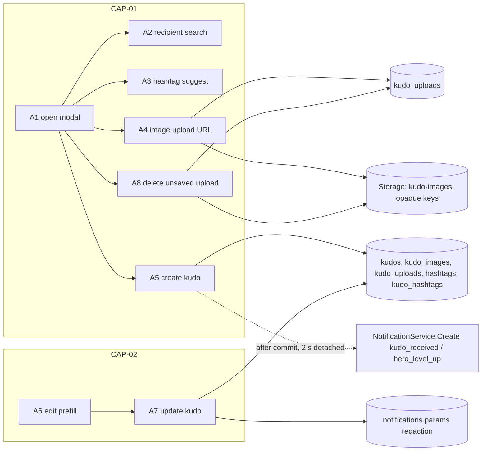
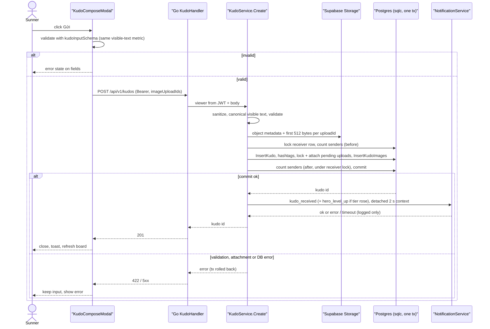
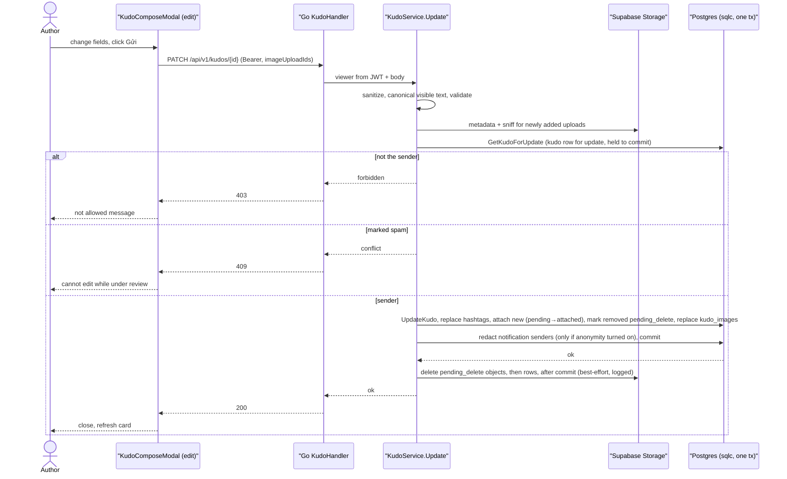
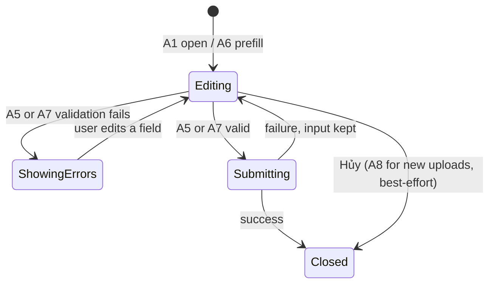

# F005_KudoCompose — Technical Spec

**Priority**: P1
**Type**: mixed

**See also:** [`functional-spec.md`](./functional-spec.md) — plain-language overview, open decisions, requirements and business rules, screens, user stories, scenarios, edge cases.

## 1. Technical Overview

A Sunner opens one modal (Next.js 16 App Router client component, frontend only) to compose a kudo — recipient, title (Danh hiệu), rich text with `@mention`, 1–5 hashtags, 0–5 images, optional anonymous flag — and sends it; the same modal, prefilled, edits the author's own kudo. The modal calls the Go REST API from the browser with the Supabase access token as `Authorization: Bearer`; Next.js never touches the database and uses no Server Actions or route handlers for this feature. The Go backend (`backend/`, stdlib `net/http` ServeMux) verifies the JWT (F002 middleware), sanitizes the HTML, derives the canonical visible text and validates every rule on that stored representation (Codex R20), and writes through sqlc-generated queries over pgx inside one Go transaction (`backend/internal/kudo`).

Images go browser → Supabase Storage through a Go-issued signed upload URL for an **opaque, immutable key** `kudo-images/{uploadId}.{ext}`; ownership and lifecycle live only in the server-side table `kudo_uploads`, which this feature owns (Codex R01). Each upload carries an explicit `state` — `pending` → `attached` → (on removal in an edit) `pending_delete`, never eligible again (Codex N02). The client only ever sends `uploadId`s; Go finalizes each attachment against the real stored object before commit (Codex R03), and one authenticated endpoint deletes the caller's own `pending` uploads (Codex R04).

Global lock order for kudo writes: **kudo row first, then the receiver `users` row** (Codex N05). The create transaction locks only the receiver row (the new kudo does not exist yet) and computes the receiver's hero-tier transition (Codex R10); F005 is the sole producer of `hero_level_up` (Codex N04). After commit the kudo service calls the shared `NotificationService.Create` (F009) with kind `kudo_received` and, when the tier rose, `hero_level_up` — both inside a 2 s context detached from the request; failures are logged only (Codex R23). The edit transaction locks only the kudo row (the recipient is immutable) and holds it `for update` across the anonymity change and the redaction of existing notifications (Codex R02, N01); F009's notification insert takes `for share` on the same kudo row and strips sender fields when the kudo is anonymous at insert time, so the two serialize. Nothing is implemented yet; every handler name below is a provisional identity.



## 2. Action Index

| # | Action (handler) | Method · Path | Codes | Writes | Detail |
|---|---|---|---|---|---|
| **A0** | *cross-cutting — belongs to no single action* | — | FR-601, FR-603 | — | § 4.4 |
| **A1** | `KudoComposeModal#open` (planned) *(client only)* | — | FR-101, FR-202, FR-203, FR-204, FR-207, FR-209, FR-210, FR-405, ALG-002, US001, US005, US006 | — *(read-only)* | § 3.1 |
| **A2** | `UserHandler#search` (planned) | `GET` `/api/v1/users/search` | FR-201, FR-204, BR-001, US002 | — *(read-only)* | § 3.1 |
| **A3** | `HashtagHandler#list` (planned) | `GET` `/api/v1/hashtags` | FR-002, FR-205, BR-002, DEC-002, US003 | — *(read-only)* | § 3.1 |
| **A4** | `UploadHandler#createKudoImageUploadURL` (planned) | `POST` `/api/v1/uploads/kudo-images` | FR-003, FR-206, FR-604, BR-003, BR-007, INT-001, US004 | `kudo_uploads` (one `pending` row); Storage object once the browser uploads | § 3.1 |
| **A8** | `UploadHandler#deleteKudoImageUpload` (planned) | `DELETE` `/api/v1/uploads/{uploadId}` | FR-206, FR-405, BR-007, US004 | `kudo_uploads` (`pending` row deleted); Storage object deleted | § 3.1 |
| **A5** | `KudoHandler#create` (planned) | `POST` `/api/v1/kudos` | FR-001, FR-003, FR-208, FR-401, FR-402, FR-404, FR-604, BR-001, BR-002, BR-003, BR-004, BR-005, BR-007, DEC-001, SM-001, ALG-001, ALG-002, ALG-003, INT-002, US002, US004, US005, US007 | `kudos`, `kudo_images`, `kudo_uploads` (`pending` → `attached`), `hashtags`, `kudo_hashtags` | § 3.1 ▸ **diagram** |
| **A6** | `KudoHandler#getForEdit` (planned) | `GET` `/api/v1/kudos/{id}/edit` | FR-102, FR-602, BR-006, US008 | — *(read-only)* | § 3.2 |
| **A7** | `KudoHandler#update` (planned) | `PATCH` `/api/v1/kudos/{id}` | FR-403, FR-404, FR-406, FR-602, FR-604, BR-002, BR-003, BR-004, BR-005, BR-006, BR-007, BR-008, SM-001, ALG-001, ALG-002, INT-002, US008 | `kudos`, `kudo_images`, `kudo_uploads` (`pending` → `attached`; removed `attached` → `pending_delete`), `hashtags`, `kudo_hashtags`, `notifications` (`params` redaction) | § 3.2 ▸ **diagram** |

## 3. Actions

### 3.1 CAP-01 — Compose and send a kudo

#### A1 · Open the write-kudo modal and fill the form (client)
`—` → `KudoComposeModal#open` (planned)
`FR-101` `FR-202` `FR-203` `FR-204` `FR-207` `FR-209` `FR-210` `FR-405` `ALG-002` `US001` `US005` `US006` · `SCR-write-kudo-modal`

**Who** · signed-in Sunner. US001 = open the write form from the board; US005 = tick "send anonymously"; US006 = mention a teammate with `@name`.
**FE** · modal opens from the floating action button "Viết KUDOS" or the Thể lệ panel's Viết KUDOS button (FR-101: modal over the current page). Fields per `SCR-write-kudo-modal`: title input (FR-202: required Danh hiệu, at most 100 characters, shown as the kudo heading); rich-text editor with Bold, Italic, Strikethrough, numbered list, link, quote and a live 0/1,000 counter (FR-203) — the counter uses the same canonical visible-text metric as Go (ALG-002: Unicode code points of the visible text, whitespace runs collapsed, a mention counted as its displayed `@Name`), adjacent text nodes joined with no inserted separator, so bold/italic/link/mention boundaries add nothing, and each `<br>` or block boundary contributes one line break before collapsing — so the client and server agree at the boundary (Codex R20, N07); typing `@` opens a Sunner suggestion list fed by A2 (FR-204); "Thêm đường dẫn" box takes link text and web address and inserts a link (FR-209); checkbox "Gửi lời cám ơn và ghi nhận ẩn danh" (FR-207); "Tiêu chuẩn cộng đồng" link opens the standards page in a new tab (FR-210); Hủy closes the modal and discards input silently, and calls A8 for every image uploaded in this session but not yet saved, best-effort (FR-405, Codex R04). The design variants `828:13433` and `1612:5056` are states of this one modal, not separate layouts. Form state lives in the modal component and keeps, per image, its `uploadId` and whether it is *new* (uploaded this session) or *committed* (prefilled in edit mode). A client-side `kudoInputSchema` (planned) mirrors the Go rules for instant feedback only — Go stays authoritative.
**Result** · read-only — nothing leaves the browser until Gửi (A5) except image uploads (A4) and their cleanup (A8); anonymous flag is only a checkbox value here.
**Source:** `TBD (draft)`

---

#### A2 · Search Sunners for recipient and mention
`GET /api/v1/users/search?q=` → `UserHandler#search` (planned)
`FR-201` `FR-204` `BR-001` `US002`

**Who** · signed-in Sunner sending US002 (send a kudo to a teammate).
**FE** · recipient combobox (dropdown `828:10943`) and the `@` mention list call this from the browser with a debounced query and the bearer token; each row shows avatar, name, unit. FR-201 = recipient required, chosen by searching; FR-204 = the same list feeds `@` mentions (DRY, one search).
**Request** · `q` *(string, name or email fragment)*, optional `limit` *(default `RECIPIENT_SEARCH_LIMIT`)*
**BE** · `UserHandler#search` in `backend/internal/user` — viewer from the verified JWT; `UserService.Search` runs sqlc query `SearchUsers` (case-insensitive match on `users.name` / `users.email`, joins `units` for the label, excludes the caller).
**Rule** · **BR-001 — A kudo cannot be sent to yourself.** The search omits the caller's own row so the UI never offers it; A5 enforces the real check *(§ 4.4)*.
**Result** · read-only — **no DB write**. Returns `[{id, name, avatarUrl, unitName}]`, empty list when no match.
**Source:** `TBD (draft)`

---

#### A3 · Suggest hashtags
`GET /api/v1/hashtags?q=` → `HashtagHandler#list` (planned)
`FR-002` `FR-205` `BR-002` `DEC-002` `US003`

**Who** · signed-in Sunner attaching hashtags (US003 = tag a kudo with 1–5 hashtags).
**FE** · "+ Hashtag" opens the hashtag dropdown (`1002:13013`); chosen tags show as removable chips; a typed name that does not exist yet can be added as a new tag. FR-205 = pick 1–5 hashtags from the list; FR-002 = hashtags are shared, reusable records, not per-kudo text.
**Request** · optional `q` *(prefix filter)*
**BE** · `HashtagHandler#list` in `backend/internal/kudo` — sqlc query `ListHashtags` ordered by name (usage-count ordering deferred, YAGNI).
**Rule** · **BR-002 — A kudo carries 1 to 5 distinct hashtags.** Senders may create new names; names are normalized (trimmed, lower-cased, leading `#` stripped) and de-duplicated; A5/A7 enforce it *(§ 4.4)*.

| DEC | subtype | Condition | What the user sees | Source |
|---|---|---|---|---|
| **DEC-002** | render | `selectedHashtags.length == 5` | "+ Hashtag" is disabled; chips stay removable | `TBD (draft)` |

**Result** · read-only — **no DB write**. Returns `[{id, name}]`.
**Source:** `TBD (draft)`

---

#### A4 · Get a signed upload URL for one image
`POST /api/v1/uploads/kudo-images` → `UploadHandler#createKudoImageUploadURL` (planned)
`FR-003` `FR-206` `FR-604` `BR-003` `BR-007` `INT-001` `US004`

**Who** · signed-in Sunner attaching images (US004 = attach up to 5 images).
**FE** · Image row shows up to 5 thumbnails, each with a remove control (FR-206); after file pick the browser asks Go for a signed upload URL per file, then uploads the bytes straight to Supabase Storage. The browser keeps only the returned `uploadId` (plus a local preview); it never builds or sends a storage path (Codex R03). Removing a *new* thumbnail calls A8. FR-003 = images persist as ordered attachments of the kudo.
**Request** · `contentType`, `size` *(declared, per file — used only for early refusal; the real object is checked at A5/A7)*
**BE** · `UploadHandler#createKudoImageUploadURL` in `backend/internal/upload` — viewer from JWT; refuses a declared type outside JPEG/PNG/WebP or declared size over 5 MB (422) for fast feedback; generates `uploadId` = random UUID; object key `kudo-images/{uploadId}.{ext}` with `ext` from the declared type — **no user id, file name or other author identifier in the key** (Codex R01); inserts `kudo_uploads(id = uploadId, owner_id = viewer, object_path, mime, size_bytes, created_at)` with `state = 'pending'` and `kudo_id = null` (Codex N02); asks Supabase Storage (service key held only by Go) for a signed upload URL **without upsert**, so the key is write-once and an attached object can never be replaced (Codex R03). Returns `{uploadId, uploadUrl, token}`.
**Rule** · **BR-003 — At most 5 images, each a real JPEG, PNG or WebP up to 5 MB.** The bucket itself enforces `file_size_limit` 5 MB and `allowed_mime_types`; the declared values checked here are a convenience only; A5/A7 finalize against the stored object *(§ 4.4)*. **BR-007 — An upload belongs to its uploader, attaches to at most one kudo, and moves only `pending` → `attached` → `pending_delete`** *(§ 4.4)*. **FR-604** — the key is opaque, so a signed read URL for an anonymous kudo's image reveals nothing about its author.
**Result** · writes one `pending` `kudo_uploads` row; the Storage object exists only after the browser uploads with the URL. INT-001 = Supabase Storage direct upload, gloss: browser sends bytes to Storage so they never pass through Next.js or Go *(§ 4.5)*. A manual/admin purge script (no scheduler) removes `pending` uploads older than 24 h and any leftover `pending_delete` uploads, object then row (Codex R04, N02).
**Source:** `TBD (draft)`

---

#### A8 · Delete an unsaved upload
`DELETE /api/v1/uploads/{uploadId}` → `UploadHandler#deleteKudoImageUpload` (planned)
`FR-206` `FR-405` `BR-007` `US004`

**Who** · signed-in Sunner who removed a newly uploaded thumbnail or pressed Hủy (Codex R04).
**FE** · called for each *new* (unsaved) upload when its thumbnail is removed or the modal is cancelled; best-effort — a failure is ignored by the UI (AD05). Removing a *committed* attachment in edit mode does **not** call A8; it only drops the `uploadId` from the A7 body.
**Request** · path param `uploadId` *(uuid)*
**BE** · `UploadHandler#deleteKudoImageUpload` — viewer from JWT; sqlc `GetKudoUploadForUpdate` locks the row; not found or `owner_id != viewer` → 404 (does not reveal foreign uploads); `state <> 'pending'` (`attached` or `pending_delete`) → 409 `upload_attached`; otherwise deletes the Storage object, then the row (Codex N02).
**Rule** · BR-007 — only the uploader's own `pending` uploads can be deleted here; an `attached` or `pending_delete` upload is never deleted through this endpoint *(§ 4.4)*.
**Result** · 204; Storage object and `kudo_uploads` row removed. If the Storage delete fails, the `pending` row stays (so the purge script finds it after 24 h) and Go returns 5xx; the UI ignores it.
**Source:** `TBD (draft)`

---

#### A5 · Send a kudo
`POST /api/v1/kudos` → `KudoHandler#create` (planned)
`FR-001` `FR-003` `FR-208` `FR-401` `FR-402` `FR-404` `FR-604` `BR-001` `BR-002` `BR-003` `BR-004` `BR-005` `BR-007` `DEC-001` `SM-001` `ALG-001` `ALG-002` `ALG-003` `INT-002` `US002` `US004` `US005` `US007` · `SCR-write-kudo-modal`

**Who** · signed-in Sunner. US002 = send a kudo; US005 = send it anonymously; US007 = fix highlighted missing fields and resend.
**FE** · Gửi button. FR-208 = on submit, missing/invalid fields get the error state (`662:13035`) and focus moves to the first one; FR-401 = success closes the modal, shows confirmation, board refetches from Go; FR-402 = failure keeps the modal open with all input and shows an error. Button is disabled while submitting (SM-001 `submitting`).
**Request** · JSON body `receiverId`, `title`, `contentHtml`, `hashtags[]` *(names)*, `imageUploadIds[]` *(ordered, from A4 — never paths, Codex R03)*, `isAnonymous`
**BE** · `KudoHandler#create` in `backend/internal/kudo` — sender id from the verified JWT (never from the body). `KudoService.Create`:
1. **Content (Codex R20):** sanitize `contentHtml` (ALG-001) → derive canonical visible text from the sanitized HTML (ALG-002) → BR-004 checks required and the 1,000-code-point limit on that stored representation; title, receiver ≠ sender, hashtags checked too.
2. **Attachment pre-check (Codex R03):** for each `uploadId` (count 0–5, no duplicates) read the stored object's metadata (size, content-type) from Storage and sniff its first 512 bytes for the JPEG/PNG/WebP magic number. Because keys are write-once, the checked object cannot change afterwards.
3. **One pgx transaction:** `LockUserForUpdate` (`select … from users where id = $receiver for update` — also proves the receiver exists, Codex R10; this is the **only** lock create takes on existing rows, since the new kudo does not exist yet — consistent with the global order kudo row → receiver row, Codex N05) → `CountDistinctPublicSenders` (before) → `InsertKudo` → `UpsertHashtags` (`insert … on conflict (name) do nothing` then select ids) → `InsertKudoHashtags` → `LockKudoUploadsForUpdate` re-checks each upload exists, `owner_id = viewer`, `state = 'pending'`, `kudo_id is null` → `AttachKudoUploads` (sets `state = 'attached'`, `kudo_id`, `attached_at`, actual `mime`/`size_bytes`, Codex N02) → `InsertKudoImages` (`upload_id`, `position`) → `CountDistinctPublicSenders` (after, captured under the receiver lock) → ALG-003 maps before/after to tiers → commit.
4. **After commit (Codex R23):** in a context with its own 2 s deadline, detached from the request, call `NotificationService.Create` with kind `kudo_received` (INT-002) and, when ALG-003 reports a rise, the hero-tier transition `{receiverId, fromTier, toTier, sendersCount}` (kind `hero_level_up`, `sendersCount` = the after-count captured under the receiver lock; F009 maps it and dedupes on `hero_level:{receiverId}:{toTier}`, Codex N04). Any failure or timeout is logged and the 201 is still returned.
**Rule** · BR-001 — recipient must differ from sender *(§ 4.4)*; BR-002 — 1–5 distinct hashtags *(§ 4.4)*; BR-003 — 0–5 images, each a real JPEG/PNG/WebP ≤ 5 MB checked on the stored object *(§ 4.4)*; BR-004 — title (≤100 characters) required; content required and ≤1,000 code points of canonical visible text after sanitizing *(§ 4.4)*; BR-005 — anonymous flag hides the sender from everyone except admins, but the row keeps `sender_id` *(§ 4.4)*; BR-007 — each upload must be the caller's own and `pending`; any attachment failure → 422 `invalid_attachment`, nothing committed *(§ 4.4)*; FR-604 — the response, image URLs and the notification carry no stable author identifier for an anonymous kudo.

| DEC | subtype | Condition | What the user sees | Source |
|---|---|---|---|---|
| **DEC-001** | flow | any of receiver, title, content, hashtags, images fails BR-001..BR-004 or BR-007 | nothing is saved; Go returns 422 with field errors (`invalid_attachment` for images); error state on the offending fields; modal stays open | `TBD (draft)` |

**Result**
- Writes `kudos` ← one row, `status = 'public'`, `is_anonymous` from payload, `content` = sanitized HTML (FR-001: a kudo stores sender, receiver, title, content, anonymity, status, timestamps) — `TBD (draft)`
- Writes `hashtags` ← new names only; `kudo_hashtags` ← one link per hashtag; `kudo_uploads` ← `state = 'attached'`, `kudo_id`, `attached_at` set once per upload (Codex N02); `kudo_images` ← one row per `uploadId` with `position` 0–4
- After commit: one `kudo_received` notification for the recipient; for an anonymous kudo no sender id, name or avatar is attached (and F009 strips them anyway if the kudo is anonymous at insert time, Codex N01); plus one `hero_level_up` notice only when the receiver's tier rose (ALG-003, payload `{receiverId, fromTier, toTier, sendersCount}`, Codex N04)
- User sees: modal closes, success toast, live board shows the kudo (FR-404: anonymous kudos show no sender to non-admins; masking is applied by the shared Go `maskSender` helper on every read)
**Source:** `TBD (draft)`



### 3.2 CAP-02 — Edit own kudo

#### A6 · Load my kudo into the modal
`GET /api/v1/kudos/{id}/edit` → `KudoHandler#getForEdit` (planned)
`FR-102` `FR-602` `BR-006` `US008`

**Who** · the kudo's author. US008 = edit my own kudo.
**FE** · edit entry on the author's own kudo detail view in F006 (`1949:13746`) opens the same modal prefilled (FR-102); recipient is shown read-only. Prefilled images are marked *committed* in form state.
**Request** · path param `id` *(kudo uuid)*
**BE** · `KudoHandler#getForEdit` — `KudoService.GetForEdit` loads the kudo with hashtags and attachments through sqlc query `GetKudoForEdit`, checks `sender_id` against the viewer, and returns, per current `kudo_images` row (upload `state = 'attached'`, Codex N02), its `uploadId` and a Go-issued signed read URL for the opaque key. The prefill is a snapshot: A7 re-validates every kept `uploadId` under the kudo row lock, so a stale prefill cannot resurrect a removed image.
**Rule** · **BR-006 — Only the sender can edit a kudo, and not while it is marked spam.** FR-602: anyone else gets a refusal, even if they guess the id *(§ 4.4)*.
**Result** · read-only — **no DB write**. Returns the prefill payload (`images: [{uploadId, url}]`), 403 for non-author, 409 when the kudo is marked spam, 404 for missing.
**Source:** `TBD (draft)`

---

#### A7 · Save changes to my kudo
`PATCH /api/v1/kudos/{id}` → `KudoHandler#update` (planned)
`FR-403` `FR-404` `FR-406` `FR-602` `FR-604` `BR-002` `BR-003` `BR-004` `BR-005` `BR-006` `BR-007` `BR-008` `SM-001` `ALG-001` `ALG-002` `INT-002` `US008`

**Who** · the kudo's author (US008, edit my own kudo).
**FE** · same Gửi button as A5, labelled for saving in edit mode; FR-403 = the author can change title, content, hashtags, images and the anonymous flag, and a successful save closes the modal and updates the card. Removing a committed image only drops its `uploadId` from the body; removing a new image calls A8 (Codex R04).
**Request** · path param `id`, JSON body with the A5 fields except `receiverId` (a `receiverId` in the body is ignored — the recipient is locked); `imageUploadIds[]` is the complete, ordered list to keep
**BE** · `KudoHandler#update` — `KudoService.Update`: sanitize → canonical visible text → validate (ALG-001, ALG-002, BR-004, Codex R20); Storage metadata + 512-byte sniff for every `uploadId` not currently attached to this kudo (Codex R03); then one transaction: `GetKudoForUpdate` (`select … from kudos where id = $1 for update`) — the **only** row lock edit takes, held until commit; the recipient is immutable, so no `users` row is locked (Codex N05) — compares `sender_id` with the viewer and refuses when `status = 'spam'` → `UpdateKudo` (title, content, `is_anonymous`, `updated_at`) → `DeleteKudoHashtags` + `UpsertHashtags` + `InsertKudoHashtags` → `LockKudoUploadsForUpdate`: each listed upload must be the caller's and either **new** (`state = 'pending'`, `kudo_id is null`) or **kept** (`state = 'attached'`, `kudo_id` = this kudo, **and** still referenced by a current `kudo_images` row of this kudo — checked under the kudo row lock); a `pending_delete` upload, or an `attached` one no longer referenced, fails with 422 `invalid_attachment` (Codex N02); new ones get `AttachKudoUploads` (`state = 'attached'`) → **removed** attachments (current `kudo_images` rows whose upload is missing from the list): `MarkKudoUploadsPendingDelete` sets their `state = 'pending_delete'` and their `kudo_images` rows are deleted, in this transaction; `pending_delete` is never eligible again → `DeleteKudoImages` + `InsertKudoImages` for the new order → if `is_anonymous` changed false → true, `RedactKudoNotificationSenders` while still holding the kudo row `for update` (BR-008, Codex R02, N01) → commit. **After commit:** Go deletes only the uploads this edit marked `pending_delete` — Storage object, then `kudo_uploads` row (`DeletePendingDeleteUpload`, `where state = 'pending_delete'`) — in a context detached from the request; failures are logged and leave the `pending_delete` row for the purge script (best-effort, Codex R04, N02). No notification is sent on edit.
**Rule** · BR-006 — author-only edit, not while spam; BR-002/BR-003/BR-004/BR-007 — same hashtag, image, content and upload-ownership rules as A5, any attachment failure → 422 `invalid_attachment`, nothing committed; BR-005 — anonymity may be toggled and still hides the sender from non-admins *(§ 4.4)*. **BR-008 — Turning anonymity on removes the sender from the kudo's existing notifications.** In the same transaction, every `notifications` row with this `kudo_id` loses its sender fields: `update notifications set params = params - 'senderId' - 'senderName' - 'senderAvatarUrl' where kudo_id = $1` (read and unread rows alike), while the edit holds the kudo row `for update`. F009's kudo-linked notification insert runs in a short transaction that first takes `select is_anonymous from kudos where id = $1 for share` and strips sender fields when the kudo is anonymous at insert time, so a late `kudo_received` insert either commits before this edit (and is redacted by it) or waits for it (and stores no sender) — no stored row ever carries a sender for a kudo that was anonymous at any time after that row's insert (Codex N01). F009 additionally re-masks on read by the kudo's *current* `is_anonymous` for non-admin viewers. Turning anonymity off never re-adds names to old notices. What a recipient already saw before the edit cannot be recalled (stated limitation). FR-404 = anonymous kudos keep hiding the sender after edit, including in notifications (FR-406). FR-602 = non-author refused.
**Result**
- Writes `kudos` ← title, content (sanitized), `is_anonymous`, `updated_at`
- Writes `kudo_hashtags` ← replaced set; `hashtags` ← new names only; `kudo_images` ← replaced set; `kudo_uploads` ← new uploads `attached`, removed ones `pending_delete` in the transaction, then object and row deleted after commit (Codex N02)
- Writes `notifications.params` ← sender fields removed, only when anonymity was turned on
- User sees: modal closes, card shows new content
**Source:** `TBD (draft)`



### 3.3 Edge cases

| Action | Scenario | Behavior |
|---|---|---|
| A1 · A5 · A7 | Content exactly 1,000 vs 1,001 code points of visible text | 1,000 accepted, 1,001 refused by client counter and by Go 422 — both use ALG-002 (Codex R20) |
| A1 · A5 · A7 | Inline formatting inside a word (`<p>a<strong>b</strong>c</p>`), or a link/mention directly next to text | Counts only visible characters (`abc` = 3); formatting a valid 1,000-character message does not push it to 1,001 (Codex N07) |
| A5 · A7 | Content that is whitespace-only, or becomes empty after sanitizing (e.g. only a `<script>`) | Go 422 "content required", nothing written (Codex R20) |
| A5 | Double submit (double click, two tabs) | Button disabled while submitting; no server-side dedupe in v1, a second tab can create a second kudo — but it cannot reuse the same uploads (BR-007), so it fails with 422 `invalid_attachment` when images were attached |
| A3 · A5 | 6th hashtag attempted | `+ Hashtag` disabled (DEC-002); Go rejects any payload with >5 or duplicates after normalization |
| A4 · A5 | 6th image or oversize/wrong-type file declared | Upload URL refused (422); client shows per-file message; A5 rejects >5 `imageUploadIds` |
| A4 · A5 | Declaration lies (says PNG ≤5 MB, uploads 8 MB or a non-image) | Bucket limits refuse the upload; anything that got through fails the A5/A7 metadata + magic-number check → 422 `invalid_attachment` (Codex R03) |
| A5 · A7 | `uploadId` with no stored object, owned by someone else, or already attached to another kudo | 422 `invalid_attachment`, nothing committed (Codex R03, R04) |
| A7 | Two edits from the same stale prefill: edit 1 removes image X (X → `pending_delete`), edit 2 still lists X as kept | Edit 2 fails the kept check (X not `attached`, no current `kudo_images` row) → 422 `invalid_attachment`, nothing committed; X can never be re-referenced, so edit 1's post-commit cleanup deletes nothing in use (Codex N02) |
| A4 | Second upload to an already used key (replace attempt) | Refused by Storage — signed upload URLs never allow upsert (Codex R03) |
| A8 | Delete an `attached` or `pending_delete` upload, or someone else's | 409 `upload_attached` / 404; nothing deleted (Codex R04, N02) |
| A4 · A5 | Upload fails midway | Thumbnail shows retry/remove; Gửi disabled while any upload is pending or failed |
| A5 | Receiver deleted or not found at send | Receiver row lock finds nothing → 422 "recipient not available"; modal stays open |
| A5 | Two different senders become the receiver's 5th distinct sender at the same moment | Receiver row lock serializes them; exactly one `hero_level_up` notice (Codex R10) |
| A5 | Same sender sends the receiver a second kudo | Distinct-sender count unchanged → no tier change, no level-up notice (Codex R10) |
| A5 | Repeat-sender create races F011 restoring a fifth sender's kudo from Spam | F011 locks kudo row then receiver row; create locks the receiver row; the two serialize, so the create's before/after counts both include or both exclude the restored sender → no level-up notice from the create (Codex N05) |
| A5 · A7 | Session expired while composing | Go returns 401 (no write); modal keeps input and prompts sign-in |
| A5 | Notification insert fails or stalls after commit | Bounded by the 2 s detached context; error logged; kudo stays saved; sender still sees 201 (INT-002, Codex R23) |
| A7 | Named kudo turned anonymous; recipient reopens the old `kudo_received` notice | Stored params already redacted (BR-008) and F009 re-masks on read; no sender shown (Codex R02) |
| A5 · A7 | Late `kudo_received` insert holding named params arrives after an anonymous edit; author later turns anonymity off | F009 insert takes `for share` on the kudo row, waits for the edit's `for update`, sees `is_anonymous = true` and stores no sender; the later named edit re-adds nothing → neither notice ever shows the sender (Codex N01) |
| A6 · A7 | Non-author opens or saves edit | 403, nothing written |
| A6 · A7 | Kudo marked spam | 409, nothing written; message that it cannot be edited now |
| A6 · A7 | Kudo no longer exists | 404 mapped to "this kudo is no longer available" |
| A7 | Committed image removed, then the post-commit object delete fails | Edit stays saved; error logged; `kudo_uploads` row stays `pending_delete` for the purge script (Codex R04, N02) |
| A5 · A7 | Pasted markup with scripts or unsupported tags | Go sanitizer strips silently (ALG-001); stored content contains only allowed tags |
| A2 | No Sunner matches the query | Empty list; combobox shows empty state |
| A0 | Any write without a valid bearer token | Rejected by the Go auth middleware before validation (FR-601) |

## 4. Shared Foundation

### 4.1 Components

| Component | Responsibility | Used in | File |
|---|---|---|---|
| `KudoComposeModal` | Modal shell, form state (new vs committed uploads), create/edit mode, submit to Go | A1, A5, A6, A7, A8 | `TBD (draft)` |
| `RecipientCombobox` | Debounced searchable select | A2 | `TBD (draft)` |
| `RichTextEditor` | Toolbar, `@mention`, link box, 0/1,000 counter on canonical visible text | A1, A2 | `TBD (draft)` |
| `visibleTextLength` | Client mirror of ALG-002 (adjacent text nodes joined with no separator, `<br>`/block boundary = one `\n`, whitespace collapsed and trimmed, code points, mention = `@Name`; Codex N07) | A1, A5, A7 | `TBD (draft)` |
| `HashtagPicker` | Dropdown + chips, cap of 5, new tag entry | A3 | `TBD (draft)` |
| `ImageAttachmentGrid` | Pick, upload via signed URL, thumbnails, remove (A8 for new uploads) | A4, A8 | `TBD (draft)` |
| `kudoInputSchema` | Client-side mirror of the Go rules for instant feedback | A5, A7 | `TBD (draft)` |
| `KudoHandler` / `KudoService` | Go HTTP handlers and business logic for create, edit prefill, update | A5, A6, A7 | `backend/internal/kudo` (planned) |
| `AttachmentFinalizer` | Go: Storage metadata + 512-byte sniff, ownership and `state` checks (`pending` / kept `attached`), marks removals `pending_delete`, post-commit cleanup of `pending_delete` only | A5, A7 | `backend/internal/upload` (planned) |
| `HashtagHandler` | Go hashtag listing | A3 | `backend/internal/kudo` (planned) |
| `UserHandler` | Go Sunner search | A2 | `backend/internal/user` (planned) |
| `UploadHandler` | Go signed upload URLs and unsaved-upload deletion | A4, A8 | `backend/internal/upload` (planned) |
| sqlc queries | `SearchUsers`, `ListHashtags`, `InsertKudoUpload`, `GetKudoUploadForUpdate`, `DeleteKudoUpload`, `LockKudoUploadsForUpdate`, `AttachKudoUploads`, `MarkKudoUploadsPendingDelete`, `DeletePendingDeleteUpload`, `LockUserForUpdate`, `CountDistinctPublicSenders`, `InsertKudo`, `UpsertHashtags`, `InsertKudoHashtags`, `InsertKudoImages`, `GetKudoForEdit`, `GetKudoForUpdate`, `UpdateKudo`, `DeleteKudoHashtags`, `DeleteKudoImages`, `RedactKudoNotificationSenders` | A2–A8 | `backend/db/queries` (planned) |

### 4.2 Data Model

#### Key Entities

| Entity | Table | Key Columns | Purpose |
|--------|-------|-------------|---------|
| kudo | `kudos` | `id`, `sender_id`→users, `receiver_id`→users, `title`, `content`, `is_anonymous`, `status`, `created_at`, `updated_at` | The kudo; written by A5/A7. A7 locks this row `for update` for the whole edit; F009 takes `for share` on it before inserting a kudo-linked notification (Codex N01) |
| kudo upload | `kudo_uploads` | `id` (uuid pk = `uploadId`), `owner_id`→users, `object_path` (unique, `kudo-images/{uploadId}.{ext}`), `mime`, `size_bytes`, `created_at`, `state` (enum `pending` \| `attached` \| `pending_delete`, default `pending`), `kudo_id`→kudos (null while `pending`, set once on attach, kept on `pending_delete`), `attached_at` (null until attached) | Server-only ownership and lifecycle of one uploaded image; owned by F005 (Codex R01, R04). `state` — not `kudo_id` — decides eligibility: only `pending` can be attached or deleted via A8; only `attached` can be kept; `pending_delete` is terminal and never eligible again (Codex N02). Never returned to non-admin readers except as an opaque `uploadId` to its owner |
| kudo image | `kudo_images` | `id`, `kudo_id`→kudos, `upload_id`→kudo_uploads (unique), `position` | Ordered attachments, max 5 per kudo; exists only for `attached` uploads; readers (F006) sign `kudo_uploads.object_path` through this join, filtered to `state = 'attached'` (Codex N02) |
| hashtag | `hashtags` | `id`, `name` (unique, normalized) | Reusable tag; created on first use by any sender |
| kudo hashtag | `kudo_hashtags` | `kudo_id`, `hashtag_id` (composite key) | Many-to-many link, max 5 per kudo |
| user | `users` | `id`, `name`, `email`, `avatar_url`, `unit_id` | Read here for recipient search and sender identity; the receiver row is locked `for update` during create (Codex R10). Global lock order: kudo row before receiver `users` row — F011 status changes follow it; F005 create locks only this row, F005 edit never locks it (Codex N05) |
| unit | `units` | `id`, `name` | Read only here: label in recipient rows |
| notification | `notifications` | `kudo_id`, `params` | Owned by F009; A7 only removes sender keys from `params`, under the kudo row lock (Codex R02, N01) |

Storage bucket `kudo-images` is private, with bucket-level `file_size_limit` 5 MB and `allowed_mime_types` image/jpeg, image/png, image/webp (Codex R03). Object keys are opaque and write-once. Tables are created by Supabase CLI migrations (`supabase/migrations`); browser roles have no grants on them and RLS is enabled deny-all as defence in depth — only the Go service connects. MODEL### codes: `TBD (draft)` (allocated at promote).

#### Polymorphic Behavior

N/A — no discriminator fields in Key Entities that this feature owns. `kudos.status` (public/spam) belongs to F011 moderation; this feature only ever writes `public` and reads `status` to block edits of spam kudos. `kudo_uploads.state` is a lifecycle status (`pending` → `attached` → `pending_delete`, one direction only), not a type discriminator (Codex N02). DISC-### codes: `TBD (draft)`.

### 4.3 State Management

### The compose form moves from editing to sent or back to editing (SM-001)
**kind:** ui
**Linked FR:** FR-401
**Source:** `TBD (draft)`



### 4.4 Shared Rules

#### Bin 3 — cross-cutting, belongs to no single action

**A0 · FR-601 / FR-603 — every call requires a verified bearer token and every rule is re-checked in Go.**
The Go auth middleware (F002) verifies the Supabase JWT against Supabase JWKS and loads the viewer's role on each request; the sender id always comes from the verified token, never the body. All rules below run in `KudoService` regardless of client checks. The database is reachable only by the Go service; browser roles have no table grants and RLS is deny-all. Every request uses the shared per-request DB deadline of 5 s (Codex R23). **Cross-cutting — not a rule of one action.**
**Source:** `TBD (draft)`

#### Bin 2 — used by ≥2 named actions

**BR-001 — A kudo cannot be sent to yourself.**
Used in: **A2** · **A5**. Search hides the caller; create rejects `receiverId == senderId`.
**Source:** `TBD (draft)`
```text
if receiverId == viewer.id: reject("recipient")
```

**BR-002 — A kudo carries 1 to 5 distinct hashtags.**
Used in: **A3** · **A5** · **A7**. Names normalized (trim, lower-case, strip `#`), de-duplicated, then counted; unknown names are created.
**Source:** `TBD (draft)`
```text
tags = unique(normalize(names))
if tags.length < 1 or tags.length > 5: reject("hashtags")
```

**BR-003 — At most 5 images, each a real JPEG, PNG or WebP up to 5 MB, checked on the stored object.**
Used in: **A4** · **A5** · **A7**. A4 checks the declaration for fast feedback only; the bucket enforces size and MIME; A5/A7 read the stored object's metadata and sniff its first 512 bytes (Codex R03).
**Source:** `TBD (draft)`
```text
if uploadIds.length > 5 or hasDuplicates(uploadIds): reject("invalid_attachment")
for id in uploadIds (not currently attached to this kudo):
    meta = storage.head(objectPath(id))            // missing -> reject
    require meta.size <= 5 MB and meta.contentType in IMAGE_TYPES
    require magic(storage.readFirst(objectPath(id), 512)) in {JPEG, PNG, WebP}
```

**BR-004 — Title and content are required; title is at most 100 characters; content is at most 1,000 code points of canonical visible text.**
Used in: **A5** · **A7**. Checked after sanitizing, on the stored representation (ALG-001 → ALG-002, Codex R20).
**Source:** `TBD (draft)`
```text
clean = sanitize(contentHtml)                       // ALG-001
text  = visibleText(clean)                          // ALG-002
if blank(title) or text == "": reject
if length(title) > TITLE_MAX_CHARS: reject("title")
if codePoints(text) > CONTENT_MAX_CHARS: reject("content")
store(content = clean)
```

**BR-005 — An anonymous kudo hides the sender from everyone except admins; the sender stays stored.**
Used in: **A5** · **A7**. Write path stores `sender_id` always; every Go endpoint that returns kudos passes them through the shared `maskSender(kudo, viewer)` helper, which nulls sender fields unless the viewer is an admin. Image keys are opaque (`kudo-images/{uploadId}.{ext}`), so attachment URLs carry no author identifier either (FR-604, Codex R01). The kudo still counts toward the recipient's hero-badge distinct senders (F008). The `kudo_received` notification for an anonymous kudo carries no sender id, name or avatar; turning anonymity on later redacts existing notices (BR-008).
**Source:** `TBD (draft)`
```text
store(sender_id = viewer.id, is_anonymous = flag)
```

**BR-006 — Only the sender can edit a kudo, and not while it is marked spam.**
Used in: **A6** · **A7**. Compared in `KudoService`; the recipient cannot change on edit.
**Source:** `TBD (draft)`
```text
if kudo.sender_id != viewer.id: reject(403)
if kudo.status == 'spam': reject(409)
```

**BR-007 — An upload belongs to its uploader, attaches to at most one kudo, and moves only `pending` → `attached` → `pending_delete`.**
Used in: **A4** · **A5** · **A7** · **A8**. Ownership lives only in `kudo_uploads.owner_id`; `kudo_id` is set once and never moved; eligibility is decided by `state` (Codex N02). A5 accepts only the caller's `pending` uploads; A7 also accepts **kept** uploads — `attached` to the kudo being edited **and** still referenced by a current `kudo_images` row of it, checked under the kudo row lock; removing an attachment in A7 deletes its `kudo_images` row and sets `pending_delete` in the same transaction; `pending_delete` is never eligible again; A8 deletes only the caller's `pending` uploads; post-commit cleanup deletes only `pending_delete` uploads (object, then row); the manual purge script handles `pending` older than 24 h and any leftover `pending_delete` (Codex R01, R03, R04, N02).
**Source:** `TBD (draft)`
```text
u = lockUpload(id)                                   // for update; A7 already holds the kudo row lock
if u == null or u.owner_id != viewer.id: reject("invalid_attachment")   // A8: 404
if u.state == 'pending' and u.kudo_id == null: ok (new)                 // A8: may delete
else if editingKudoId != null and u.state == 'attached' and u.kudo_id == editingKudoId
        and exists kudo_images(kudo_id = editingKudoId, upload_id = u.id): ok (kept)
else: reject("invalid_attachment")                                      // A8: 409 upload_attached
for each current kudo_images row of editingKudoId whose upload_id not in uploadIds:   // A7 removal, same tx
    delete that kudo_images row; set upload.state = 'pending_delete'
after commit: for u in marked: storage.delete(u.object_path); delete kudo_uploads where id = u.id and state = 'pending_delete'
```

### 4.5 Algorithms & Integrations

### Rich-text content is reduced to an allowed tag set in Go before storage (ALG-001)
**Linked FR:** FR-603
**Used in:** A5, A7
**Source:** `TBD (draft)`
**Input:** editor HTML · **Output:** sanitized HTML · **Complexity:** O(n)
**Description:** a Go HTML sanitizer policy (for example bluemonday) allows only bold, italic, strike, ordered list, blockquote, paragraph, link (http/https, `rel="noopener noreferrer"`), and mention spans carrying a user id; everything else is dropped. Sanitizing is the **first** step; required/length rules run on its output (Codex R20). Runs in Go so client checks cannot be bypassed; the stored, sanitized HTML is what the board renders.

**Pseudocode:**
```text
clean = policy.Sanitize(html)   // allowTags, allowAttrs, allowUrlSchemes=[http, https]
return clean
```

### Content length is counted as code points of the canonical visible text (ALG-002)
**Linked FR:** FR-203
**Used in:** A1, A5, A7
**Source:** `TBD (draft)`
**Input:** sanitized HTML · **Output:** visible text and its length · **Complexity:** O(n)
**Description:** one metric shared by the Go validator and the client counter (Codex R20, N07). Walk the sanitized HTML in document order: concatenate adjacent text nodes with **no inserted separator** (so inline formatting — bold, italic, strike, link, mention — adds no character: `<p>a<strong>b</strong>c</p>` is `abc`); a mention contributes its displayed `@Name`; HTML entities are decoded; each `<br>` and each block boundary (`p`, `li`, `blockquote`) contributes exactly one `\n`. Then every run of whitespace (spaces, `\n`, `&nbsp;` after decoding) collapses to one space, and the result is trimmed. Required = the result is non-empty; maximum = 1,000 Unicode code points (an emoji written as a surrogate pair counts as 1). The client `visibleTextLength` applies exactly these steps to the editor document — never the editor's own text export, which may insert different separators.

**Pseudocode:**
```text
buf = ""
for event in walk(clean):                              // document order
    if event is text:            buf += decodeEntities(event.text)        // no separator
    if event is mention:         buf += "@" + event.displayName
    if event is <br>:            buf += "\n"
    if event is block boundary (p, li, blockquote): buf += "\n"
text = trim(collapseWhitespace(buf))                   // any whitespace run -> " "
return text, countCodePoints(text)
```

### Creating a kudo detects whether the receiver's hero tier rose (ALG-003)
**Linked FR:** FR-401
**Used in:** A5
**Source:** `TBD (draft)`
**Input:** receiver id, the kudo-create transaction · **Output:** optional transition `{receiverId, fromTier, toTier, sendersCount}` · **Complexity:** two indexed counts
**Description:** Codex R10, N04, N05. F005 is the **only producer** of `hero_level_up`. Inside the create transaction Go first locks the receiver row (`select … from users where id = $1 for update`). Global lock order is kudo row first, then receiver `users` row: create locks only the receiver row (the new kudo does not exist yet); F005 edit locks only the kudo row (recipient is immutable, counted set unchanged); F011's status-change transaction locks the kudo row `for update`, then the receiver's `users` row `for update`, then applies its versioned update — so every write that changes a receiver's counted set is serialized on that receiver row, and a Spam ↔ Public change can never land between a create's before and after counts. Go counts the receiver's distinct real senders over public kudos (anonymous included) before and after inserting the new kudo, and maps both counts to tiers with F008's `heroTier(n)` — the thresholds belong to F008 and are not restated here. If the tier rose, the transition `{receiverId, fromTier, toTier, sendersCount}` (`sendersCount` = the after-count captured under the lock) is handed to the post-commit notifier; F009 maps `params.levelKey = toTier`, `params.fromLevelKey = fromTier`, `params.sendersCount = sendersCount` and stores it once ever under dedupe key `hero_level:{receiverId}:{toTier}`. Moderation changes (Spam ↔ Public, F011) never emit level-up notices; tiers are still derived on read by F008.

**Pseudocode:**
```text
lockUserForUpdate(receiverId)                          // only lock create takes (Codex N05)
before = countDistinctPublicSenders(receiverId)
insertKudo(...)
after  = countDistinctPublicSenders(receiverId)        // captured under the receiver lock
if heroTier(after) > heroTier(before):
    transition = {receiverId, fromTier: heroTier(before), toTier: heroTier(after), sendersCount: after}
commit; afterCommit(notify(hero_level_up, transition)) // Codex N04
```

### Images upload directly from the browser to Storage with a Go-issued signed URL (INT-001)
**Linked FR:** FR-003
**Used in:** A4, A8
**Source:** `TBD (draft)`
**Type:** api-call
**Target:** Supabase Storage bucket `kudo-images` (private, `file_size_limit` 5 MB, `allowed_mime_types` image/jpeg, image/png, image/webp); Go holds the service key, requests signed upload URLs (no upsert) for opaque keys `kudo-images/{uploadId}.{ext}`, reads object metadata and the first 512 bytes at finalization, and deletes objects
**Payload:** file bytes via signed upload URL; no secrets and no storage paths in the browser — only `uploadId`s
**Failure handling:** client shows per-file retry/remove; removing a new upload or pressing Hủy calls A8 best-effort; committed attachments removed in an edit are marked `pending_delete` in the edit transaction and deleted by Go after commit (object, then row), best-effort and logged; a manual/admin purge script (no scheduler) removes `pending` uploads older than 24 h and any leftover `pending_delete` uploads (Codex R04, N02).

### A new kudo notifies its recipient after commit, best-effort and time-bounded (INT-002)
**Linked FR:** FR-401
**Used in:** A5, A7
**Source:** `TBD (draft)`
**Type:** in-process service call
**Target:** shared Go `NotificationService.Create(...)` (owned by F009)
**Payload:** A5 — kind `kudo_received`, recipient = `receiver_id`, kudo id; sender id, name and avatar only when the kudo is not anonymous. F009 inserts the kudo-linked row in a short transaction that first takes `select is_anonymous from kudos where id = $1 for share` and strips sender fields if the kudo is anonymous at that moment (Codex N01). When ALG-003 reports a rise, also kind `hero_level_up` with `{receiverId, fromTier, toTier, sendersCount}`; F009 maps it to `params.levelKey`/`params.fromLevelKey`/`params.sendersCount` with dedupe key `hero_level:{receiverId}:{toTier}` (Codex R10, N04). A7 sends no notification; it only redacts sender fields in existing rows inside its own transaction, holding the kudo row `for update` (BR-008, Codex R02, N01).
**Failure handling:** called after the kudo transaction commits, in a context with its own 2 s deadline detached from the request (Codex R23); an error or timeout is logged and never changes the successful 201. Mentions in the text do not notify anyone in the first release.

### 4.6 Configuration

```text
CONTENT_MAX_CHARS = 1000        # BR-004, code points of canonical visible text (ALG-002)
TITLE_MAX_CHARS = 100           # BR-004
HASHTAGS_MAX = 5                # BR-002
IMAGES_MAX = 5                  # BR-003
IMAGE_MAX_BYTES = 5242880       # BR-003, 5 MB; also bucket file_size_limit
IMAGE_TYPES = image/jpeg, image/png, image/webp   # BR-003; also bucket allowed_mime_types
IMAGE_SNIFF_BYTES = 512         # BR-003 magic-number check
STORAGE_BUCKET = kudo-images    # INT-001, keys kudo-images/{uploadId}.{ext}
ORPHAN_UPLOAD_AGE_HOURS = 24    # INT-001, manual/admin purge script only: `pending` older than this; leftover `pending_delete` regardless of age (Codex N02)
POST_COMMIT_NOTIFY_TIMEOUT = 2s # INT-002, detached context (Codex R23)
RECIPIENT_SEARCH_LIMIT = 10     # A2 page size (assumed)
RECIPIENT_SEARCH_DEBOUNCE_MS = 250   # A1/A2 (assumed)
```

**Client behavior:** see behavior-logic.md, permissions.md, architecture.md

## 5. Verification & Technical Notes

### 5.1 Technical Verification

- **SC-001** *(A5)* valid payload creates exactly one kudo with its hashtag links, image rows and attached uploads, `status = public` (covers FR-001, FR-401)
- **SC-002** *(A5, A7)* any broken rule leaves the database unchanged and returns a field-level 422 (covers BR-001..BR-004, BR-007, FR-208)
- **SC-003** *(A0, A7)* unauthenticated, non-author or spam-kudo edit call writes nothing (covers FR-601, FR-602, BR-006)
- **SC-004** *(A5, A7)* sanitizer and length cases (covers ALG-001, ALG-002, BR-004, FR-603; Codex R20): exactly 1,000 code points accepted and 1,001 refused, client counter agreeing at both; whitespace-only content refused; content that becomes empty after sanitizing (e.g. only `<script>…</script>`) refused; entities (`&amp;`, `&nbsp;`) counted as one character each after decoding; an emoji surrogate pair counts as 1; a mention counts as its `@Name`; visible-text extraction (Codex N07): `<p>a<strong>b</strong>c</p>` = 3; a link or mention directly adjacent to text (`x<a href="https://e.x">y</a>z`, `hi<span data-mention>@An</span>!`) adds no separator at either boundary; `<p>a</p><p>b</p>` and `a<br>b` = 3 (`a b`); a message of exactly 1,000 code points with bold/italic/link formatting applied is accepted and the same with 1,001 is refused, client counter agreeing at both; `javascript:` links, `on*` attributes and unsupported tags are stripped from the stored HTML
- **SC-005** *(A4, A5, A7)* real-object attachment checks (covers BR-003, BR-007, FR-206; Codex R03): sixth image refused; a declared PNG ≤5 MB whose stored object is larger or not an image (lying MIME/size) → 422 `invalid_attachment`; `uploadId` with no stored object → 422; another user's `uploadId` → 422; an `uploadId` already `attached` to another kudo, or in `pending_delete`, → 422 (Codex N02); a second upload to an existing key (replace attempt) refused by Storage
- **SC-006** *(A5)* a sent kudo creates one `kudo_received` notification for the recipient, with no sender id, name or avatar when anonymous; a failing **or stalled** notification service still returns 201 within the 2 s post-commit bound (covers INT-002, BR-005; Codex R23)
- **SC-007** *(A4, A5, A6)* anonymous kudo with images, read by a third (non-admin) user through the board, detail, profile lists and notification APIs: no field, image URL, object key or HTML attribute contains the sender's id or any other stable author identifier (covers FR-604, BR-005; Codex R01)
- **SC-008** *(A7)* named kudo with read and unread `kudo_received` notices is edited to anonymous: both rows' `params` lose `senderId`/`senderName`/`senderAvatarUrl` in the same commit; turning anonymity off again does not restore names (covers BR-008, FR-406; Codex R02). Late-insert sequence (Codex N01, with F009): named create whose post-commit `kudo_received` insert is held (barrier) with named params → anonymous edit commits with redaction while holding the kudo row `for update` → the held notice insert proceeds, takes `for share` on the kudo row, sees `is_anonymous = true` and stores no sender → named edit (anonymity off) → recipient reads notifications: no sender in either the redacted notice or the late notice, in stored `params` and in the API response
- **SC-009** *(A8, A7)* `DELETE /api/v1/uploads/{uploadId}`: own `pending` → 204, object and row gone; `attached` or `pending_delete` → 409; someone else's → 404; in an edit, a removed committed image loses its `kudo_images` row and becomes `pending_delete` in the transaction, and its object then row are deleted only after commit, while a removed new image goes through A8 (covers BR-007, FR-405; Codex R04, N02). Stale-prefill race (Codex N02): kudo K with attached image X; two A6 prefills taken; post-commit cleanup paused; edit 1 (removes X) commits → X is `pending_delete`, no `kudo_images` row; edit 2 from the stale prefill still lists X → 422 `invalid_attachment`, nothing committed; resume cleanup → X's object and row deleted, and K's remaining images all still render. Purge script: a `pending` upload older than 24 h and a leftover `pending_delete` row (cleanup failed) are both removed; an `attached` upload is never touched
- **SC-010** *(A5)* hero-tier transitions (covers ALG-003; Codex R10, N04, N05): the same sender twice → no level-up notice; two simultaneous kudos from two new senders that both would make the receiver's 5th distinct sender → exactly one `hero_level_up` notice; spam then restore of a kudo (F011) → no notice; the `hero_level_up` event carries `{receiverId, fromTier, toTier, sendersCount}` with `sendersCount` equal to the after-count, and the F009 contract case renders it in VN and EN (Codex N04); barrier-controlled race (Codex N05, shared with F011's restore test): receiver R has four public distinct senders and a Spam kudo from a fifth sender; a create from a repeat sender and an F011 restore-from-Spam of the fifth sender's kudo run concurrently → the create produces no level-up notice, whichever commits first

#### US002 *(A2, A5)*

**Independent Test:** pick a recipient, fill title, content, one hashtag, press Gửi.

**Acceptance Scenarios:**

1. **Given** all required fields valid, **When** Gửi is pressed, **Then** a public kudo exists for that recipient, the recipient has a `kudo_received` notification, and the modal closes.
2. **Given** the recipient is the sender, **When** Gửi is pressed, **Then** nothing is saved.

#### US004 *(A4, A5, A8)*

**Independent Test:** attach five images, remove one, attach another, send.

**Acceptance Scenarios:**

1. **Given** five attached images, **When** a sixth is chosen, **Then** it is refused.
2. **Given** a send with three images, **Then** three `kudo_images` rows with positions 0–2 exist and their three `kudo_uploads` rows are `attached` and carry this `kudo_id` (Codex N02).
3. **Given** a newly uploaded image is removed before sending, **Then** A8 deletes its object and `kudo_uploads` row.

#### US008 *(A6, A7)*

**Independent Test:** author edits title and removes a hashtag; another user attempts the same.

**Acceptance Scenarios:**

1. **Given** the author, **When** saving changes, **Then** the kudo shows new values and a later `updated_at`.
2. **Given** a non-author, **When** requesting edit data or saving, **Then** the request is refused.

### 5.2 Assumptions

- *(A1)* The modal is a Next.js 16 client component calling Go directly with the Supabase access token; confirm client patterns against `node_modules/next/dist/docs/` before building (AGENTS.md warns of breaking changes).
- *(A5, A7)* Multi-table writes run in one pgx transaction inside `KudoService`; no Postgres functions are used.
- *(A4)* Bucket `kudo-images` is private with bucket-level size and MIME limits; Go issues signed upload URLs (no upsert) here and signed read URLs on every read (F006). F006 signs `kudo_uploads.object_path` through `kudo_images.upload_id`, only for uploads with `state = 'attached'` (Codex N02).
- *(A5, A7)* Storage metadata and the 512-byte sniff run before the transaction opens; this is safe because keys are write-once, and ownership and `state` are re-checked under row locks inside the transaction (A7 under the kudo row lock).
- *(A5)* Rich text is stored as Go-sanitized HTML; editor library assumed Tiptap (has Bold/Italic/Strike/OrderedList/Blockquote/Link/Mention extensions).
- *(A5)* Anonymous masking is enforced by the one Go `maskSender(kudo, viewer)` helper used by every endpoint that returns kudos; the browser cannot read tables directly.
- *(A7)* F009 re-masks notification sender fields on read by the kudo's current `is_anonymous` for non-admin viewers (Codex R02, F009 side), and its kudo-linked insert takes `for share` on the kudo row and strips sender fields when the kudo is anonymous at insert time (Codex N01, F009 side).
- *(A5, A7)* Global lock order is kudo row, then receiver `users` row; F011's status-change transaction follows it (kudo `for update`, then receiver `for update`) and owns the create-versus-restore test (Codex N05, F011 side).

### 5.3 Unresolved Questions

1. **Editor library** *(A1)*: Tiptap vs Lexical, bundle size impact on the board page.
2. **Search index** *(A2)*: plain `ILIKE` fine for the Sunner count? needs `pg_trgm` if the user table is large.

Resolved: orphaned uploads get best-effort removal through `DELETE /api/v1/uploads/{uploadId}` (`pending` only) and post-commit deletion of `pending_delete` uploads on edit; a manual/admin purge script removes `pending` uploads older than 24 h and leftover `pending_delete` rows, no scheduled job (AD05, Codex R04, N02); concurrent creation of the same new hashtag is handled by `insert … on conflict (name) do nothing` inside the Go transaction.

### 5.4 Source References

No source code written yet — see `## 7. User Stories` in functional-spec.md for planned behavior.

#### Data Flow

```text
Gửi -> kudoInputSchema (client, ALG-002 counter) -> POST /api/v1/kudos (Bearer, imageUploadIds) -> Go auth middleware (JWT, role)
    -> KudoService.Create: sanitize -> visible text -> validate -> Storage metadata + 512-byte sniff per upload
    -> tx: lock receiver -> count before -> InsertKudo -> UpsertHashtags -> InsertKudoHashtags -> lock + attach pending uploads (state attached) -> InsertKudoImages -> count after -> commit
    -> detached 2 s context: NotificationService.Create(kudo_received) [+ hero_level_up {receiverId, fromTier, toTier, sendersCount} if tier rose] best-effort
    -> 201 {kudoId} -> modal closes, board refetch from Go
Edit: PATCH /api/v1/kudos/{id} -> tx: lock kudo row (for update, held to commit) -> update -> kept = attached + current kudo_images row -> removed -> pending_delete -> redact notices if anonymity turned on -> commit
Images: file -> POST /api/v1/uploads/kudo-images -> {uploadId (pending), signed upload URL} -> Storage key kudo-images/{uploadId}.{ext} -> uploadId in payload
Cleanup: remove new image / Hủy -> DELETE /api/v1/uploads/{uploadId} (pending only); edit removal -> pending_delete in tx -> delete object then row after commit; purge script -> pending > 24 h + leftover pending_delete
```

### 5.5 Artifact References

| Artifact | File | Codes Used | Reviewed |
|----------|------|------------|----------|
| Feature List | [feature-list.md](../feature-list.md) | F005 | [x] |
| Gap Resolution Log | [gap-resolution-log.md](../gap-resolution-log.md) | G04, G15–G19, AD05, AD13, X01, X05, X07 | [x] |
| Codex resolution contract | [codex-findings-resolution-contract.md](../../reports/codex-findings-resolution-contract.md) | R01, R02, R03, R04, R10, R20, R23; addendum N01, N02, N04, N05, N07 | [x] |
| API Map | `TBD (draft)` | TBD (draft) | [ ] |
| Entities | `TBD (draft)` | TBD (draft) | [ ] |
| Screens | [functional-spec.md § 6](./functional-spec.md) | TBD (draft) | [ ] |
| Behavior Logic | `TBD (draft)` | TBD (draft) | [ ] |
| Permissions Matrix | `TBD (draft)` | TBD (draft) | [ ] |
| User Stories | [functional-spec.md § 7](./functional-spec.md) | US001, US002, US003, US004, US005, US006, US007, US008 | [ ] |
